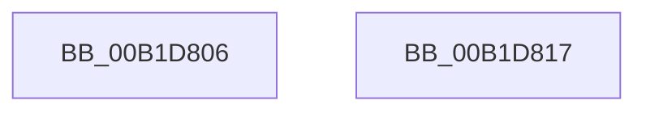

# sub_00B1D806

- RVA: `0x00B1D806`–`0x00B1D822` (길이 `28` bytes)
- VA: `0x0000000140B1D806`
- 실행 섹션: `PAGE`
- PDB 이름 있음: `아니요`; PDB Function 태그: `아니요`
- unwind 정보 RVA: `0x00086C18`
- 디코드: `7`개 명령, `28/28` bytes 표시
- 미해석 바이트: `0` (있으면 어셈블리에 `.byte`로 보존)

> 이 문서는 커널 이미지의 기계어와 PDB 기호를 분석해 생성했습니다. 4번과 5번은 함수 원형과 자료형을 바이너리 사용 방식에서 추정한 C 해석이며 원본 소스 복구 결과는 아닙니다.

## 1. Dependencies

- 직접 호출 지점: **2**; 고유 호출 대상: **2**
- 직접 호출자로 확인된 함수: **0**
- RIP 상대 이미지 참조: **0**

### Outgoing calls
- `0x00B1D809` → [ObfDereferenceObject](../../text/2F/ObfDereferenceObject_function_002F9350.md) (function, `0x002F9350`)
- `0x00B1D817` → [guard_dispatch_icall](../../text/6B/guard_dispatch_icall_function_006BAAD0.md) (function, `0x006BAAD0`)

### Direct callers
- 이 함수 시작 RVA로 연결되는 직접 call은 확인되지 않았습니다. 간접 호출은 완전히 역산할 수 없습니다.

### Static image references
- 디코드된 RIP-relative 메모리 참조가 없습니다.

## 2. Other-region calls and transfers

- 다른 실행 섹션으로 향하는 call: **2**
  - `0x00B1D809` → [ObfDereferenceObject](../../text/2F/ObfDereferenceObject_function_002F9350.md) (`PAGE` → `.text`)
  - `0x00B1D817` → [guard_dispatch_icall](../../text/6B/guard_dispatch_icall_function_006BAAD0.md) (`PAGE` → `.text`)
- call이 아닌 외부 분기/꼬리 이동: **2**
  - `0x00B1D812` → [IopXxxControlFile + 0x9A3](../8E/IopXxxControlFile_function_008E9AD0.md) (`tail-transfer`)
  - `0x00B1D81D` → [IopXxxControlFile + 0x6EE](../8E/IopXxxControlFile_function_008E9AD0.md) (`tail-transfer`)

## 3. Assembly (complete function range)

```asm
00B1D806  48 8B CF                        mov rcx, rdi
00B1D809  E8 42 BB 7D FF                  call 0x1402f9350
00B1D80E  8B 44 24 78                     mov eax, dword ptr [rsp + 0x78]
00B1D812  E9 5C CC DC FF                  jmp 0x1408ea473
00B1D817  E8 B4 D2 B9 FF                  call 0x1406baad0
00B1D81C  90                              nop
00B1D81D  E9 9C C9 DC FF                  jmp 0x1408ea1be
```

## 4. C-style interpretation (structured pseudocode)

```c
__int64 __fastcall sub_00B1D806(__int64 a1, __int64 a2, __int64 a3, __int64 a4, __int64 a5, __int64 a6, __int64 a7, __int64 a8, __int64 a9, __int64 a10, __int64 a11, __int64 a12, __int64 a13, __int64 a14, unsigned int a15)
{
    __int64 result;

    result = ObfDereferenceObject(v_rdi, a2, a3, a4);
}
```

## 5. (Beta) C Style

```c
int64_t sub_00B1D806(int64_t Arg1, int64_t Arg2, int64_t Arg3, int64_t Arg4, uint64_t Arg5, uint64_t Arg6, uint64_t Arg7, uint64_t Arg8, uint64_t Arg9, uint64_t Arg10, uint64_t Arg11, uint64_t Arg12, uint64_t Arg13, uint64_t Arg14, uint32_t Arg15)
{
    int64_t result;

    result = ObfDereferenceObject(local_rdi, Arg2, Arg3, Arg4);
}
```

## 6. Execution-region graph

[열기: 2D/3D 그래프와 함수 탐색 컨트롤 패널](../../../control-panel.html?section=page&rva=0x00B1D806&view=graph)

- 2D 그래프는 위에서 아래로 흐르고, 3D 그래프는 빈 공간을 드래그해 회전합니다. Shift+드래그는 이동, 휠은 확대·축소, 함수 노드 선택은 대상 보고서 이동입니다.

### Static fallback


