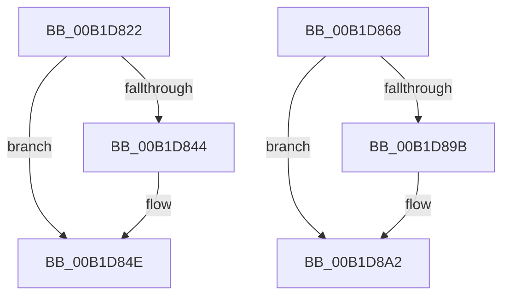

# sub_00B1D822

- RVA: `0x00B1D822`–`0x00B1D8A9` (길이 `135` bytes)
- VA: `0x0000000140B1D822`
- 실행 섹션: `PAGE`
- PDB 이름 있음: `아니요`; PDB Function 태그: `아니요`
- unwind 정보 RVA: `0x00086CE8`
- 디코드: `35`개 명령, `135/135` bytes 표시
- 미해석 바이트: `0` (있으면 어셈블리에 `.byte`로 보존)

> 이 문서는 커널 이미지의 기계어와 PDB 기호를 분석해 생성했습니다. 4번과 5번은 함수 원형과 자료형을 바이너리 사용 방식에서 추정한 C 해석이며 원본 소스 복구 결과는 아닙니다.

## 1. Dependencies

- 직접 호출 지점: **5**; 고유 호출 대상: **5**
- 직접 호출자로 확인된 함수: **0**
- RIP 상대 이미지 참조: **0**

### Outgoing calls
- `0x00B1D837` → [IoAllocateMdl](../../text/29/IoAllocateMdl_function_0029EBF0.md) (function, `0x0029EBF0`)
- `0x00B1D849` → [RtlRaiseStatus](../../text/2F/RtlRaiseStatus_function_002F6A50.md) (function, `0x002F6A50`)
- `0x00B1D85D` → [IopProbeAndLockPages](../../text/4B/IopProbeAndLockPages_function_004B1188.md) (function, `0x004B1188`)
- `0x00B1D88C` → [IopExceptionCleanupEx](../8A/IopExceptionCleanupEx_function_008AE5C8.md) (function, `0x008AE5C8`)
- `0x00B1D89D` → [ExFreePoolWithTag](../../poolcode/B8/ExFreePoolWithTag_function_00B82870.md) (function, `0x00B82870`)

### Direct callers
- 이 함수 시작 RVA로 연결되는 직접 call은 확인되지 않았습니다. 간접 호출은 완전히 역산할 수 없습니다.

### Static image references
- 디코드된 RIP-relative 메모리 참조가 없습니다.

## 2. Other-region calls and transfers

- 다른 실행 섹션으로 향하는 call: **4**
  - `0x00B1D837` → [IoAllocateMdl](../../text/29/IoAllocateMdl_function_0029EBF0.md) (`PAGE` → `.text`)
  - `0x00B1D849` → [RtlRaiseStatus](../../text/2F/RtlRaiseStatus_function_002F6A50.md) (`PAGE` → `.text`)
  - `0x00B1D85D` → [IopProbeAndLockPages](../../text/4B/IopProbeAndLockPages_function_004B1188.md) (`PAGE` → `.text`)
  - `0x00B1D89D` → [ExFreePoolWithTag](../../poolcode/B8/ExFreePoolWithTag_function_00B82870.md) (`PAGE` → `POOLCODE`)
- call이 아닌 외부 분기/꼬리 이동: **2**
  - `0x00B1D863` → [BuildQueryDirectoryIrp + 0x52C](../8E/BuildQueryDirectoryIrp_function_008EC770.md) (`tail-transfer`)
  - `0x00B1D8A4` → [BuildQueryDirectoryIrp + 0x561](../8E/BuildQueryDirectoryIrp_function_008EC770.md) (`tail-transfer`)

## 3. Assembly (complete function range)

```asm
00B1D822  48 89 5C 24 20                  mov qword ptr [rsp + 0x20], rbx
00B1D827  41 B1 01                        mov r9b, 1
00B1D82A  45 33 C0                        xor r8d, r8d
00B1D82D  8B 94 24 E0 00 00 00            mov edx, dword ptr [rsp + 0xe0]
00B1D834  49 8B CF                        mov rcx, r15
00B1D837  E8 B4 13 78 FF                  call 0x14029ebf0
00B1D83C  48 8B C8                        mov rcx, rax
00B1D83F  48 85 C0                        test rax, rax
00B1D842  75 0A                           jne 0x140b1d84e
00B1D844  B9 9A 00 00 C0                  mov ecx, 0xc000009a
00B1D849  E8 02 92 7D FF                  call 0x1402f6a50
00B1D84E  0F B6 47 B8                     movzx eax, byte ptr [rdi - 0x48]
00B1D852  89 44 24 20                     mov dword ptr [rsp + 0x20], eax
00B1D856  4D 8B CD                        mov r9, r13
00B1D859  41 0F B6 D4                     movzx edx, r12b
00B1D85D  E8 26 39 99 FF                  call 0x1404b1188
00B1D862  90                              nop
00B1D863  E9 34 F4 DC FF                  jmp 0x1408ecc9c
00B1D868  8B D8                           mov ebx, eax
00B1D86A  48 8B 4C 24 38                  mov rcx, qword ptr [rsp + 0x38]
00B1D86F  0F B6 51 50                     movzx edx, byte ptr [rcx + 0x50]
00B1D873  D1 EA                           shr edx, 1
00B1D875  83 E2 01                        and edx, 1
00B1D878  88 54 24 20                     mov byte ptr [rsp + 0x20], dl
00B1D87C  45 33 C9                        xor r9d, r9d
00B1D87F  4C 8B 44 24 40                  mov r8, qword ptr [rsp + 0x40]
00B1D884  48 8B 94 24 28 01 00 00         mov rdx, qword ptr [rsp + 0x128]
00B1D88C  E8 37 0D D9 FF                  call 0x1408ae5c8
00B1D891  48 8B 4C 24 48                  mov rcx, qword ptr [rsp + 0x48]
00B1D896  48 85 C9                        test rcx, rcx
00B1D899  74 07                           je 0x140b1d8a2
00B1D89B  33 D2                           xor edx, edx
00B1D89D  E8 CE 4F 06 00                  call 0x140b82870
00B1D8A2  8B C3                           mov eax, ebx
00B1D8A4  E9 28 F4 DC FF                  jmp 0x1408eccd1
```

## 4. C-style interpretation (structured pseudocode)

```c
__int64 __fastcall sub_00B1D822(__int64 a1, __int64 a2, int a3, __int64 a4, __int64 a5, __int64 a6, __int64 a7, __int64 a8, __int64 a9, __int64 a10, __int64 a11, __int64 a12, __int64 a13, __int64 a14, __int64 a15, __int64 a16, __int64 a17, __int64 a18, __int64 a19, __int64 a20, __int64 a21, __int64 a22, __int64 a23, __int64 a24, __int64 a25, __int64 a26, __int64 a27, unsigned int a28)
{
    __int64 result;
    unsigned __int64 v_stack_p128;
    unsigned __int64 v_stack_p20;
    unsigned __int64 v_stack_p38;
    unsigned __int64 v_stack_p40;
    unsigned __int64 v_stack_p48;

    v_stack_p20 = v_rbx;
    a3 = 0;
    result = IoAllocateMdl(v_r15, (unsigned int)(a28), a3, 1);
    if (result == 0) {
        a1 = 0xC000009AULL;
        result = RtlRaiseStatus(a1, (unsigned int)(a28), a3, 1);
    }
    v_stack_p20 = (unsigned int)(*(unsigned __int8 *)(v_rdi - 72));
    result = IopProbeAndLockPages(a1, (unsigned __int8)(v_r12), a3, v_r13);
}
```

## 5. (Beta) C Style

```c
int64_t sub_00B1D822(int64_t Arg1, int64_t Arg2, int32_t Arg3, int64_t Arg4, uint64_t Arg5, uint64_t Arg6, uint64_t Arg7, uint64_t Arg8, uint64_t Arg9, uint64_t Arg10, uint64_t Arg11, uint64_t Arg12, uint64_t Arg13, uint64_t Arg14, uint64_t Arg15, uint64_t Arg16, uint64_t Arg17, uint64_t Arg18, uint64_t Arg19, uint64_t Arg20, uint64_t Arg21, uint64_t Arg22, uint64_t Arg23, uint64_t Arg24, uint64_t Arg25, uint64_t Arg26, uint64_t Arg27, uint32_t Arg28)
{
    int64_t result;
    uint64_t v_stack_p128;
    uint64_t v_stack_p20;
    uint64_t v_stack_p38;
    uint64_t v_stack_p40;
    uint64_t v_stack_p48;

    v_stack_p20 = local_rbx;
    Arg3 = 0;
    result = IoAllocateMdl(local_r15, (uint32_t)(Arg28), Arg3, 1);
    if (result == 0) {
        Arg1 = 0xC000009AULL;
        result = RtlRaiseStatus(Arg1, (uint32_t)(Arg28), Arg3, 1);
    }
    v_stack_p20 = (uint32_t)(*(uint8_t *)(local_rdi - 0x48));
    result = IopProbeAndLockPages(Arg1, (uint8_t)(local_r12), Arg3, local_r13);
}
```

## 6. Execution-region graph

[열기: 2D/3D 그래프와 함수 탐색 컨트롤 패널](../../../control-panel.html?section=page&rva=0x00B1D822&view=graph)

- 2D 그래프는 위에서 아래로 흐르고, 3D 그래프는 빈 공간을 드래그해 회전합니다. Shift+드래그는 이동, 휠은 확대·축소, 함수 노드 선택은 대상 보고서 이동입니다.

### Static fallback


