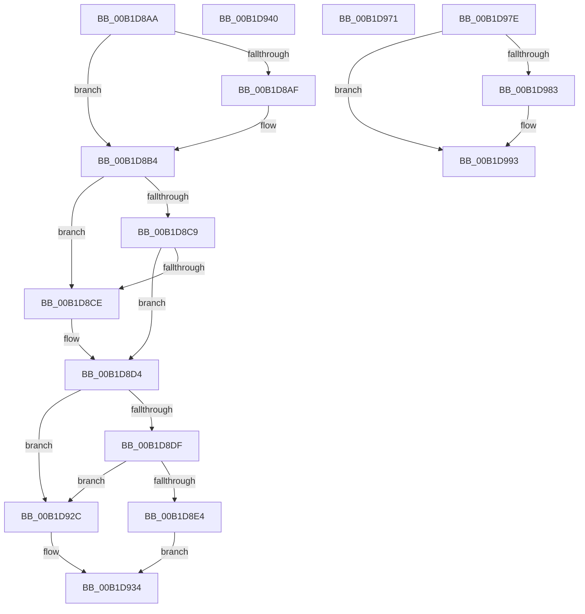

# sub_00B1D8AA

- RVA: `0x00B1D8AA`–`0x00B1D9AC` (길이 `258` bytes)
- VA: `0x0000000140B1D8AA`
- 실행 섹션: `PAGE`
- PDB 이름 있음: `아니요`; PDB Function 태그: `아니요`
- unwind 정보 RVA: `0x00086D50`
- 디코드: `67`개 명령, `258/258` bytes 표시
- 미해석 바이트: `0` (있으면 어셈블리에 `.byte`로 보존)

> 이 문서는 커널 이미지의 기계어와 PDB 기호를 분석해 생성했습니다. 4번과 5번은 함수 원형과 자료형을 바이너리 사용 방식에서 추정한 C 해석이며 원본 소스 복구 결과는 아닙니다.

## 1. Dependencies

- 직접 호출 지점: **2**; 고유 호출 대상: **2**
- 직접 호출자로 확인된 함수: **0**
- RIP 상대 이미지 참조: **0**

### Outgoing calls
- `0x00B1D8AF` → [ExRaiseDatatypeMisalignment](../89/ExRaiseDatatypeMisalignment_function_00899FD0.md) (function, `0x00899FD0`)
- `0x00B1D98E` → [PiControlFreeUserModeCallersBuffer](../../text/44/PiControlFreeUserModeCallersBuffer_function_00448990.md) (function, `0x00448990`)

### Direct callers
- 이 함수 시작 RVA로 연결되는 직접 call은 확인되지 않았습니다. 간접 호출은 완전히 역산할 수 없습니다.

### Static image references
- 디코드된 RIP-relative 메모리 참조가 없습니다.

## 2. Other-region calls and transfers

- 다른 실행 섹션으로 향하는 call: **1**
  - `0x00B1D98E` → [PiControlFreeUserModeCallersBuffer](../../text/44/PiControlFreeUserModeCallersBuffer_function_00448990.md) (`PAGE` → `.text`)
- call이 아닌 외부 분기/꼬리 이동: **4**
  - `0x00B1D93B` → [PiCMCaptureRegistryPropertyInputData + 0x111](../8E/PiCMCaptureRegistryPropertyInputData_function_008ED078.md) (`tail-transfer`)
  - `0x00B1D96C` → [PiCMCaptureRegistryPropertyInputData + 0x111](../8E/PiCMCaptureRegistryPropertyInputData_function_008ED078.md) (`tail-transfer`)
  - `0x00B1D979` → [PiCMCaptureRegistryPropertyInputData + 0x1FC](../8E/PiCMCaptureRegistryPropertyInputData_function_008ED078.md) (`tail-transfer`)
  - `0x00B1D9A7` → [PiCMCaptureRegistryPropertyInputData + 0x209](../8E/PiCMCaptureRegistryPropertyInputData_function_008ED078.md) (`tail-transfer`)

## 3. Assembly (complete function range)

```asm
00B1D8AA  F6 C1 03                        test cl, 3
00B1D8AD  74 05                           je 0x140b1d8b4
00B1D8AF  E8 1C C7 D7 FF                  call 0x140899fd0
00B1D8B4  44 8B C2                        mov r8d, edx
00B1D8B7  4C 03 C1                        add r8, rcx
00B1D8BA  48 B8 00 00 FF FF FF 7F 00 00   movabs rax, 0x7fffffff0000
00B1D8C4  4C 3B C0                        cmp r8, rax
00B1D8C7  77 05                           ja 0x140b1d8ce
00B1D8C9  4C 3B C1                        cmp r8, rcx
00B1D8CC  73 06                           jae 0x140b1d8d4
00B1D8CE  8A 00                           mov al, byte ptr [rax]
00B1D8D0  8B 7C 24 38                     mov edi, dword ptr [rsp + 0x38]
00B1D8D4  41 BE 0D 00 00 C0               mov r14d, 0xc000000d
00B1D8DA  83 FA 28                        cmp edx, 0x28
00B1D8DD  72 4D                           jb 0x140b1d92c
00B1D8DF  83 39 28                        cmp dword ptr [rcx], 0x28
00B1D8E2  75 48                           jne 0x140b1d92c
00B1D8E4  41 C7 01 38 00 00 00            mov dword ptr [r9], 0x38
00B1D8EB  8B 41 04                        mov eax, dword ptr [rcx + 4]
00B1D8EE  41 89 41 04                     mov dword ptr [r9 + 4], eax
00B1D8F2  8B 41 08                        mov eax, dword ptr [rcx + 8]
00B1D8F5  41 89 41 08                     mov dword ptr [r9 + 8], eax
00B1D8F9  8B 41 0C                        mov eax, dword ptr [rcx + 0xc]
00B1D8FC  49 89 41 10                     mov qword ptr [r9 + 0x10], rax
00B1D900  8B 41 10                        mov eax, dword ptr [rcx + 0x10]
00B1D903  41 89 41 18                     mov dword ptr [r9 + 0x18], eax
00B1D907  8B 41 14                        mov eax, dword ptr [rcx + 0x14]
00B1D90A  41 89 41 1C                     mov dword ptr [r9 + 0x1c], eax
00B1D90E  8B 41 18                        mov eax, dword ptr [rcx + 0x18]
00B1D911  41 89 41 20                     mov dword ptr [r9 + 0x20], eax
00B1D915  8B 41 1C                        mov eax, dword ptr [rcx + 0x1c]
00B1D918  49 89 41 28                     mov qword ptr [r9 + 0x28], rax
00B1D91C  8B 41 20                        mov eax, dword ptr [rcx + 0x20]
00B1D91F  41 89 41 30                     mov dword ptr [r9 + 0x30], eax
00B1D923  8B 41 24                        mov eax, dword ptr [rcx + 0x24]
00B1D926  41 89 41 34                     mov dword ptr [r9 + 0x34], eax
00B1D92A  EB 08                           jmp 0x140b1d934
00B1D92C  41 8B FE                        mov edi, r14d
00B1D92F  44 89 74 24 38                  mov dword ptr [rsp + 0x38], r14d
00B1D934  8A 84 24 80 00 00 00            mov al, byte ptr [rsp + 0x80]
00B1D93B  E9 49 F8 DC FF                  jmp 0x1408ed189
00B1D940  8B F8                           mov edi, eax
00B1D942  89 44 24 38                     mov dword ptr [rsp + 0x38], eax
00B1D946  33 DB                           xor ebx, ebx
00B1D948  41 BE 0D 00 00 C0               mov r14d, 0xc000000d
00B1D94E  48 8B B4 24 98 00 00 00         mov rsi, qword ptr [rsp + 0x98]
00B1D956  8B C3                           mov eax, ebx
00B1D958  89 5C 24 3C                     mov dword ptr [rsp + 0x3c], ebx
00B1D95C  8A 44 24 30                     mov al, byte ptr [rsp + 0x30]
00B1D960  88 84 24 80 00 00 00            mov byte ptr [rsp + 0x80], al
00B1D967  4C 8B 6C 24 48                  mov r13, qword ptr [rsp + 0x48]
00B1D96C  E9 18 F8 DC FF                  jmp 0x1408ed189
00B1D971  49 89 5D 00                     mov qword ptr [r13], rbx
00B1D975  41 89 1C 24                     mov dword ptr [r12], ebx
00B1D979  E9 F6 F8 DC FF                  jmp 0x1408ed274
00B1D97E  45 85 F6                        test r14d, r14d
00B1D981  74 10                           je 0x140b1d993
00B1D983  48 8B 56 28                     mov rdx, qword ptr [rsi + 0x28]
00B1D987  8A 8C 24 80 00 00 00            mov cl, byte ptr [rsp + 0x80]
00B1D98E  E8 FD AF 92 FF                  call 0x140448990
00B1D993  0F 57 C0                        xorps xmm0, xmm0
00B1D996  33 C0                           xor eax, eax
00B1D998  0F 11 06                        movups xmmword ptr [rsi], xmm0
00B1D99B  0F 11 46 10                     movups xmmword ptr [rsi + 0x10], xmm0
00B1D99F  0F 11 46 20                     movups xmmword ptr [rsi + 0x20], xmm0
00B1D9A3  48 89 46 30                     mov qword ptr [rsi + 0x30], rax
00B1D9A7  E9 D5 F8 DC FF                  jmp 0x1408ed281
```

## 4. C-style interpretation (structured pseudocode)

```c
__int64 __fastcall sub_00B1D8AA(__int64 a1, int a2, __int64 a3, __int64 a4, __int64 a5, __int64 a6, unsigned int a7, __int64 a8, __int64 a9, __int64 a10, __int64 a11, __int64 a12, __int64 a13, __int64 a14, __int64 a15, unsigned __int8 a16)
{
    __int64 result;
    __int64 v_rdi;
    unsigned __int8 v_stack_p30;
    unsigned int v_stack_p38;
    unsigned int v_stack_p3C;
    unsigned __int64 v_stack_p48;
    unsigned __int8 v_stack_p80;
    unsigned __int64 v_stack_p98;

    if ((((unsigned __int8)(a1)) & (3)) != 0) {
        result = ExRaiseDatatypeMisalignment(a1, a2, a3, a4);
    }
    a3 = ((unsigned int)(a2)) + (a1);
    if (a3 > result) goto loc_00B1D8CE;
    if (a3 < a1) {
        result = *(unsigned __int8 *)(result);
        v_rdi = a7;
    }
    if (a2 < 40) goto loc_00B1D92C;
    if ((*(unsigned int *)(a1)) != 40) goto loc_00B1D92C;
    *(unsigned int *)(a4) = 56;
    *(unsigned int *)(a4 + 4) = (unsigned int)((unsigned int)(*(unsigned int *)(a1 + 4)));
    *(unsigned int *)(a4 + 8) = (unsigned int)((unsigned int)(*(unsigned int *)(a1 + 8)));
    *(unsigned __int64 *)(a4 + 16) = (unsigned int)(*(unsigned int *)(a1 + 12));
    *(unsigned int *)(a4 + 24) = (unsigned int)((unsigned int)(*(unsigned int *)(a1 + 16)));
    *(unsigned int *)(a4 + 28) = (unsigned int)((unsigned int)(*(unsigned int *)(a1 + 20)));
    *(unsigned int *)(a4 + 32) = (unsigned int)((unsigned int)(*(unsigned int *)(a1 + 24)));
    *(unsigned __int64 *)(a4 + 40) = (unsigned int)(*(unsigned int *)(a1 + 28));
    *(unsigned int *)(a4 + 48) = (unsigned int)((unsigned int)(*(unsigned int *)(a1 + 32)));
    *(unsigned int *)(a4 + 52) = (unsigned int)((unsigned int)(*(unsigned int *)(a1 + 36)));
    goto loc_00B1D934;
loc_00B1D92C:
    v_stack_p38 = (unsigned int)((unsigned int)(0xC000000DULL));
loc_00B1D934:
}
```

## 5. (Beta) C Style

```c
int64_t sub_00B1D8AA(int64_t Arg1, int32_t Arg2, int64_t Arg3, int64_t Arg4, uint64_t Arg5, uint64_t Arg6, uint32_t Arg7, uint64_t Arg8, uint64_t Arg9, uint64_t Arg10, uint64_t Arg11, uint64_t Arg12, uint64_t Arg13, uint64_t Arg14, uint64_t Arg15, uint8_t Arg16)
{
    int64_t result;
    int64_t local_rdi;
    uint8_t v_stack_p30;
    uint32_t v_stack_p38;
    uint32_t v_stack_p3C;
    uint64_t v_stack_p48;
    uint8_t v_stack_p80;
    uint64_t v_stack_p98;

    if ((((uint8_t)(Arg1)) & (3)) != 0) {
        result = ExRaiseDatatypeMisalignment(Arg1, Arg2, Arg3, Arg4);
    }
    Arg3 = ((uint32_t)(Arg2)) + (Arg1);
    if (Arg3 > result) goto loc_00B1D8CE;
    if (Arg3 < Arg1) {
        result = *(uint8_t *)(result);
        local_rdi = Arg7;
    }
    if (Arg2 < 40) goto loc_00B1D92C;
    if ((*(uint32_t *)(Arg1)) != 40) goto loc_00B1D92C;
    *(uint32_t *)(Arg4) = 56;
    *(uint32_t *)(Arg4 + 0x4) = (uint32_t)((uint32_t)(*(uint32_t *)(Arg1 + 0x4)));
    *(uint32_t *)(Arg4 + 0x8) = (uint32_t)((uint32_t)(*(uint32_t *)(Arg1 + 0x8)));
    *(uint64_t *)(Arg4 + 0x10) = (uint32_t)(*(uint32_t *)(Arg1 + 0xC));
    *(uint32_t *)(Arg4 + 0x18) = (uint32_t)((uint32_t)(*(uint32_t *)(Arg1 + 0x10)));
    *(uint32_t *)(Arg4 + 0x1C) = (uint32_t)((uint32_t)(*(uint32_t *)(Arg1 + 0x14)));
    *(uint32_t *)(Arg4 + 0x20) = (uint32_t)((uint32_t)(*(uint32_t *)(Arg1 + 0x18)));
    *(uint64_t *)(Arg4 + 0x28) = (uint32_t)(*(uint32_t *)(Arg1 + 0x1C));
    *(uint32_t *)(Arg4 + 0x30) = (uint32_t)((uint32_t)(*(uint32_t *)(Arg1 + 0x20)));
    *(uint32_t *)(Arg4 + 0x34) = (uint32_t)((uint32_t)(*(uint32_t *)(Arg1 + 0x24)));
    goto loc_00B1D934;
loc_00B1D92C:
    v_stack_p38 = (uint32_t)((uint32_t)(0xC000000DULL));
loc_00B1D934:
}
```

## 6. Execution-region graph

[열기: 2D/3D 그래프와 함수 탐색 컨트롤 패널](../../../control-panel.html?section=page&rva=0x00B1D8AA&view=graph)

- 2D 그래프는 위에서 아래로 흐르고, 3D 그래프는 빈 공간을 드래그해 회전합니다. Shift+드래그는 이동, 휠은 확대·축소, 함수 노드 선택은 대상 보고서 이동입니다.

### Static fallback


