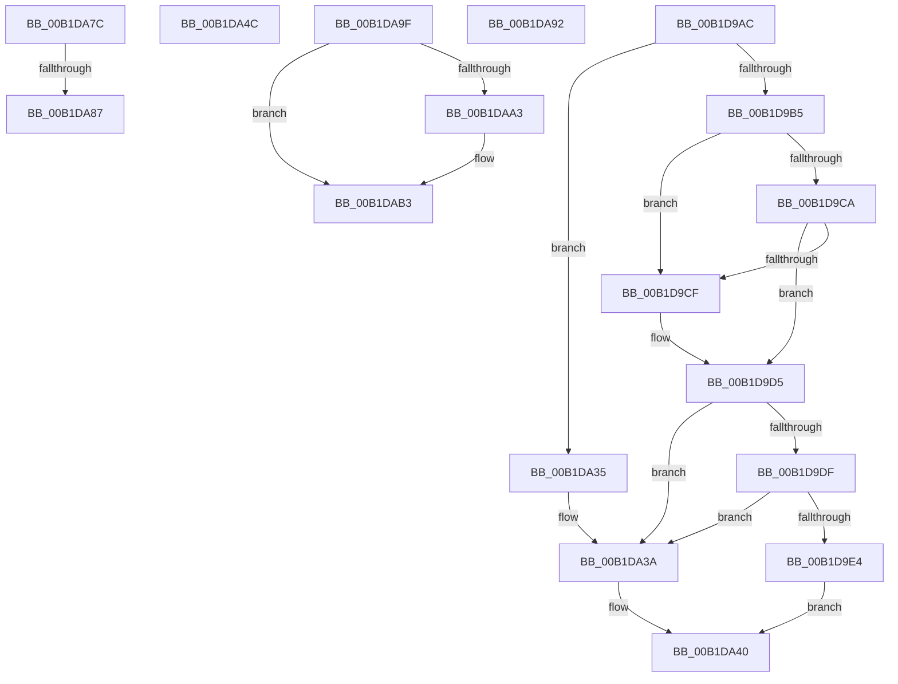

# sub_00B1D9AC

- RVA: `0x00B1D9AC`–`0x00B1DAC7` (길이 `283` bytes)
- VA: `0x0000000140B1D9AC`
- 실행 섹션: `PAGE`
- PDB 이름 있음: `아니요`; PDB Function 태그: `아니요`
- unwind 정보 RVA: `0x00086DA4`
- 디코드: `72`개 명령, `283/283` bytes 표시
- 미해석 바이트: `0` (있으면 어셈블리에 `.byte`로 보존)

> 이 문서는 커널 이미지의 기계어와 PDB 기호를 분석해 생성했습니다. 4번과 5번은 함수 원형과 자료형을 바이너리 사용 방식에서 추정한 C 해석이며 원본 소스 복구 결과는 아닙니다.

## 1. Dependencies

- 직접 호출 지점: **3**; 고유 호출 대상: **3**
- 직접 호출자로 확인된 함수: **0**
- RIP 상대 이미지 참조: **0**

### Outgoing calls
- `0x00B1DA35` → [ExRaiseDatatypeMisalignment](../89/ExRaiseDatatypeMisalignment_function_00899FD0.md) (function, `0x00899FD0`)
- `0x00B1DAAE` → [PiControlFreeUserModeCallersBuffer](../../text/44/PiControlFreeUserModeCallersBuffer_function_00448990.md) (function, `0x00448990`)
- `0x00B1DABC` → [memset](../../text/6C/memset_function_006C6C40.md) (function, `0x006C6C40`)

### Direct callers
- 이 함수 시작 RVA로 연결되는 직접 call은 확인되지 않았습니다. 간접 호출은 완전히 역산할 수 없습니다.

### Static image references
- 디코드된 RIP-relative 메모리 참조가 없습니다.

## 2. Other-region calls and transfers

- 다른 실행 섹션으로 향하는 call: **2**
  - `0x00B1DAAE` → [PiControlFreeUserModeCallersBuffer](../../text/44/PiControlFreeUserModeCallersBuffer_function_00448990.md) (`PAGE` → `.text`)
  - `0x00B1DABC` → [memset](../../text/6C/memset_function_006C6C40.md) (`PAGE` → `.text`)
- call이 아닌 외부 분기/꼬리 이동: **6**
  - `0x00B1DA47` → [PiCMCapturePropertyInputData + 0x115](../8E/PiCMCapturePropertyInputData_function_008ED3A0.md) (`tail-transfer`)
  - `0x00B1DA77` → [PiCMCapturePropertyInputData + 0x115](../8E/PiCMCapturePropertyInputData_function_008ED3A0.md) (`tail-transfer`)
  - `0x00B1DA81` → [PiCMCapturePropertyInputData + 0x274](../8E/PiCMCapturePropertyInputData_function_008ED3A0.md) (`tail-transfer`)
  - `0x00B1DA8D` → [PiCMCapturePropertyInputData + 0x1F8](../8E/PiCMCapturePropertyInputData_function_008ED3A0.md) (`tail-transfer`)
  - `0x00B1DA9A` → [PiCMCapturePropertyInputData + 0x235](../8E/PiCMCapturePropertyInputData_function_008ED3A0.md) (`tail-transfer`)
  - `0x00B1DAC2` → [PiCMCapturePropertyInputData + 0x241](../8E/PiCMCapturePropertyInputData_function_008ED3A0.md) (`tail-transfer`)

## 3. Assembly (complete function range)

```asm
00B1D9AC  F6 C1 03                        test cl, 3
00B1D9AF  0F 85 80 00 00 00               jne 0x140b1da35
00B1D9B5  44 8B C2                        mov r8d, edx
00B1D9B8  4C 03 C1                        add r8, rcx
00B1D9BB  48 B8 00 00 FF FF FF 7F 00 00   movabs rax, 0x7fffffff0000
00B1D9C5  4C 3B C0                        cmp r8, rax
00B1D9C8  77 05                           ja 0x140b1d9cf
00B1D9CA  4C 3B C1                        cmp r8, rcx
00B1D9CD  73 06                           jae 0x140b1d9d5
00B1D9CF  8A 00                           mov al, byte ptr [rax]
00B1D9D1  8B 7C 24 38                     mov edi, dword ptr [rsp + 0x38]
00B1D9D5  BE 0D 00 00 C0                  mov esi, 0xc000000d
00B1D9DA  83 FA 38                        cmp edx, 0x38
00B1D9DD  72 5B                           jb 0x140b1da3a
00B1D9DF  83 39 38                        cmp dword ptr [rcx], 0x38
00B1D9E2  75 56                           jne 0x140b1da3a
00B1D9E4  41 C7 01 48 00 00 00            mov dword ptr [r9], 0x48
00B1D9EB  8B 41 04                        mov eax, dword ptr [rcx + 4]
00B1D9EE  41 89 41 04                     mov dword ptr [r9 + 4], eax
00B1D9F2  8B 41 08                        mov eax, dword ptr [rcx + 8]
00B1D9F5  41 89 41 08                     mov dword ptr [r9 + 8], eax
00B1D9F9  8B 41 0C                        mov eax, dword ptr [rcx + 0xc]
00B1D9FC  49 89 41 10                     mov qword ptr [r9 + 0x10], rax
00B1DA00  8B 41 10                        mov eax, dword ptr [rcx + 0x10]
00B1DA03  41 89 41 18                     mov dword ptr [r9 + 0x18], eax
00B1DA07  0F 10 41 14                     movups xmm0, xmmword ptr [rcx + 0x14]
00B1DA0B  41 0F 11 41 1C                  movups xmmword ptr [r9 + 0x1c], xmm0
00B1DA10  8B 41 24                        mov eax, dword ptr [rcx + 0x24]
00B1DA13  41 89 41 2C                     mov dword ptr [r9 + 0x2c], eax
00B1DA17  8B 41 28                        mov eax, dword ptr [rcx + 0x28]
00B1DA1A  41 89 41 30                     mov dword ptr [r9 + 0x30], eax
00B1DA1E  8B 41 2C                        mov eax, dword ptr [rcx + 0x2c]
00B1DA21  49 89 41 38                     mov qword ptr [r9 + 0x38], rax
00B1DA25  8B 41 30                        mov eax, dword ptr [rcx + 0x30]
00B1DA28  41 89 41 40                     mov dword ptr [r9 + 0x40], eax
00B1DA2C  8B 41 34                        mov eax, dword ptr [rcx + 0x34]
00B1DA2F  41 89 41 44                     mov dword ptr [r9 + 0x44], eax
00B1DA33  EB 0B                           jmp 0x140b1da40
00B1DA35  E8 96 C5 D7 FF                  call 0x140899fd0
00B1DA3A  8B FE                           mov edi, esi
00B1DA3C  89 74 24 38                     mov dword ptr [rsp + 0x38], esi
00B1DA40  8A 84 24 80 00 00 00            mov al, byte ptr [rsp + 0x80]
00B1DA47  E9 69 FA DC FF                  jmp 0x1408ed4b5
00B1DA4C  8B F8                           mov edi, eax
00B1DA4E  89 44 24 38                     mov dword ptr [rsp + 0x38], eax
00B1DA52  33 DB                           xor ebx, ebx
00B1DA54  BE 0D 00 00 C0                  mov esi, 0xc000000d
00B1DA59  4C 8B B4 24 98 00 00 00         mov r14, qword ptr [rsp + 0x98]
00B1DA61  8B C3                           mov eax, ebx
00B1DA63  89 5C 24 3C                     mov dword ptr [rsp + 0x3c], ebx
00B1DA67  8A 44 24 30                     mov al, byte ptr [rsp + 0x30]
00B1DA6B  88 84 24 80 00 00 00            mov byte ptr [rsp + 0x80], al
00B1DA72  4C 8B 6C 24 48                  mov r13, qword ptr [rsp + 0x48]
00B1DA77  E9 39 FA DC FF                  jmp 0x1408ed4b5
00B1DA7C  41 83 7D 00 02                  cmp dword ptr [r13], 2
00B1DA81  0F 82 8D FB DC FF               jb 0x1408ed614
00B1DA87  41 BF 01 00 00 00               mov r15d, 1
00B1DA8D  E9 06 FB DC FF                  jmp 0x1408ed598
00B1DA92  49 89 5D 00                     mov qword ptr [r13], rbx
00B1DA96  41 89 1C 24                     mov dword ptr [r12], ebx
00B1DA9A  E9 36 FB DC FF                  jmp 0x1408ed5d5
00B1DA9F  85 F6                           test esi, esi
00B1DAA1  74 10                           je 0x140b1dab3
00B1DAA3  49 8B 56 38                     mov rdx, qword ptr [r14 + 0x38]
00B1DAA7  8A 8C 24 80 00 00 00            mov cl, byte ptr [rsp + 0x80]
00B1DAAE  E8 DD AE 92 FF                  call 0x140448990
00B1DAB3  33 D2                           xor edx, edx
00B1DAB5  44 8D 42 48                     lea r8d, [rdx + 0x48]
00B1DAB9  49 8B CE                        mov rcx, r14
00B1DABC  E8 7F 91 BA FF                  call 0x1406c6c40
00B1DAC1  90                              nop
00B1DAC2  E9 1A FB DC FF                  jmp 0x1408ed5e1
```

## 4. C-style interpretation (structured pseudocode)

```c
__int64 __fastcall sub_00B1D9AC(__int64 a1, int a2, __int64 a3, __int64 a4, __int64 a5, __int64 a6, unsigned int a7, __int64 a8, __int64 a9, __int64 a10, __int64 a11, __int64 a12, __int64 a13, __int64 a14, __int64 a15, unsigned __int8 a16)
{
    __int64 result;
    __int64 v_rdi;
    unsigned __int8 v_stack_p30;
    unsigned int v_stack_p38;
    unsigned int v_stack_p3C;
    unsigned __int64 v_stack_p48;
    unsigned __int8 v_stack_p80;
    unsigned __int64 v_stack_p98;

    if ((((unsigned __int8)(a1)) & (3)) != 0) goto loc_00B1DA35;
    a3 = ((unsigned int)(a2)) + (a1);
    if (a3 > result) goto loc_00B1D9CF;
    if (a3 < a1) {
        result = *(unsigned __int8 *)(result);
        v_rdi = a7;
    }
    if (a2 < 56) goto loc_00B1DA3A;
    if ((*(unsigned int *)(a1)) != 56) goto loc_00B1DA3A;
    *(unsigned int *)(a4) = 72;
    *(unsigned int *)(a4 + 4) = (unsigned int)((unsigned int)(*(unsigned int *)(a1 + 4)));
    *(unsigned int *)(a4 + 8) = (unsigned int)((unsigned int)(*(unsigned int *)(a1 + 8)));
    *(unsigned __int64 *)(a4 + 16) = (unsigned int)(*(unsigned int *)(a1 + 12));
    *(unsigned int *)(a4 + 24) = (unsigned int)((unsigned int)(*(unsigned int *)(a1 + 16)));
    *(unsigned __int64 *)(a4 + 28) = v_xmm0;
    *(unsigned int *)(a4 + 44) = (unsigned int)((unsigned int)(*(unsigned int *)(a1 + 36)));
    *(unsigned int *)(a4 + 48) = (unsigned int)((unsigned int)(*(unsigned int *)(a1 + 40)));
    *(unsigned __int64 *)(a4 + 56) = (unsigned int)(*(unsigned int *)(a1 + 44));
    *(unsigned int *)(a4 + 64) = (unsigned int)((unsigned int)(*(unsigned int *)(a1 + 48)));
    *(unsigned int *)(a4 + 68) = (unsigned int)((unsigned int)(*(unsigned int *)(a1 + 52)));
    goto loc_00B1DA40;
loc_00B1DA35:
    result = ExRaiseDatatypeMisalignment(a1, a2, a3, a4);
loc_00B1DA3A:
    v_stack_p38 = (unsigned int)((unsigned int)(0xC000000DULL));
loc_00B1DA40:
}
```

## 5. (Beta) C Style

```c
int64_t sub_00B1D9AC(int64_t Arg1, int32_t Arg2, int64_t Arg3, void *Arg4, uint64_t Arg5, uint64_t Arg6, uint32_t Arg7, uint64_t Arg8, uint64_t Arg9, uint64_t Arg10, uint64_t Arg11, uint64_t Arg12, uint64_t Arg13, uint64_t Arg14, uint64_t Arg15, uint8_t Arg16)
{
    uint8_t *arg4 = (uint8_t *)Arg4;

    int64_t result;
    int64_t local_rdi;
    uint8_t v_stack_p30;
    uint32_t v_stack_p38;
    uint32_t v_stack_p3C;
    uint64_t v_stack_p48;
    uint8_t v_stack_p80;
    uint64_t v_stack_p98;

    if ((((uint8_t)(Arg1)) & (3)) != 0) goto loc_00B1DA35;
    Arg3 = ((uint32_t)(Arg2)) + (Arg1);
    if (Arg3 > result) goto loc_00B1D9CF;
    if (Arg3 < Arg1) {
        result = *(uint8_t *)(result);
        local_rdi = Arg7;
    }
    if (Arg2 < 56) goto loc_00B1DA3A;
    if ((*(uint32_t *)(Arg1)) != 56) goto loc_00B1DA3A;
    *(uint32_t *)(arg4) = 72;
    *(uint32_t *)(arg4 + 0x4) = (uint32_t)((uint32_t)(*(uint32_t *)(Arg1 + 0x4)));
    *(uint32_t *)(arg4 + 0x8) = (uint32_t)((uint32_t)(*(uint32_t *)(Arg1 + 0x8)));
    *(uint64_t *)(arg4 + 0x10) = (uint32_t)(*(uint32_t *)(Arg1 + 0xC));
    *(uint32_t *)(arg4 + 0x18) = (uint32_t)((uint32_t)(*(uint32_t *)(Arg1 + 0x10)));
    *(uint64_t *)(arg4 + 0x1C) = v_xmm0;
    *(uint32_t *)(arg4 + 0x2C) = (uint32_t)((uint32_t)(*(uint32_t *)(Arg1 + 0x24)));
    *(uint32_t *)(arg4 + 0x30) = (uint32_t)((uint32_t)(*(uint32_t *)(Arg1 + 0x28)));
    *(uint64_t *)(arg4 + 0x38) = (uint32_t)(*(uint32_t *)(Arg1 + 0x2C));
    *(uint32_t *)(arg4 + 0x40) = (uint32_t)((uint32_t)(*(uint32_t *)(Arg1 + 0x30)));
    *(uint32_t *)(arg4 + 0x44) = (uint32_t)((uint32_t)(*(uint32_t *)(Arg1 + 0x34)));
    goto loc_00B1DA40;
loc_00B1DA35:
    result = ExRaiseDatatypeMisalignment(Arg1, Arg2, Arg3, Arg4);
loc_00B1DA3A:
    v_stack_p38 = (uint32_t)((uint32_t)(0xC000000DULL));
loc_00B1DA40:
}
```

### 관측된 메모리 오프셋

구조체 형식이 확인되지 않은 접근은 인자 기준의 오프셋으로만 기록했습니다.

| 기준 인자 | 오프셋 표현 | 폭 (bit) | 접근 |
|---|---:|---:|---|
| `Arg4` | `+ 0x0` | `32` | `W` |
| `Arg4` | `+ 0x4` | `32` | `W` |
| `Arg4` | `+ 0x8` | `32` | `W` |
| `Arg4` | `+ 0x10` | `64` | `W` |
| `Arg4` | `+ 0x18` | `32` | `W` |
| `Arg4` | `+ 0x1C` | `128` | `R` |
| `Arg4` | `+ 0x2C` | `32` | `W` |
| `Arg4` | `+ 0x30` | `32` | `W` |
| `Arg4` | `+ 0x38` | `64` | `W` |
| `Arg4` | `+ 0x40` | `32` | `W` |
| `Arg4` | `+ 0x44` | `32` | `W` |

## 6. Execution-region graph

[열기: 2D/3D 그래프와 함수 탐색 컨트롤 패널](../../../control-panel.html?section=page&rva=0x00B1D9AC&view=graph)

- 2D 그래프는 위에서 아래로 흐르고, 3D 그래프는 빈 공간을 드래그해 회전합니다. Shift+드래그는 이동, 휠은 확대·축소, 함수 노드 선택은 대상 보고서 이동입니다.

### Static fallback


