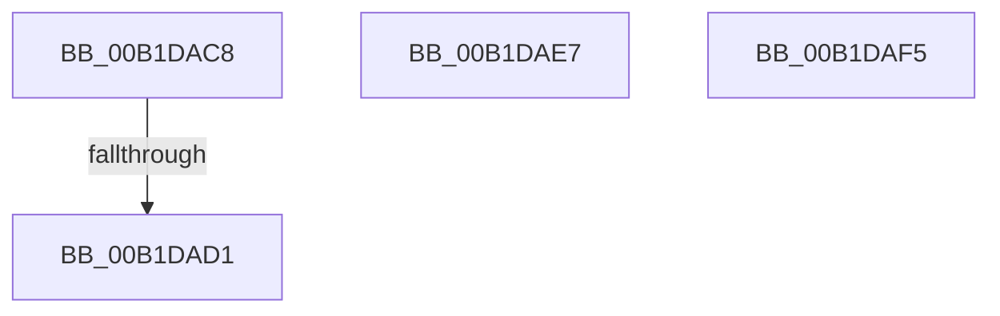

# sub_00B1DAC8

- RVA: `0x00B1DAC8`–`0x00B1DB29` (길이 `97` bytes)
- VA: `0x0000000140B1DAC8`
- 실행 섹션: `PAGE`
- PDB 이름 있음: `아니요`; PDB Function 태그: `아니요`
- unwind 정보 RVA: `0x00086E9C`
- 디코드: `38`개 명령, `97/97` bytes 표시
- 미해석 바이트: `1` (있으면 어셈블리에 `.byte`로 보존)

> 이 문서는 커널 이미지의 기계어와 PDB 기호를 분석해 생성했습니다. 4번과 5번은 함수 원형과 자료형을 바이너리 사용 방식에서 추정한 C 해석이며 원본 소스 복구 결과는 아닙니다.

## 1. Dependencies

- 직접 호출 지점: **0**; 고유 호출 대상: **0**
- 직접 호출자로 확인된 함수: **0**
- RIP 상대 이미지 참조: **0**

### Outgoing calls
- 직접 디코드된 call 명령이 없습니다.

### Direct callers
- 이 함수 시작 RVA로 연결되는 직접 call은 확인되지 않았습니다. 간접 호출은 완전히 역산할 수 없습니다.

### Static image references
- 디코드된 RIP-relative 메모리 참조가 없습니다.

## 2. Other-region calls and transfers

- 다른 실행 섹션으로 향하는 call: **0**
- call이 아닌 외부 분기/꼬리 이동: **2**
  - `0x00B1DACB` → [sub_008EDC5D + 0xDB](../8E/Unknown_function_008EDC5D.md) (`tail-transfer`)
  - `0x00B1DAF0` → [sub_008EDAC3 + 0x15B](../8E/Unknown_function_008EDAC3.md) (`tail-transfer`)

## 3. Assembly (complete function range)

```asm
00B1DAC8  83 FB 24                        cmp ebx, 0x24
00B1DACB  0F 87 67 02 DD FF               ja 0x1408edd38
00B1DAD1  41 0F B6 84 18 04 DB B1 00      movzx eax, byte ptr [r8 + rbx + 0xb1db04]
00B1DADA  41 8B 8C 80 F8 DA B1 00         mov ecx, dword ptr [r8 + rax*4 + 0xb1daf8]
00B1DAE2  49 03 C8                        add rcx, r8
00B1DAE5  FF E1                           jmp rcx
00B1DAE7  CC                              int3
00B1DAE8  CC                              int3
00B1DAE9  CC                              int3
00B1DAEA  CC                              int3
00B1DAEB  BF 30 02 00 C0                  mov edi, 0xc0000230
00B1DAF0  E9 29 01 DD FF                  jmp 0x1408edc1e
00B1DAF5  0F 1F 00                        nop dword ptr [rax]
00B1DAF8  38 DD                           cmp ch, bl
00B1DAFA  8E 00                           mov es, word ptr [rax]
00B1DAFC  04 DB                           add al, 0xdb
00B1DAFE  8E 00                           mov es, word ptr [rax]
00B1DB00  38 DD                           cmp ch, bl
00B1DB02  8E 00                           mov es, word ptr [rax]
00B1DB04  00 01                           add byte ptr [rcx], al
00B1DB06  01 01                           add dword ptr [rcx], eax
00B1DB08  00 01                           add byte ptr [rcx], al
00B1DB0A  00 00                           add byte ptr [rax], al
00B1DB0C  01 01                           add dword ptr [rcx], eax
00B1DB0E  01 01                           add dword ptr [rcx], eax
00B1DB10  01 01                           add dword ptr [rcx], eax
00B1DB12  01 01                           add dword ptr [rcx], eax
00B1DB14  01 01                           add dword ptr [rcx], eax
00B1DB16  01 01                           add dword ptr [rcx], eax
00B1DB18  01 01                           add dword ptr [rcx], eax
00B1DB1A  01 01                           add dword ptr [rcx], eax
00B1DB1C  01 02                           add dword ptr [rdx], eax
00B1DB1E  01 01                           add dword ptr [rcx], eax
00B1DB20  01 01                           add dword ptr [rcx], eax
00B1DB22  01 01                           add dword ptr [rcx], eax
00B1DB24  01 01                           add dword ptr [rcx], eax
00B1DB26  01 01                           add dword ptr [rcx], eax
00B1DB28  01                              .byte 0x01
```

## 4. C-style interpretation (structured pseudocode)

```c
__int64 __fastcall sub_00B1DAC8(__int64 a1, __int64 a2, __int64 a3)
{
    a1 = ((unsigned int)(*(unsigned int *)(a3 + *(unsigned __int8 *)(a3 + v_rbx * 1 + 11655940) * 4 + 11655928))) + (a3);
}
```

## 5. (Beta) C Style

```c
int64_t sub_00B1DAC8(int64_t Arg1, int64_t Arg2, void *Arg3)
{
    uint8_t *arg3 = (uint8_t *)Arg3;

    Arg1 = ((uint32_t)(*(uint32_t *)(arg3 + *(uint8_t *)(arg3 + local_rbx * 1 + 0xB1DB04) * 4 + 0xB1DAF8))) + (Arg3);
}
```

### 관측된 메모리 오프셋

구조체 형식이 확인되지 않은 접근은 인자 기준의 오프셋으로만 기록했습니다.

| 기준 인자 | 오프셋 표현 | 폭 (bit) | 접근 |
|---|---:|---:|---|
| `Arg3` | `+ 0xB1DAF8 + rax*4` | `32` | `R` |
| `Arg3` | `+ 0xB1DB04 + rbx*1` | `8` | `R` |

## 6. Execution-region graph

[열기: 2D/3D 그래프와 함수 탐색 컨트롤 패널](../../../control-panel.html?section=page&rva=0x00B1DAC8&view=graph)

- 2D 그래프는 위에서 아래로 흐르고, 3D 그래프는 빈 공간을 드래그해 회전합니다. Shift+드래그는 이동, 휠은 확대·축소, 함수 노드 선택은 대상 보고서 이동입니다.

### Static fallback


