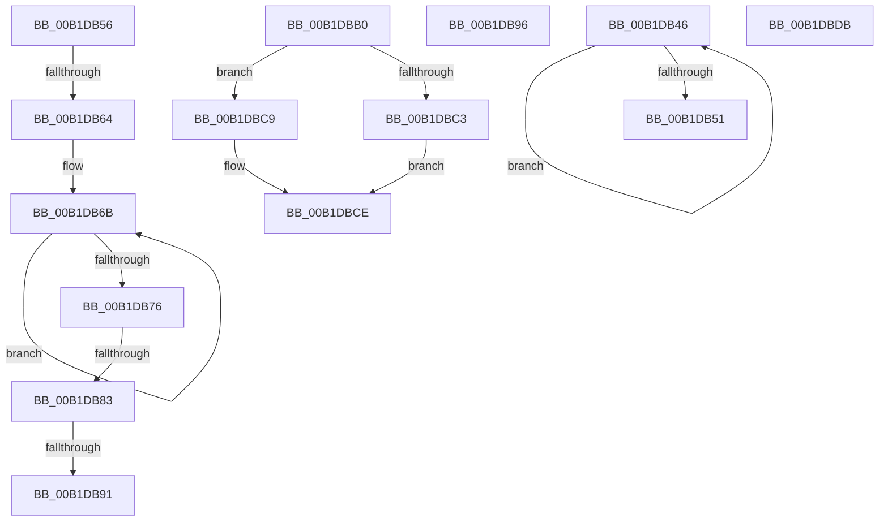

# sub_00B1DB46

- RVA: `0x00B1DB46`–`0x00B1DC0E` (길이 `200` bytes)
- VA: `0x0000000140B1DB46`
- 실행 섹션: `PAGE`
- PDB 이름 있음: `아니요`; PDB Function 태그: `아니요`
- unwind 정보 RVA: `0x00086FDC`
- 디코드: `70`개 명령, `200/200` bytes 표시
- 미해석 바이트: `6` (있으면 어셈블리에 `.byte`로 보존)

> 이 문서는 커널 이미지의 기계어와 PDB 기호를 분석해 생성했습니다. 4번과 5번은 함수 원형과 자료형을 바이너리 사용 방식에서 추정한 C 해석이며 원본 소스 복구 결과는 아닙니다.

## 1. Dependencies

- 직접 호출 지점: **0**; 고유 호출 대상: **0**
- 직접 호출자로 확인된 함수: **0**
- RIP 상대 이미지 참조: **1**

### Outgoing calls
- 직접 디코드된 call 명령이 없습니다.

### Direct callers
- 이 함수 시작 RVA로 연결되는 직접 call은 확인되지 않았습니다. 간접 호출은 완전히 역산할 수 없습니다.

### Static image references
- `0x00B1DB9D` → RVA `0x00000000` (`image boundary/outside`; read)

## 2. Other-region calls and transfers

- 다른 실행 섹션으로 향하는 call: **0**
- call이 아닌 외부 분기/꼬리 이동: **6**
  - `0x00B1DB51` → [sub_008EE966 + 0x635](../8E/Unknown_function_008EE966.md) (`tail-transfer`)
  - `0x00B1DB5E` → [sub_008EE966 + 0x5ED](../8E/Unknown_function_008EE966.md) (`tail-transfer`)
  - `0x00B1DB7D` → [sub_008EE966 + 0x473](../8E/Unknown_function_008EE966.md) (`tail-transfer`)
  - `0x00B1DB8B` → [sub_008EE966 + 0x6AC](../8E/Unknown_function_008EE966.md) (`tail-transfer`)
  - `0x00B1DB91` → [sub_008EE966 + 0x612](../8E/Unknown_function_008EE966.md) (`tail-transfer`)
  - `0x00B1DBD6` → [sub_008EE74B + 0xF1](../8E/Unknown_function_008EE74B.md) (`tail-transfer`)

## 3. Assembly (complete function range)

```asm
00B1DB46  48 FF C0                        inc rax
00B1DB49  66 41 83 3C 43 00               cmp word ptr [r11 + rax*2], 0
00B1DB4F  75 F5                           jne 0x140b1db46
00B1DB51  E9 45 14 DD FF                  jmp 0x1408eef9b
00B1DB56  B9 FF FF FF FF                  mov ecx, 0xffffffff
00B1DB5B  44 3B F1                        cmp r14d, ecx
00B1DB5E  0F 84 EF 13 DD FF               je 0x1408eef53
00B1DB64  48 C7 C0 FF FF FF FF            mov rax, 0xffffffffffffffff
00B1DB6B  48 FF C0                        inc rax
00B1DB6E  66 41 83 3C 43 00               cmp word ptr [r11 + rax*2], 0
00B1DB74  75 F5                           jne 0x140b1db6b
00B1DB76  48 83 C0 4F                     add rax, 0x4f
00B1DB7A  48 3B C1                        cmp rax, rcx
00B1DB7D  0F 87 56 12 DD FF               ja 0x1408eedd9
00B1DB83  89 45 C7                        mov dword ptr [rbp - 0x39], eax
00B1DB86  8B F8                           mov edi, eax
00B1DB88  41 3B C2                        cmp eax, r10d
00B1DB8B  0F 86 81 14 DD FF               jbe 0x1408ef012
00B1DB91  E9 E2 13 DD FF                  jmp 0x1408eef78
00B1DB96  41 8D 40 FC                     lea eax, [r8 - 4]
00B1DB9A  48 63 C8                        movsxd rcx, eax
00B1DB9D  48 8D 15 5C 24 4E FF            lea rdx, [rip - 0xb1dba4]
00B1DBA4  8B 84 8A DE DB B1 00            mov eax, dword ptr [rdx + rcx*4 + 0xb1dbde]
00B1DBAB  48 03 C2                        add rax, rdx
00B1DBAE  FF E0                           jmp rax
00B1DBB0  CC                              int3
00B1DBB1  CC                              int3
00B1DBB2  CC                              int3
00B1DBB3  CC                              int3
00B1DBB4  49 8B 54 24 38                  mov rdx, qword ptr [r12 + 0x38]
00B1DBB9  49 8D 44 24 38                  lea rax, [r12 + 0x38]
00B1DBBE  48 3B D0                        cmp rdx, rax
00B1DBC1  74 06                           je 0x140b1dbc9
00B1DBC3  48 83 C2 F0                     add rdx, -0x10
00B1DBC7  EB 05                           jmp 0x140b1dbce
00B1DBC9  49 8B 54 24 58                  mov rdx, qword ptr [r12 + 0x58]
00B1DBCE  41 8B C0                        mov eax, r8d
00B1DBD1  49 89 54 C4 60                  mov qword ptr [r12 + rax*8 + 0x60], rdx
00B1DBD6  E9 61 0C DD FF                  jmp 0x1408ee83c
00B1DBDB  0F 1F 00                        nop dword ptr [rax]
00B1DBDE  C9                              leave
00B1DBDF  DB                              .byte 0xdb
00B1DBE0  B1 00                           mov cl, 0
00B1DBE2  B4 DB                           mov ah, 0xdb
00B1DBE4  B1 00                           mov cl, 0
00B1DBE6  C9                              leave
00B1DBE7  DB                              .byte 0xdb
00B1DBE8  B1 00                           mov cl, 0
00B1DBEA  C9                              leave
00B1DBEB  DB                              .byte 0xdb
00B1DBEC  B1 00                           mov cl, 0
00B1DBEE  C9                              leave
00B1DBEF  DB                              .byte 0xdb
00B1DBF0  B1 00                           mov cl, 0
00B1DBF2  B4 DB                           mov ah, 0xdb
00B1DBF4  B1 00                           mov cl, 0
00B1DBF6  B4 DB                           mov ah, 0xdb
00B1DBF8  B1 00                           mov cl, 0
00B1DBFA  B4 DB                           mov ah, 0xdb
00B1DBFC  B1 00                           mov cl, 0
00B1DBFE  C9                              leave
00B1DBFF  DB                              .byte 0xdb
00B1DC00  B1 00                           mov cl, 0
00B1DC02  C9                              leave
00B1DC03  DB                              .byte 0xdb
00B1DC04  B1 00                           mov cl, 0
00B1DC06  B4 DB                           mov ah, 0xdb
00B1DC08  B1 00                           mov cl, 0
00B1DC0A  B4 DB                           mov ah, 0xdb
00B1DC0C  B1 00                           mov cl, 0
```

## 4. C-style interpretation (structured pseudocode)

```c
__int64 __fastcall sub_00B1DB46(__int64 a1, __int64 a2, __int64 a3)
{
    __int64 result;

    result = (result) + 1;
    if ((*(unsigned __int16 *)(v_r11 + result * 2)) != 0) goto loc_00B1DB46;
}
```

## 5. (Beta) C Style

```c
int64_t sub_00B1DB46(int64_t Arg1, int64_t Arg2, int64_t Arg3)
{
    int64_t result;

    result = (result) + 1;
    if ((*(uint16_t *)(local_r11 + result * 2)) != 0) goto loc_00B1DB46;
}
```

## 6. Execution-region graph

[열기: 2D/3D 그래프와 함수 탐색 컨트롤 패널](../../../control-panel.html?section=page&rva=0x00B1DB46&view=graph)

- 2D 그래프는 위에서 아래로 흐르고, 3D 그래프는 빈 공간을 드래그해 회전합니다. Shift+드래그는 이동, 휠은 확대·축소, 함수 노드 선택은 대상 보고서 이동입니다.

### Static fallback


