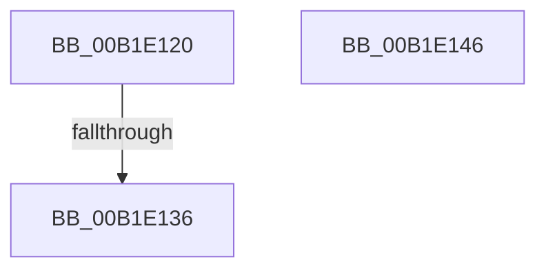

# sub_00B1E120

- RVA: `0x00B1E120`–`0x00B1E14D` (길이 `45` bytes)
- VA: `0x0000000140B1E120`
- 실행 섹션: `PAGE`
- PDB 이름 있음: `아니요`; PDB Function 태그: `아니요`
- unwind 정보 RVA: `0x000870D8`
- 디코드: `13`개 명령, `45/45` bytes 표시
- 미해석 바이트: `0` (있으면 어셈블리에 `.byte`로 보존)

> 이 문서는 커널 이미지의 기계어와 PDB 기호를 분석해 생성했습니다. 4번과 5번은 함수 원형과 자료형을 바이너리 사용 방식에서 추정한 C 해석이며 원본 소스 복구 결과는 아닙니다.

## 1. Dependencies

- 직접 호출 지점: **0**; 고유 호출 대상: **0**
- 직접 호출자로 확인된 함수: **0**
- RIP 상대 이미지 참조: **0**

### Outgoing calls
- 직접 디코드된 call 명령이 없습니다.

### Direct callers
- 이 함수 시작 RVA로 연결되는 직접 call은 확인되지 않았습니다. 간접 호출은 완전히 역산할 수 없습니다.

### Static image references
- 디코드된 RIP-relative 메모리 참조가 없습니다.

## 2. Other-region calls and transfers

- 다른 실행 섹션으로 향하는 call: **0**
- call이 아닌 외부 분기/꼬리 이동: **1**
  - `0x00B1E130` → [sub_00B1E33E](Unknown_function_00B1E33E.md) (`tail-transfer`)

## 3. Assembly (complete function range)

```asm
00B1E120  4C 89 A4 24 90 00 00 00         mov qword ptr [rsp + 0x90], r12
00B1E128  45 8D 62 FF                     lea r12d, [r10 - 1]
00B1E12C  41 83 FC 0E                     cmp r12d, 0xe
00B1E130  0F 87 08 02 00 00               ja 0x140b1e33e
00B1E136  49 63 C4                        movsxd rax, r12d
00B1E139  41 8B 8C 80 48 E3 B1 00         mov ecx, dword ptr [r8 + rax*4 + 0xb1e348]
00B1E141  49 03 C8                        add rcx, r8
00B1E144  FF E1                           jmp rcx
00B1E146  CC                              int3
00B1E147  CC                              int3
00B1E148  CC                              int3
00B1E149  CC                              int3
00B1E14A  49 63 C4                        movsxd rax, r12d
```

## 4. C-style interpretation (structured pseudocode)

```c
__int64 __fastcall sub_00B1E120(__int64 a1, __int64 a2, __int64 a3)
{
    unsigned __int64 v_stack_p90;

    v_stack_p90 = v_r12;
    a1 = ((unsigned int)(*(unsigned int *)(a3 + (int)((unsigned int)(v_r10 - 1)) * 4 + 11658056))) + (a3);
}
```

## 5. (Beta) C Style

```c
int64_t sub_00B1E120(int64_t Arg1, int64_t Arg2, void *Arg3)
{
    uint8_t *arg3 = (uint8_t *)Arg3;

    uint64_t v_stack_p90;

    v_stack_p90 = local_r12;
    Arg1 = ((uint32_t)(*(uint32_t *)(arg3 + (int32_t)((uint32_t)(local_r10 - 0x1)) * 4 + 0xB1E348))) + (Arg3);
}
```

### 관측된 메모리 오프셋

구조체 형식이 확인되지 않은 접근은 인자 기준의 오프셋으로만 기록했습니다.

| 기준 인자 | 오프셋 표현 | 폭 (bit) | 접근 |
|---|---:|---:|---|
| `Arg3` | `+ 0xB1E348 + rax*4` | `32` | `R` |

## 6. Execution-region graph

[열기: 2D/3D 그래프와 함수 탐색 컨트롤 패널](../../../control-panel.html?section=page&rva=0x00B1E120&view=graph)

- 2D 그래프는 위에서 아래로 흐르고, 3D 그래프는 빈 공간을 드래그해 회전합니다. Shift+드래그는 이동, 휠은 확대·축소, 함수 노드 선택은 대상 보고서 이동입니다.

### Static fallback


