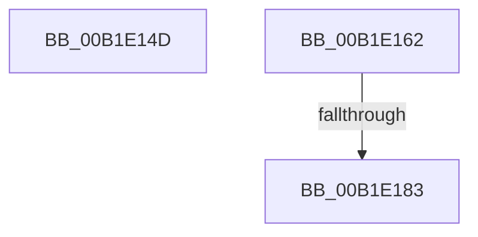

# sub_00B1E14D

- RVA: `0x00B1E14D`–`0x00B1E190` (길이 `67` bytes)
- VA: `0x0000000140B1E14D`
- 실행 섹션: `PAGE`
- PDB 이름 있음: `아니요`; PDB Function 태그: `아니요`
- unwind 정보 RVA: `0x000870EC`
- 디코드: `16`개 명령, `67/67` bytes 표시
- 미해석 바이트: `0` (있으면 어셈블리에 `.byte`로 보존)

> 이 문서는 커널 이미지의 기계어와 PDB 기호를 분석해 생성했습니다. 4번과 5번은 함수 원형과 자료형을 바이너리 사용 방식에서 추정한 C 해석이며 원본 소스 복구 결과는 아닙니다.

## 1. Dependencies

- 직접 호출 지점: **1**; 고유 호출 대상: **1**
- 직접 호출자로 확인된 함수: **0**
- RIP 상대 이미지 참조: **1**

### Outgoing calls
- `0x00B1E172` → [PnpGetEnumSecurityDescriptor](../83/PnpGetEnumSecurityDescriptor_function_00831FCC.md) (function, `0x00831FCC`)

### Direct callers
- 이 함수 시작 RVA로 연결되는 직접 call은 확인되지 않았습니다. 간접 호출은 완전히 역산할 수 없습니다.

### Static image references
- `0x00B1E16B` → RVA `0x00AFDA80` (` ?? ::NNGAKEGL::`string'`; read)

## 2. Other-region calls and transfers

- 다른 실행 섹션으로 향하는 call: **0**
- call이 아닌 외부 분기/꼬리 이동: **1**
  - `0x00B1E17D` → [sub_00B1E19D + 0x97](Unknown_function_00B1E19D.md) (`tail-transfer`)

## 3. Assembly (complete function range)

```asm
00B1E14D  4C 89 BC 24 98 00 00 00         mov qword ptr [rsp + 0x98], r15
00B1E155  41 8B 8C 80 84 E3 B1 00         mov ecx, dword ptr [r8 + rax*4 + 0xb1e384]
00B1E15D  49 03 C8                        add rcx, r8
00B1E160  FF E1                           jmp rcx
00B1E162  CC                              int3
00B1E163  CC                              int3
00B1E164  CC                              int3
00B1E165  CC                              int3
00B1E166  BE 04 00 00 00                  mov esi, 4
00B1E16B  4C 8D 3D 0E F9 FD FF            lea r15, [rip - 0x206f2]
00B1E172  E8 55 3E D1 FF                  call 0x140831fcc
00B1E177  4C 8B F0                        mov r14, rax
00B1E17A  48 85 C0                        test rax, rax
00B1E17D  0F 85 B1 00 00 00               jne 0x140b1e234
00B1E183  B8 E5 00 00 C0                  mov eax, 0xc00000e5
00B1E188  4C 8B BC 24 98 00 00 00         mov r15, qword ptr [rsp + 0x98]
```

## 4. C-style interpretation (structured pseudocode)

```c
__int64 __fastcall sub_00B1E14D(__int64 a1, __int64 a2, __int64 a3)
{
    unsigned __int64 v_stack_p98;

    v_stack_p98 = v_r15;
    a1 = ((unsigned int)(*(unsigned int *)(a3 + result * 4 + 11658116))) + (a3);
}
```

## 5. (Beta) C Style

```c
int64_t sub_00B1E14D(int64_t Arg1, int64_t Arg2, void *Arg3)
{
    uint8_t *arg3 = (uint8_t *)Arg3;

    uint64_t v_stack_p98;

    v_stack_p98 = local_r15;
    Arg1 = ((uint32_t)(*(uint32_t *)(arg3 + result * 4 + 0xB1E384))) + (Arg3);
}
```

### 관측된 메모리 오프셋

구조체 형식이 확인되지 않은 접근은 인자 기준의 오프셋으로만 기록했습니다.

| 기준 인자 | 오프셋 표현 | 폭 (bit) | 접근 |
|---|---:|---:|---|
| `Arg3` | `+ 0xB1E384 + rax*4` | `32` | `R` |

## 6. Execution-region graph

[열기: 2D/3D 그래프와 함수 탐색 컨트롤 패널](../../../control-panel.html?section=page&rva=0x00B1E14D&view=graph)

- 2D 그래프는 위에서 아래로 흐르고, 3D 그래프는 빈 공간을 드래그해 회전합니다. Shift+드래그는 이동, 휠은 확대·축소, 함수 노드 선택은 대상 보고서 이동입니다.

### Static fallback


