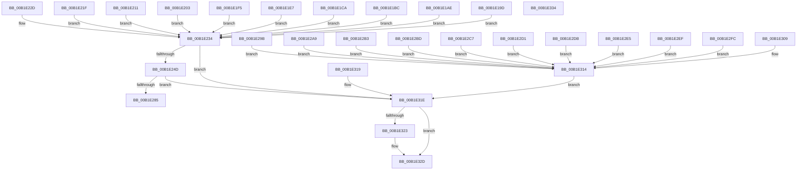

# sub_00B1E19D

- RVA: `0x00B1E19D`–`0x00B1E33E` (길이 `417` bytes)
- VA: `0x0000000140B1E19D`
- 실행 섹션: `PAGE`
- PDB 이름 있음: `아니요`; PDB Function 태그: `아니요`
- unwind 정보 RVA: `0x00087110`
- 디코드: `104`개 명령, `417/417` bytes 표시
- 미해석 바이트: `0` (있으면 어셈블리에 `.byte`로 보존)

> 이 문서는 커널 이미지의 기계어와 PDB 기호를 분석해 생성했습니다. 4번과 5번은 함수 원형과 자료형을 바이너리 사용 방식에서 추정한 C 해석이며 원본 소스 복구 결과는 아닙니다.

## 1. Dependencies

- 직접 호출 지점: **3**; 고유 호출 대상: **3**
- 직접 호출자로 확인된 함수: **0**
- RIP 상대 이미지 참조: **11**

### Outgoing calls
- `0x00B1E23E` → [SysCtxGetCachedContextBaseKey](../A3/SysCtxGetCachedContextBaseKey_function_00A376A0.md) (function, `0x00A376A0`)
- `0x00B1E276` → [SysCtxRegCreateTree](../93/SysCtxRegCreateTree_function_0093000C.md) (function, `0x0093000C`)
- `0x00B1E328` → [ExFreePoolWithTag](../../poolcode/B8/ExFreePoolWithTag_function_00B82870.md) (function, `0x00B82870`)

### Direct callers
- 이 함수 시작 RVA로 연결되는 직접 call은 확인되지 않았습니다. 간접 호출은 완전히 역산할 수 없습니다.

### Static image references
- `0x00B1E1A2` → RVA `0x00AFF390` (` ?? ::NNGAKEGL::`string'`; read)
- `0x00B1E1B3` → RVA `0x00B0D320` (` ?? ::NNGAKEGL::`string'`; read)
- `0x00B1E1C1` → RVA `0x00B0D1A0` (` ?? ::NNGAKEGL::`string'`; read)
- `0x00B1E1D5` → RVA `0x00B0D1D0` (` ?? ::NNGAKEGL::`string'`; read)
- `0x00B1E1EC` → RVA `0x00B0D210` (` ?? ::NNGAKEGL::`string'`; read)
- `0x00B1E1FA` → RVA `0x00B0D250` (` ?? ::NNGAKEGL::`string'`; read)
- `0x00B1E208` → RVA `0x00B0D280` (` ?? ::NNGAKEGL::`string'`; read)
- `0x00B1E216` → RVA `0x00B0D2C0` (` ?? ::NNGAKEGL::`string'`; read)
- `0x00B1E224` → RVA `0x00B09130` (` ?? ::NNGAKEGL::`string'`; read)
- `0x00B1E22D` → RVA `0x00B0D300` (` ?? ::NNGAKEGL::`string'`; read)
- `0x00B1E285` → RVA `0x00000000` (`image boundary/outside`; read)

## 2. Other-region calls and transfers

- 다른 실행 섹션으로 향하는 call: **1**
  - `0x00B1E328` → [ExFreePoolWithTag](../../poolcode/B8/ExFreePoolWithTag_function_00B82870.md) (`PAGE` → `POOLCODE`)
- call이 아닌 외부 분기/꼬리 이동: **2**
  - `0x00B1E32F` → [sub_00B1E14D + 0x3B](Unknown_function_00B1E14D.md) (`tail-transfer`)
  - `0x00B1E339` → [sub_00B1E14D + 0x3B](Unknown_function_00B1E14D.md) (`tail-transfer`)

## 3. Assembly (complete function range)

```asm
00B1E19D  BE 04 00 00 00                  mov esi, 4
00B1E1A2  4C 8D 3D E7 11 FE FF            lea r15, [rip - 0x1ee19]
00B1E1A9  E9 86 00 00 00                  jmp 0x140b1e234
00B1E1AE  BE 04 00 00 00                  mov esi, 4
00B1E1B3  4C 8D 3D 66 F1 FE FF            lea r15, [rip - 0x10e9a]
00B1E1BA  EB 78                           jmp 0x140b1e234
00B1E1BC  BE 04 00 00 00                  mov esi, 4
00B1E1C1  4C 8D 3D D8 EF FE FF            lea r15, [rip - 0x11028]
00B1E1C8  EB 6A                           jmp 0x140b1e234
00B1E1CA  45 38 6B 04                     cmp byte ptr [r11 + 4], r13b
00B1E1CE  48 8D 05 CB EF FE FF            lea rax, [rip - 0x11035]
00B1E1D5  4C 8D 3D F4 EF FE FF            lea r15, [rip - 0x1100c]
00B1E1DC  BE 04 00 00 00                  mov esi, 4
00B1E1E1  4C 0F 44 F8                     cmove r15, rax
00B1E1E5  EB 4D                           jmp 0x140b1e234
00B1E1E7  BE 04 00 00 00                  mov esi, 4
00B1E1EC  4C 8D 3D 1D F0 FE FF            lea r15, [rip - 0x10fe3]
00B1E1F3  EB 3F                           jmp 0x140b1e234
00B1E1F5  BE 04 00 00 00                  mov esi, 4
00B1E1FA  4C 8D 3D 4F F0 FE FF            lea r15, [rip - 0x10fb1]
00B1E201  EB 31                           jmp 0x140b1e234
00B1E203  BE 04 00 00 00                  mov esi, 4
00B1E208  4C 8D 3D 71 F0 FE FF            lea r15, [rip - 0x10f8f]
00B1E20F  EB 23                           jmp 0x140b1e234
00B1E211  BE 04 00 00 00                  mov esi, 4
00B1E216  4C 8D 3D A3 F0 FE FF            lea r15, [rip - 0x10f5d]
00B1E21D  EB 15                           jmp 0x140b1e234
00B1E21F  BE 04 00 00 00                  mov esi, 4
00B1E224  4C 8D 3D 05 AF FE FF            lea r15, [rip - 0x150fb]
00B1E22B  EB 07                           jmp 0x140b1e234
00B1E22D  4C 8D 3D CC F0 FE FF            lea r15, [rip - 0x10f34]
00B1E234  48 8B 4F 38                     mov rcx, qword ptr [rdi + 0x38]
00B1E238  4C 8D 45 F8                     lea r8, [rbp - 8]
00B1E23C  8B D6                           mov edx, esi
00B1E23E  E8 5D 94 F1 FF                  call 0x140a376a0
00B1E243  8B F0                           mov esi, eax
00B1E245  85 C0                           test eax, eax
00B1E247  0F 88 D1 00 00 00               js 0x140b1e31e
00B1E24D  48 8B 55 F8                     mov rdx, qword ptr [rbp - 8]
00B1E251  48 8D 45 F0                     lea rax, [rbp - 0x10]
00B1E255  48 8B 4F 38                     mov rcx, qword ptr [rdi + 0x38]
00B1E259  45 33 C9                        xor r9d, r9d
00B1E25C  4C 89 6C 24 40                  mov qword ptr [rsp + 0x40], r13
00B1E261  4D 8B C7                        mov r8, r15
00B1E264  48 89 44 24 38                  mov qword ptr [rsp + 0x38], rax
00B1E269  4C 89 6C 24 28                  mov qword ptr [rsp + 0x28], r13
00B1E26E  C7 44 24 20 00 00 00 02         mov dword ptr [rsp + 0x20], 0x2000000
00B1E276  E8 91 1D E1 FF                  call 0x14093000c
00B1E27B  8B F0                           mov esi, eax
00B1E27D  85 C0                           test eax, eax
00B1E27F  0F 88 99 00 00 00               js 0x140b1e31e
00B1E285  48 8D 15 74 1D 4E FF            lea rdx, [rip - 0xb1e28c]
00B1E28C  49 63 C4                        movsxd rax, r12d
00B1E28F  8B 8C 82 C0 E3 B1 00            mov ecx, dword ptr [rdx + rax*4 + 0xb1e3c0]
00B1E296  48 03 CA                        add rcx, rdx
00B1E299  FF E1                           jmp rcx
00B1E29B  CC                              int3
00B1E29C  CC                              int3
00B1E29D  CC                              int3
00B1E29E  CC                              int3
00B1E29F  48 8B 45 F0                     mov rax, qword ptr [rbp - 0x10]
00B1E2A3  48 89 47 40                     mov qword ptr [rdi + 0x40], rax
00B1E2A7  EB 6B                           jmp 0x140b1e314
00B1E2A9  48 8B 45 F0                     mov rax, qword ptr [rbp - 0x10]
00B1E2AD  48 89 47 48                     mov qword ptr [rdi + 0x48], rax
00B1E2B1  EB 61                           jmp 0x140b1e314
00B1E2B3  48 8B 45 F0                     mov rax, qword ptr [rbp - 0x10]
00B1E2B7  48 89 47 50                     mov qword ptr [rdi + 0x50], rax
00B1E2BB  EB 57                           jmp 0x140b1e314
00B1E2BD  48 8B 45 F0                     mov rax, qword ptr [rbp - 0x10]
00B1E2C1  48 89 47 58                     mov qword ptr [rdi + 0x58], rax
00B1E2C5  EB 4D                           jmp 0x140b1e314
00B1E2C7  48 8B 45 F0                     mov rax, qword ptr [rbp - 0x10]
00B1E2CB  48 89 47 60                     mov qword ptr [rdi + 0x60], rax
00B1E2CF  EB 43                           jmp 0x140b1e314
00B1E2D1  48 8B 45 F0                     mov rax, qword ptr [rbp - 0x10]
00B1E2D5  48 89 47 68                     mov qword ptr [rdi + 0x68], rax
00B1E2D9  EB 39                           jmp 0x140b1e314
00B1E2DB  48 8B 45 F0                     mov rax, qword ptr [rbp - 0x10]
00B1E2DF  48 89 47 70                     mov qword ptr [rdi + 0x70], rax
00B1E2E3  EB 2F                           jmp 0x140b1e314
00B1E2E5  48 8B 45 F0                     mov rax, qword ptr [rbp - 0x10]
00B1E2E9  48 89 47 78                     mov qword ptr [rdi + 0x78], rax
00B1E2ED  EB 25                           jmp 0x140b1e314
00B1E2EF  48 8B 45 F0                     mov rax, qword ptr [rbp - 0x10]
00B1E2F3  48 89 87 80 00 00 00            mov qword ptr [rdi + 0x80], rax
00B1E2FA  EB 18                           jmp 0x140b1e314
00B1E2FC  48 8B 45 F0                     mov rax, qword ptr [rbp - 0x10]
00B1E300  48 89 87 88 00 00 00            mov qword ptr [rdi + 0x88], rax
00B1E307  EB 0B                           jmp 0x140b1e314
00B1E309  48 8B 45 F0                     mov rax, qword ptr [rbp - 0x10]
00B1E30D  48 89 87 90 00 00 00            mov qword ptr [rdi + 0x90], rax
00B1E314  48 89 03                        mov qword ptr [rbx], rax
00B1E317  EB 05                           jmp 0x140b1e31e
00B1E319  BE 0D 00 00 C0                  mov esi, 0xc000000d
00B1E31E  4D 85 F6                        test r14, r14
00B1E321  74 0A                           je 0x140b1e32d
00B1E323  33 D2                           xor edx, edx
00B1E325  49 8B CE                        mov rcx, r14
00B1E328  E8 43 45 06 00                  call 0x140b82870
00B1E32D  8B C6                           mov eax, esi
00B1E32F  E9 54 FE FF FF                  jmp 0x140b1e188
00B1E334  B8 0D 00 00 C0                  mov eax, 0xc000000d
00B1E339  E9 4A FE FF FF                  jmp 0x140b1e188
```

## 4. C-style interpretation (structured pseudocode)

```c
__int64 __fastcall sub_00B1E19D(__int64 a1, __int64 a2, __int64 a3, int a4)
{
    __int64 result;
    unsigned int v_stack_p20;
    unsigned __int64 v_stack_p28;
    unsigned __int64 v_stack_p38;
    unsigned __int64 v_stack_p40;

    goto loc_00B1E234;
loc_00B1E234:
    result = SysCtxGetCachedContextBaseKey(*(unsigned __int64 *)(v_rdi + 56), 4, v_rbp - 8, a4);
    if (sign_flag) goto loc_00B1E31E;
    a4 = 0;
    v_stack_p40 = v_r13;
    v_stack_p38 = v_rbp - 16;
    v_stack_p28 = v_r13;
    v_stack_p20 = 0x2000000ULL;
    result = SysCtxRegCreateTree(*(unsigned __int64 *)(v_rdi + 56), *(unsigned __int64 *)(v_rbp - 8), v_rip - 126489, a4);
    if (sign_flag) goto loc_00B1E31E;
    a1 = ((unsigned int)(*(unsigned int *)(v_rip - 11657868 + (int)((unsigned int)(v_r12)) * 4 + 11658176))) + (v_rip - 11657868);
loc_00B1E31E:
    result = (int)((unsigned int)(v_r12));
    if (v_r14 != 0) {
        a2 = 0;
        a1 = v_r14;
        result = ExFreePoolWithTag(a1, a2, v_rip - 126489, a4);
    }
}
```

## 5. (Beta) C Style

```c
int64_t sub_00B1E19D(int64_t Arg1, int64_t Arg2, int64_t Arg3, int32_t Arg4)
{
    int64_t result;
    uint32_t v_stack_p20;
    uint64_t v_stack_p28;
    uint64_t v_stack_p38;
    uint64_t v_stack_p40;

    goto loc_00B1E234;
loc_00B1E234:
    result = SysCtxGetCachedContextBaseKey(*(uint64_t *)(local_rdi + 0x38), 4, local_rbp - 8, Arg4);
    if (sign_flag) goto loc_00B1E31E;
    Arg4 = 0;
    v_stack_p40 = local_r13;
    v_stack_p38 = local_rbp - 16;
    v_stack_p28 = local_r13;
    v_stack_p20 = 0x2000000ULL;
    result = SysCtxRegCreateTree(*(uint64_t *)(local_rdi + 0x38), *(uint64_t *)(local_rbp - 0x8), v_rip - 126489, Arg4);
    if (sign_flag) goto loc_00B1E31E;
    Arg1 = ((uint32_t)(*(uint32_t *)(v_rip - 0xB1E28C + (int32_t)((uint32_t)(local_r12)) * 4 + 0xB1E3C0))) + (v_rip - 11657868);
loc_00B1E31E:
    result = (int32_t)((uint32_t)(local_r12));
    if (local_r14 != 0) {
        Arg2 = 0;
        Arg1 = local_r14;
        result = ExFreePoolWithTag(Arg1, Arg2, v_rip - 126489, Arg4);
    }
}
```

## 6. Execution-region graph

[열기: 2D/3D 그래프와 함수 탐색 컨트롤 패널](../../../control-panel.html?section=page&rva=0x00B1E19D&view=graph)

- 2D 그래프는 위에서 아래로 흐르고, 3D 그래프는 빈 공간을 드래그해 회전합니다. Shift+드래그는 이동, 휠은 확대·축소, 함수 노드 선택은 대상 보고서 이동입니다.

### Static fallback


