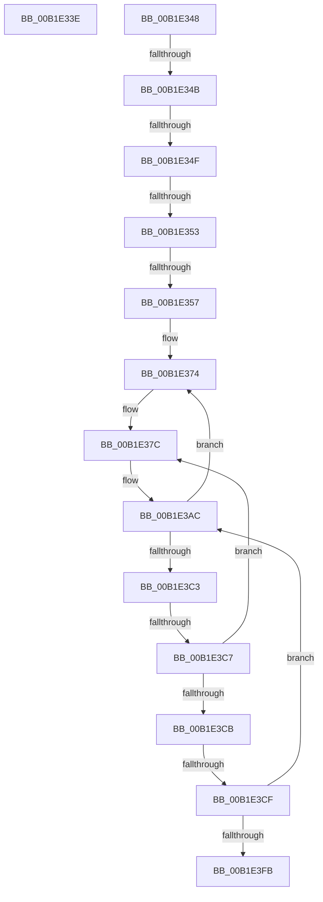

# sub_00B1E33E

- RVA: `0x00B1E33E`–`0x00B1E3FC` (길이 `190` bytes)
- VA: `0x0000000140B1E33E`
- 실행 섹션: `PAGE`
- PDB 이름 있음: `아니요`; PDB Function 태그: `아니요`
- unwind 정보 RVA: `0x00087128`
- 디코드: `76`개 명령, `190/190` bytes 표시
- 미해석 바이트: `1` (있으면 어셈블리에 `.byte`로 보존)

> 이 문서는 커널 이미지의 기계어와 PDB 기호를 분석해 생성했습니다. 4번과 5번은 함수 원형과 자료형을 바이너리 사용 방식에서 추정한 C 해석이며 원본 소스 복구 결과는 아닙니다.

## 1. Dependencies

- 직접 호출 지점: **0**; 고유 호출 대상: **0**
- 직접 호출자로 확인된 함수: **0**
- RIP 상대 이미지 참조: **1**

### Outgoing calls
- 직접 디코드된 call 명령이 없습니다.

### Direct callers
- 이 함수 시작 RVA로 연결되는 직접 call은 확인되지 않았습니다. 간접 호출은 완전히 역산할 수 없습니다.

### Static image references
- `0x00B1E3BB` → RVA `0x19B295A3` (`image boundary/outside`; read/write)

## 2. Other-region calls and transfers

- 다른 실행 섹션으로 향하는 call: **0**
- call이 아닌 외부 분기/꼬리 이동: **5**
  - `0x00B1E343` → [sub_00B1E190](Unknown_function_00B1E190.md) (`tail-transfer`)
  - `0x00B1E348` → [sub_00B1E19D + 0x15F](Unknown_function_00B1E19D.md) (`tail-transfer`)
  - `0x00B1E34D` → [sub_00B1E19D + 0x163](Unknown_function_00B1E19D.md) (`tail-transfer`)
  - `0x00B1E351` → [sub_00B1E19D + 0x167](Unknown_function_00B1E19D.md) (`tail-transfer`)
  - `0x00B1E355` → [sub_00B1E19D + 0x16B](Unknown_function_00B1E19D.md) (`tail-transfer`)

## 3. Assembly (complete function range)

```asm
00B1E33E  B8 0D 00 00 C0                  mov eax, 0xc000000d
00B1E343  E9 48 FE FF FF                  jmp 0x140b1e190
00B1E348  3E E3 B1                        jrcxz 0x140b1e2fc
00B1E34B  00 3E                           add byte ptr [rsi], bh
00B1E34D  E3 B1                           jrcxz 0x140b1e300
00B1E34F  00 3E                           add byte ptr [rsi], bh
00B1E351  E3 B1                           jrcxz 0x140b1e304
00B1E353  00 3E                           add byte ptr [rsi], bh
00B1E355  E3 B1                           jrcxz 0x140b1e308
00B1E357  00 4A E1                        add byte ptr [rdx - 0x1f], cl
00B1E35A  B1 00                           mov cl, 0
00B1E35C  4A E1 B1                        loope 0x140b1e310
00B1E35F  00 4A E1                        add byte ptr [rdx - 0x1f], cl
00B1E362  B1 00                           mov cl, 0
00B1E364  4A E1 B1                        loope 0x140b1e318
00B1E367  00 4A E1                        add byte ptr [rdx - 0x1f], cl
00B1E36A  B1 00                           mov cl, 0
00B1E36C  4A E1 B1                        loope 0x140b1e320
00B1E36F  00 4A E1                        add byte ptr [rdx - 0x1f], cl
00B1E372  B1 00                           mov cl, 0
00B1E374  4A E1 B1                        loope 0x140b1e328
00B1E377  00 4A E1                        add byte ptr [rdx - 0x1f], cl
00B1E37A  B1 00                           mov cl, 0
00B1E37C  4A E1 B1                        loope 0x140b1e330
00B1E37F  00 4A E1                        add byte ptr [rdx - 0x1f], cl
00B1E382  B1 00                           mov cl, 0
00B1E384  34 E3                           xor al, 0xe3
00B1E386  B1 00                           mov cl, 0
00B1E388  34 E3                           xor al, 0xe3
00B1E38A  B1 00                           mov cl, 0
00B1E38C  34 E3                           xor al, 0xe3
00B1E38E  B1 00                           mov cl, 0
00B1E390  34 E3                           xor al, 0xe3
00B1E392  B1 00                           mov cl, 0
00B1E394  66 E1 B1                        loope 0x140b1e348
00B1E397  00 9D E1 B1 00 AE               add byte ptr [rbp - 0x51ff4e1f], bl
00B1E39D  E1 B1                           loope 0x140b1e350
00B1E39F  00 BC E1 B1 00 CA E1            add byte ptr [rcx + riz*8 - 0x1e35ff4f], bh
00B1E3A6  B1 00                           mov cl, 0
00B1E3A8  E7 E1                           out 0xe1, eax
00B1E3AA  B1 00                           mov cl, 0
00B1E3AC  F5                              cmc
00B1E3AD  E1 B1                           loope 0x140b1e360
00B1E3AF  00 03                           add byte ptr [rbx], al
00B1E3B1  E2 B1                           loop 0x140b1e364
00B1E3B3  00 11                           add byte ptr [rcx], dl
00B1E3B5  E2 B1                           loop 0x140b1e368
00B1E3B7  00 1F                           add byte ptr [rdi], bl
00B1E3B9  E2 B1                           loop 0x140b1e36c
00B1E3BB  00 2D E2 B1 00 19               add byte ptr [rip + 0x1900b1e2], ch
00B1E3C1  E3 B1                           jrcxz 0x140b1e374
00B1E3C3  00 19                           add byte ptr [rcx], bl
00B1E3C5  E3 B1                           jrcxz 0x140b1e378
00B1E3C7  00 19                           add byte ptr [rcx], bl
00B1E3C9  E3 B1                           jrcxz 0x140b1e37c
00B1E3CB  00 19                           add byte ptr [rcx], bl
00B1E3CD  E3 B1                           jrcxz 0x140b1e380
00B1E3CF  00 9F E2 B1 00 A9               add byte ptr [rdi - 0x56ff4e1e], bl
00B1E3D5  E2 B1                           loop 0x140b1e388
00B1E3D7  00 B3 E2 B1 00 BD               add byte ptr [rbx - 0x42ff4e1e], dh
00B1E3DD  E2 B1                           loop 0x140b1e390
00B1E3DF  00 C7                           add bh, al
00B1E3E1  E2 B1                           loop 0x140b1e394
00B1E3E3  00 D1                           add cl, dl
00B1E3E5  E2 B1                           loop 0x140b1e398
00B1E3E7  00 DB                           add bl, bl
00B1E3E9  E2 B1                           loop 0x140b1e39c
00B1E3EB  00 E5                           add ch, ah
00B1E3ED  E2 B1                           loop 0x140b1e3a0
00B1E3EF  00 EF                           add bh, ch
00B1E3F1  E2 B1                           loop 0x140b1e3a4
00B1E3F3  00 FC                           add ah, bh
00B1E3F5  E2 B1                           loop 0x140b1e3a8
00B1E3F7  00 09                           add byte ptr [rcx], cl
00B1E3F9  E3 B1                           jrcxz 0x140b1e3ac
00B1E3FB  00                              .byte 0x00
```

## 4. C-style interpretation (structured pseudocode)

```c
__int64 __fastcall sub_00B1E33E(unsigned __int8 a1, __int64 a2)
{
}
```

## 5. (Beta) C Style

```c
int64_t sub_00B1E33E(uint8_t Arg1, int64_t Arg2)
{
}
```

## 6. Execution-region graph

[열기: 2D/3D 그래프와 함수 탐색 컨트롤 패널](../../../control-panel.html?section=page&rva=0x00B1E33E&view=graph)

- 2D 그래프는 위에서 아래로 흐르고, 3D 그래프는 빈 공간을 드래그해 회전합니다. Shift+드래그는 이동, 휠은 확대·축소, 함수 노드 선택은 대상 보고서 이동입니다.

### Static fallback


