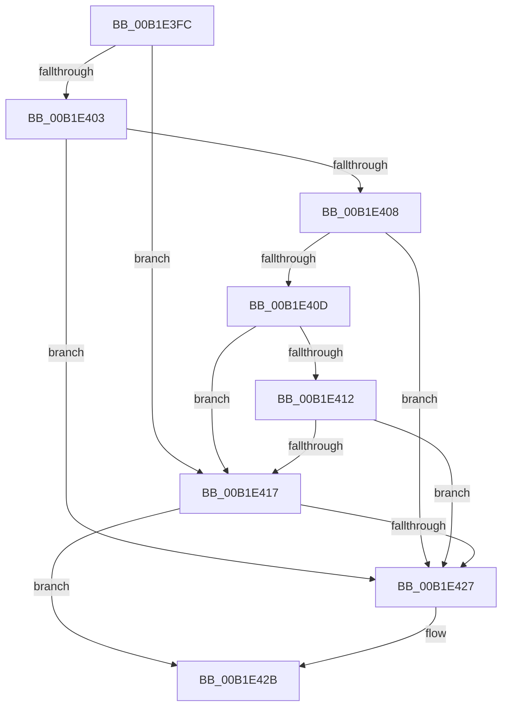

# sub_00B1E3FC

- RVA: `0x00B1E3FC`–`0x00B1E435` (길이 `57` bytes)
- VA: `0x0000000140B1E3FC`
- 실행 섹션: `PAGE`
- PDB 이름 있음: `아니요`; PDB Function 태그: `아니요`
- unwind 정보 RVA: `0x00087148`
- 디코드: `19`개 명령, `57/57` bytes 표시
- 미해석 바이트: `0` (있으면 어셈블리에 `.byte`로 보존)

> 이 문서는 커널 이미지의 기계어와 PDB 기호를 분석해 생성했습니다. 4번과 5번은 함수 원형과 자료형을 바이너리 사용 방식에서 추정한 C 해석이며 원본 소스 복구 결과는 아닙니다.

## 1. Dependencies

- 직접 호출 지점: **0**; 고유 호출 대상: **0**
- 직접 호출자로 확인된 함수: **0**
- RIP 상대 이미지 참조: **0**

### Outgoing calls
- 직접 디코드된 call 명령이 없습니다.

### Direct callers
- 이 함수 시작 RVA로 연결되는 직접 call은 확인되지 않았습니다. 간접 호출은 완전히 역산할 수 없습니다.

### Static image references
- 디코드된 RIP-relative 메모리 참조가 없습니다.

## 2. Other-region calls and transfers

- 다른 실행 섹션으로 향하는 call: **0**
- call이 아닌 외부 분기/꼬리 이동: **1**
  - `0x00B1E430` → [_PnpCtxGetCachedContextBaseKey + 0x14](../8E/_PnpCtxGetCachedContextBaseKey_function_008EFB2C.md) (`tail-transfer`)

## 3. Assembly (complete function range)

```asm
00B1E3FC  8B CA                           mov ecx, edx
00B1E3FE  83 E9 0B                        sub ecx, 0xb
00B1E401  74 14                           je 0x140b1e417
00B1E403  83 E9 01                        sub ecx, 1
00B1E406  74 1F                           je 0x140b1e427
00B1E408  83 E9 01                        sub ecx, 1
00B1E40B  74 1A                           je 0x140b1e427
00B1E40D  83 E9 01                        sub ecx, 1
00B1E410  74 05                           je 0x140b1e417
00B1E412  83 F9 01                        cmp ecx, 1
00B1E415  75 10                           jne 0x140b1e427
00B1E417  49 8D 42 38                     lea rax, [r10 + 0x38]
00B1E41B  48 8B 08                        mov rcx, qword ptr [rax]
00B1E41E  48 3B C8                        cmp rcx, rax
00B1E421  48 8D 41 F0                     lea rax, [rcx - 0x10]
00B1E425  75 04                           jne 0x140b1e42b
00B1E427  49 8B 42 58                     mov rax, qword ptr [r10 + 0x58]
00B1E42B  4B 89 44 CA 60                  mov qword ptr [r10 + r9*8 + 0x60], rax
00B1E430  E9 0B 17 DD FF                  jmp 0x1408efb40
```

## 4. C-style interpretation (structured pseudocode)

```c
__int64 __fastcall sub_00B1E3FC(__int64 a1, int a2, __int64 a3, __int64 a4)
{
    __int64 result;

    a1 = (unsigned int)(((unsigned int)(a2)) - (11));
    if (condition_is_equal) goto loc_00B1E417;
    a1 = (unsigned int)((a1) - (1));
    if (condition_is_equal) goto loc_00B1E427;
    a1 = (unsigned int)((a1) - (1));
    if (condition_is_equal) goto loc_00B1E427;
    a1 = (unsigned int)((a1) - (1));
    if (condition_is_equal) goto loc_00B1E417;
    if (((unsigned int)(a1)) != 1) goto loc_00B1E427;
loc_00B1E417:
    result = *(unsigned __int64 *)(v_r10 + 56) - 16;
    if ((*(unsigned __int64 *)(v_r10 + 56)) == (v_r10 + 56)) {
        result = *(unsigned __int64 *)(v_r10 + 88);
    }
    *(unsigned __int64 *)(v_r10 + a4 * 8 + 96) = result;
}
```

## 5. (Beta) C Style

```c
int64_t sub_00B1E3FC(int64_t Arg1, int32_t Arg2, int64_t Arg3, int64_t Arg4)
{
    int64_t result;

    Arg1 = (uint32_t)(((uint32_t)(Arg2)) - (11));
    if (condition_is_equal) goto loc_00B1E417;
    Arg1 = (uint32_t)((Arg1) - (1));
    if (condition_is_equal) goto loc_00B1E427;
    Arg1 = (uint32_t)((Arg1) - (1));
    if (condition_is_equal) goto loc_00B1E427;
    Arg1 = (uint32_t)((Arg1) - (1));
    if (condition_is_equal) goto loc_00B1E417;
    if (((uint32_t)(Arg1)) != 1) goto loc_00B1E427;
loc_00B1E417:
    result = *(uint64_t *)(local_r10 + 0x38) - 16;
    if ((*(uint64_t *)(local_r10 + 0x38)) == (local_r10 + 56)) {
        result = *(uint64_t *)(local_r10 + 0x58);
    }
    *(uint64_t *)(local_r10 + Arg4 * 8 + 0x60) = result;
}
```

## 6. Execution-region graph

[열기: 2D/3D 그래프와 함수 탐색 컨트롤 패널](../../../control-panel.html?section=page&rva=0x00B1E3FC&view=graph)

- 2D 그래프는 위에서 아래로 흐르고, 3D 그래프는 빈 공간을 드래그해 회전합니다. Shift+드래그는 이동, 휠은 확대·축소, 함수 노드 선택은 대상 보고서 이동입니다.

### Static fallback


