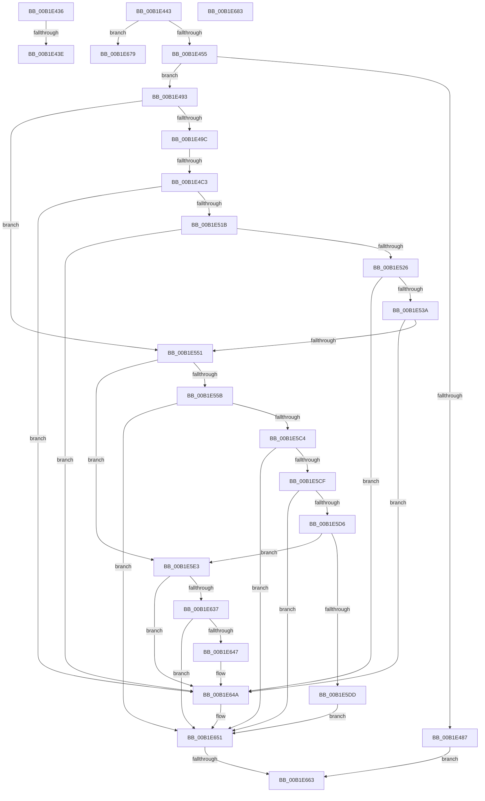

# sub_00B1E436

- RVA: `0x00B1E436`–`0x00B1E68D` (길이 `599` bytes)
- VA: `0x0000000140B1E436`
- 실행 섹션: `PAGE`
- PDB 이름 있음: `아니요`; PDB Function 태그: `아니요`
- unwind 정보 RVA: `0x0008720C`
- 디코드: `136`개 명령, `599/599` bytes 표시
- 미해석 바이트: `0` (있으면 어셈블리에 `.byte`로 보존)

> 이 문서는 커널 이미지의 기계어와 PDB 기호를 분석해 생성했습니다. 4번과 5번은 함수 원형과 자료형을 바이너리 사용 방식에서 추정한 C 해석이며 원본 소스 복구 결과는 아닙니다.

## 1. Dependencies

- 직접 호출 지점: **11**; 고유 호출 대상: **10**
- 직접 호출자로 확인된 함수: **0**
- RIP 상대 이미지 참조: **3**

### Outgoing calls
- `0x00B1E47E` → [_CmOpenDeviceInterfaceRegKey](../8F/_CmOpenDeviceInterfaceRegKey_function_008F31F4.md) (function, `0x008F31F4`)
- `0x00B1E4AE` → [ExAllocatePool2](../../poolcode/B8/ExAllocatePool2_function_00B820F0.md) (function, `0x00B820F0`)
- `0x00B1E50E` → [PnpGetObjectProperty](../8E/PnpGetObjectProperty_function_008E2180.md) (function, `0x008E2180`)
- `0x00B1E52D` → [RtlInitUnicodeStringEx](../../text/46/RtlInitUnicodeStringEx_function_00463960.md) (function, `0x00463960`)
- `0x00B1E544` → [RtlEqualUnicodeString](../93/RtlEqualUnicodeString_function_00932A20.md) (function, `0x00932A20`)
- `0x00B1E5B7` → [PnpGetObjectProperty](../8E/PnpGetObjectProperty_function_008E2180.md) (function, `0x008E2180`)
- `0x00B1E5F7` → [SeCaptureSubjectContext](../86/SeCaptureSubjectContext_function_0086B820.md) (function, `0x0086B820`)
- `0x00B1E623` → [PiPnpRtlApplyMandatoryFilters](../8E/PiPnpRtlApplyMandatoryFilters_function_008E5C80.md) (function, `0x008E5C80`)
- `0x00B1E62E` → [SeReleaseSubjectContext](../86/SeReleaseSubjectContext_function_0086B710.md) (function, `0x0086B710`)
- `0x00B1E655` → [ZwClose](../../text/6A/ZwClose_function_006AD2B0.md) (function, `0x006AD2B0`)
- `0x00B1E668` → [ExFreePoolWithTag](../../poolcode/B8/ExFreePoolWithTag_function_00B82870.md) (function, `0x00B82870`)

### Direct callers
- 이 함수 시작 RVA로 연결되는 직접 call은 확인되지 않았습니다. 간접 호출은 완전히 역산할 수 없습니다.

### Static image references
- `0x00B1E455` → RVA `0x00E66398` (`.data`; read)
- `0x00B1E4FD` → RVA `0x00011490` (`.rdata`; read)
- `0x00B1E59E` → RVA `0x000114D0` (`.rdata`; read)

## 2. Other-region calls and transfers

- 다른 실행 섹션으로 향하는 call: **4**
  - `0x00B1E4AE` → [ExAllocatePool2](../../poolcode/B8/ExAllocatePool2_function_00B820F0.md) (`PAGE` → `POOLCODE`)
  - `0x00B1E52D` → [RtlInitUnicodeStringEx](../../text/46/RtlInitUnicodeStringEx_function_00463960.md) (`PAGE` → `.text`)
  - `0x00B1E655` → [ZwClose](../../text/6A/ZwClose_function_006AD2B0.md) (`PAGE` → `.text`)
  - `0x00B1E668` → [ExFreePoolWithTag](../../poolcode/B8/ExFreePoolWithTag_function_00B82870.md) (`PAGE` → `POOLCODE`)
- call이 아닌 외부 분기/꼬리 이동: **7**
  - `0x00B1E438` → [IopGetDeviceInterfaces + 0x1C1](../8F/IopGetDeviceInterfaces_function_008F0120.md) (`tail-transfer`)
  - `0x00B1E43E` → [IopGetDeviceInterfaces + 0x789](../8F/IopGetDeviceInterfaces_function_008F0120.md) (`tail-transfer`)
  - `0x00B1E4BD` → [IopGetDeviceInterfaces + 0x67F](../8F/IopGetDeviceInterfaces_function_008F0120.md) (`tail-transfer`)
  - `0x00B1E65D` → [IopGetDeviceInterfaces + 0x258](../8F/IopGetDeviceInterfaces_function_008F0120.md) (`tail-transfer`)
  - `0x00B1E674` → [IopGetDeviceInterfaces + 0x258](../8F/IopGetDeviceInterfaces_function_008F0120.md) (`tail-transfer`)
  - `0x00B1E67E` → [IopGetDeviceInterfaces + 0x42C](../8F/IopGetDeviceInterfaces_function_008F0120.md) (`tail-transfer`)
  - `0x00B1E688` → [IopGetDeviceInterfaces + 0x400](../8F/IopGetDeviceInterfaces_function_008F0120.md) (`tail-transfer`)

## 3. Assembly (complete function range)

```asm
00B1E436  85 C0                           test eax, eax
00B1E438  0F 84 A3 1E DD FF               je 0x1408f02e1
00B1E43E  E9 66 24 DD FF                  jmp 0x1408f08a9
00B1E443  48 8B 75 80                     mov rsi, qword ptr [rbp - 0x80]
00B1E447  45 33 FF                        xor r15d, r15d
00B1E44A  83 7C 24 6C 12                  cmp dword ptr [rsp + 0x6c], 0x12
00B1E44F  0F 85 24 02 00 00               jne 0x140b1e679
00B1E455  48 8B 0D 3C 7F 34 00            mov rcx, qword ptr [rip + 0x347f3c]
00B1E45C  48 8D 45 90                     lea rax, [rbp - 0x70]
00B1E460  4C 89 7C 24 38                  mov qword ptr [rsp + 0x38], r15
00B1E465  45 8D 47 30                     lea r8d, [r15 + 0x30]
00B1E469  48 89 44 24 30                  mov qword ptr [rsp + 0x30], rax
00B1E46E  48 8B D6                        mov rdx, rsi
00B1E471  44 88 7C 24 28                  mov byte ptr [rsp + 0x28], r15b
00B1E476  C7 44 24 20 19 00 02 00         mov dword ptr [rsp + 0x20], 0x20019
00B1E47E  E8 71 4D DD FF                  call 0x1408f31f4
00B1E483  85 C0                           test eax, eax
00B1E485  79 0C                           jns 0x140b1e493
00B1E487  44 88 7C 24 60                  mov byte ptr [rsp + 0x60], r15b
00B1E48C  33 DB                           xor ebx, ebx
00B1E48E  E9 D0 01 00 00                  jmp 0x140b1e663
00B1E493  4D 85 E4                        test r12, r12
00B1E496  0F 84 B5 00 00 00               je 0x140b1e551
00B1E49C  BA 90 01 00 00                  mov edx, 0x190
00B1E4A1  41 B8 50 70 20 20               mov r8d, 0x20207050
00B1E4A7  48 8B CF                        mov rcx, rdi
00B1E4AA  89 54 24 70                     mov dword ptr [rsp + 0x70], edx
00B1E4AE  E8 3D 3C 06 00                  call 0x140b820f0
00B1E4B3  48 89 45 C8                     mov qword ptr [rbp - 0x38], rax
00B1E4B7  48 8B D8                        mov rbx, rax
00B1E4BA  48 85 C0                        test rax, rax
00B1E4BD  0F 84 DC 22 DD FF               je 0x1408f079f
00B1E4C3  4C 8B 4D 90                     mov r9, qword ptr [rbp - 0x70]
00B1E4C7  48 8D 44 24 70                  lea rax, [rsp + 0x70]
00B1E4CC  48 8B 0D C5 7E 34 00            mov rcx, qword ptr [rip + 0x347ec5]
00B1E4D3  41 B8 03 00 00 00               mov r8d, 3
00B1E4D9  44 89 7C 24 50                  mov dword ptr [rsp + 0x50], r15d
00B1E4DE  48 8B D6                        mov rdx, rsi
00B1E4E1  48 89 44 24 48                  mov qword ptr [rsp + 0x48], rax
00B1E4E6  8B 44 24 70                     mov eax, dword ptr [rsp + 0x70]
00B1E4EA  89 44 24 40                     mov dword ptr [rsp + 0x40], eax
00B1E4EE  48 8D 44 24 6C                  lea rax, [rsp + 0x6c]
00B1E4F3  48 89 5C 24 38                  mov qword ptr [rsp + 0x38], rbx
00B1E4F8  48 89 44 24 30                  mov qword ptr [rsp + 0x30], rax
00B1E4FD  48 8D 05 8C 2F 4F FF            lea rax, [rip - 0xb0d074]
00B1E504  48 89 44 24 28                  mov qword ptr [rsp + 0x28], rax
00B1E509  4C 89 7C 24 20                  mov qword ptr [rsp + 0x20], r15
00B1E50E  E8 6D 3C DC FF                  call 0x1408e2180
00B1E513  85 C0                           test eax, eax
00B1E515  0F 88 2F 01 00 00               js 0x140b1e64a
00B1E51B  83 7C 24 6C 12                  cmp dword ptr [rsp + 0x6c], 0x12
00B1E520  0F 85 24 01 00 00               jne 0x140b1e64a
00B1E526  48 8B D3                        mov rdx, rbx
00B1E529  48 8D 4D F8                     lea rcx, [rbp - 8]
00B1E52D  E8 2E 54 94 FF                  call 0x140463960
00B1E532  85 C0                           test eax, eax
00B1E534  0F 88 10 01 00 00               js 0x140b1e64a
00B1E53A  41 B0 01                        mov r8b, 1
00B1E53D  48 8D 55 F8                     lea rdx, [rbp - 8]
00B1E541  49 8B CC                        mov rcx, r12
00B1E544  E8 D7 44 E1 FF                  call 0x140932a20
00B1E549  84 C0                           test al, al
00B1E54B  0F 84 F9 00 00 00               je 0x140b1e64a
00B1E551  F6 45 8C 01                     test byte ptr [rbp - 0x74], 1
00B1E555  0F 85 88 00 00 00               jne 0x140b1e5e3
00B1E55B  4C 8B 4D 90                     mov r9, qword ptr [rbp - 0x70]
00B1E55F  48 8D 44 24 70                  lea rax, [rsp + 0x70]
00B1E564  48 8B 0D 2D 7E 34 00            mov rcx, qword ptr [rip + 0x347e2d]
00B1E56B  33 DB                           xor ebx, ebx
00B1E56D  89 5C 24 50                     mov dword ptr [rsp + 0x50], ebx
00B1E571  48 8B D6                        mov rdx, rsi
00B1E574  48 89 44 24 48                  mov qword ptr [rsp + 0x48], rax
00B1E579  48 8D 44 24 68                  lea rax, [rsp + 0x68]
00B1E57E  C7 44 24 40 01 00 00 00         mov dword ptr [rsp + 0x40], 1
00B1E586  48 89 44 24 38                  mov qword ptr [rsp + 0x38], rax
00B1E58B  44 8D 43 03                     lea r8d, [rbx + 3]
00B1E58F  48 8D 44 24 6C                  lea rax, [rsp + 0x6c]
00B1E594  44 88 7C 24 60                  mov byte ptr [rsp + 0x60], r15b
00B1E599  48 89 44 24 30                  mov qword ptr [rsp + 0x30], rax
00B1E59E  48 8D 05 2B 2F 4F FF            lea rax, [rip - 0xb0d0d5]
00B1E5A5  48 89 44 24 28                  mov qword ptr [rsp + 0x28], rax
00B1E5AA  48 89 5C 24 20                  mov qword ptr [rsp + 0x20], rbx
00B1E5AF  C7 44 24 70 01 00 00 00         mov dword ptr [rsp + 0x70], 1
00B1E5B7  E8 C4 3B DC FF                  call 0x1408e2180
00B1E5BC  85 C0                           test eax, eax
00B1E5BE  0F 88 8D 00 00 00               js 0x140b1e651
00B1E5C4  83 7C 24 6C 11                  cmp dword ptr [rsp + 0x6c], 0x11
00B1E5C9  0F 85 82 00 00 00               jne 0x140b1e651
00B1E5CF  83 7C 24 70 01                  cmp dword ptr [rsp + 0x70], 1
00B1E5D4  75 7B                           jne 0x140b1e651
00B1E5D6  80 7C 24 68 FF                  cmp byte ptr [rsp + 0x68], 0xff
00B1E5DB  74 06                           je 0x140b1e5e3
00B1E5DD  88 5C 24 60                     mov byte ptr [rsp + 0x60], bl
00B1E5E1  EB 6E                           jmp 0x140b1e651
00B1E5E3  0F 57 C0                        xorps xmm0, xmm0
00B1E5E6  44 88 7C 24 69                  mov byte ptr [rsp + 0x69], r15b
00B1E5EB  48 8D 4D 08                     lea rcx, [rbp + 8]
00B1E5EF  0F 11 45 08                     movups xmmword ptr [rbp + 8], xmm0
00B1E5F3  0F 11 45 18                     movups xmmword ptr [rbp + 0x18], xmm0
00B1E5F7  E8 24 D2 D4 FF                  call 0x14086b820
00B1E5FC  4C 8B 4D 90                     mov r9, qword ptr [rbp - 0x70]
00B1E600  48 8D 44 24 69                  lea rax, [rsp + 0x69]
00B1E605  48 8B 0D 8C 7D 34 00            mov rcx, qword ptr [rip + 0x347d8c]
00B1E60C  41 B8 03 00 00 00               mov r8d, 3
00B1E612  48 89 44 24 28                  mov qword ptr [rsp + 0x28], rax
00B1E617  48 8B D6                        mov rdx, rsi
00B1E61A  48 8D 45 08                     lea rax, [rbp + 8]
00B1E61E  48 89 44 24 20                  mov qword ptr [rsp + 0x20], rax
00B1E623  E8 58 76 DC FF                  call 0x1408e5c80
00B1E628  48 8D 4D 08                     lea rcx, [rbp + 8]
00B1E62C  8B D8                           mov ebx, eax
00B1E62E  E8 DD D0 D4 FF                  call 0x14086b710
00B1E633  85 DB                           test ebx, ebx
00B1E635  78 13                           js 0x140b1e64a
00B1E637  33 DB                           xor ebx, ebx
00B1E639  41 B7 01                        mov r15b, 1
00B1E63C  44 88 7C 24 60                  mov byte ptr [rsp + 0x60], r15b
00B1E641  38 5C 24 69                     cmp byte ptr [rsp + 0x69], bl
00B1E645  75 0A                           jne 0x140b1e651
00B1E647  45 33 FF                        xor r15d, r15d
00B1E64A  44 88 7C 24 60                  mov byte ptr [rsp + 0x60], r15b
00B1E64F  33 DB                           xor ebx, ebx
00B1E651  48 8B 4D 90                     mov rcx, qword ptr [rbp - 0x70]
00B1E655  E8 56 EC B8 FF                  call 0x1406ad2b0
00B1E65A  45 84 FF                        test r15b, r15b
00B1E65D  0F 85 15 1D DD FF               jne 0x1408f0378
00B1E663  33 D2                           xor edx, edx
00B1E665  48 8B CE                        mov rcx, rsi
00B1E668  E8 03 42 06 00                  call 0x140b82870
00B1E66D  48 8B F3                        mov rsi, rbx
00B1E670  89 5C 24 74                     mov dword ptr [rsp + 0x74], ebx
00B1E674  E9 FF 1C DD FF                  jmp 0x1408f0378
00B1E679  BB 01 00 00 C0                  mov ebx, 0xc0000001
00B1E67E  E9 C9 1E DD FF                  jmp 0x1408f054c
00B1E683  BB 01 00 00 C0                  mov ebx, 0xc0000001
00B1E688  E9 93 1E DD FF                  jmp 0x1408f0520
```

## 4. C-style interpretation (structured pseudocode)

```c
__int64 __fastcall sub_00B1E436(void)
{
    unsigned int v_stack_p20;
    unsigned __int8 v_stack_p28;
    unsigned __int64 v_stack_p30;
    unsigned __int64 v_stack_p38;
    unsigned int v_stack_p40;
    unsigned __int64 v_stack_p48;
    unsigned int v_stack_p50;
    unsigned __int8 v_stack_p60;
    unsigned __int64 v_stack_p68;
    unsigned __int8 v_stack_p69;
    unsigned int v_stack_p6C;
    unsigned int v_stack_p70;
    unsigned int v_stack_p74;
}
```

## 5. (Beta) C Style

```c
void sub_00B1E436(void)
{
    uint32_t v_stack_p20;
    uint8_t v_stack_p28;
    uint64_t v_stack_p30;
    uint64_t v_stack_p38;
    uint32_t v_stack_p40;
    uint64_t v_stack_p48;
    uint32_t v_stack_p50;
    uint8_t v_stack_p60;
    uint64_t v_stack_p68;
    uint8_t v_stack_p69;
    uint32_t v_stack_p6C;
    uint32_t v_stack_p70;
    uint32_t v_stack_p74;
}
```

## 6. Execution-region graph

[열기: 2D/3D 그래프와 함수 탐색 컨트롤 패널](../../../control-panel.html?section=page&rva=0x00B1E436&view=graph)

- 2D 그래프는 위에서 아래로 흐르고, 3D 그래프는 빈 공간을 드래그해 회전합니다. Shift+드래그는 이동, 휠은 확대·축소, 함수 노드 선택은 대상 보고서 이동입니다.

### Static fallback


