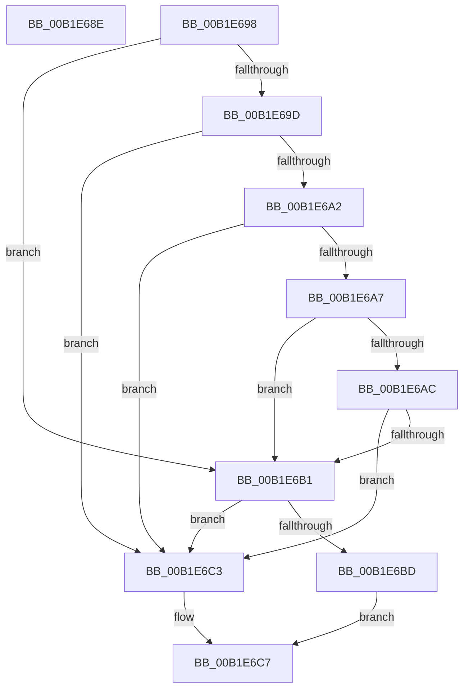

# sub_00B1E68E

- RVA: `0x00B1E68E`–`0x00B1E6D4` (길이 `70` bytes)
- VA: `0x0000000140B1E68E`
- 실행 섹션: `PAGE`
- PDB 이름 있음: `아니요`; PDB Function 태그: `아니요`
- unwind 정보 RVA: `0x00087238`
- 디코드: `22`개 명령, `70/70` bytes 표시
- 미해석 바이트: `0` (있으면 어셈블리에 `.byte`로 보존)

> 이 문서는 커널 이미지의 기계어와 PDB 기호를 분석해 생성했습니다. 4번과 5번은 함수 원형과 자료형을 바이너리 사용 방식에서 추정한 C 해석이며 원본 소스 복구 결과는 아닙니다.

## 1. Dependencies

- 직접 호출 지점: **0**; 고유 호출 대상: **0**
- 직접 호출자로 확인된 함수: **0**
- RIP 상대 이미지 참조: **0**

### Outgoing calls
- 직접 디코드된 call 명령이 없습니다.

### Direct callers
- 이 함수 시작 RVA로 연결되는 직접 call은 확인되지 않았습니다. 간접 호출은 완전히 역산할 수 없습니다.

### Static image references
- 디코드된 RIP-relative 메모리 참조가 없습니다.

## 2. Other-region calls and transfers

- 다른 실행 섹션으로 향하는 call: **0**
- call이 아닌 외부 분기/꼬리 이동: **2**
  - `0x00B1E693` → [_CmOpenCommonClassRegKeyWorker + 0x164](../8F/_CmOpenCommonClassRegKeyWorker_function_008F0A1C.md) (`tail-transfer`)
  - `0x00B1E6CF` → [_CmOpenCommonClassRegKeyWorker + 0x2D5](../8F/_CmOpenCommonClassRegKeyWorker_function_008F0A1C.md) (`tail-transfer`)

## 3. Assembly (complete function range)

```asm
00B1E68E  BB 95 00 00 C0                  mov ebx, 0xc0000095
00B1E693  E9 E8 24 DD FF                  jmp 0x1408f0b80
00B1E698  83 E9 0B                        sub ecx, 0xb
00B1E69B  74 14                           je 0x140b1e6b1
00B1E69D  83 E9 01                        sub ecx, 1
00B1E6A0  74 21                           je 0x140b1e6c3
00B1E6A2  83 E9 01                        sub ecx, 1
00B1E6A5  74 1C                           je 0x140b1e6c3
00B1E6A7  83 E9 01                        sub ecx, 1
00B1E6AA  74 05                           je 0x140b1e6b1
00B1E6AC  83 F9 01                        cmp ecx, 1
00B1E6AF  75 12                           jne 0x140b1e6c3
00B1E6B1  48 8D 46 38                     lea rax, [rsi + 0x38]
00B1E6B5  48 8B 10                        mov rdx, qword ptr [rax]
00B1E6B8  48 3B D0                        cmp rdx, rax
00B1E6BB  74 06                           je 0x140b1e6c3
00B1E6BD  48 83 C2 F0                     add rdx, -0x10
00B1E6C1  EB 04                           jmp 0x140b1e6c7
00B1E6C3  48 8B 56 58                     mov rdx, qword ptr [rsi + 0x58]
00B1E6C7  41 8B C6                        mov eax, r14d
00B1E6CA  48 89 54 C6 60                  mov qword ptr [rsi + rax*8 + 0x60], rdx
00B1E6CF  E9 1D 26 DD FF                  jmp 0x1408f0cf1
```

## 4. C-style interpretation (structured pseudocode)

```c
__int64 __fastcall sub_00B1E68E(int a1)
{
}
```

## 5. (Beta) C Style

```c
int64_t sub_00B1E68E(int32_t Arg1)
{
}
```

## 6. Execution-region graph

[열기: 2D/3D 그래프와 함수 탐색 컨트롤 패널](../../../control-panel.html?section=page&rva=0x00B1E68E&view=graph)

- 2D 그래프는 위에서 아래로 흐르고, 3D 그래프는 빈 공간을 드래그해 회전합니다. Shift+드래그는 이동, 휠은 확대·축소, 함수 노드 선택은 대상 보고서 이동입니다.

### Static fallback


