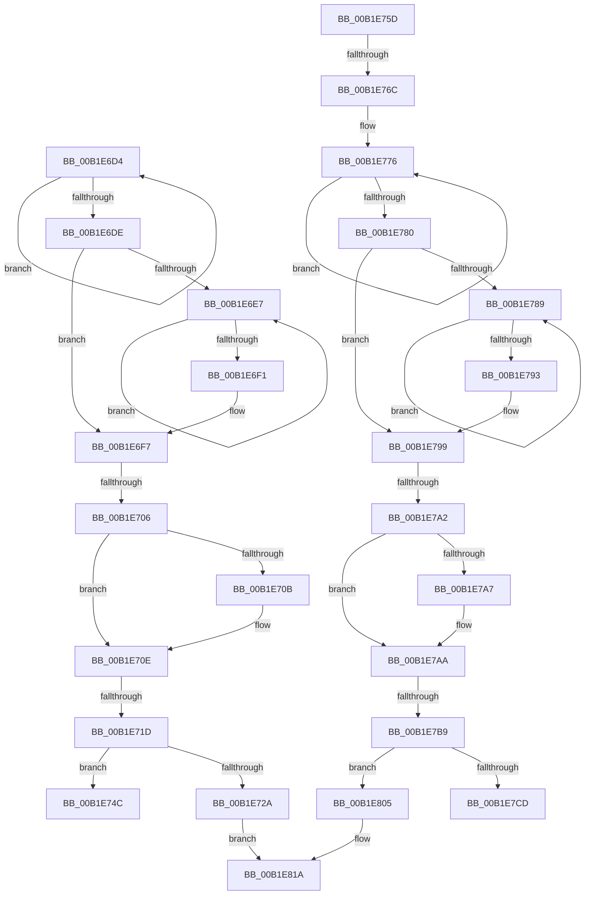

# sub_00B1E6D4

- RVA: `0x00B1E6D4`–`0x00B1E839` (길이 `357` bytes)
- VA: `0x0000000140B1E6D4`
- 실행 섹션: `PAGE`
- PDB 이름 있음: `아니요`; PDB Function 태그: `아니요`
- unwind 정보 RVA: `0x00087328`
- 디코드: `87`개 명령, `357/357` bytes 표시
- 미해석 바이트: `0` (있으면 어셈블리에 `.byte`로 보존)

> 이 문서는 커널 이미지의 기계어와 PDB 기호를 분석해 생성했습니다. 4번과 5번은 함수 원형과 자료형을 바이너리 사용 방식에서 추정한 C 해석이며 원본 소스 복구 결과는 아닙니다.

## 1. Dependencies

- 직접 호출 지점: **2**; 고유 호출 대상: **1**
- 직접 호출자로 확인된 함수: **0**
- RIP 상대 이미지 참조: **5**

### Outgoing calls
- `0x00B1E7F9` → [RtlStringCchPrintfExW](../../text/42/RtlStringCchPrintfExW_function_0042B390.md) (function, `0x0042B390`)
- `0x00B1E82D` → [RtlStringCchPrintfExW](../../text/42/RtlStringCchPrintfExW_function_0042B390.md) (function, `0x0042B390`)

### Direct callers
- 이 함수 시작 RVA로 연결되는 직접 call은 확인되지 않았습니다. 간접 호출은 완전히 역산할 수 없습니다.

### Static image references
- `0x00B1E72F` → RVA `0x00AFDE50` (` ?? ::NNGAKEGL::`string'`; read)
- `0x00B1E73B` → RVA `0x00B0D590` (` ?? ::NNGAKEGL::`string'`; read)
- `0x00B1E7C1` → RVA `0x00B0D620` (` ?? ::NNGAKEGL::`string'`; read)
- `0x00B1E7E2` → RVA `0x00B0D700` (` ?? ::NNGAKEGL::`string'`; read)
- `0x00B1E813` → RVA `0x00B0D460` (` ?? ::NNGAKEGL::`string'`; read)

## 2. Other-region calls and transfers

- 다른 실행 섹션으로 향하는 call: **2**
  - `0x00B1E7F9` → [RtlStringCchPrintfExW](../../text/42/RtlStringCchPrintfExW_function_0042B390.md) (`PAGE` → `.text`)
  - `0x00B1E82D` → [RtlStringCchPrintfExW](../../text/42/RtlStringCchPrintfExW_function_0042B390.md) (`PAGE` → `.text`)
- call이 아닌 외부 분기/꼬리 이동: **8**
  - `0x00B1E700` → [sub_008F1D09 + 0xD4](../8F/Unknown_function_008F1D09.md) (`tail-transfer`)
  - `0x00B1E717` → [sub_008F1E09 + 0x74](../8F/Unknown_function_008F1E09.md) (`tail-transfer`)
  - `0x00B1E758` → [sub_008F1E09 + 0x29](../8F/Unknown_function_008F1E09.md) (`tail-transfer`)
  - `0x00B1E766` → [sub_008F1E09 + 0x7E](../8F/Unknown_function_008F1E09.md) (`tail-transfer`)
  - `0x00B1E79C` → [sub_008F1D09 + 0xD4](../8F/Unknown_function_008F1D09.md) (`tail-transfer`)
  - `0x00B1E7B3` → [sub_008F1E09 + 0x74](../8F/Unknown_function_008F1E09.md) (`tail-transfer`)
  - `0x00B1E800` → [sub_008F1D09 + 0xD9](../8F/Unknown_function_008F1D09.md) (`tail-transfer`)
  - `0x00B1E834` → [sub_008F1D09 + 0xD9](../8F/Unknown_function_008F1D09.md) (`tail-transfer`)

## 3. Assembly (complete function range)

```asm
00B1E6D4  48 FF C0                        inc rax
00B1E6D7  66 83 3C 42 00                  cmp word ptr [rdx + rax*2], 0
00B1E6DC  75 F6                           jne 0x140b1e6d4
00B1E6DE  48 83 C0 34                     add rax, 0x34
00B1E6E2  48 85 DB                        test rbx, rbx
00B1E6E5  74 10                           je 0x140b1e6f7
00B1E6E7  48 FF C1                        inc rcx
00B1E6EA  66 83 3C 4B 00                  cmp word ptr [rbx + rcx*2], 0
00B1E6EF  75 F6                           jne 0x140b1e6e7
00B1E6F1  48 FF C0                        inc rax
00B1E6F4  48 03 C1                        add rax, rcx
00B1E6F7  41 B8 FF FF FF FF               mov r8d, 0xffffffff
00B1E6FD  49 3B C0                        cmp rax, r8
00B1E700  0F 87 D7 36 DD FF               ja 0x1408f1ddd
00B1E706  4D 85 F6                        test r14, r14
00B1E709  74 03                           je 0x140b1e70e
00B1E70B  41 89 06                        mov dword ptr [r14], eax
00B1E70E  8B 8C 24 E0 00 00 00            mov ecx, dword ptr [rsp + 0xe0]
00B1E715  3B C1                           cmp eax, ecx
00B1E717  0F 87 60 37 DD FF               ja 0x1408f1e7d
00B1E71D  45 33 C9                        xor r9d, r9d
00B1E720  45 33 C0                        xor r8d, r8d
00B1E723  8B C1                           mov eax, ecx
00B1E725  48 85 DB                        test rbx, rbx
00B1E728  74 22                           je 0x140b1e74c
00B1E72A  48 89 5C 24 40                  mov qword ptr [rsp + 0x40], rbx
00B1E72F  48 8D 0D 1A F7 FD FF            lea rcx, [rip - 0x208e6]
00B1E736  48 89 54 24 38                  mov qword ptr [rsp + 0x38], rdx
00B1E73B  48 8D 15 4E EE FE FF            lea rdx, [rip - 0x111b2]
00B1E742  48 89 54 24 30                  mov qword ptr [rsp + 0x30], rdx
00B1E747  E9 CE 00 00 00                  jmp 0x140b1e81a
00B1E74C  48 89 54 24 38                  mov qword ptr [rsp + 0x38], rdx
00B1E751  48 8D 15 38 EE FE FF            lea rdx, [rip - 0x111c8]
00B1E758  E9 D5 36 DD FF                  jmp 0x1408f1e32
00B1E75D  41 B8 FF FF FF FF               mov r8d, 0xffffffff
00B1E763  41 3B E8                        cmp ebp, r8d
00B1E766  0F 84 1B 37 DD FF               je 0x1408f1e87
00B1E76C  48 C7 C1 FF FF FF FF            mov rcx, 0xffffffffffffffff
00B1E773  48 8B C1                        mov rax, rcx
00B1E776  48 FF C0                        inc rax
00B1E779  66 83 3C 42 00                  cmp word ptr [rdx + rax*2], 0
00B1E77E  75 F6                           jne 0x140b1e776
00B1E780  48 83 C0 31                     add rax, 0x31
00B1E784  48 85 DB                        test rbx, rbx
00B1E787  74 10                           je 0x140b1e799
00B1E789  48 FF C1                        inc rcx
00B1E78C  66 83 3C 4B 00                  cmp word ptr [rbx + rcx*2], 0
00B1E791  75 F6                           jne 0x140b1e789
00B1E793  48 FF C0                        inc rax
00B1E796  48 03 C1                        add rax, rcx
00B1E799  49 3B C0                        cmp rax, r8
00B1E79C  0F 87 3B 36 DD FF               ja 0x1408f1ddd
00B1E7A2  4D 85 F6                        test r14, r14
00B1E7A5  74 03                           je 0x140b1e7aa
00B1E7A7  41 89 06                        mov dword ptr [r14], eax
00B1E7AA  8B 8C 24 E0 00 00 00            mov ecx, dword ptr [rsp + 0xe0]
00B1E7B1  3B C1                           cmp eax, ecx
00B1E7B3  0F 87 C4 36 DD FF               ja 0x1408f1e7d
00B1E7B9  45 33 C9                        xor r9d, r9d
00B1E7BC  45 33 C0                        xor r8d, r8d
00B1E7BF  8B C1                           mov eax, ecx
00B1E7C1  48 8D 0D 58 EE FE FF            lea rcx, [rip - 0x111a8]
00B1E7C8  48 85 DB                        test rbx, rbx
00B1E7CB  74 38                           je 0x140b1e805
00B1E7CD  48 89 5C 24 48                  mov qword ptr [rsp + 0x48], rbx
00B1E7D2  48 89 54 24 40                  mov qword ptr [rsp + 0x40], rdx
00B1E7D7  8B D0                           mov edx, eax
00B1E7D9  89 6C 24 38                     mov dword ptr [rsp + 0x38], ebp
00B1E7DD  48 89 4C 24 30                  mov qword ptr [rsp + 0x30], rcx
00B1E7E2  48 8D 0D 17 EF FE FF            lea rcx, [rip - 0x110e9]
00B1E7E9  48 89 4C 24 28                  mov qword ptr [rsp + 0x28], rcx
00B1E7EE  49 8B CF                        mov rcx, r15
00B1E7F1  C7 44 24 20 00 08 00 00         mov dword ptr [rsp + 0x20], 0x800
00B1E7F9  E8 92 CB 90 FF                  call 0x14042b390
00B1E7FE  8B C8                           mov ecx, eax
00B1E800  E9 DD 35 DD FF                  jmp 0x1408f1de2
00B1E805  48 89 54 24 40                  mov qword ptr [rsp + 0x40], rdx
00B1E80A  89 6C 24 38                     mov dword ptr [rsp + 0x38], ebp
00B1E80E  48 89 4C 24 30                  mov qword ptr [rsp + 0x30], rcx
00B1E813  48 8D 0D 46 EC FE FF            lea rcx, [rip - 0x113ba]
00B1E81A  48 89 4C 24 28                  mov qword ptr [rsp + 0x28], rcx
00B1E81F  48 8B D0                        mov rdx, rax
00B1E822  49 8B CF                        mov rcx, r15
00B1E825  C7 44 24 20 00 08 00 00         mov dword ptr [rsp + 0x20], 0x800
00B1E82D  E8 5E CB 90 FF                  call 0x14042b390
00B1E832  8B C8                           mov ecx, eax
00B1E834  E9 A9 35 DD FF                  jmp 0x1408f1de2
```

## 4. C-style interpretation (structured pseudocode)

```c
__int64 __fastcall sub_00B1E6D4(__int64 a1, __int64 a2, __int64 a3, int a4, __int64 a5, __int64 a6, __int64 a7, __int64 a8, __int64 a9, __int64 a10, __int64 a11, __int64 a12, __int64 a13, __int64 a14, __int64 a15, __int64 a16, __int64 a17, __int64 a18, __int64 a19, __int64 a20, __int64 a21, __int64 a22, __int64 a23, __int64 a24, __int64 a25, __int64 a26, __int64 a27, unsigned int a28)
{
    __int64 result;
    unsigned int v_stack_p20;
    unsigned __int64 v_stack_p28;
    unsigned __int64 v_stack_p30;
    unsigned __int64 v_stack_p38;
    unsigned __int64 v_stack_p40;
    unsigned __int64 v_stack_p48;
    unsigned int v_stack_pE0;

    result = (result) + 1;
    if ((*(unsigned __int16 *)(a2 + result * 2)) != 0) goto loc_00B1E6D4;
    result = (result) + (52);
    if (v_rbx == 0) goto loc_00B1E6F7;
loc_00B1E6E7:
    a1 = (a1) + 1;
    if ((*(unsigned __int16 *)(v_rbx + a1 * 2)) != 0) goto loc_00B1E6E7;
    result = (result) + 1;
    result = (result) + (a1);
loc_00B1E6F7:
    if (v_r14 != 0) {
        *(unsigned int *)(v_r14) = (unsigned int)(result);
    }
    a4 = 0;
    a3 = 0;
    if (v_rbx == 0) goto loc_00B1E74C;
    v_stack_p40 = v_rbx;
    v_stack_p38 = a2;
    v_stack_p30 = v_rip - 70066;
    goto loc_00B1E81A;
loc_00B1E74C:
    v_stack_p38 = v_rip - 70066;
loc_00B1E81A:
    v_stack_p28 = v_rip - 133350;
    v_stack_p20 = 0x800ULL;
    result = RtlStringCchPrintfExW(v_r15, (unsigned int)((unsigned int)((unsigned int)(a28))), a3, a4);
}
```

## 5. (Beta) C Style

```c
int64_t sub_00B1E6D4(int64_t Arg1, void *Arg2, int64_t Arg3, int32_t Arg4, uint64_t Arg5, uint64_t Arg6, uint64_t Arg7, uint64_t Arg8, uint64_t Arg9, uint64_t Arg10, uint64_t Arg11, uint64_t Arg12, uint64_t Arg13, uint64_t Arg14, uint64_t Arg15, uint64_t Arg16, uint64_t Arg17, uint64_t Arg18, uint64_t Arg19, uint64_t Arg20, uint64_t Arg21, uint64_t Arg22, uint64_t Arg23, uint64_t Arg24, uint64_t Arg25, uint64_t Arg26, uint64_t Arg27, uint32_t Arg28)
{
    uint8_t *arg2 = (uint8_t *)Arg2;

    int64_t result;
    uint32_t v_stack_p20;
    uint64_t v_stack_p28;
    uint64_t v_stack_p30;
    uint64_t v_stack_p38;
    uint64_t v_stack_p40;
    uint64_t v_stack_p48;
    uint32_t v_stack_pE0;

    result = (result) + 1;
    if ((*(uint16_t *)(arg2 + result * 2)) != 0) goto loc_00B1E6D4;
    result = (result) + (52);
    if (local_rbx == 0) goto loc_00B1E6F7;
loc_00B1E6E7:
    Arg1 = (Arg1) + 1;
    if ((*(uint16_t *)(local_rbx + Arg1 * 2)) != 0) goto loc_00B1E6E7;
    result = (result) + 1;
    result = (result) + (Arg1);
loc_00B1E6F7:
    if (local_r14 != 0) {
        *(uint32_t *)(local_r14) = (uint32_t)(result);
    }
    Arg4 = 0;
    Arg3 = 0;
    if (local_rbx == 0) goto loc_00B1E74C;
    v_stack_p40 = local_rbx;
    v_stack_p38 = Arg2;
    v_stack_p30 = v_rip - 70066;
    goto loc_00B1E81A;
loc_00B1E74C:
    v_stack_p38 = v_rip - 70066;
loc_00B1E81A:
    v_stack_p28 = v_rip - 133350;
    v_stack_p20 = 0x800ULL;
    result = RtlStringCchPrintfExW(local_r15, (uint32_t)((uint32_t)((uint32_t)(Arg28))), Arg3, Arg4);
}
```

### 관측된 메모리 오프셋

구조체 형식이 확인되지 않은 접근은 인자 기준의 오프셋으로만 기록했습니다.

| 기준 인자 | 오프셋 표현 | 폭 (bit) | 접근 |
|---|---:|---:|---|
| `Arg2` | `+ 0x0 + rax*2` | `16` | `R` |

## 6. Execution-region graph

[열기: 2D/3D 그래프와 함수 탐색 컨트롤 패널](../../../control-panel.html?section=page&rva=0x00B1E6D4&view=graph)

- 2D 그래프는 위에서 아래로 흐르고, 3D 그래프는 빈 공간을 드래그해 회전합니다. Shift+드래그는 이동, 휠은 확대·축소, 함수 노드 선택은 대상 보고서 이동입니다.

### Static fallback


