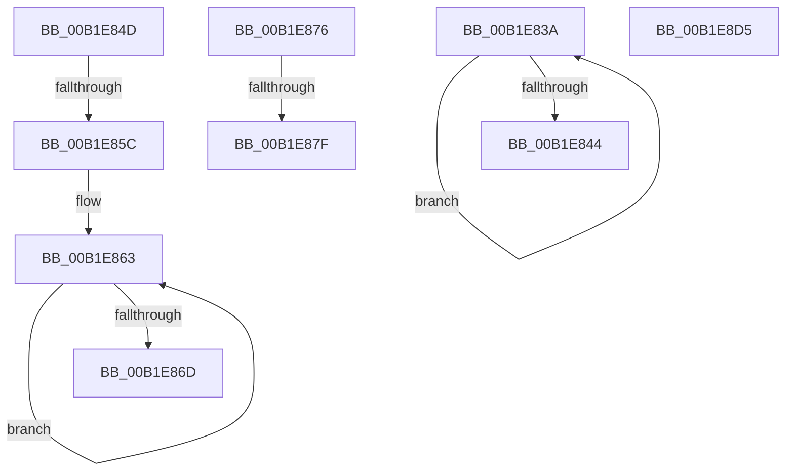

# sub_00B1E83A

- RVA: `0x00B1E83A`–`0x00B1E8E0` (길이 `166` bytes)
- VA: `0x0000000140B1E83A`
- 실행 섹션: `PAGE`
- PDB 이름 있음: `아니요`; PDB Function 태그: `아니요`
- unwind 정보 RVA: `0x00087544`
- 디코드: `38`개 명령, `166/166` bytes 표시
- 미해석 바이트: `0` (있으면 어셈블리에 `.byte`로 보존)

> 이 문서는 커널 이미지의 기계어와 PDB 기호를 분석해 생성했습니다. 4번과 5번은 함수 원형과 자료형을 바이너리 사용 방식에서 추정한 C 해석이며 원본 소스 복구 결과는 아닙니다.

## 1. Dependencies

- 직접 호출 지점: **2**; 고유 호출 대상: **2**
- 직접 호출자로 확인된 함수: **0**
- RIP 상대 이미지 참조: **3**

### Outgoing calls
- `0x00B1E8CA` → [RtlStringCchPrintfExW](../../text/42/RtlStringCchPrintfExW_function_0042B390.md) (function, `0x0042B390`)
- `0x00B1E8D5` → [RtlStringExHandleOtherFlagsW](../../text/41/RtlStringExHandleOtherFlagsW_function_0041E3F0.md) (function, `0x0041E3F0`)

### Direct callers
- 이 함수 시작 RVA로 연결되는 직접 call은 확인되지 않았습니다. 간접 호출은 완전히 역산할 수 없습니다.

### Static image references
- `0x00B1E890` → RVA `0x00B0D400` (` ?? ::NNGAKEGL::`string'`; read)
- `0x00B1E8A7` → RVA `0x00B0D620` (` ?? ::NNGAKEGL::`string'`; read)
- `0x00B1E8B6` → RVA `0x00B0D680` (` ?? ::NNGAKEGL::`string'`; read)

## 2. Other-region calls and transfers

- 다른 실행 섹션으로 향하는 call: **2**
  - `0x00B1E8CA` → [RtlStringCchPrintfExW](../../text/42/RtlStringCchPrintfExW_function_0042B390.md) (`PAGE` → `.text`)
  - `0x00B1E8D5` → [RtlStringExHandleOtherFlagsW](../../text/41/RtlStringExHandleOtherFlagsW_function_0041E3F0.md) (`PAGE` → `.text`)
- call이 아닌 외부 분기/꼬리 이동: **6**
  - `0x00B1E848` → [sub_008F246A + 0x199](../8F/Unknown_function_008F246A.md) (`tail-transfer`)
  - `0x00B1E856` → [sub_008F2936 + 0x46](../8F/Unknown_function_008F2936.md) (`tail-transfer`)
  - `0x00B1E871` → [sub_008F246A + 0x1A6](../8F/Unknown_function_008F246A.md) (`tail-transfer`)
  - `0x00B1E879` → [sub_008F246A + 0x240](../8F/Unknown_function_008F246A.md) (`tail-transfer`)
  - `0x00B1E8D0` → [sub_008F246A + 0x23E](../8F/Unknown_function_008F246A.md) (`tail-transfer`)
  - `0x00B1E8DB` → [sub_008F21BF + 0x5](../8F/Unknown_function_008F21BF.md) (`tail-transfer`)

## 3. Assembly (complete function range)

```asm
00B1E83A  48 FF C0                        inc rax
00B1E83D  66 83 3C 41 00                  cmp word ptr [rcx + rax*2], 0
00B1E842  75 F6                           jne 0x140b1e83a
00B1E844  48 83 C0 63                     add rax, 0x63
00B1E848  E9 B6 3D DD FF                  jmp 0x1408f2603
00B1E84D  41 B9 FF FF FF FF               mov r9d, 0xffffffff
00B1E853  45 3B C1                        cmp r8d, r9d
00B1E856  0F 84 20 41 DD FF               je 0x1408f297c
00B1E85C  48 8D 4D 10                     lea rcx, [rbp + 0x10]
00B1E860  49 8B C4                        mov rax, r12
00B1E863  48 FF C0                        inc rax
00B1E866  66 83 3C 41 00                  cmp word ptr [rcx + rax*2], 0
00B1E86B  75 F6                           jne 0x140b1e863
00B1E86D  48 83 C0 60                     add rax, 0x60
00B1E871  E9 9A 3D DD FF                  jmp 0x1408f2610
00B1E876  45 3B C1                        cmp r8d, r9d
00B1E879  0F 84 2B 3E DD FF               je 0x1408f26aa
00B1E87F  48 89 74 24 50                  mov qword ptr [rsp + 0x50], rsi
00B1E884  48 8D 45 10                     lea rax, [rbp + 0x10]
00B1E888  48 89 44 24 48                  mov qword ptr [rsp + 0x48], rax
00B1E88D  48 8B D7                        mov rdx, rdi
00B1E890  48 8D 05 69 EB FE FF            lea rax, [rip - 0x11497]
00B1E897  45 33 C9                        xor r9d, r9d
00B1E89A  48 89 44 24 40                  mov qword ptr [rsp + 0x40], rax
00B1E89F  49 8B CF                        mov rcx, r15
00B1E8A2  44 89 44 24 38                  mov dword ptr [rsp + 0x38], r8d
00B1E8A7  48 8D 05 72 ED FE FF            lea rax, [rip - 0x1128e]
00B1E8AE  48 89 44 24 30                  mov qword ptr [rsp + 0x30], rax
00B1E8B3  45 33 C0                        xor r8d, r8d
00B1E8B6  48 8D 05 C3 ED FE FF            lea rax, [rip - 0x1123d]
00B1E8BD  48 89 44 24 28                  mov qword ptr [rsp + 0x28], rax
00B1E8C2  C7 44 24 20 00 08 00 00         mov dword ptr [rsp + 0x20], 0x800
00B1E8CA  E8 C1 CA 90 FF                  call 0x14042b390
00B1E8CF  90                              nop
00B1E8D0  E9 D3 3D DD FF                  jmp 0x1408f26a8
00B1E8D5  E8 16 FB 8F FF                  call 0x14041e3f0
00B1E8DA  90                              nop
00B1E8DB  E9 E4 38 DD FF                  jmp 0x1408f21c4
```

## 4. C-style interpretation (structured pseudocode)

```c
__int64 __fastcall sub_00B1E83A(__int64 a1, __int64 a2, int a3)
{
    __int64 result;
    unsigned int v_stack_p20;
    unsigned __int64 v_stack_p28;
    unsigned __int64 v_stack_p30;
    unsigned int v_stack_p38;
    unsigned __int64 v_stack_p40;
    unsigned __int64 v_stack_p48;
    unsigned __int64 v_stack_p50;

    result = (result) + 1;
    if ((*(unsigned __int16 *)(a1 + result * 2)) != 0) goto loc_00B1E83A;
    result = (result) + (99);
}
```

## 5. (Beta) C Style

```c
int64_t sub_00B1E83A(void *Arg1, int64_t Arg2, int32_t Arg3)
{
    uint8_t *arg1 = (uint8_t *)Arg1;

    int64_t result;
    uint32_t v_stack_p20;
    uint64_t v_stack_p28;
    uint64_t v_stack_p30;
    uint32_t v_stack_p38;
    uint64_t v_stack_p40;
    uint64_t v_stack_p48;
    uint64_t v_stack_p50;

    result = (result) + 1;
    if ((*(uint16_t *)(arg1 + result * 2)) != 0) goto loc_00B1E83A;
    result = (result) + (99);
}
```

### 관측된 메모리 오프셋

구조체 형식이 확인되지 않은 접근은 인자 기준의 오프셋으로만 기록했습니다.

| 기준 인자 | 오프셋 표현 | 폭 (bit) | 접근 |
|---|---:|---:|---|
| `Arg1` | `+ 0x0 + rax*2` | `16` | `R` |

## 6. Execution-region graph

[열기: 2D/3D 그래프와 함수 탐색 컨트롤 패널](../../../control-panel.html?section=page&rva=0x00B1E83A&view=graph)

- 2D 그래프는 위에서 아래로 흐르고, 3D 그래프는 빈 공간을 드래그해 회전합니다. Shift+드래그는 이동, 휠은 확대·축소, 함수 노드 선택은 대상 보고서 이동입니다.

### Static fallback


