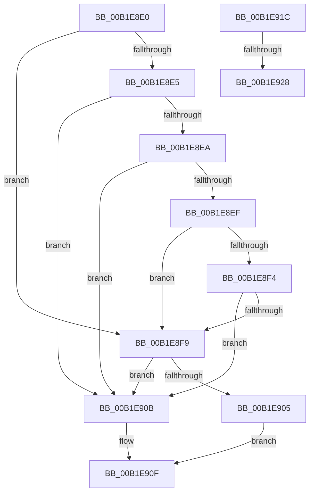

# sub_00B1E8E0

- RVA: `0x00B1E8E0`–`0x00B1E92F` (길이 `79` bytes)
- VA: `0x0000000140B1E8E0`
- 실행 섹션: `PAGE`
- PDB 이름 있음: `아니요`; PDB Function 태그: `아니요`
- unwind 정보 RVA: `0x000875A0`
- 디코드: `25`개 명령, `79/79` bytes 표시
- 미해석 바이트: `0` (있으면 어셈블리에 `.byte`로 보존)

> 이 문서는 커널 이미지의 기계어와 PDB 기호를 분석해 생성했습니다. 4번과 5번은 함수 원형과 자료형을 바이너리 사용 방식에서 추정한 C 해석이며 원본 소스 복구 결과는 아닙니다.

## 1. Dependencies

- 직접 호출 지점: **0**; 고유 호출 대상: **0**
- 직접 호출자로 확인된 함수: **0**
- RIP 상대 이미지 참조: **0**

### Outgoing calls
- 직접 디코드된 call 명령이 없습니다.

### Direct callers
- 이 함수 시작 RVA로 연결되는 직접 call은 확인되지 않았습니다. 간접 호출은 완전히 역산할 수 없습니다.

### Static image references
- 디코드된 RIP-relative 메모리 참조가 없습니다.

## 2. Other-region calls and transfers

- 다른 실행 섹션으로 향하는 call: **0**
- call이 아닌 외부 분기/꼬리 이동: **3**
  - `0x00B1E917` → [_CmOpenDeviceInterfaceRegKeyWorker + 0x21E](../8F/_CmOpenDeviceInterfaceRegKeyWorker_function_008F2B48.md) (`tail-transfer`)
  - `0x00B1E922` → [_CmOpenDeviceInterfaceRegKeyWorker + 0x28D](../8F/_CmOpenDeviceInterfaceRegKeyWorker_function_008F2B48.md) (`tail-transfer`)
  - `0x00B1E92A` → [_CmOpenDeviceInterfaceRegKeyWorker + 0x28D](../8F/_CmOpenDeviceInterfaceRegKeyWorker_function_008F2B48.md) (`tail-transfer`)

## 3. Assembly (complete function range)

```asm
00B1E8E0  83 E9 0B                        sub ecx, 0xb
00B1E8E3  74 14                           je 0x140b1e8f9
00B1E8E5  83 E9 01                        sub ecx, 1
00B1E8E8  74 21                           je 0x140b1e90b
00B1E8EA  83 E9 01                        sub ecx, 1
00B1E8ED  74 1C                           je 0x140b1e90b
00B1E8EF  83 E9 01                        sub ecx, 1
00B1E8F2  74 05                           je 0x140b1e8f9
00B1E8F4  83 F9 01                        cmp ecx, 1
00B1E8F7  75 12                           jne 0x140b1e90b
00B1E8F9  48 8D 46 38                     lea rax, [rsi + 0x38]
00B1E8FD  48 8B 10                        mov rdx, qword ptr [rax]
00B1E900  48 3B D0                        cmp rdx, rax
00B1E903  74 06                           je 0x140b1e90b
00B1E905  48 83 C2 F0                     add rdx, -0x10
00B1E909  EB 04                           jmp 0x140b1e90f
00B1E90B  48 8B 56 58                     mov rdx, qword ptr [rsi + 0x58]
00B1E90F  41 8B C6                        mov eax, r14d
00B1E912  48 89 54 C6 60                  mov qword ptr [rsi + rax*8 + 0x60], rdx
00B1E917  E9 4A 44 DD FF                  jmp 0x1408f2d66
00B1E91C  4C 8B 6D C7                     mov r13, qword ptr [rbp - 0x39]
00B1E920  85 C0                           test eax, eax
00B1E922  0F 89 AD 44 DD FF               jns 0x1408f2dd5
00B1E928  8B D8                           mov ebx, eax
00B1E92A  E9 A6 44 DD FF                  jmp 0x1408f2dd5
```

## 4. C-style interpretation (structured pseudocode)

```c
__int64 __fastcall sub_00B1E8E0(int a1)
{
    a1 = (unsigned int)((a1) - (11));
    if (condition_is_equal) goto loc_00B1E8F9;
    a1 = (unsigned int)((a1) - (1));
    if (condition_is_equal) goto loc_00B1E90B;
    a1 = (unsigned int)((a1) - (1));
    if (condition_is_equal) goto loc_00B1E90B;
    a1 = (unsigned int)((a1) - (1));
    if (condition_is_equal) goto loc_00B1E8F9;
    if (a1 != 1) goto loc_00B1E90B;
loc_00B1E8F9:
    if ((*(unsigned __int64 *)(v_rsi + 56)) == (v_rsi + 56)) goto loc_00B1E90B;
    a2 = (*(unsigned __int64 *)(v_rsi + 56)) + (-16);
    goto loc_00B1E90F;
loc_00B1E90B:
loc_00B1E90F:
    *(unsigned __int64 *)(v_rsi + (unsigned int)((unsigned int)(v_r14)) * 8 + 96) = *(unsigned __int64 *)(v_rsi + 88);
}
```

## 5. (Beta) C Style

```c
int64_t sub_00B1E8E0(int32_t Arg1)
{
    Arg1 = (uint32_t)((Arg1) - (11));
    if (condition_is_equal) goto loc_00B1E8F9;
    Arg1 = (uint32_t)((Arg1) - (1));
    if (condition_is_equal) goto loc_00B1E90B;
    Arg1 = (uint32_t)((Arg1) - (1));
    if (condition_is_equal) goto loc_00B1E90B;
    Arg1 = (uint32_t)((Arg1) - (1));
    if (condition_is_equal) goto loc_00B1E8F9;
    if (Arg1 != 1) goto loc_00B1E90B;
loc_00B1E8F9:
    if ((*(uint64_t *)(local_rsi + 0x38)) == (local_rsi + 56)) goto loc_00B1E90B;
    a2 = (*(uint64_t *)(local_rsi + 0x38)) + (-16);
    goto loc_00B1E90F;
loc_00B1E90B:
loc_00B1E90F:
    *(uint64_t *)(local_rsi + (uint32_t)((uint32_t)(local_r14)) * 8 + 0x60) = *(uint64_t *)(local_rsi + 0x58);
}
```

## 6. Execution-region graph

[열기: 2D/3D 그래프와 함수 탐색 컨트롤 패널](../../../control-panel.html?section=page&rva=0x00B1E8E0&view=graph)

- 2D 그래프는 위에서 아래로 흐르고, 3D 그래프는 빈 공간을 드래그해 회전합니다. Shift+드래그는 이동, 휠은 확대·축소, 함수 노드 선택은 대상 보고서 이동입니다.

### Static fallback


