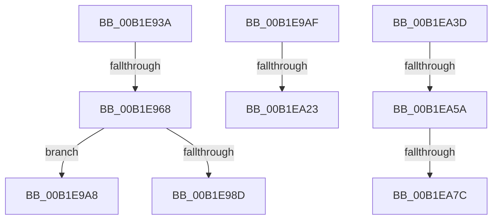

# sub_00B1E93A

- RVA: `0x00B1E93A`–`0x00B1EAA5` (길이 `363` bytes)
- VA: `0x0000000140B1E93A`
- 실행 섹션: `PAGE`
- PDB 이름 있음: `아니요`; PDB Function 태그: `아니요`
- unwind 정보 RVA: `0x00087768`
- 디코드: `90`개 명령, `363/363` bytes 표시
- 미해석 바이트: `0` (있으면 어셈블리에 `.byte`로 보존)

> 이 문서는 커널 이미지의 기계어와 PDB 기호를 분석해 생성했습니다. 4번과 5번은 함수 원형과 자료형을 바이너리 사용 방식에서 추정한 C 해석이며 원본 소스 복구 결과는 아닙니다.

## 1. Dependencies

- 직접 호출 지점: **14**; 고유 호출 대상: **8**
- 직접 호출자로 확인된 함수: **0**
- RIP 상대 이미지 참조: **3**

### Outgoing calls
- `0x00B1E957` → [RtlStringCchPrintfW](../../text/48/RtlStringCchPrintfW_function_00482D5C.md) (function, `0x00482D5C`)
- `0x00B1E970` → [RtlInitUnicodeString](../../text/42/RtlInitUnicodeString_function_0042A780.md) (function, `0x0042A780`)
- `0x00B1E982` → [RtlGetCurrentServiceSessionId](../../text/22/RtlGetCurrentServiceSessionId_function_00225070.md) (function, `0x00225070`)
- `0x00B1E998` → [RtlInitUnicodeString](../../text/42/RtlInitUnicodeString_function_0042A780.md) (function, `0x0042A780`)
- `0x00B1E9B7` → [RtlSubAuthoritySid](../../text/45/RtlSubAuthoritySid_function_00456D10.md) (function, `0x00456D10`)
- `0x00B1E9C7` → [RtlSubAuthoritySid](../../text/45/RtlSubAuthoritySid_function_00456D10.md) (function, `0x00456D10`)
- `0x00B1E9D7` → [RtlSubAuthoritySid](../../text/45/RtlSubAuthoritySid_function_00456D10.md) (function, `0x00456D10`)
- `0x00B1E9E7` → [RtlSubAuthoritySid](../../text/45/RtlSubAuthoritySid_function_00456D10.md) (function, `0x00456D10`)
- `0x00B1EA12` → [RtlStringCchPrintfW](../../text/48/RtlStringCchPrintfW_function_00482D5C.md) (function, `0x00482D5C`)
- `0x00B1EA2E` → [RtlInitUnicodeString](../../text/42/RtlInitUnicodeString_function_0042A780.md) (function, `0x0042A780`)
- `0x00B1EA4D` → [RtlGetAppContainerParent](../78/RtlGetAppContainerParent_function_0078E4A0.md) (function, `0x0078E4A0`)
- `0x00B1EA6D` → [RtlConvertSidToUnicodeString](../92/RtlConvertSidToUnicodeString_function_00927B30.md) (function, `0x00927B30`)
- `0x00B1EA88` → [RtlEqualUnicodeString](../93/RtlEqualUnicodeString_function_00932A20.md) (function, `0x00932A20`)
- `0x00B1EA93` → [RtlFreeAnsiString](../9C/RtlFreeAnsiString_function_009C0800.md) (function, `0x009C0800`)

### Direct callers
- 이 함수 시작 RVA로 연결되는 직접 call은 확인되지 않았습니다. 간접 호출은 완전히 역산할 수 없습니다.

### Static image references
- `0x00B1E942` → RVA `0x00B06150` (` ?? ::NNGAKEGL::`string'`; read)
- `0x00B1E98D` → RVA `0x00037C48` (`.rdata`; read)
- `0x00B1E9EE` → RVA `0x00B06170` (` ?? ::NNGAKEGL::`string'`; read)

## 2. Other-region calls and transfers

- 다른 실행 섹션으로 향하는 call: **10**
  - `0x00B1E957` → [RtlStringCchPrintfW](../../text/48/RtlStringCchPrintfW_function_00482D5C.md) (`PAGE` → `.text`)
  - `0x00B1E970` → [RtlInitUnicodeString](../../text/42/RtlInitUnicodeString_function_0042A780.md) (`PAGE` → `.text`)
  - `0x00B1E982` → [RtlGetCurrentServiceSessionId](../../text/22/RtlGetCurrentServiceSessionId_function_00225070.md) (`PAGE` → `.text`)
  - `0x00B1E998` → [RtlInitUnicodeString](../../text/42/RtlInitUnicodeString_function_0042A780.md) (`PAGE` → `.text`)
  - `0x00B1E9B7` → [RtlSubAuthoritySid](../../text/45/RtlSubAuthoritySid_function_00456D10.md) (`PAGE` → `.text`)
  - `0x00B1E9C7` → [RtlSubAuthoritySid](../../text/45/RtlSubAuthoritySid_function_00456D10.md) (`PAGE` → `.text`)
  - `0x00B1E9D7` → [RtlSubAuthoritySid](../../text/45/RtlSubAuthoritySid_function_00456D10.md) (`PAGE` → `.text`)
  - `0x00B1E9E7` → [RtlSubAuthoritySid](../../text/45/RtlSubAuthoritySid_function_00456D10.md) (`PAGE` → `.text`)
  - `0x00B1EA12` → [RtlStringCchPrintfW](../../text/48/RtlStringCchPrintfW_function_00482D5C.md) (`PAGE` → `.text`)
  - `0x00B1EA2E` → [RtlInitUnicodeString](../../text/42/RtlInitUnicodeString_function_0042A780.md) (`PAGE` → `.text`)
- call이 아닌 외부 분기/꼬리 이동: **8**
  - `0x00B1E962` → [SepValidateReferencedCachedHandles + 0x1A3](../8F/SepValidateReferencedCachedHandles_function_008F4BB0.md) (`tail-transfer`)
  - `0x00B1E9A3` → [SepValidateReferencedCachedHandles + 0x370](../8F/SepValidateReferencedCachedHandles_function_008F4BB0.md) (`tail-transfer`)
  - `0x00B1E9AA` → [SepValidateReferencedCachedHandles + 0x37B](../8F/SepValidateReferencedCachedHandles_function_008F4BB0.md) (`tail-transfer`)
  - `0x00B1EA1D` → [SepValidateReferencedCachedHandles + 0x1A3](../8F/SepValidateReferencedCachedHandles_function_008F4BB0.md) (`tail-transfer`)
  - `0x00B1EA38` → [SepValidateReferencedCachedHandles + 0x31A](../8F/SepValidateReferencedCachedHandles_function_008F4BB0.md) (`tail-transfer`)
  - `0x00B1EA54` → [SepValidateReferencedCachedHandles + 0x19E](../8F/SepValidateReferencedCachedHandles_function_008F4BB0.md) (`tail-transfer`)
  - `0x00B1EA76` → [SepValidateReferencedCachedHandles + 0x385](../8F/SepValidateReferencedCachedHandles_function_008F4BB0.md) (`tail-transfer`)
  - `0x00B1EAA0` → [SepValidateReferencedCachedHandles + 0x385](../8F/SepValidateReferencedCachedHandles_function_008F4BB0.md) (`tail-transfer`)

## 3. Assembly (complete function range)

```asm
00B1E93A  45 8B 4D 78                     mov r9d, dword ptr [r13 + 0x78]
00B1E93E  49 8D 5F 08                     lea rbx, [r15 + 8]
00B1E942  4C 8D 05 07 78 FE FF            lea r8, [rip - 0x187f9]
00B1E949  48 89 5C 24 50                  mov qword ptr [rsp + 0x50], rbx
00B1E94E  BA 00 01 00 00                  mov edx, 0x100
00B1E953  48 8D 4D D0                     lea rcx, [rbp - 0x30]
00B1E957  E8 00 44 96 FF                  call 0x140482d5c
00B1E95C  33 DB                           xor ebx, ebx
00B1E95E  8B F8                           mov edi, eax
00B1E960  85 C0                           test eax, eax
00B1E962  0F 88 EB 63 DD FF               js 0x1408f4d53
00B1E968  48 8D 55 D0                     lea rdx, [rbp - 0x30]
00B1E96C  48 8D 4D A0                     lea rcx, [rbp - 0x60]
00B1E970  E8 0B BE 90 FF                  call 0x14042a780
00B1E975  44 8D 63 01                     lea r12d, [rbx + 1]
00B1E979  C6 45 B0 01                     mov byte ptr [rbp - 0x50], 1
00B1E97D  44 89 64 24 48                  mov dword ptr [rsp + 0x48], r12d
00B1E982  E8 E9 66 70 FF                  call 0x140225070
00B1E987  41 39 45 78                     cmp dword ptr [r13 + 0x78], eax
00B1E98B  75 1B                           jne 0x140b1e9a8
00B1E98D  48 8D 15 B4 92 51 FF            lea rdx, [rip - 0xae6d4c]
00B1E994  48 8D 4D B8                     lea rcx, [rbp - 0x48]
00B1E998  E8 E3 BD 90 FF                  call 0x14042a780
00B1E99D  8B D3                           mov edx, ebx
00B1E99F  44 88 65 C8                     mov byte ptr [rbp - 0x38], r12b
00B1E9A3  E9 78 65 DD FF                  jmp 0x1408f4f20
00B1E9A8  8B D3                           mov edx, ebx
00B1E9AA  E9 7C 65 DD FF                  jmp 0x1408f4f2b
00B1E9AF  BA 0B 00 00 00                  mov edx, 0xb
00B1E9B4  49 8B CC                        mov rcx, r12
00B1E9B7  E8 54 83 93 FF                  call 0x140456d10
00B1E9BC  BA 0A 00 00 00                  mov edx, 0xa
00B1E9C1  49 8B CC                        mov rcx, r12
00B1E9C4  48 8B F0                        mov rsi, rax
00B1E9C7  E8 44 83 93 FF                  call 0x140456d10
00B1E9CC  BA 09 00 00 00                  mov edx, 9
00B1E9D1  49 8B CC                        mov rcx, r12
00B1E9D4  48 8B F8                        mov rdi, rax
00B1E9D7  E8 34 83 93 FF                  call 0x140456d10
00B1E9DC  BA 08 00 00 00                  mov edx, 8
00B1E9E1  49 8B CC                        mov rcx, r12
00B1E9E4  48 8B D8                        mov rbx, rax
00B1E9E7  E8 24 83 93 FF                  call 0x140456d10
00B1E9EC  8B 0E                           mov ecx, dword ptr [rsi]
00B1E9EE  4C 8D 05 7B 77 FE FF            lea r8, [rip - 0x18885]
00B1E9F5  89 4C 24 30                     mov dword ptr [rsp + 0x30], ecx
00B1E9F9  49 8B D7                        mov rdx, r15
00B1E9FC  8B 0F                           mov ecx, dword ptr [rdi]
00B1E9FE  44 8B 08                        mov r9d, dword ptr [rax]
00B1EA01  89 4C 24 28                     mov dword ptr [rsp + 0x28], ecx
00B1EA05  8B 0B                           mov ecx, dword ptr [rbx]
00B1EA07  89 4C 24 20                     mov dword ptr [rsp + 0x20], ecx
00B1EA0B  48 8D 8D D0 01 00 00            lea rcx, [rbp + 0x1d0]
00B1EA12  E8 45 43 96 FF                  call 0x140482d5c
00B1EA17  33 DB                           xor ebx, ebx
00B1EA19  8B F8                           mov edi, eax
00B1EA1B  85 C0                           test eax, eax
00B1EA1D  0F 88 30 63 DD FF               js 0x1408f4d53
00B1EA23  48 8D 95 D0 01 00 00            lea rdx, [rbp + 0x1d0]
00B1EA2A  48 8D 4D 90                     lea rcx, [rbp - 0x70]
00B1EA2E  E8 4D BD 90 FF                  call 0x14042a780
00B1EA33  48 8B 74 24 60                  mov rsi, qword ptr [rsp + 0x60]
00B1EA38  E9 8D 64 DD FF                  jmp 0x1408f4eca
00B1EA3D  49 8B 4F 08                     mov rcx, qword ptr [r15 + 8]
00B1EA41  48 8D 54 24 50                  lea rdx, [rsp + 0x50]
00B1EA46  33 DB                           xor ebx, ebx
00B1EA48  48 89 5C 24 50                  mov qword ptr [rsp + 0x50], rbx
00B1EA4D  E8 4E FA C6 FF                  call 0x14078e4a0
00B1EA52  85 C0                           test eax, eax
00B1EA54  0F 88 F4 62 DD FF               js 0x1408f4d4e
00B1EA5A  48 8B 54 24 50                  mov rdx, qword ptr [rsp + 0x50]
00B1EA5F  48 8D 4D 80                     lea rcx, [rbp - 0x80]
00B1EA63  0F 57 C0                        xorps xmm0, xmm0
00B1EA66  41 B0 01                        mov r8b, 1
00B1EA69  0F 11 45 80                     movups xmmword ptr [rbp - 0x80], xmm0
00B1EA6D  E8 BE 90 E0 FF                  call 0x140927b30
00B1EA72  8B F8                           mov edi, eax
00B1EA74  85 C0                           test eax, eax
00B1EA76  0F 88 B9 64 DD FF               js 0x1408f4f35
00B1EA7C  41 B0 01                        mov r8b, 1
00B1EA7F  48 8D 55 80                     lea rdx, [rbp - 0x80]
00B1EA83  48 8D 4C 24 70                  lea rcx, [rsp + 0x70]
00B1EA88  E8 93 3F E1 FF                  call 0x140932a20
00B1EA8D  48 8D 4D 80                     lea rcx, [rbp - 0x80]
00B1EA91  8A D8                           mov bl, al
00B1EA93  E8 68 1D EA FF                  call 0x1409c0800
00B1EA98  84 DB                           test bl, bl
00B1EA9A  40 0F 95 C6                     setne sil
00B1EA9E  33 DB                           xor ebx, ebx
00B1EAA0  E9 90 64 DD FF                  jmp 0x1408f4f35
```

## 4. C-style interpretation (structured pseudocode)

```c
__int64 __fastcall sub_00B1E93A(void)
{
    __int64 result;
    __int64 v_rbx;
    unsigned int v_stack_p20;
    unsigned int v_stack_p28;
    unsigned int v_stack_p30;
    unsigned int v_stack_p48;
    unsigned __int64 v_stack_p50;
    unsigned __int64 v_stack_p60;
    unsigned __int64 v_stack_p70;

    v_stack_p50 = v_r15 + 8;
    result = RtlStringCchPrintfW(v_rbp - 48, 256, v_rip - 100345, (unsigned int)(*(unsigned int *)(v_r13 + 120)));
    v_rbx = 0;
    result = RtlInitUnicodeString(v_rbp - 96, v_rbp - 48, v_rip - 100345, (unsigned int)(*(unsigned int *)(v_r13 + 120)));
    *(unsigned __int8 *)(v_rbp - 80) = 1;
    v_stack_p48 = (unsigned int)(v_rbx + 1);
    result = RtlGetCurrentServiceSessionId(v_rbp - 96, v_rbp - 48, v_rip - 100345, (unsigned int)(*(unsigned int *)(v_r13 + 120)));
    if ((*(unsigned int *)(v_r13 + 120)) != ((unsigned int)(result))) goto loc_00B1E9A8;
    result = RtlInitUnicodeString(v_rbp - 72, v_rip - 11431244, v_rip - 100345, (unsigned int)(*(unsigned int *)(v_r13 + 120)));
    *(unsigned __int8 *)(v_rbp - 56) = (unsigned __int8)(v_rbx + 1);
loc_00B1E9A8:
}
```

## 5. (Beta) C Style

```c
void sub_00B1E93A(void)
{
    int64_t result;
    int64_t local_rbx;
    uint32_t v_stack_p20;
    uint32_t v_stack_p28;
    uint32_t v_stack_p30;
    uint32_t v_stack_p48;
    uint64_t v_stack_p50;
    uint64_t v_stack_p60;
    uint64_t v_stack_p70;

    v_stack_p50 = local_r15 + 8;
    result = RtlStringCchPrintfW(local_rbp - 48, 256, v_rip - 100345, (uint32_t)(*(uint32_t *)(local_r13 + 0x78)));
    local_rbx = 0;
    result = RtlInitUnicodeString(local_rbp - 96, local_rbp - 48, v_rip - 100345, (uint32_t)(*(uint32_t *)(local_r13 + 0x78)));
    *(uint8_t *)(local_rbp - 0x50) = 1;
    v_stack_p48 = (uint32_t)(local_rbx + 1);
    result = RtlGetCurrentServiceSessionId(local_rbp - 96, local_rbp - 48, v_rip - 100345, (uint32_t)(*(uint32_t *)(local_r13 + 0x78)));
    if ((*(uint32_t *)(local_r13 + 0x78)) != ((uint32_t)(result))) goto loc_00B1E9A8;
    result = RtlInitUnicodeString(local_rbp - 72, v_rip - 11431244, v_rip - 100345, (uint32_t)(*(uint32_t *)(local_r13 + 0x78)));
    *(uint8_t *)(local_rbp - 0x38) = (uint8_t)(local_rbx + 1);
loc_00B1E9A8:
}
```

## 6. Execution-region graph

[열기: 2D/3D 그래프와 함수 탐색 컨트롤 패널](../../../control-panel.html?section=page&rva=0x00B1E93A&view=graph)

- 2D 그래프는 위에서 아래로 흐르고, 3D 그래프는 빈 공간을 드래그해 회전합니다. Shift+드래그는 이동, 휠은 확대·축소, 함수 노드 선택은 대상 보고서 이동입니다.

### Static fallback


