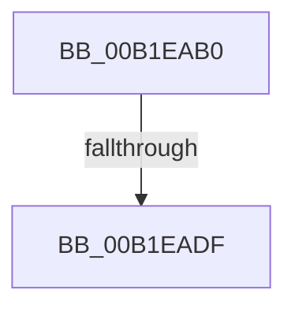

# sub_00B1EAB0

- RVA: `0x00B1EAB0`–`0x00B1EB0D` (길이 `93` bytes)
- VA: `0x0000000140B1EAB0`
- 실행 섹션: `PAGE`
- PDB 이름 있음: `아니요`; PDB Function 태그: `아니요`
- unwind 정보 RVA: `0x0008780C`
- 디코드: `23`개 명령, `93/93` bytes 표시
- 미해석 바이트: `0` (있으면 어셈블리에 `.byte`로 보존)

> 이 문서는 커널 이미지의 기계어와 PDB 기호를 분석해 생성했습니다. 4번과 5번은 함수 원형과 자료형을 바이너리 사용 방식에서 추정한 C 해석이며 원본 소스 복구 결과는 아닙니다.

## 1. Dependencies

- 직접 호출 지점: **3**; 고유 호출 대상: **3**
- 직접 호출자로 확인된 함수: **0**
- RIP 상대 이미지 참조: **0**

### Outgoing calls
- `0x00B1EAB5` → [ExFreePoolWithTag](../../poolcode/B8/ExFreePoolWithTag_function_00B82870.md) (function, `0x00B82870`)
- `0x00B1EACE` → [ExAllocatePool2](../../poolcode/B8/ExAllocatePool2_function_00B820F0.md) (function, `0x00B820F0`)
- `0x00B1EB01` → [CmGetDeviceInterfaceName](../8F/CmGetDeviceInterfaceName_function_008F3870.md) (function, `0x008F3870`)

### Direct callers
- 이 함수 시작 RVA로 연결되는 직접 call은 확인되지 않았습니다. 간접 호출은 완전히 역산할 수 없습니다.

### Static image references
- 디코드된 RIP-relative 메모리 참조가 없습니다.

## 2. Other-region calls and transfers

- 다른 실행 섹션으로 향하는 call: **2**
  - `0x00B1EAB5` → [ExFreePoolWithTag](../../poolcode/B8/ExFreePoolWithTag_function_00B82870.md) (`PAGE` → `POOLCODE`)
  - `0x00B1EACE` → [ExAllocatePool2](../../poolcode/B8/ExAllocatePool2_function_00B820F0.md) (`PAGE` → `POOLCODE`)
- call이 아닌 외부 분기/꼬리 이동: **2**
  - `0x00B1EAD9` → [IoGetDeviceInterfaceAlias + 0x3FD](../8F/IoGetDeviceInterfaceAlias_function_008F5570.md) (`tail-transfer`)
  - `0x00B1EB08` → [IoGetDeviceInterfaceAlias + 0x301](../8F/IoGetDeviceInterfaceAlias_function_008F5570.md) (`tail-transfer`)

## 3. Assembly (complete function range)

```asm
00B1EAB0  33 D2                           xor edx, edx
00B1EAB2  48 8B CF                        mov rcx, rdi
00B1EAB5  E8 B6 3D 06 00                  call 0x140b82870
00B1EABA  8B 5C 24 68                     mov ebx, dword ptr [rsp + 0x68]
00B1EABE  B9 00 01 00 00                  mov ecx, 0x100
00B1EAC3  8B D3                           mov edx, ebx
00B1EAC5  41 B8 50 70 20 20               mov r8d, 0x20207050
00B1EACB  48 03 D2                        add rdx, rdx
00B1EACE  E8 1D 36 06 00                  call 0x140b820f0
00B1EAD3  48 8B F8                        mov rdi, rax
00B1EAD6  48 85 C0                        test rax, rax
00B1EAD9  0F 84 8E 6E DD FF               je 0x1408f596d
00B1EADF  48 8D 44 24 68                  lea rax, [rsp + 0x68]
00B1EAE4  4C 8B CE                        mov r9, rsi
00B1EAE7  48 89 44 24 38                  mov qword ptr [rsp + 0x38], rax
00B1EAEC  48 8D 55 B0                     lea rdx, [rbp - 0x50]
00B1EAF0  89 5C 24 30                     mov dword ptr [rsp + 0x30], ebx
00B1EAF4  4D 8B C6                        mov r8, r14
00B1EAF7  48 89 7C 24 28                  mov qword ptr [rsp + 0x28], rdi
00B1EAFC  44 88 64 24 20                  mov byte ptr [rsp + 0x20], r12b
00B1EB01  E8 6A 4D DD FF                  call 0x1408f3870
00B1EB06  8B D8                           mov ebx, eax
00B1EB08  E9 64 6D DD FF                  jmp 0x1408f5871
```

## 4. C-style interpretation (structured pseudocode)

```c
__int64 __fastcall sub_00B1EAB0(__int64 a1, int a2, __int64 a3, __int64 a4, __int64 a5, __int64 a6, __int64 a7, __int64 a8, __int64 a9, __int64 a10, __int64 a11, __int64 a12, unsigned int a13)
{
    __int64 result;
    unsigned __int8 v_stack_p20;
    unsigned __int64 v_stack_p28;
    unsigned int v_stack_p30;
    unsigned __int64 v_stack_p38;

    a2 = 0;
    result = ExFreePoolWithTag(v_rdi, a2, a3, a4);
    a2 = ((unsigned int)((unsigned int)((unsigned int)(a13)))) + ((unsigned int)((unsigned int)((unsigned int)(a13))));
    result = ExAllocatePool2(256, a2, (unsigned int)(0x20207050ULL), a4);
    v_stack_p38 = a13;
    v_stack_p30 = (unsigned int)((unsigned int)(a13));
    v_stack_p28 = result;
    v_stack_p20 = (unsigned __int8)(v_r12);
    result = CmGetDeviceInterfaceName(256, v_rbp - 80, v_r14, v_rsi);
}
```

## 5. (Beta) C Style

```c
int64_t sub_00B1EAB0(int64_t Arg1, int32_t Arg2, int64_t Arg3, int64_t Arg4, uint64_t Arg5, uint64_t Arg6, uint64_t Arg7, uint64_t Arg8, uint64_t Arg9, uint64_t Arg10, uint64_t Arg11, uint64_t Arg12, uint32_t Arg13)
{
    int64_t result;
    uint8_t v_stack_p20;
    uint64_t v_stack_p28;
    uint32_t v_stack_p30;
    uint64_t v_stack_p38;

    Arg2 = 0;
    result = ExFreePoolWithTag(local_rdi, Arg2, Arg3, Arg4);
    Arg2 = ((uint32_t)((uint32_t)((uint32_t)(Arg13)))) + ((uint32_t)((uint32_t)((uint32_t)(Arg13))));
    result = ExAllocatePool2(256, Arg2, (uint32_t)(0x20207050ULL), Arg4);
    v_stack_p38 = Arg13;
    v_stack_p30 = (uint32_t)((uint32_t)(Arg13));
    v_stack_p28 = result;
    v_stack_p20 = (uint8_t)(local_r12);
    result = CmGetDeviceInterfaceName(256, local_rbp - 80, local_r14, local_rsi);
}
```

## 6. Execution-region graph

[열기: 2D/3D 그래프와 함수 탐색 컨트롤 패널](../../../control-panel.html?section=page&rva=0x00B1EAB0&view=graph)

- 2D 그래프는 위에서 아래로 흐르고, 3D 그래프는 빈 공간을 드래그해 회전합니다. Shift+드래그는 이동, 휠은 확대·축소, 함수 노드 선택은 대상 보고서 이동입니다.

### Static fallback


