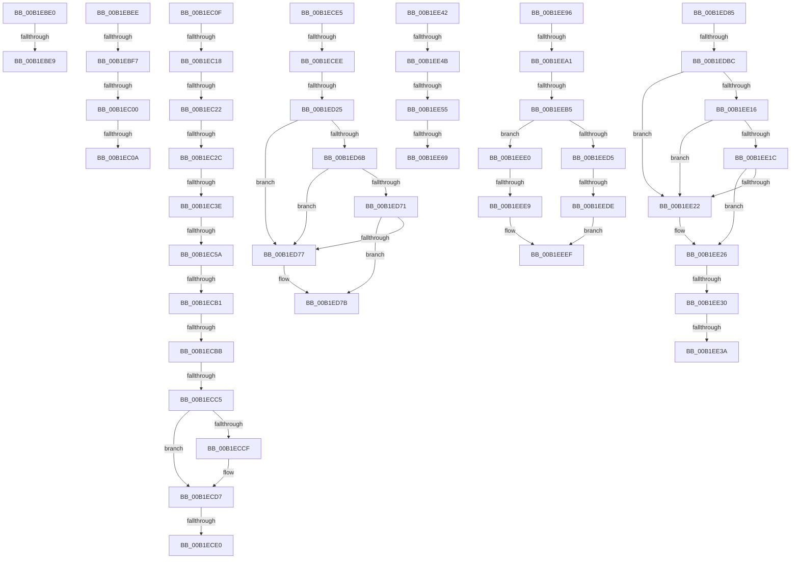

# sub_00B1EBE0

- RVA: `0x00B1EBE0`–`0x00B1EF01` (길이 `801` bytes)
- VA: `0x0000000140B1EBE0`
- 실행 섹션: `PAGE`
- PDB 이름 있음: `아니요`; PDB Function 태그: `아니요`
- unwind 정보 RVA: `0x00087950`
- 디코드: `187`개 명령, `801/801` bytes 표시
- 미해석 바이트: `0` (있으면 어셈블리에 `.byte`로 보존)

> 이 문서는 커널 이미지의 기계어와 PDB 기호를 분석해 생성했습니다. 4번과 5번은 함수 원형과 자료형을 바이너리 사용 방식에서 추정한 C 해석이며 원본 소스 복구 결과는 아닙니다.

## 1. Dependencies

- 직접 호출 지점: **14**; 고유 호출 대상: **8**
- 직접 호출자로 확인된 함수: **0**
- RIP 상대 이미지 참조: **3**

### Outgoing calls
- `0x00B1EC4D` → [CmSplitDevicePanelId](../AC/CmSplitDevicePanelId_function_00ACEA18.md) (function, `0x00ACEA18`)
- `0x00B1ECA4` → [PnpGetObjectProperty](../8E/PnpGetObjectProperty_function_008E2180.md) (function, `0x008E2180`)
- `0x00B1ED08` → [ExAcquireResourceExclusiveLite](../../text/21/ExAcquireResourceExclusiveLite_function_00214E20.md) (function, `0x00214E20`)
- `0x00B1ED18` → [SeAuditingWithTokenForSubcategory](../90/SeAuditingWithTokenForSubcategory_function_009047D0.md) (function, `0x009047D0`)
- `0x00B1ED62` → [CmGetDeviceRegProp](../8E/CmGetDeviceRegProp_function_008ED870.md) (function, `0x008ED870`)
- `0x00B1ED9F` → [ExAcquireResourceExclusiveLite](../../text/21/ExAcquireResourceExclusiveLite_function_00214E20.md) (function, `0x00214E20`)
- `0x00B1EDAF` → [SeAuditingWithTokenForSubcategory](../90/SeAuditingWithTokenForSubcategory_function_009047D0.md) (function, `0x009047D0`)
- `0x00B1EE0D` → [PnpGetObjectProperty](../8E/PnpGetObjectProperty_function_008E2180.md) (function, `0x008E2180`)
- `0x00B1EE5C` → [SeAuditingWithTokenForSubcategory](../90/SeAuditingWithTokenForSubcategory_function_009047D0.md) (function, `0x009047D0`)
- `0x00B1EE70` → [RtlInitUnicodeString](../../text/42/RtlInitUnicodeString_function_0042A780.md) (function, `0x0042A780`)
- `0x00B1EE8B` → [PiAuditDeviceEnableDisableRequest](../74/PiAuditDeviceEnableDisableRequest_function_00740AB8.md) (function, `0x00740AB8`)
- `0x00B1EEA8` → [SeAuditingWithTokenForSubcategory](../90/SeAuditingWithTokenForSubcategory_function_009047D0.md) (function, `0x009047D0`)
- `0x00B1EEBC` → [RtlInitUnicodeString](../../text/42/RtlInitUnicodeString_function_0042A780.md) (function, `0x0042A780`)
- `0x00B1EEF6` → [PiAuditDeviceOperation](../A8/PiAuditDeviceOperation_function_00A864DC.md) (function, `0x00A864DC`)

### Direct callers
- 이 함수 시작 RVA로 연결되는 직접 call은 확인되지 않았습니다. 간접 호출은 완전히 역산할 수 없습니다.

### Static image references
- `0x00B1EC93` → RVA `0x00011568` (`.rdata`; read)
- `0x00B1ECF7` → RVA `0x00F8C600` (`.data`; read)
- `0x00B1EDF0` → RVA `0x000116B8` (`.rdata`; read)

## 2. Other-region calls and transfers

- 다른 실행 섹션으로 향하는 call: **4**
  - `0x00B1ED08` → [ExAcquireResourceExclusiveLite](../../text/21/ExAcquireResourceExclusiveLite_function_00214E20.md) (`PAGE` → `.text`)
  - `0x00B1ED9F` → [ExAcquireResourceExclusiveLite](../../text/21/ExAcquireResourceExclusiveLite_function_00214E20.md) (`PAGE` → `.text`)
  - `0x00B1EE70` → [RtlInitUnicodeString](../../text/42/RtlInitUnicodeString_function_0042A780.md) (`PAGE` → `.text`)
  - `0x00B1EEBC` → [RtlInitUnicodeString](../../text/42/RtlInitUnicodeString_function_0042A780.md) (`PAGE` → `.text`)
- call이 아닌 외부 분기/꼬리 이동: **32**
  - `0x00B1EBE3` → [PiPnpRtlSetObjectProperty + 0xE0](../8F/PiPnpRtlSetObjectProperty_function_008F62A0.md) (`tail-transfer`)
  - `0x00B1EBE9` → [PiPnpRtlSetObjectProperty + 0x285](../8F/PiPnpRtlSetObjectProperty_function_008F62A0.md) (`tail-transfer`)
  - `0x00B1EBF1` → [PiPnpRtlSetObjectProperty + 0x1FF](../8F/PiPnpRtlSetObjectProperty_function_008F62A0.md) (`tail-transfer`)
  - `0x00B1EBFA` → [PiPnpRtlSetObjectProperty + 0x2ED](../8F/PiPnpRtlSetObjectProperty_function_008F62A0.md) (`tail-transfer`)
  - `0x00B1EC04` → [PiPnpRtlSetObjectProperty + 0x1FF](../8F/PiPnpRtlSetObjectProperty_function_008F62A0.md) (`tail-transfer`)
  - `0x00B1EC0A` → [PiPnpRtlSetObjectProperty + 0x2ED](../8F/PiPnpRtlSetObjectProperty_function_008F62A0.md) (`tail-transfer`)
  - `0x00B1EC12` → [PiPnpRtlSetObjectProperty + 0x2ED](../8F/PiPnpRtlSetObjectProperty_function_008F62A0.md) (`tail-transfer`)
  - `0x00B1EC1C` → [PiPnpRtlSetObjectProperty + 0x2ED](../8F/PiPnpRtlSetObjectProperty_function_008F62A0.md) (`tail-transfer`)
  - `0x00B1EC26` → [PiPnpRtlSetObjectProperty + 0x2ED](../8F/PiPnpRtlSetObjectProperty_function_008F62A0.md) (`tail-transfer`)
  - `0x00B1EC38` → [PiPnpRtlSetObjectProperty + 0x2ED](../8F/PiPnpRtlSetObjectProperty_function_008F62A0.md) (`tail-transfer`)
  - `0x00B1EC54` → [PiPnpRtlSetObjectProperty + 0x2ED](../8F/PiPnpRtlSetObjectProperty_function_008F62A0.md) (`tail-transfer`)
  - `0x00B1ECAB` → [PiPnpRtlSetObjectProperty + 0x2ED](../8F/PiPnpRtlSetObjectProperty_function_008F62A0.md) (`tail-transfer`)
  - `0x00B1ECB5` → [PiPnpRtlSetObjectProperty + 0x2ED](../8F/PiPnpRtlSetObjectProperty_function_008F62A0.md) (`tail-transfer`)
  - `0x00B1ECBF` → [PiPnpRtlSetObjectProperty + 0x2ED](../8F/PiPnpRtlSetObjectProperty_function_008F62A0.md) (`tail-transfer`)
  - `0x00B1ECDA` → [PiPnpRtlSetObjectProperty + 0x2ED](../8F/PiPnpRtlSetObjectProperty_function_008F62A0.md) (`tail-transfer`)
  - `0x00B1ECE0` → [PiPnpRtlSetObjectProperty + 0x1F1](../8F/PiPnpRtlSetObjectProperty_function_008F62A0.md) (`tail-transfer`)
  - `0x00B1ECE8` → [PiPnpRtlSetObjectProperty + 0xE0](../8F/PiPnpRtlSetObjectProperty_function_008F62A0.md) (`tail-transfer`)
  - `0x00B1ED1F` → [PiPnpRtlSetObjectProperty + 0xE0](../8F/PiPnpRtlSetObjectProperty_function_008F62A0.md) (`tail-transfer`)
  - `0x00B1ED80` → [PiPnpRtlSetObjectProperty + 0xE0](../8F/PiPnpRtlSetObjectProperty_function_008F62A0.md) (`tail-transfer`)
  - `0x00B1EDB6` → [PiPnpRtlSetObjectProperty + 0xE0](../8F/PiPnpRtlSetObjectProperty_function_008F62A0.md) (`tail-transfer`)
  - `0x00B1EE2A` → [PiPnpRtlSetObjectProperty + 0xE0](../8F/PiPnpRtlSetObjectProperty_function_008F62A0.md) (`tail-transfer`)
  - `0x00B1EE34` → [PiPnpRtlSetObjectProperty + 0xE0](../8F/PiPnpRtlSetObjectProperty_function_008F62A0.md) (`tail-transfer`)
  - `0x00B1EE3D` → [PiPnpRtlSetObjectProperty + 0xE0](../8F/PiPnpRtlSetObjectProperty_function_008F62A0.md) (`tail-transfer`)
  - `0x00B1EE45` → [PiPnpRtlSetObjectProperty + 0x177](../8F/PiPnpRtlSetObjectProperty_function_008F62A0.md) (`tail-transfer`)
  - `0x00B1EE4F` → [PiPnpRtlSetObjectProperty + 0x177](../8F/PiPnpRtlSetObjectProperty_function_008F62A0.md) (`tail-transfer`)
  - `0x00B1EE63` → [PiPnpRtlSetObjectProperty + 0x177](../8F/PiPnpRtlSetObjectProperty_function_008F62A0.md) (`tail-transfer`)
  - `0x00B1EE91` → [PiPnpRtlSetObjectProperty + 0x177](../8F/PiPnpRtlSetObjectProperty_function_008F62A0.md) (`tail-transfer`)
  - `0x00B1EE9B` → [PiPnpRtlSetObjectProperty + 0x177](../8F/PiPnpRtlSetObjectProperty_function_008F62A0.md) (`tail-transfer`)
  - `0x00B1EEAF` → [PiPnpRtlSetObjectProperty + 0x177](../8F/PiPnpRtlSetObjectProperty_function_008F62A0.md) (`tail-transfer`)
  - `0x00B1EED8` → [PiPnpRtlSetObjectProperty + 0x177](../8F/PiPnpRtlSetObjectProperty_function_008F62A0.md) (`tail-transfer`)
  - `0x00B1EEE3` → [PiPnpRtlSetObjectProperty + 0x177](../8F/PiPnpRtlSetObjectProperty_function_008F62A0.md) (`tail-transfer`)
  - `0x00B1EEFC` → [PiPnpRtlSetObjectProperty + 0x177](../8F/PiPnpRtlSetObjectProperty_function_008F62A0.md) (`tail-transfer`)

## 3. Assembly (complete function range)

```asm
00B1EBE0  48 85 C0                        test rax, rax
00B1EBE3  0F 85 97 77 DD FF               jne 0x1408f6380
00B1EBE9  E9 37 79 DD FF                  jmp 0x1408f6525
00B1EBEE  48 85 C0                        test rax, rax
00B1EBF1  0F 85 A8 78 DD FF               jne 0x1408f649f
00B1EBF7  48 85 DB                        test rbx, rbx
00B1EBFA  0F 84 8D 79 DD FF               je 0x1408f658d
00B1EC00  41 83 FD 04                     cmp r13d, 4
00B1EC04  0F 84 95 78 DD FF               je 0x1408f649f
00B1EC0A  E9 7E 79 DD FF                  jmp 0x1408f658d
00B1EC0F  48 85 DB                        test rbx, rbx
00B1EC12  0F 84 75 79 DD FF               je 0x1408f658d
00B1EC18  41 83 FD 02                     cmp r13d, 2
00B1EC1C  0F 82 6B 79 DD FF               jb 0x1408f658d
00B1EC22  83 7D 7F 12                     cmp dword ptr [rbp + 0x7f], 0x12
00B1EC26  0F 85 61 79 DD FF               jne 0x1408f658d
00B1EC2C  49 8B C5                        mov rax, r13
00B1EC2F  48 D1 E8                        shr rax, 1
00B1EC32  66 44 39 54 43 FE               cmp word ptr [rbx + rax*2 - 2], r10w
00B1EC38  0F 85 4F 79 DD FF               jne 0x1408f658d
00B1EC3E  4C 8D 4D AF                     lea r9, [rbp - 0x51]
00B1EC42  48 8B CB                        mov rcx, rbx
00B1EC45  4C 8D 45 B3                     lea r8, [rbp - 0x4d]
00B1EC49  48 8D 55 DF                     lea rdx, [rbp - 0x21]
00B1EC4D  E8 C6 FD FA FF                  call 0x140acea18
00B1EC52  85 C0                           test eax, eax
00B1EC54  0F 88 33 79 DD FF               js 0x1408f658d
00B1EC5A  44 21 64 24 50                  and dword ptr [rsp + 0x50], r12d
00B1EC5F  48 8D 45 83                     lea rax, [rbp - 0x7d]
00B1EC63  4C 8B 4D 9F                     mov r9, qword ptr [rbp - 0x61]
00B1EC67  41 B8 01 00 00 00               mov r8d, 1
00B1EC6D  48 8B 4D A7                     mov rcx, qword ptr [rbp - 0x59]
00B1EC71  49 8B D7                        mov rdx, r15
00B1EC74  48 89 44 24 48                  mov qword ptr [rsp + 0x48], rax
00B1EC79  48 8D 45 CF                     lea rax, [rbp - 0x31]
00B1EC7D  C7 44 24 40 10 00 00 00         mov dword ptr [rsp + 0x40], 0x10
00B1EC85  48 89 44 24 38                  mov qword ptr [rsp + 0x38], rax
00B1EC8A  48 8D 45 87                     lea rax, [rbp - 0x79]
00B1EC8E  48 89 44 24 30                  mov qword ptr [rsp + 0x30], rax
00B1EC93  48 8D 05 CE 28 4F FF            lea rax, [rip - 0xb0d732]
00B1EC9A  48 89 44 24 28                  mov qword ptr [rsp + 0x28], rax
00B1EC9F  4C 21 64 24 20                  and qword ptr [rsp + 0x20], r12
00B1ECA4  E8 D7 34 DC FF                  call 0x1408e2180
00B1ECA9  85 C0                           test eax, eax
00B1ECAB  0F 88 DC 78 DD FF               js 0x1408f658d
00B1ECB1  83 7D 87 0D                     cmp dword ptr [rbp - 0x79], 0xd
00B1ECB5  0F 85 D2 78 DD FF               jne 0x1408f658d
00B1ECBB  83 7D 83 10                     cmp dword ptr [rbp - 0x7d], 0x10
00B1ECBF  0F 85 C8 78 DD FF               jne 0x1408f658d
00B1ECC5  48 8B 45 CF                     mov rax, qword ptr [rbp - 0x31]
00B1ECC9  48 2B 45 DF                     sub rax, qword ptr [rbp - 0x21]
00B1ECCD  75 08                           jne 0x140b1ecd7
00B1ECCF  48 8B 45 D7                     mov rax, qword ptr [rbp - 0x29]
00B1ECD3  48 2B 45 E7                     sub rax, qword ptr [rbp - 0x19]
00B1ECD7  48 85 C0                        test rax, rax
00B1ECDA  0F 85 AD 78 DD FF               jne 0x1408f658d
00B1ECE0  E9 AC 77 DD FF                  jmp 0x1408f6491
00B1ECE5  48 85 C0                        test rax, rax
00B1ECE8  0F 85 92 76 DD FF               jne 0x1408f6380
00B1ECEE  65 48 8B 04 25 88 01 00 00      mov rax, qword ptr gs:[0x188]
00B1ECF7  48 8D 0D 02 D9 46 00            lea rcx, [rip + 0x46d902]
00B1ECFE  B2 01                           mov dl, 1
00B1ED00  66 FF 88 E4 01 00 00            dec word ptr [rax + 0x1e4]
00B1ED07  90                              nop
00B1ED08  E8 13 61 6F FF                  call 0x140214e20
00B1ED0D  33 D2                           xor edx, edx
00B1ED0F  C6 45 80 01                     mov byte ptr [rbp - 0x80], 1
00B1ED13  B9 8A 00 00 00                  mov ecx, 0x8a
00B1ED18  E8 B3 5A DE FF                  call 0x1409047d0
00B1ED1D  84 C0                           test al, al
00B1ED1F  0F 84 5B 76 DD FF               je 0x1408f6380
00B1ED25  44 21 64 24 38                  and dword ptr [rsp + 0x38], r12d
00B1ED2A  48 8D 45 83                     lea rax, [rbp - 0x7d]
00B1ED2E  4C 8B 45 9F                     mov r8, qword ptr [rbp - 0x61]
00B1ED32  41 B9 0B 00 00 00               mov r9d, 0xb
00B1ED38  48 8B 4D A7                     mov rcx, qword ptr [rbp - 0x59]
00B1ED3C  49 8B D7                        mov rdx, r15
00B1ED3F  48 89 44 24 30                  mov qword ptr [rsp + 0x30], rax
00B1ED44  48 8D 45 8B                     lea rax, [rbp - 0x75]
00B1ED48  48 89 44 24 28                  mov qword ptr [rsp + 0x28], rax
00B1ED4D  48 8D 45 93                     lea rax, [rbp - 0x6d]
00B1ED51  48 89 44 24 20                  mov qword ptr [rsp + 0x20], rax
00B1ED56  C6 44 24 60 01                  mov byte ptr [rsp + 0x60], 1
00B1ED5B  C7 45 83 04 00 00 00            mov dword ptr [rbp - 0x7d], 4
00B1ED62  E8 09 EB DC FF                  call 0x1408ed870
00B1ED67  85 C0                           test eax, eax
00B1ED69  78 0C                           js 0x140b1ed77
00B1ED6B  83 7D 83 04                     cmp dword ptr [rbp - 0x7d], 4
00B1ED6F  75 06                           jne 0x140b1ed77
00B1ED71  83 7D 93 04                     cmp dword ptr [rbp - 0x6d], 4
00B1ED75  74 04                           je 0x140b1ed7b
00B1ED77  44 21 65 8B                     and dword ptr [rbp - 0x75], r12d
00B1ED7B  8B 03                           mov eax, dword ptr [rbx]
00B1ED7D  89 45 97                        mov dword ptr [rbp - 0x69], eax
00B1ED80  E9 FB 75 DD FF                  jmp 0x1408f6380
00B1ED85  65 48 8B 04 25 88 01 00 00      mov rax, qword ptr gs:[0x188]
00B1ED8E  48 8D 0D 6B D8 46 00            lea rcx, [rip + 0x46d86b]
00B1ED95  B2 01                           mov dl, 1
00B1ED97  66 FF 88 E4 01 00 00            dec word ptr [rax + 0x1e4]
00B1ED9E  90                              nop
00B1ED9F  E8 7C 60 6F FF                  call 0x140214e20
00B1EDA4  33 D2                           xor edx, edx
00B1EDA6  C6 45 80 01                     mov byte ptr [rbp - 0x80], 1
00B1EDAA  B9 8A 00 00 00                  mov ecx, 0x8a
00B1EDAF  E8 1C 5A DE FF                  call 0x1409047d0
00B1EDB4  84 C0                           test al, al
00B1EDB6  0F 84 C4 75 DD FF               je 0x1408f6380
00B1EDBC  4C 8B 4D 9F                     mov r9, qword ptr [rbp - 0x61]
00B1EDC0  48 8D 45 83                     lea rax, [rbp - 0x7d]
00B1EDC4  44 89 64 24 50                  mov dword ptr [rsp + 0x50], r12d
00B1EDC9  B9 04 00 00 00                  mov ecx, 4
00B1EDCE  48 89 44 24 48                  mov qword ptr [rsp + 0x48], rax
00B1EDD3  49 8B D7                        mov rdx, r15
00B1EDD6  89 4C 24 40                     mov dword ptr [rsp + 0x40], ecx
00B1EDDA  48 8D 45 8F                     lea rax, [rbp - 0x71]
00B1EDDE  48 89 44 24 38                  mov qword ptr [rsp + 0x38], rax
00B1EDE3  48 8D 45 87                     lea rax, [rbp - 0x79]
00B1EDE7  48 89 44 24 30                  mov qword ptr [rsp + 0x30], rax
00B1EDEC  44 8D 41 FD                     lea r8d, [rcx - 3]
00B1EDF0  48 8D 05 C1 28 4F FF            lea rax, [rip - 0xb0d73f]
00B1EDF7  89 4D 83                        mov dword ptr [rbp - 0x7d], ecx
00B1EDFA  48 8B 4D A7                     mov rcx, qword ptr [rbp - 0x59]
00B1EDFE  48 89 44 24 28                  mov qword ptr [rsp + 0x28], rax
00B1EE03  4C 89 64 24 20                  mov qword ptr [rsp + 0x20], r12
00B1EE08  C6 44 24 60 01                  mov byte ptr [rsp + 0x60], 1
00B1EE0D  E8 6E 33 DC FF                  call 0x1408e2180
00B1EE12  85 C0                           test eax, eax
00B1EE14  78 0C                           js 0x140b1ee22
00B1EE16  83 7D 83 04                     cmp dword ptr [rbp - 0x7d], 4
00B1EE1A  75 06                           jne 0x140b1ee22
00B1EE1C  83 7D 87 17                     cmp dword ptr [rbp - 0x79], 0x17
00B1EE20  74 04                           je 0x140b1ee26
00B1EE22  44 89 65 8F                     mov dword ptr [rbp - 0x71], r12d
00B1EE26  41 83 FD 04                     cmp r13d, 4
00B1EE2A  0F 85 50 75 DD FF               jne 0x1408f6380
00B1EE30  83 7D 7F 17                     cmp dword ptr [rbp + 0x7f], 0x17
00B1EE34  0F 85 46 75 DD FF               jne 0x1408f6380
00B1EE3A  44 8B 23                        mov r12d, dword ptr [rbx]
00B1EE3D  E9 3E 75 DD FF                  jmp 0x1408f6380
00B1EE42  48 85 C0                        test rax, rax
00B1EE45  0F 85 CC 75 DD FF               jne 0x1408f6417
00B1EE4B  38 44 24 60                     cmp byte ptr [rsp + 0x60], al
00B1EE4F  0F 84 C2 75 DD FF               je 0x1408f6417
00B1EE55  33 D2                           xor edx, edx
00B1EE57  B9 8A 00 00 00                  mov ecx, 0x8a
00B1EE5C  E8 6F 59 DE FF                  call 0x1409047d0
00B1EE61  84 C0                           test al, al
00B1EE63  0F 84 AE 75 DD FF               je 0x1408f6417
00B1EE69  49 8B D7                        mov rdx, r15
00B1EE6C  48 8D 4D B7                     lea rcx, [rbp - 0x49]
00B1EE70  E8 0B B9 90 FF                  call 0x14042a780
00B1EE75  44 8B 45 97                     mov r8d, dword ptr [rbp - 0x69]
00B1EE79  48 8D 4D B7                     lea rcx, [rbp - 0x49]
00B1EE7D  8B 55 8B                        mov edx, dword ptr [rbp - 0x75]
00B1EE80  44 8B CB                        mov r9d, ebx
00B1EE83  41 C1 E9 1F                     shr r9d, 0x1f
00B1EE87  41 80 F1 01                     xor r9b, 1
00B1EE8B  E8 28 1C C2 FF                  call 0x140740ab8
00B1EE90  90                              nop
00B1EE91  E9 81 75 DD FF                  jmp 0x1408f6417
00B1EE96  80 7C 24 60 00                  cmp byte ptr [rsp + 0x60], 0
00B1EE9B  0F 84 76 75 DD FF               je 0x1408f6417
00B1EEA1  33 D2                           xor edx, edx
00B1EEA3  B9 8A 00 00 00                  mov ecx, 0x8a
00B1EEA8  E8 23 59 DE FF                  call 0x1409047d0
00B1EEAD  84 C0                           test al, al
00B1EEAF  0F 84 62 75 DD FF               je 0x1408f6417
00B1EEB5  49 8B D7                        mov rdx, r15
00B1EEB8  48 8D 4D B7                     lea rcx, [rbp - 0x49]
00B1EEBC  E8 BF B8 90 FF                  call 0x14042a780
00B1EEC1  44 8B C3                        mov r8d, ebx
00B1EEC4  B8 48 02 00 E0                  mov eax, 0xe0000248
00B1EEC9  41 F7 D0                        not r8d
00B1EECC  41 C1 E8 1F                     shr r8d, 0x1f
00B1EED0  39 45 8F                        cmp dword ptr [rbp - 0x71], eax
00B1EED3  74 0B                           je 0x140b1eee0
00B1EED5  44 3B E0                        cmp r12d, eax
00B1EED8  0F 85 39 75 DD FF               jne 0x1408f6417
00B1EEDE  EB 0F                           jmp 0x140b1eeef
00B1EEE0  44 3B E0                        cmp r12d, eax
00B1EEE3  0F 84 2E 75 DD FF               je 0x1408f6417
00B1EEE9  41 BE 06 00 00 00               mov r14d, 6
00B1EEEF  41 8B D6                        mov edx, r14d
00B1EEF2  48 8D 4D B7                     lea rcx, [rbp - 0x49]
00B1EEF6  E8 E1 75 F6 FF                  call 0x140a864dc
00B1EEFB  90                              nop
00B1EEFC  E9 16 75 DD FF                  jmp 0x1408f6417
```

## 4. C-style interpretation (structured pseudocode)

```c
__int64 __fastcall sub_00B1EBE0(void)
{
    unsigned __int64 v_stack_p20;
    unsigned __int64 v_stack_p28;
    unsigned __int64 v_stack_p30;
    unsigned __int64 v_stack_p38;
    unsigned int v_stack_p40;
    unsigned __int64 v_stack_p48;
    unsigned int v_stack_p50;
    unsigned __int8 v_stack_p60;
}
```

## 5. (Beta) C Style

```c
void sub_00B1EBE0(void)
{
    uint64_t v_stack_p20;
    uint64_t v_stack_p28;
    uint64_t v_stack_p30;
    uint64_t v_stack_p38;
    uint32_t v_stack_p40;
    uint64_t v_stack_p48;
    uint32_t v_stack_p50;
    uint8_t v_stack_p60;
}
```

## 6. Execution-region graph

[열기: 2D/3D 그래프와 함수 탐색 컨트롤 패널](../../../control-panel.html?section=page&rva=0x00B1EBE0&view=graph)

- 2D 그래프는 위에서 아래로 흐르고, 3D 그래프는 빈 공간을 드래그해 회전합니다. Shift+드래그는 이동, 휠은 확대·축소, 함수 노드 선택은 대상 보고서 이동입니다.

### Static fallback


