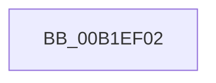

# sub_00B1EF02

- RVA: `0x00B1EF02`–`0x00B1EF2F` (길이 `45` bytes)
- VA: `0x0000000140B1EF02`
- 실행 섹션: `PAGE`
- PDB 이름 있음: `아니요`; PDB Function 태그: `아니요`
- unwind 정보 RVA: `0x0008798C`
- 디코드: `11`개 명령, `45/45` bytes 표시
- 미해석 바이트: `0` (있으면 어셈블리에 `.byte`로 보존)

> 이 문서는 커널 이미지의 기계어와 PDB 기호를 분석해 생성했습니다. 4번과 5번은 함수 원형과 자료형을 바이너리 사용 방식에서 추정한 C 해석이며 원본 소스 복구 결과는 아닙니다.

## 1. Dependencies

- 직접 호출 지점: **1**; 고유 호출 대상: **1**
- 직접 호출자로 확인된 함수: **0**
- RIP 상대 이미지 참조: **0**

### Outgoing calls
- `0x00B1EF24` → [CmGetMatchingDeviceContainerList](../82/CmGetMatchingDeviceContainerList_function_0082BCC4.md) (function, `0x0082BCC4`)

### Direct callers
- 이 함수 시작 RVA로 연결되는 직접 call은 확인되지 않았습니다. 간접 호출은 완전히 역산할 수 없습니다.

### Static image references
- 디코드된 RIP-relative 메모리 참조가 없습니다.

## 2. Other-region calls and transfers

- 다른 실행 섹션으로 향하는 call: **0**
- call이 아닌 외부 분기/꼬리 이동: **1**
  - `0x00B1EF2A` → [_PnpDispatchDeviceContainer + 0xAA](../8F/_PnpDispatchDeviceContainer_function_008F6880.md) (`tail-transfer`)

## 3. Assembly (complete function range)

```asm
00B1EF02  41 8B 41 28                     mov eax, dword ptr [r9 + 0x28]
00B1EF06  25 00 00 FF FF                  and eax, 0xffff0000
00B1EF0B  89 44 24 30                     mov dword ptr [rsp + 0x30], eax
00B1EF0F  49 8B 41 20                     mov rax, qword ptr [r9 + 0x20]
00B1EF13  48 89 44 24 28                  mov qword ptr [rsp + 0x28], rax
00B1EF18  41 8B 41 18                     mov eax, dword ptr [r9 + 0x18]
00B1EF1C  4D 8B 49 10                     mov r9, qword ptr [r9 + 0x10]
00B1EF20  89 44 24 20                     mov dword ptr [rsp + 0x20], eax
00B1EF24  E8 9B CD D0 FF                  call 0x14082bcc4
00B1EF29  90                              nop
00B1EF2A  E9 FB 79 DD FF                  jmp 0x1408f692a
```

## 4. C-style interpretation (structured pseudocode)

```c
__int64 __fastcall sub_00B1EF02(__int64 a1, __int64 a2, __int64 a3, __int64 a4)
{
    __int64 result;
    unsigned int v_stack_p20;
    unsigned __int64 v_stack_p28;
    unsigned int v_stack_p30;

    result = (unsigned int)(((unsigned int)(*(unsigned int *)(a4 + 40))) & (0xFFFF0000ULL));
    v_stack_p30 = (unsigned int)(result);
    v_stack_p28 = *(unsigned __int64 *)(a4 + 32);
    v_stack_p20 = (unsigned int)((unsigned int)(*(unsigned int *)(a4 + 24)));
    result = CmGetMatchingDeviceContainerList(a1, a2, a3, *(unsigned __int64 *)(a4 + 16));
}
```

## 5. (Beta) C Style

```c
int64_t sub_00B1EF02(int64_t Arg1, int64_t Arg2, int64_t Arg3, void *Arg4)
{
    uint8_t *arg4 = (uint8_t *)Arg4;

    int64_t result;
    uint32_t v_stack_p20;
    uint64_t v_stack_p28;
    uint32_t v_stack_p30;

    result = (uint32_t)(((uint32_t)(*(uint32_t *)(arg4 + 0x28))) & (0xFFFF0000ULL));
    v_stack_p30 = (uint32_t)(result);
    v_stack_p28 = *(uint64_t *)(arg4 + 0x20);
    v_stack_p20 = (uint32_t)((uint32_t)(*(uint32_t *)(arg4 + 0x18)));
    result = CmGetMatchingDeviceContainerList(Arg1, Arg2, Arg3, *(uint64_t *)(arg4 + 0x10));
}
```

### 관측된 메모리 오프셋

구조체 형식이 확인되지 않은 접근은 인자 기준의 오프셋으로만 기록했습니다.

| 기준 인자 | 오프셋 표현 | 폭 (bit) | 접근 |
|---|---:|---:|---|
| `Arg4` | `+ 0x10` | `64` | `R` |
| `Arg4` | `+ 0x18` | `32` | `R` |
| `Arg4` | `+ 0x20` | `64` | `R` |
| `Arg4` | `+ 0x28` | `32` | `R` |

## 6. Execution-region graph

[열기: 2D/3D 그래프와 함수 탐색 컨트롤 패널](../../../control-panel.html?section=page&rva=0x00B1EF02&view=graph)

- 2D 그래프는 위에서 아래로 흐르고, 3D 그래프는 빈 공간을 드래그해 회전합니다. Shift+드래그는 이동, 휠은 확대·축소, 함수 노드 선택은 대상 보고서 이동입니다.

### Static fallback


