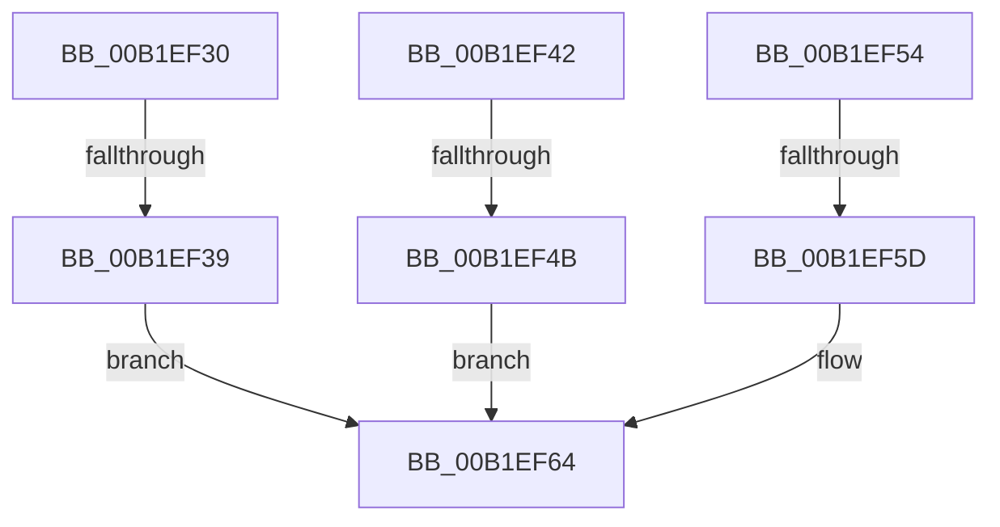

# sub_00B1EF30

- RVA: `0x00B1EF30`–`0x00B1EF9B` (길이 `107` bytes)
- VA: `0x0000000140B1EF30`
- 실행 섹션: `PAGE`
- PDB 이름 있음: `아니요`; PDB Function 태그: `아니요`
- unwind 정보 RVA: `0x000879A8`
- 디코드: `22`개 명령, `107/107` bytes 표시
- 미해석 바이트: `0` (있으면 어셈블리에 `.byte`로 보존)

> 이 문서는 커널 이미지의 기계어와 PDB 기호를 분석해 생성했습니다. 4번과 5번은 함수 원형과 자료형을 바이너리 사용 방식에서 추정한 C 해석이며 원본 소스 복구 결과는 아닙니다.

## 1. Dependencies

- 직접 호출 지점: **1**; 고유 호출 대상: **1**
- 직접 호출자로 확인된 함수: **0**
- RIP 상대 이미지 참조: **3**

### Outgoing calls
- `0x00B1EF8E` → [CmGetContainerBooleanProperty](../82/CmGetContainerBooleanProperty_function_0082B8E4.md) (function, `0x0082B8E4`)

### Direct callers
- 이 함수 시작 RVA로 연결되는 직접 call은 확인되지 않았습니다. 간접 호출은 완전히 역산할 수 없습니다.

### Static image references
- `0x00B1EF39` → RVA `0x00014260` (`.rdata`; read)
- `0x00B1EF4B` → RVA `0x000142F0` (`.rdata`; read)
- `0x00B1EF5D` → RVA `0x00014308` (`.rdata`; read)

## 2. Other-region calls and transfers

- 다른 실행 섹션으로 향하는 call: **0**
- call이 아닌 외부 분기/꼬리 이동: **4**
  - `0x00B1EF33` → [_CmGetDeviceContainerMappedProperty + 0x20](../8F/_CmGetDeviceContainerMappedProperty_function_008F6A38.md) (`tail-transfer`)
  - `0x00B1EF45` → [_CmGetDeviceContainerMappedProperty + 0x20](../8F/_CmGetDeviceContainerMappedProperty_function_008F6A38.md) (`tail-transfer`)
  - `0x00B1EF57` → [_CmGetDeviceContainerMappedProperty + 0x20](../8F/_CmGetDeviceContainerMappedProperty_function_008F6A38.md) (`tail-transfer`)
  - `0x00B1EF96` → [_CmGetDeviceContainerMappedProperty + 0x20](../8F/_CmGetDeviceContainerMappedProperty_function_008F6A38.md) (`tail-transfer`)

## 3. Assembly (complete function range)

```asm
00B1EF30  48 85 C9                        test rcx, rcx
00B1EF33  0F 85 1F 7B DD FF               jne 0x1408f6a58
00B1EF39  4C 8D 0D 20 53 4F FF            lea r9, [rip - 0xb0ace0]
00B1EF40  EB 22                           jmp 0x140b1ef64
00B1EF42  48 85 C9                        test rcx, rcx
00B1EF45  0F 85 0D 7B DD FF               jne 0x1408f6a58
00B1EF4B  4C 8D 0D 9E 53 4F FF            lea r9, [rip - 0xb0ac62]
00B1EF52  EB 10                           jmp 0x140b1ef64
00B1EF54  48 85 C9                        test rcx, rcx
00B1EF57  0F 85 FB 7A DD FF               jne 0x1408f6a58
00B1EF5D  4C 8D 0D A4 53 4F FF            lea r9, [rip - 0xb0ac5c]
00B1EF64  8B 84 24 88 00 00 00            mov eax, dword ptr [rsp + 0x88]
00B1EF6B  48 8B CB                        mov rcx, rbx
00B1EF6E  4C 89 5C 24 38                  mov qword ptr [rsp + 0x38], r11
00B1EF73  89 44 24 30                     mov dword ptr [rsp + 0x30], eax
00B1EF77  48 8B 84 24 80 00 00 00         mov rax, qword ptr [rsp + 0x80]
00B1EF7F  48 89 44 24 28                  mov qword ptr [rsp + 0x28], rax
00B1EF84  48 8B 44 24 78                  mov rax, qword ptr [rsp + 0x78]
00B1EF89  48 89 44 24 20                  mov qword ptr [rsp + 0x20], rax
00B1EF8E  E8 51 C9 D0 FF                  call 0x14082b8e4
00B1EF93  44 8B D0                        mov r10d, eax
00B1EF96  E9 BD 7A DD FF                  jmp 0x1408f6a58
```

## 4. C-style interpretation (structured pseudocode)

```c
__int64 __fastcall sub_00B1EF30(__int64 a1, __int64 a2, __int64 a3, __int64 a4, __int64 a5, __int64 a6, __int64 a7, __int64 a8, __int64 a9, __int64 a10, __int64 a11, __int64 a12, __int64 a13, __int64 a14, __int64 a15, __int64 a16, unsigned int a17)
{
    __int64 result;
    unsigned __int64 v_stack_p20;
    unsigned __int64 v_stack_p28;
    unsigned int v_stack_p30;
    unsigned __int64 v_stack_p38;

    goto loc_00B1EF64;
loc_00B1EF64:
    v_stack_p38 = v_r11;
    v_stack_p30 = (unsigned int)((unsigned int)(a17));
    v_stack_p28 = a16;
    v_stack_p20 = a15;
    result = CmGetContainerBooleanProperty(v_rbx, a2, a3, v_rip - 11578592);
}
```

## 5. (Beta) C Style

```c
int64_t sub_00B1EF30(int64_t Arg1, int64_t Arg2, int64_t Arg3, int64_t Arg4, uint64_t Arg5, uint64_t Arg6, uint64_t Arg7, uint64_t Arg8, uint64_t Arg9, uint64_t Arg10, uint64_t Arg11, uint64_t Arg12, uint64_t Arg13, uint64_t Arg14, int64_t Arg15, int64_t Arg16, uint32_t Arg17)
{
    int64_t result;
    uint64_t v_stack_p20;
    uint64_t v_stack_p28;
    uint32_t v_stack_p30;
    uint64_t v_stack_p38;

    goto loc_00B1EF64;
loc_00B1EF64:
    v_stack_p38 = local_r11;
    v_stack_p30 = (uint32_t)((uint32_t)(Arg17));
    v_stack_p28 = Arg16;
    v_stack_p20 = Arg15;
    result = CmGetContainerBooleanProperty(local_rbx, Arg2, Arg3, v_rip - 11578592);
}
```

## 6. Execution-region graph

[열기: 2D/3D 그래프와 함수 탐색 컨트롤 패널](../../../control-panel.html?section=page&rva=0x00B1EF30&view=graph)

- 2D 그래프는 위에서 아래로 흐르고, 3D 그래프는 빈 공간을 드래그해 회전합니다. Shift+드래그는 이동, 휠은 확대·축소, 함수 노드 선택은 대상 보고서 이동입니다.

### Static fallback


