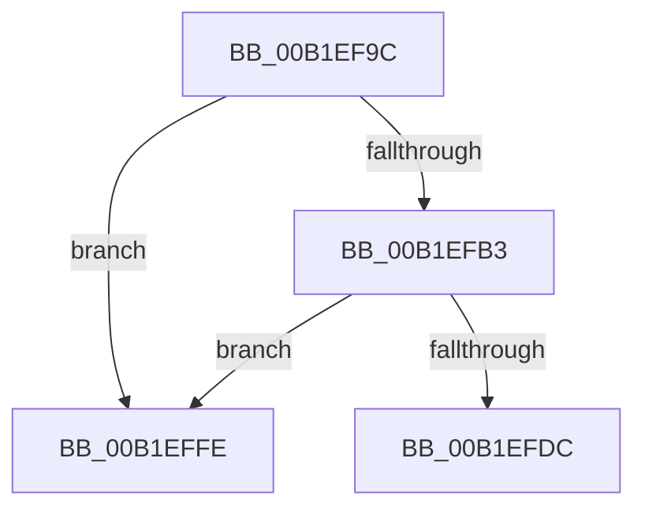

# sub_00B1EF9C

- RVA: `0x00B1EF9C`–`0x00B1F008` (길이 `108` bytes)
- VA: `0x0000000140B1EF9C`
- 실행 섹션: `PAGE`
- PDB 이름 있음: `아니요`; PDB Function 태그: `아니요`
- unwind 정보 RVA: `0x000879E0`
- 디코드: `23`개 명령, `108/108` bytes 표시
- 미해석 바이트: `0` (있으면 어셈블리에 `.byte`로 보존)

> 이 문서는 커널 이미지의 기계어와 PDB 기호를 분석해 생성했습니다. 4번과 5번은 함수 원형과 자료형을 바이너리 사용 방식에서 추정한 C 해석이며 원본 소스 복구 결과는 아닙니다.

## 1. Dependencies

- 직접 호출 지점: **3**; 고유 호출 대상: **3**
- 직접 호출자로 확인된 함수: **0**
- RIP 상대 이미지 참조: **2**

### Outgoing calls
- `0x00B1EFBA` → [DbgPrint](../../text/35/DbgPrint_function_00358CB0.md) (function, `0x00358CB0`)
- `0x00B1EFD3` → [DownLevelLangIDToLanguageName](../../text/4B/DownLevelLangIDToLanguageName_function_004BBAA8.md) (function, `0x004BBAA8`)
- `0x00B1EFE8` → [RtlInitUnicodeString](../../text/42/RtlInitUnicodeString_function_0042A780.md) (function, `0x0042A780`)

### Direct callers
- 이 함수 시작 RVA로 연결되는 직접 call은 확인되지 않았습니다. 간접 호출은 완전히 역산할 수 없습니다.

### Static image references
- `0x00B1EFB3` → RVA `0x00B05A50` (` ?? ::NNGAKEGL::`string'`; read)
- `0x00B1EFC5` → RVA `0x00E62390` (`.data`; read)

## 2. Other-region calls and transfers

- 다른 실행 섹션으로 향하는 call: **3**
  - `0x00B1EFBA` → [DbgPrint](../../text/35/DbgPrint_function_00358CB0.md) (`PAGE` → `.text`)
  - `0x00B1EFD3` → [DownLevelLangIDToLanguageName](../../text/4B/DownLevelLangIDToLanguageName_function_004BBAA8.md) (`PAGE` → `.text`)
  - `0x00B1EFE8` → [RtlInitUnicodeString](../../text/42/RtlInitUnicodeString_function_0042A780.md) (`PAGE` → `.text`)
- call이 아닌 외부 분기/꼬리 이동: **2**
  - `0x00B1EFF9` → [PnpGetDeviceInterfacePropertyData + 0x95](../8F/PnpGetDeviceInterfacePropertyData_function_008F6BD4.md) (`tail-transfer`)
  - `0x00B1F003` → [PnpGetDeviceInterfacePropertyData + 0x191](../8F/PnpGetDeviceInterfacePropertyData_function_008F6BD4.md) (`tail-transfer`)

## 3. Assembly (complete function range)

```asm
00B1EF9C  66 89 6C 24 62                  mov word ptr [rsp + 0x62], bp
00B1EFA1  48 8D 44 24 70                  lea rax, [rsp + 0x70]
00B1EFA6  48 89 44 24 68                  mov qword ptr [rsp + 0x68], rax
00B1EFAB  81 FB 00 10 00 00               cmp ebx, 0x1000
00B1EFB1  74 4B                           je 0x140b1effe
00B1EFB3  48 8D 0D 96 6A FE FF            lea rcx, [rip - 0x1956a]
00B1EFBA  E8 F1 9C 83 FF                  call 0x140358cb0
00B1EFBF  41 B9 02 00 00 00               mov r9d, 2
00B1EFC5  48 8D 15 C4 33 34 00            lea rdx, [rip + 0x3433c4]
00B1EFCC  0F B7 CB                        movzx ecx, bx
00B1EFCF  45 8D 41 3E                     lea r8d, [r9 + 0x3e]
00B1EFD3  E8 D0 CA 99 FF                  call 0x1404bbaa8
00B1EFD8  85 C0                           test eax, eax
00B1EFDA  7E 22                           jle 0x140b1effe
00B1EFDC  48 8D 15 AD 33 34 00            lea rdx, [rip + 0x3433ad]
00B1EFE3  48 8D 4C 24 60                  lea rcx, [rsp + 0x60]
00B1EFE8  E8 93 B7 90 FF                  call 0x14042a780
00B1EFED  48 8B 6C 24 68                  mov rbp, qword ptr [rsp + 0x68]
00B1EFF2  45 33 C9                        xor r9d, r9d
00B1EFF5  45 8D 51 02                     lea r10d, [r9 + 2]
00B1EFF9  E9 6B 7C DD FF                  jmp 0x1408f6c69
00B1EFFE  BB 01 00 00 C0                  mov ebx, 0xc0000001
00B1F003  E9 5D 7D DD FF                  jmp 0x1408f6d65
```

## 4. C-style interpretation (structured pseudocode)

```c
__int64 __fastcall sub_00B1EF9C(__int64 a1, __int64 a2, __int64 a3, __int64 a4, __int64 a5, __int64 a6, __int64 a7, __int64 a8, __int64 a9, __int64 a10, __int64 a11, __int64 a12, __int64 a13, __int64 a14)
{
    __int64 result;
    unsigned __int16 v_stack_p62;
    unsigned __int64 v_stack_p68;

    v_stack_p62 = (unsigned __int16)(v_rbp);
    v_stack_p68 = a14;
    if (((unsigned int)(v_rbx)) == 0x1000ULL) goto loc_00B1EFFE;
    result = DbgPrint(v_rip - 103786, a2, a3, a4);
    result = DownLevelLangIDToLanguageName((unsigned __int16)(v_rbx), v_rip + 3421124, 2 + 62, 2);
    if (condition_is_less_or_equal) goto loc_00B1EFFE;
    result = RtlInitUnicodeString(a12, v_rip + 3421101, 2 + 62, 2);
    a4 = 0;
loc_00B1EFFE:
}
```

## 5. (Beta) C Style

```c
int64_t sub_00B1EF9C(int64_t Arg1, int64_t Arg2, int64_t Arg3, int64_t Arg4, uint64_t Arg5, uint64_t Arg6, uint64_t Arg7, uint64_t Arg8, uint64_t Arg9, uint64_t Arg10, uint64_t Arg11, int64_t Arg12, int64_t Arg13, int64_t Arg14)
{
    int64_t result;
    uint16_t v_stack_p62;
    uint64_t v_stack_p68;

    v_stack_p62 = (uint16_t)(local_rbp);
    v_stack_p68 = Arg14;
    if (((uint32_t)(local_rbx)) == 0x1000ULL) goto loc_00B1EFFE;
    result = DbgPrint(v_rip - 103786, Arg2, Arg3, Arg4);
    result = DownLevelLangIDToLanguageName((uint16_t)(local_rbx), v_rip + 3421124, 2 + 62, 2);
    if (condition_is_less_or_equal) goto loc_00B1EFFE;
    result = RtlInitUnicodeString(Arg12, v_rip + 3421101, 2 + 62, 2);
    Arg4 = 0;
loc_00B1EFFE:
}
```

## 6. Execution-region graph

[열기: 2D/3D 그래프와 함수 탐색 컨트롤 패널](../../../control-panel.html?section=page&rva=0x00B1EF9C&view=graph)

- 2D 그래프는 위에서 아래로 흐르고, 3D 그래프는 빈 공간을 드래그해 회전합니다. Shift+드래그는 이동, 휠은 확대·축소, 함수 노드 선택은 대상 보고서 이동입니다.

### Static fallback


