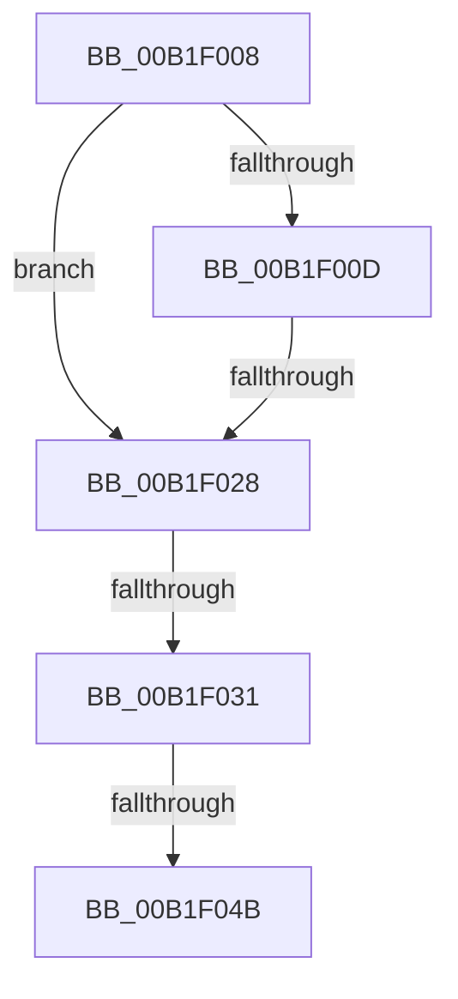

# sub_00B1F008

- RVA: `0x00B1F008`–`0x00B1F050` (길이 `72` bytes)
- VA: `0x0000000140B1F008`
- 실행 섹션: `PAGE`
- PDB 이름 있음: `아니요`; PDB Function 태그: `아니요`
- unwind 정보 RVA: `0x00087A3C`
- 디코드: `17`개 명령, `72/72` bytes 표시
- 미해석 바이트: `0` (있으면 어셈블리에 `.byte`로 보존)

> 이 문서는 커널 이미지의 기계어와 PDB 기호를 분석해 생성했습니다. 4번과 5번은 함수 원형과 자료형을 바이너리 사용 방식에서 추정한 C 해석이며 원본 소스 복구 결과는 아닙니다.

## 1. Dependencies

- 직접 호출 지점: **2**; 고유 호출 대상: **2**
- 직접 호출자로 확인된 함수: **0**
- RIP 상대 이미지 참조: **0**

### Outgoing calls
- `0x00B1F01B` → [AuthzBasepCompareSecurityAttributesInformation](../82/AuthzBasepCompareSecurityAttributesInformation_function_00821D94.md) (function, `0x00821D94`)
- `0x00B1F03E` → [SepCompareSidAndAttributeArrays](../8F/SepCompareSidAndAttributeArrays_function_008F7284.md) (function, `0x008F7284`)

### Direct callers
- 이 함수 시작 RVA로 연결되는 직접 call은 확인되지 않았습니다. 간접 호출은 완전히 역산할 수 없습니다.

### Static image references
- 디코드된 RIP-relative 메모리 참조가 없습니다.

## 2. Other-region calls and transfers

- 다른 실행 섹션으로 향하는 call: **0**
- call이 아닌 외부 분기/꼬리 이동: **4**
  - `0x00B1F022` → [SepCompareClaimAttributes + 0x5B](../8F/SepCompareClaimAttributes_function_008F7198.md) (`tail-transfer`)
  - `0x00B1F02B` → [SepCompareClaimAttributes + 0x34](../8F/SepCompareClaimAttributes_function_008F7198.md) (`tail-transfer`)
  - `0x00B1F045` → [SepCompareClaimAttributes + 0x34](../8F/SepCompareClaimAttributes_function_008F7198.md) (`tail-transfer`)
  - `0x00B1F04B` → [SepCompareClaimAttributes + 0x5B](../8F/SepCompareClaimAttributes_function_008F7198.md) (`tail-transfer`)

## 3. Assembly (complete function range)

```asm
00B1F008  40 84 F6                        test sil, sil
00B1F00B  74 1B                           je 0x140b1f028
00B1F00D  48 8B 93 48 02 00 00            mov rdx, qword ptr [rbx + 0x248]
00B1F014  48 8B 8F 48 02 00 00            mov rcx, qword ptr [rdi + 0x248]
00B1F01B  E8 74 2D D0 FF                  call 0x140821d94
00B1F020  84 C0                           test al, al
00B1F022  0F 84 CB 81 DD FF               je 0x1408f71f3
00B1F028  40 84 ED                        test bpl, bpl
00B1F02B  0F 84 9B 81 DD FF               je 0x1408f71cc
00B1F031  44 8B 0B                        mov r9d, dword ptr [rbx]
00B1F034  4C 8B 43 08                     mov r8, qword ptr [rbx + 8]
00B1F038  8B 17                           mov edx, dword ptr [rdi]
00B1F03A  48 8B 4F 08                     mov rcx, qword ptr [rdi + 8]
00B1F03E  E8 41 82 DD FF                  call 0x1408f7284
00B1F043  84 C0                           test al, al
00B1F045  0F 85 81 81 DD FF               jne 0x1408f71cc
00B1F04B  E9 A3 81 DD FF                  jmp 0x1408f71f3
```

## 4. C-style interpretation (structured pseudocode)

```c
__int64 __fastcall sub_00B1F008(void)
{
    __int64 result;

    if ((unsigned __int8)(v_rsi) == 0) goto loc_00B1F028;
    result = AuthzBasepCompareSecurityAttributesInformation(*(unsigned __int64 *)(v_rdi + 584), *(unsigned __int64 *)(v_rbx + 584), a3, a4);
loc_00B1F028:
    result = SepCompareSidAndAttributeArrays(*(unsigned __int64 *)(v_rdi + 8), (unsigned int)(*(unsigned int *)(v_rdi)), *(unsigned __int64 *)(v_rbx + 8), (unsigned int)(*(unsigned int *)(v_rbx)));
}
```

## 5. (Beta) C Style

```c
void sub_00B1F008(void)
{
    int64_t result;

    if ((uint8_t)(local_rsi) == 0) goto loc_00B1F028;
    result = AuthzBasepCompareSecurityAttributesInformation(*(uint64_t *)(local_rdi + 0x248), *(uint64_t *)(local_rbx + 0x248), a3, a4);
loc_00B1F028:
    result = SepCompareSidAndAttributeArrays(*(uint64_t *)(local_rdi + 0x8), (uint32_t)(*(uint32_t *)(local_rdi)), *(uint64_t *)(local_rbx + 0x8), (uint32_t)(*(uint32_t *)(local_rbx)));
}
```

## 6. Execution-region graph

[열기: 2D/3D 그래프와 함수 탐색 컨트롤 패널](../../../control-panel.html?section=page&rva=0x00B1F008&view=graph)

- 2D 그래프는 위에서 아래로 흐르고, 3D 그래프는 빈 공간을 드래그해 회전합니다. Shift+드래그는 이동, 휠은 확대·축소, 함수 노드 선택은 대상 보고서 이동입니다.

### Static fallback


