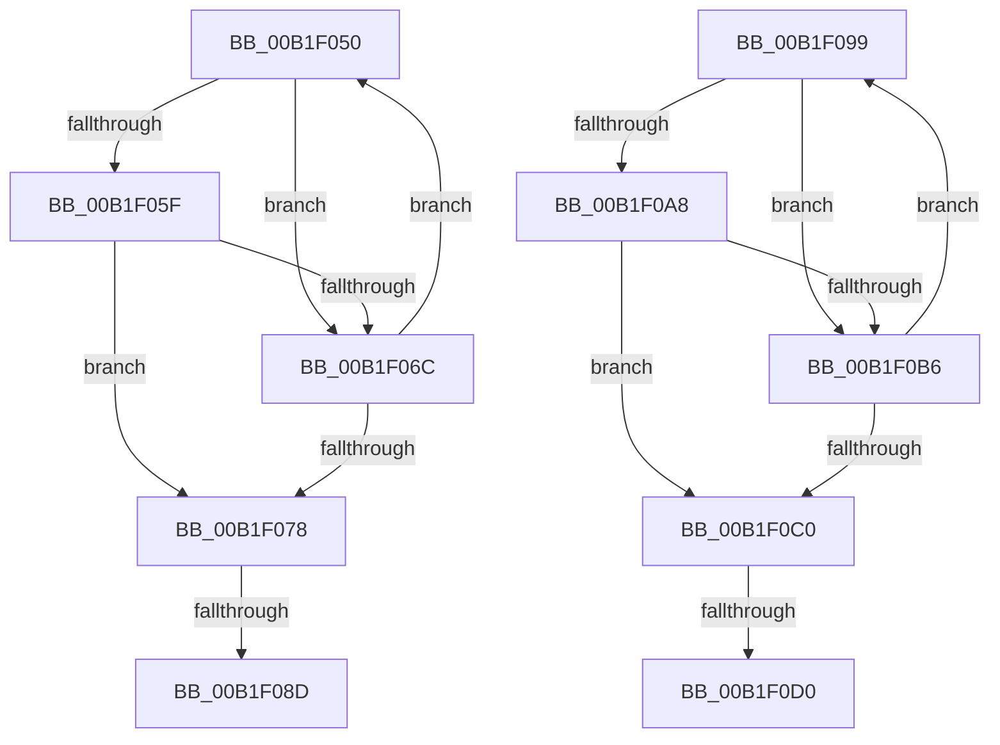

# sub_00B1F050

- RVA: `0x00B1F050`–`0x00B1F0DC` (길이 `140` bytes)
- VA: `0x0000000140B1F050`
- 실행 섹션: `PAGE`
- PDB 이름 있음: `아니요`; PDB Function 태그: `아니요`
- unwind 정보 RVA: `0x00087A68`
- 디코드: `39`개 명령, `140/140` bytes 표시
- 미해석 바이트: `0` (있으면 어셈블리에 `.byte`로 보존)

> 이 문서는 커널 이미지의 기계어와 PDB 기호를 분석해 생성했습니다. 4번과 5번은 함수 원형과 자료형을 바이너리 사용 방식에서 추정한 C 해석이며 원본 소스 복구 결과는 아닙니다.

## 1. Dependencies

- 직접 호출 지점: **2**; 고유 호출 대상: **1**
- 직접 호출자로 확인된 함수: **0**
- RIP 상대 이미지 참조: **0**

### Outgoing calls
- `0x00B1F056` → [RtlEqualSid](../../text/40/RtlEqualSid_function_00400AD0.md) (function, `0x00400AD0`)
- `0x00B1F09F` → [RtlEqualSid](../../text/40/RtlEqualSid_function_00400AD0.md) (function, `0x00400AD0`)

### Direct callers
- 이 함수 시작 RVA로 연결되는 직접 call은 확인되지 않았습니다. 간접 호출은 완전히 역산할 수 없습니다.

### Static image references
- 디코드된 RIP-relative 메모리 참조가 없습니다.

## 2. Other-region calls and transfers

- 다른 실행 섹션으로 향하는 call: **2**
  - `0x00B1F056` → [RtlEqualSid](../../text/40/RtlEqualSid_function_00400AD0.md) (`PAGE` → `.text`)
  - `0x00B1F09F` → [RtlEqualSid](../../text/40/RtlEqualSid_function_00400AD0.md) (`PAGE` → `.text`)
- call이 아닌 외부 분기/꼬리 이동: **4**
  - `0x00B1F087` → [SepCompareSidAndAttributeArrays + 0xE4](../8F/SepCompareSidAndAttributeArrays_function_008F7284.md) (`tail-transfer`)
  - `0x00B1F094` → [SepCompareSidAndAttributeArrays + 0x78](../8F/SepCompareSidAndAttributeArrays_function_008F7284.md) (`tail-transfer`)
  - `0x00B1F0CA` → [SepCompareSidAndAttributeArrays + 0xE4](../8F/SepCompareSidAndAttributeArrays_function_008F7284.md) (`tail-transfer`)
  - `0x00B1F0D7` → [SepCompareSidAndAttributeArrays + 0x7E](../8F/SepCompareSidAndAttributeArrays_function_008F7284.md) (`tail-transfer`)

## 3. Assembly (complete function range)

```asm
00B1F050  48 8B 16                        mov rdx, qword ptr [rsi]
00B1F053  48 8B CF                        mov rcx, rdi
00B1F056  E8 75 1A 8E FF                  call 0x140400ad0
00B1F05B  84 C0                           test al, al
00B1F05D  74 0D                           je 0x140b1f06c
00B1F05F  8B 4E 08                        mov ecx, dword ptr [rsi + 8]
00B1F062  43 33 4C FD 08                  xor ecx, dword ptr [r13 + r15*8 + 8]
00B1F067  F6 C1 14                        test cl, 0x14
00B1F06A  74 0C                           je 0x140b1f078
00B1F06C  41 FF C6                        inc r14d
00B1F06F  48 83 C6 10                     add rsi, 0x10
00B1F073  45 3B F4                        cmp r14d, r12d
00B1F076  72 D8                           jb 0x140b1f050
00B1F078  8B 7C 24 78                     mov edi, dword ptr [rsp + 0x78]
00B1F07C  4C 8B AC 24 80 00 00 00         mov r13, qword ptr [rsp + 0x80]
00B1F084  45 3B F4                        cmp r14d, r12d
00B1F087  0F 84 DB 82 DD FF               je 0x1408f7368
00B1F08D  48 8B 44 24 70                  mov rax, qword ptr [rsp + 0x70]
00B1F092  FF C5                           inc ebp
00B1F094  E9 63 82 DD FF                  jmp 0x1408f72fc
00B1F099  49 8B 16                        mov rdx, qword ptr [r14]
00B1F09C  49 8B CC                        mov rcx, r12
00B1F09F  E8 2C 1A 8E FF                  call 0x140400ad0
00B1F0A4  84 C0                           test al, al
00B1F0A6  74 0E                           je 0x140b1f0b6
00B1F0A8  41 8B 4E 08                     mov ecx, dword ptr [r14 + 8]
00B1F0AC  43 33 4C FD 08                  xor ecx, dword ptr [r13 + r15*8 + 8]
00B1F0B1  F6 C1 14                        test cl, 0x14
00B1F0B4  74 0A                           je 0x140b1f0c0
00B1F0B6  FF C5                           inc ebp
00B1F0B8  49 83 C6 10                     add r14, 0x10
00B1F0BC  3B EF                           cmp ebp, edi
00B1F0BE  72 D9                           jb 0x140b1f099
00B1F0C0  44 8B A4 24 88 00 00 00         mov r12d, dword ptr [rsp + 0x88]
00B1F0C8  3B EF                           cmp ebp, edi
00B1F0CA  0F 84 98 82 DD FF               je 0x1408f7368
00B1F0D0  48 8B 44 24 70                  mov rax, qword ptr [rsp + 0x70]
00B1F0D5  FF C6                           inc esi
00B1F0D7  E9 26 82 DD FF                  jmp 0x1408f7302
```

## 4. C-style interpretation (structured pseudocode)

```c
__int64 __fastcall sub_00B1F050(__int64 a1, __int64 a2, __int64 a3, __int64 a4, __int64 a5, __int64 a6, __int64 a7, __int64 a8, __int64 a9, __int64 a10, __int64 a11, __int64 a12, __int64 a13, __int64 a14, unsigned int a15, __int64 a16)
{
    __int64 result;
    __int64 v_r14;
    __int64 v_rbp;
    __int64 v_rsi;
    unsigned __int64 v_stack_p70;
    unsigned int v_stack_p88;

    result = RtlEqualSid(v_rdi, *(unsigned __int64 *)(v_rsi), a3, a4);
    if ((unsigned __int8)(result) == 0) goto loc_00B1F06C;
    a1 = (unsigned int)(((unsigned int)(*(unsigned int *)(v_rsi + 8))) ^ (*(unsigned int *)(v_r13 + v_r15 * 8 + 8)));
    if ((((unsigned __int8)(a1)) & (20)) == 0) goto loc_00B1F078;
loc_00B1F06C:
    v_r14 = (unsigned int)((v_r14) + 1);
    v_rsi = (v_rsi) + (16);
    if (((unsigned int)(v_r14)) < ((unsigned int)(v_r12))) goto loc_00B1F050;
loc_00B1F078:
    v_rbp = (unsigned int)((v_rbp) + 1);
}
```

## 5. (Beta) C Style

```c
int64_t sub_00B1F050(int64_t Arg1, int64_t Arg2, int64_t Arg3, int64_t Arg4, uint64_t Arg5, uint64_t Arg6, uint64_t Arg7, uint64_t Arg8, uint64_t Arg9, uint64_t Arg10, uint64_t Arg11, uint64_t Arg12, uint64_t Arg13, int64_t Arg14, uint32_t Arg15, int64_t Arg16)
{
    int64_t result;
    int64_t local_r14;
    int64_t local_rbp;
    int64_t local_rsi;
    uint64_t v_stack_p70;
    uint32_t v_stack_p88;

    result = RtlEqualSid(local_rdi, *(uint64_t *)(local_rsi), Arg3, Arg4);
    if ((uint8_t)(result) == 0) goto loc_00B1F06C;
    Arg1 = (uint32_t)(((uint32_t)(*(uint32_t *)(local_rsi + 0x8))) ^ (*(uint32_t *)(local_r13 + local_r15 * 8 + 0x8)));
    if ((((uint8_t)(Arg1)) & (20)) == 0) goto loc_00B1F078;
loc_00B1F06C:
    local_r14 = (uint32_t)((local_r14) + 1);
    local_rsi = (local_rsi) + (16);
    if (((uint32_t)(local_r14)) < ((uint32_t)(local_r12))) goto loc_00B1F050;
loc_00B1F078:
    local_rbp = (uint32_t)((local_rbp) + 1);
}
```

## 6. Execution-region graph

[열기: 2D/3D 그래프와 함수 탐색 컨트롤 패널](../../../control-panel.html?section=page&rva=0x00B1F050&view=graph)

- 2D 그래프는 위에서 아래로 흐르고, 3D 그래프는 빈 공간을 드래그해 회전합니다. Shift+드래그는 이동, 휠은 확대·축소, 함수 노드 선택은 대상 보고서 이동입니다.

### Static fallback


