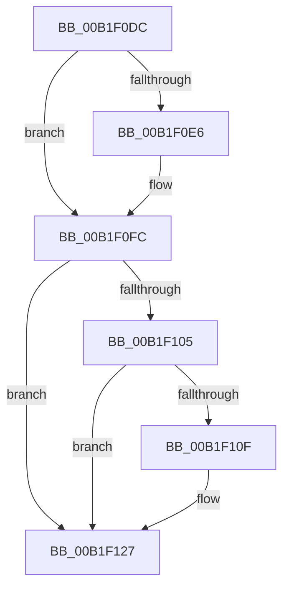

# sub_00B1F0DC

- RVA: `0x00B1F0DC`–`0x00B1F14A` (길이 `110` bytes)
- VA: `0x0000000140B1F0DC`
- 실행 섹션: `PAGE`
- PDB 이름 있음: `아니요`; PDB Function 태그: `아니요`
- unwind 정보 RVA: `0x00087AF8`
- 디코드: `29`개 명령, `110/110` bytes 표시
- 미해석 바이트: `0` (있으면 어셈블리에 `.byte`로 보존)

> 이 문서는 커널 이미지의 기계어와 PDB 기호를 분석해 생성했습니다. 4번과 5번은 함수 원형과 자료형을 바이너리 사용 방식에서 추정한 C 해석이며 원본 소스 복구 결과는 아닙니다.

## 1. Dependencies

- 직접 호출 지점: **5**; 고유 호출 대상: **2**
- 직접 호출자로 확인된 함수: **0**
- RIP 상대 이미지 참조: **0**

### Outgoing calls
- `0x00B1F0EB` → [IoAddTriageDumpDataBlock](../../text/42/IoAddTriageDumpDataBlock_function_00428374.md) (function, `0x00428374`)
- `0x00B1F0F7` → [IoAddTriageDumpDataBlock](../../text/42/IoAddTriageDumpDataBlock_function_00428374.md) (function, `0x00428374`)
- `0x00B1F111` → [IoAddTriageDumpDataBlock](../../text/42/IoAddTriageDumpDataBlock_function_00428374.md) (function, `0x00428374`)
- `0x00B1F122` → [IoAddTriageDumpDataBlock](../../text/42/IoAddTriageDumpDataBlock_function_00428374.md) (function, `0x00428374`)
- `0x00B1F144` → [KeBugCheckEx](../../text/4F/KeBugCheckEx_function_004FD660.md) (function, `0x004FD660`)

### Direct callers
- 이 함수 시작 RVA로 연결되는 직접 call은 확인되지 않았습니다. 간접 호출은 완전히 역산할 수 없습니다.

### Static image references
- 디코드된 RIP-relative 메모리 참조가 없습니다.

## 2. Other-region calls and transfers

- 다른 실행 섹션으로 향하는 call: **5**
  - `0x00B1F0EB` → [IoAddTriageDumpDataBlock](../../text/42/IoAddTriageDumpDataBlock_function_00428374.md) (`PAGE` → `.text`)
  - `0x00B1F0F7` → [IoAddTriageDumpDataBlock](../../text/42/IoAddTriageDumpDataBlock_function_00428374.md) (`PAGE` → `.text`)
  - `0x00B1F111` → [IoAddTriageDumpDataBlock](../../text/42/IoAddTriageDumpDataBlock_function_00428374.md) (`PAGE` → `.text`)
  - `0x00B1F122` → [IoAddTriageDumpDataBlock](../../text/42/IoAddTriageDumpDataBlock_function_00428374.md) (`PAGE` → `.text`)
  - `0x00B1F144` → [KeBugCheckEx](../../text/4F/KeBugCheckEx_function_004FD660.md) (`PAGE` → `.text`)
- 별도 외부 분기/꼬리 이동을 확인하지 못했습니다.

## 3. Assembly (complete function range)

```asm
00B1F0DC  48 8D 7B 38                     lea rdi, [rbx + 0x38]
00B1F0E0  66 44 39 37                     cmp word ptr [rdi], r14w
00B1F0E4  74 16                           je 0x140b1f0fc
00B1F0E6  8B D5                           mov edx, ebp
00B1F0E8  48 8B CF                        mov rcx, rdi
00B1F0EB  E8 84 92 90 FF                  call 0x140428374
00B1F0F0  0F B7 17                        movzx edx, word ptr [rdi]
00B1F0F3  48 8B 4B 40                     mov rcx, qword ptr [rbx + 0x40]
00B1F0F7  E8 78 92 90 FF                  call 0x140428374
00B1F0FC  48 8B 43 10                     mov rax, qword ptr [rbx + 0x10]
00B1F100  48 85 C0                        test rax, rax
00B1F103  74 22                           je 0x140b1f127
00B1F105  48 8D 48 38                     lea rcx, [rax + 0x38]
00B1F109  66 44 39 31                     cmp word ptr [rcx], r14w
00B1F10D  74 18                           je 0x140b1f127
00B1F10F  8B D5                           mov edx, ebp
00B1F111  E8 5E 92 90 FF                  call 0x140428374
00B1F116  48 8B 4B 10                     mov rcx, qword ptr [rbx + 0x10]
00B1F11A  0F B7 51 38                     movzx edx, word ptr [rcx + 0x38]
00B1F11E  48 8B 49 40                     mov rcx, qword ptr [rcx + 0x40]
00B1F122  E8 4D 92 90 FF                  call 0x140428374
00B1F127  48 8B 83 10 02 00 00            mov rax, qword ptr [rbx + 0x210]
00B1F12E  BA 08 00 00 00                  mov edx, 8
00B1F133  4C 8B 43 20                     mov r8, qword ptr [rbx + 0x20]
00B1F137  B9 CA 00 00 00                  mov ecx, 0xca
00B1F13C  48 89 74 24 20                  mov qword ptr [rsp + 0x20], rsi
00B1F141  44 8B 08                        mov r9d, dword ptr [rax]
00B1F144  E8 17 E5 9D FF                  call 0x1404fd660
00B1F149  CC                              int3
```

## 4. C-style interpretation (structured pseudocode)

```c
__int64 __fastcall sub_00B1F0DC(void)
{
    __int64 result;
    unsigned __int64 v_stack_p20;

    if ((*(unsigned __int16 *)(v_rbx + 56)) != ((unsigned __int16)(v_r14))) {
        a2 = (unsigned int)(v_rbp);
        a1 = v_rbx + 56;
        result = IoAddTriageDumpDataBlock(a1, a2, a3, a4);
        a2 = *(unsigned __int16 *)(v_rbx + 56);
        a1 = *(unsigned __int64 *)(v_rbx + 64);
        result = IoAddTriageDumpDataBlock(a1, a2, a3, a4);
    }
    if (*(unsigned __int64 *)(v_rbx + 16) == 0) goto loc_00B1F127;
    result = *(unsigned __int64 *)(v_rbx + 16);
    if ((*(unsigned __int16 *)(*(unsigned __int64 *)(v_rbx + 16) + 56)) != ((unsigned __int16)(v_r14))) {
        a2 = (unsigned int)(v_rbp);
        result = IoAddTriageDumpDataBlock(*(unsigned __int64 *)(v_rbx + 16) + 56, a2, a3, a4);
        a1 = *(unsigned __int64 *)(v_rbx + 16);
        a2 = *(unsigned __int16 *)(a1 + 56);
        a1 = *(unsigned __int64 *)(a1 + 64);
        result = IoAddTriageDumpDataBlock(a1, a2, a3, a4);
    }
    v_stack_p20 = v_rsi;
    result = KeBugCheckEx(202, 8, *(unsigned __int64 *)(v_rbx + 32), (unsigned int)(*(unsigned int *)(*(unsigned __int64 *)(v_rbx + 528))));
    return result;
}
```

## 5. (Beta) C Style

```c
void sub_00B1F0DC(void)
{
    int64_t result;
    uint64_t v_stack_p20;

    if ((*(uint16_t *)(local_rbx + 0x38)) != ((uint16_t)(local_r14))) {
        a2 = (uint32_t)(local_rbp);
        a1 = local_rbx + 56;
        result = IoAddTriageDumpDataBlock(a1, a2, a3, a4);
        a2 = *(uint16_t *)(local_rbx + 0x38);
        a1 = *(uint64_t *)(local_rbx + 0x40);
        result = IoAddTriageDumpDataBlock(a1, a2, a3, a4);
    }
    if (*(uint64_t *)(local_rbx + 0x10) == 0) goto loc_00B1F127;
    result = *(uint64_t *)(local_rbx + 0x10);
    if ((*(uint16_t *)(*(uint64_t *)(local_rbx + 0x10) + 0x38)) != ((uint16_t)(local_r14))) {
        a2 = (uint32_t)(local_rbp);
        result = IoAddTriageDumpDataBlock(*(uint64_t *)(local_rbx + 0x10) + 56, a2, a3, a4);
        a1 = *(uint64_t *)(local_rbx + 0x10);
        a2 = *(uint16_t *)(a1 + 0x38);
        a1 = *(uint64_t *)(a1 + 0x40);
        result = IoAddTriageDumpDataBlock(a1, a2, a3, a4);
    }
    v_stack_p20 = local_rsi;
    result = KeBugCheckEx(202, 8, *(uint64_t *)(local_rbx + 0x20), (uint32_t)(*(uint32_t *)(*(uint64_t *)(local_rbx + 0x210))));
    return result;
}
```

## 6. Execution-region graph

[열기: 2D/3D 그래프와 함수 탐색 컨트롤 패널](../../../control-panel.html?section=page&rva=0x00B1F0DC&view=graph)

- 2D 그래프는 위에서 아래로 흐르고, 3D 그래프는 빈 공간을 드래그해 회전합니다. Shift+드래그는 이동, 휠은 확대·축소, 함수 노드 선택은 대상 보고서 이동입니다.

### Static fallback


