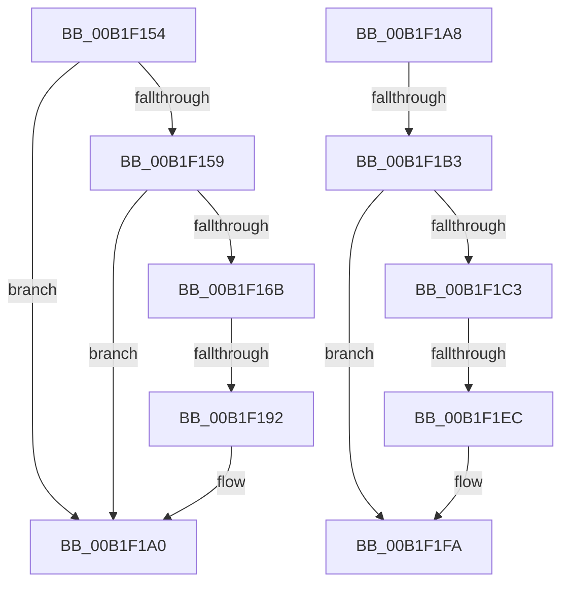

# sub_00B1F154

- RVA: `0x00B1F154`–`0x00B1F211` (길이 `189` bytes)
- VA: `0x0000000140B1F154`
- 실행 섹션: `PAGE`
- PDB 이름 있음: `아니요`; PDB Function 태그: `아니요`
- unwind 정보 RVA: `0x00087BB0`
- 디코드: `46`개 명령, `189/189` bytes 표시
- 미해석 바이트: `0` (있으면 어셈블리에 `.byte`로 보존)

> 이 문서는 커널 이미지의 기계어와 PDB 기호를 분석해 생성했습니다. 4번과 5번은 함수 원형과 자료형을 바이너리 사용 방식에서 추정한 C 해석이며 원본 소스 복구 결과는 아닙니다.

## 1. Dependencies

- 직접 호출 지점: **6**; 고유 호출 대상: **5**
- 직접 호출자로 확인된 함수: **0**
- RIP 상대 이미지 참조: **1**

### Outgoing calls
- `0x00B1F161` → [RtlLookupElementGenericTableAvl](../../text/3F/RtlLookupElementGenericTableAvl_function_003FEFB0.md) (function, `0x003FEFB0`)
- `0x00B1F175` → [RtlDeleteElementGenericTableAvl](../../text/3E/RtlDeleteElementGenericTableAvl_function_003EE750.md) (function, `0x003EE750`)
- `0x00B1F1B3` → [PiPnpRtlDisableRemoveOperationDispatch](../8E/PiPnpRtlDisableRemoveOperationDispatch_function_008E0AAC.md) (function, `0x008E0AAC`)
- `0x00B1F1CB` → [RtlDeleteElementGenericTableAvl](../../text/3E/RtlDeleteElementGenericTableAvl_function_003EE750.md) (function, `0x003EE750`)
- `0x00B1F201` → [ExReleaseResourceLite](../../text/25/ExReleaseResourceLite_function_0025FA10.md) (function, `0x0025FA10`)
- `0x00B1F206` → [KeLeaveCriticalRegion](../../text/25/KeLeaveCriticalRegion_function_0025D8B0.md) (function, `0x0025D8B0`)

### Direct callers
- 이 함수 시작 RVA로 연결되는 직접 call은 확인되지 않았습니다. 간접 호출은 완전히 역산할 수 없습니다.

### Static image references
- `0x00B1F1FA` → RVA `0x00F8B960` (`.data`; read)

## 2. Other-region calls and transfers

- 다른 실행 섹션으로 향하는 call: **5**
  - `0x00B1F161` → [RtlLookupElementGenericTableAvl](../../text/3F/RtlLookupElementGenericTableAvl_function_003FEFB0.md) (`PAGE` → `.text`)
  - `0x00B1F175` → [RtlDeleteElementGenericTableAvl](../../text/3E/RtlDeleteElementGenericTableAvl_function_003EE750.md) (`PAGE` → `.text`)
  - `0x00B1F1CB` → [RtlDeleteElementGenericTableAvl](../../text/3E/RtlDeleteElementGenericTableAvl_function_003EE750.md) (`PAGE` → `.text`)
  - `0x00B1F201` → [ExReleaseResourceLite](../../text/25/ExReleaseResourceLite_function_0025FA10.md) (`PAGE` → `.text`)
  - `0x00B1F206` → [KeLeaveCriticalRegion](../../text/25/KeLeaveCriticalRegion_function_0025D8B0.md) (`PAGE` → `.text`)
- call이 아닌 외부 분기/꼬리 이동: **5**
  - `0x00B1F18C` → [PiPnpRtlObjectEventWorker + 0x389](../8F/PiPnpRtlObjectEventWorker_function_008F8630.md) (`tail-transfer`)
  - `0x00B1F1A3` → [PiPnpRtlObjectEventWorker + 0x34D](../8F/PiPnpRtlObjectEventWorker_function_008F8630.md) (`tail-transfer`)
  - `0x00B1F1AD` → [PiPnpRtlObjectEventWorker + 0x3F3](../8F/PiPnpRtlObjectEventWorker_function_008F8630.md) (`tail-transfer`)
  - `0x00B1F1E6` → [PiPnpRtlObjectEventWorker + 0x389](../8F/PiPnpRtlObjectEventWorker_function_008F8630.md) (`tail-transfer`)
  - `0x00B1F20C` → [PiPnpRtlObjectEventWorker + 0x3F3](../8F/PiPnpRtlObjectEventWorker_function_008F8630.md) (`tail-transfer`)

## 3. Assembly (complete function range)

```asm
00B1F154  48 3B F7                        cmp rsi, rdi
00B1F157  74 47                           je 0x140b1f1a0
00B1F159  48 8D 55 C0                     lea rdx, [rbp - 0x40]
00B1F15D  48 8D 4E 18                     lea rcx, [rsi + 0x18]
00B1F161  E8 4A FE 8D FF                  call 0x1403fefb0
00B1F166  48 85 C0                        test rax, rax
00B1F169  74 35                           je 0x140b1f1a0
00B1F16B  48 8B 18                        mov rbx, qword ptr [rax]
00B1F16E  48 8D 4E 18                     lea rcx, [rsi + 0x18]
00B1F172  48 8B D0                        mov rdx, rax
00B1F175  E8 D6 F5 8C FF                  call 0x1403ee750
00B1F17A  48 8D 86 80 00 00 00            lea rax, [rsi + 0x80]
00B1F181  48 83 C3 38                     add rbx, 0x38
00B1F185  48 8B 48 08                     mov rcx, qword ptr [rax + 8]
00B1F189  48 39 01                        cmp qword ptr [rcx], rax
00B1F18C  0F 85 27 98 DD FF               jne 0x1408f89b9
00B1F192  48 89 03                        mov qword ptr [rbx], rax
00B1F195  48 89 4B 08                     mov qword ptr [rbx + 8], rcx
00B1F199  48 89 19                        mov qword ptr [rcx], rbx
00B1F19C  48 89 58 08                     mov qword ptr [rax + 8], rbx
00B1F1A0  48 8B 36                        mov rsi, qword ptr [rsi]
00B1F1A3  E9 D5 97 DD FF                  jmp 0x1408f897d
00B1F1A8  48 83 7D C0 00                  cmp qword ptr [rbp - 0x40], 0
00B1F1AD  0F 84 70 98 DD FF               je 0x1408f8a23
00B1F1B3  E8 F4 18 DC FF                  call 0x1408e0aac
00B1F1B8  48 8B 45 C0                     mov rax, qword ptr [rbp - 0x40]
00B1F1BC  48 83 78 38 00                  cmp qword ptr [rax + 0x38], 0
00B1F1C1  75 37                           jne 0x140b1f1fa
00B1F1C3  48 8D 4F 18                     lea rcx, [rdi + 0x18]
00B1F1C7  48 8D 55 C0                     lea rdx, [rbp - 0x40]
00B1F1CB  E8 80 F5 8C FF                  call 0x1403ee750
00B1F1D0  48 8B 45 C0                     mov rax, qword ptr [rbp - 0x40]
00B1F1D4  48 8D 8F 80 00 00 00            lea rcx, [rdi + 0x80]
00B1F1DB  48 8B 51 08                     mov rdx, qword ptr [rcx + 8]
00B1F1DF  48 83 C0 38                     add rax, 0x38
00B1F1E3  48 39 0A                        cmp qword ptr [rdx], rcx
00B1F1E6  0F 85 CD 97 DD FF               jne 0x1408f89b9
00B1F1EC  48 89 08                        mov qword ptr [rax], rcx
00B1F1EF  48 89 50 08                     mov qword ptr [rax + 8], rdx
00B1F1F3  48 89 02                        mov qword ptr [rdx], rax
00B1F1F6  48 89 41 08                     mov qword ptr [rcx + 8], rax
00B1F1FA  48 8D 0D 5F C7 46 00            lea rcx, [rip + 0x46c75f]
00B1F201  E8 0A 08 74 FF                  call 0x14025fa10
00B1F206  E8 A5 E6 73 FF                  call 0x14025d8b0
00B1F20B  90                              nop
00B1F20C  E9 12 98 DD FF                  jmp 0x1408f8a23
```

## 4. C-style interpretation (structured pseudocode)

```c
__int64 __fastcall sub_00B1F154(void)
{
    __int64 result;
    __int64 v_rbx;

    if (v_rsi == v_rdi) goto loc_00B1F1A0;
    result = RtlLookupElementGenericTableAvl(v_rsi + 24, v_rbp - 64, a3, a4);
    if (result == 0) goto loc_00B1F1A0;
    result = RtlDeleteElementGenericTableAvl(v_rsi + 24, result, a3, a4);
    v_rbx = (*(unsigned __int64 *)(result)) + (56);
    *(unsigned __int64 *)(v_rbx) = v_rsi + 128;
    *(unsigned __int64 *)(v_rbx + 8) = *(unsigned __int64 *)(v_rsi + 128 + 8);
    *(unsigned __int64 *)(*(unsigned __int64 *)(v_rsi + 128 + 8)) = v_rbx;
    *(unsigned __int64 *)(v_rsi + 128 + 8) = v_rbx;
loc_00B1F1A0:
}
```

## 5. (Beta) C Style

```c
void sub_00B1F154(void)
{
    int64_t result;
    int64_t local_rbx;

    if (local_rsi == local_rdi) goto loc_00B1F1A0;
    result = RtlLookupElementGenericTableAvl(local_rsi + 24, local_rbp - 64, a3, a4);
    if (result == 0) goto loc_00B1F1A0;
    result = RtlDeleteElementGenericTableAvl(local_rsi + 24, result, a3, a4);
    local_rbx = (*(uint64_t *)(result)) + (56);
    *(uint64_t *)(local_rbx) = local_rsi + 128;
    *(uint64_t *)(local_rbx + 0x8) = *(uint64_t *)(local_rsi + 0x80 + 0x8);
    *(uint64_t *)(*(uint64_t *)(local_rsi + 0x80 + 0x8)) = local_rbx;
    *(uint64_t *)(local_rsi + 0x80 + 0x8) = local_rbx;
loc_00B1F1A0:
}
```

## 6. Execution-region graph

[열기: 2D/3D 그래프와 함수 탐색 컨트롤 패널](../../../control-panel.html?section=page&rva=0x00B1F154&view=graph)

- 2D 그래프는 위에서 아래로 흐르고, 3D 그래프는 빈 공간을 드래그해 회전합니다. Shift+드래그는 이동, 휠은 확대·축소, 함수 노드 선택은 대상 보고서 이동입니다.

### Static fallback


