# sub_00B1F222

- RVA: `0x00B1F222`–`0x00B1F3C9` (길이 `423` bytes)
- VA: `0x0000000140B1F222`
- 실행 섹션: `PAGE`
- PDB 이름 있음: `아니요`; PDB Function 태그: `아니요`
- unwind 정보 RVA: `0x00087CD4`
- 디코드: `114`개 명령, `423/423` bytes 표시
- 미해석 바이트: `0` (있으면 어셈블리에 `.byte`로 보존)

> 이 문서는 커널 이미지의 기계어와 PDB 기호를 분석해 생성했습니다. 4번과 5번은 함수 원형과 자료형을 바이너리 사용 방식에서 추정한 C 해석이며 원본 소스 복구 결과는 아닙니다.

## 1. Dependencies

- 직접 호출 지점: **11**; 고유 호출 대상: **1**
- 직접 호출자로 확인된 함수: **0**
- RIP 상대 이미지 참조: **0**

### Outgoing calls
- `0x00B1F226` → [IoAddTriageDumpDataBlock](../../text/42/IoAddTriageDumpDataBlock_function_00428374.md) (function, `0x00428374`)
- `0x00B1F23C` → [IoAddTriageDumpDataBlock](../../text/42/IoAddTriageDumpDataBlock_function_00428374.md) (function, `0x00428374`)
- `0x00B1F255` → [IoAddTriageDumpDataBlock](../../text/42/IoAddTriageDumpDataBlock_function_00428374.md) (function, `0x00428374`)
- `0x00B1F26A` → [IoAddTriageDumpDataBlock](../../text/42/IoAddTriageDumpDataBlock_function_00428374.md) (function, `0x00428374`)
- `0x00B1F299` → [IoAddTriageDumpDataBlock](../../text/42/IoAddTriageDumpDataBlock_function_00428374.md) (function, `0x00428374`)
- `0x00B1F2AB` → [IoAddTriageDumpDataBlock](../../text/42/IoAddTriageDumpDataBlock_function_00428374.md) (function, `0x00428374`)
- `0x00B1F2B8` → [IoAddTriageDumpDataBlock](../../text/42/IoAddTriageDumpDataBlock_function_00428374.md) (function, `0x00428374`)
- `0x00B1F2F8` → [IoAddTriageDumpDataBlock](../../text/42/IoAddTriageDumpDataBlock_function_00428374.md) (function, `0x00428374`)
- `0x00B1F324` → [IoAddTriageDumpDataBlock](../../text/42/IoAddTriageDumpDataBlock_function_00428374.md) (function, `0x00428374`)
- `0x00B1F38A` → [IoAddTriageDumpDataBlock](../../text/42/IoAddTriageDumpDataBlock_function_00428374.md) (function, `0x00428374`)
- `0x00B1F3BE` → [IoAddTriageDumpDataBlock](../../text/42/IoAddTriageDumpDataBlock_function_00428374.md) (function, `0x00428374`)

### Direct callers
- 이 함수 시작 RVA로 연결되는 직접 call은 확인되지 않았습니다. 간접 호출은 완전히 역산할 수 없습니다.

### Static image references
- 디코드된 RIP-relative 메모리 참조가 없습니다.

## 2. Other-region calls and transfers

- 다른 실행 섹션으로 향하는 call: **11**
  - `0x00B1F226` → [IoAddTriageDumpDataBlock](../../text/42/IoAddTriageDumpDataBlock_function_00428374.md) (`PAGE` → `.text`)
  - `0x00B1F23C` → [IoAddTriageDumpDataBlock](../../text/42/IoAddTriageDumpDataBlock_function_00428374.md) (`PAGE` → `.text`)
  - `0x00B1F255` → [IoAddTriageDumpDataBlock](../../text/42/IoAddTriageDumpDataBlock_function_00428374.md) (`PAGE` → `.text`)
  - `0x00B1F26A` → [IoAddTriageDumpDataBlock](../../text/42/IoAddTriageDumpDataBlock_function_00428374.md) (`PAGE` → `.text`)
  - `0x00B1F299` → [IoAddTriageDumpDataBlock](../../text/42/IoAddTriageDumpDataBlock_function_00428374.md) (`PAGE` → `.text`)
  - `0x00B1F2AB` → [IoAddTriageDumpDataBlock](../../text/42/IoAddTriageDumpDataBlock_function_00428374.md) (`PAGE` → `.text`)
  - `0x00B1F2B8` → [IoAddTriageDumpDataBlock](../../text/42/IoAddTriageDumpDataBlock_function_00428374.md) (`PAGE` → `.text`)
  - `0x00B1F2F8` → [IoAddTriageDumpDataBlock](../../text/42/IoAddTriageDumpDataBlock_function_00428374.md) (`PAGE` → `.text`)
  - `0x00B1F324` → [IoAddTriageDumpDataBlock](../../text/42/IoAddTriageDumpDataBlock_function_00428374.md) (`PAGE` → `.text`)
  - `0x00B1F38A` → [IoAddTriageDumpDataBlock](../../text/42/IoAddTriageDumpDataBlock_function_00428374.md) (`PAGE` → `.text`)
  - `0x00B1F3BE` → [IoAddTriageDumpDataBlock](../../text/42/IoAddTriageDumpDataBlock_function_00428374.md) (`PAGE` → `.text`)
- call이 아닌 외부 분기/꼬리 이동: **5**
  - `0x00B1F276` → [PiProcessRequeryDeviceState + 0x7C](../8F/PiProcessRequeryDeviceState_function_008FA054.md) (`tail-transfer`)
  - `0x00B1F287` → [PiProcessRequeryDeviceState + 0x7C](../8F/PiProcessRequeryDeviceState_function_008FA054.md) (`tail-transfer`)
  - `0x00B1F349` → [PiProcessRequeryDeviceState + 0x7C](../8F/PiProcessRequeryDeviceState_function_008FA054.md) (`tail-transfer`)
  - `0x00B1F368` → [PiProcessRequeryDeviceState + 0x7C](../8F/PiProcessRequeryDeviceState_function_008FA054.md) (`tail-transfer`)
  - `0x00B1F3C4` → [PiProcessRequeryDeviceState + 0x7C](../8F/PiProcessRequeryDeviceState_function_008FA054.md) (`tail-transfer`)

## 3. Assembly (complete function range)

```asm
00B1F222  0F B7 51 02                     movzx edx, word ptr [rcx + 2]
00B1F226  E8 49 91 90 FF                  call 0x140428374
00B1F22B  48 8B 43 10                     mov rax, qword ptr [rbx + 0x10]
00B1F22F  48 8B 48 08                     mov rcx, qword ptr [rax + 8]
00B1F233  48 85 C9                        test rcx, rcx
00B1F236  74 37                           je 0x140b1f26f
00B1F238  0F BF 51 02                     movsx edx, word ptr [rcx + 2]
00B1F23C  E8 33 91 90 FF                  call 0x140428374
00B1F241  48 8B 43 10                     mov rax, qword ptr [rbx + 0x10]
00B1F245  48 8B 48 08                     mov rcx, qword ptr [rax + 8]
00B1F249  48 83 C1 38                     add rcx, 0x38
00B1F24D  66 39 31                        cmp word ptr [rcx], si
00B1F250  74 1D                           je 0x140b1f26f
00B1F252  41 8B D6                        mov edx, r14d
00B1F255  E8 1A 91 90 FF                  call 0x140428374
00B1F25A  48 8B 43 10                     mov rax, qword ptr [rbx + 0x10]
00B1F25E  48 8B 48 08                     mov rcx, qword ptr [rax + 8]
00B1F262  0F B7 51 38                     movzx edx, word ptr [rcx + 0x38]
00B1F266  48 8B 49 40                     mov rcx, qword ptr [rcx + 0x40]
00B1F26A  E8 05 91 90 FF                  call 0x140428374
00B1F26F  48 8B 4B 10                     mov rcx, qword ptr [rbx + 0x10]
00B1F273  48 85 C9                        test rcx, rcx
00B1F276  0F 84 54 AE DD FF               je 0x1408fa0d0
00B1F27C  48 8B 81 38 01 00 00            mov rax, qword ptr [rcx + 0x138]
00B1F283  48 39 70 28                     cmp qword ptr [rax + 0x28], rsi
00B1F287  0F 84 43 AE DD FF               je 0x1408fa0d0
00B1F28D  48 8B 78 28                     mov rdi, qword ptr [rax + 0x28]
00B1F291  BA 88 03 00 00                  mov edx, 0x388
00B1F296  48 8B CF                        mov rcx, rdi
00B1F299  E8 D6 90 90 FF                  call 0x140428374
00B1F29E  66 39 77 28                     cmp word ptr [rdi + 0x28], si
00B1F2A2  74 19                           je 0x140b1f2bd
00B1F2A4  41 8B D6                        mov edx, r14d
00B1F2A7  48 8D 4F 28                     lea rcx, [rdi + 0x28]
00B1F2AB  E8 C4 90 90 FF                  call 0x140428374
00B1F2B0  0F B7 57 28                     movzx edx, word ptr [rdi + 0x28]
00B1F2B4  48 8B 4F 30                     mov rcx, qword ptr [rdi + 0x30]
00B1F2B8  E8 B7 90 90 FF                  call 0x140428374
00B1F2BD  48 8B 53 10                     mov rdx, qword ptr [rbx + 0x10]
00B1F2C1  48 8D 8A 38 01 00 00            lea rcx, [rdx + 0x138]
00B1F2C8  48 85 D2                        test rdx, rdx
00B1F2CB  74 09                           je 0x140b1f2d6
00B1F2CD  48 8B 01                        mov rax, qword ptr [rcx]
00B1F2D0  4C 8B 40 28                     mov r8, qword ptr [rax + 0x28]
00B1F2D4  EB 03                           jmp 0x140b1f2d9
00B1F2D6  4C 8B C6                        mov r8, rsi
00B1F2D9  66 41 39 70 38                  cmp word ptr [r8 + 0x38], si
00B1F2DE  74 49                           je 0x140b1f329
00B1F2E0  48 85 D2                        test rdx, rdx
00B1F2E3  74 09                           je 0x140b1f2ee
00B1F2E5  48 8B 01                        mov rax, qword ptr [rcx]
00B1F2E8  48 8B 48 28                     mov rcx, qword ptr [rax + 0x28]
00B1F2EC  EB 03                           jmp 0x140b1f2f1
00B1F2EE  48 8B CE                        mov rcx, rsi
00B1F2F1  48 83 C1 38                     add rcx, 0x38
00B1F2F5  41 8B D6                        mov edx, r14d
00B1F2F8  E8 77 90 90 FF                  call 0x140428374
00B1F2FD  48 8B 4B 10                     mov rcx, qword ptr [rbx + 0x10]
00B1F301  48 85 C9                        test rcx, rcx
00B1F304  74 10                           je 0x140b1f316
00B1F306  48 8B 81 38 01 00 00            mov rax, qword ptr [rcx + 0x138]
00B1F30D  48 8B 50 28                     mov rdx, qword ptr [rax + 0x28]
00B1F311  48 8B CA                        mov rcx, rdx
00B1F314  EB 06                           jmp 0x140b1f31c
00B1F316  48 8B D6                        mov rdx, rsi
00B1F319  48 8B CE                        mov rcx, rsi
00B1F31C  0F B7 52 38                     movzx edx, word ptr [rdx + 0x38]
00B1F320  48 8B 49 40                     mov rcx, qword ptr [rcx + 0x40]
00B1F324  E8 4B 90 90 FF                  call 0x140428374
00B1F329  48 8B 53 10                     mov rdx, qword ptr [rbx + 0x10]
00B1F32D  48 8D 8A 38 01 00 00            lea rcx, [rdx + 0x138]
00B1F334  48 85 D2                        test rdx, rdx
00B1F337  74 09                           je 0x140b1f342
00B1F339  48 8B 01                        mov rax, qword ptr [rcx]
00B1F33C  4C 8B 40 28                     mov r8, qword ptr [rax + 0x28]
00B1F340  EB 03                           jmp 0x140b1f345
00B1F342  4C 8B C6                        mov r8, rsi
00B1F345  49 39 70 10                     cmp qword ptr [r8 + 0x10], rsi
00B1F349  0F 84 81 AD DD FF               je 0x1408fa0d0
00B1F34F  48 85 D2                        test rdx, rdx
00B1F352  74 09                           je 0x140b1f35d
00B1F354  48 8B 01                        mov rax, qword ptr [rcx]
00B1F357  48 8B 40 28                     mov rax, qword ptr [rax + 0x28]
00B1F35B  EB 03                           jmp 0x140b1f360
00B1F35D  48 8B C6                        mov rax, rsi
00B1F360  48 8B 40 10                     mov rax, qword ptr [rax + 0x10]
00B1F364  66 39 70 38                     cmp word ptr [rax + 0x38], si
00B1F368  0F 84 62 AD DD FF               je 0x1408fa0d0
00B1F36E  48 85 D2                        test rdx, rdx
00B1F371  74 09                           je 0x140b1f37c
00B1F373  48 8B 01                        mov rax, qword ptr [rcx]
00B1F376  48 8B 48 28                     mov rcx, qword ptr [rax + 0x28]
00B1F37A  EB 03                           jmp 0x140b1f37f
00B1F37C  48 8B CE                        mov rcx, rsi
00B1F37F  48 8B 49 10                     mov rcx, qword ptr [rcx + 0x10]
00B1F383  41 8B D6                        mov edx, r14d
00B1F386  48 83 C1 38                     add rcx, 0x38
00B1F38A  E8 E5 8F 90 FF                  call 0x140428374
00B1F38F  48 8B 4B 10                     mov rcx, qword ptr [rbx + 0x10]
00B1F393  48 85 C9                        test rcx, rcx
00B1F396  74 10                           je 0x140b1f3a8
00B1F398  48 8B 81 38 01 00 00            mov rax, qword ptr [rcx + 0x138]
00B1F39F  48 8B 50 28                     mov rdx, qword ptr [rax + 0x28]
00B1F3A3  48 8B CA                        mov rcx, rdx
00B1F3A6  EB 06                           jmp 0x140b1f3ae
00B1F3A8  48 8B D6                        mov rdx, rsi
00B1F3AB  48 8B CE                        mov rcx, rsi
00B1F3AE  48 8B 42 10                     mov rax, qword ptr [rdx + 0x10]
00B1F3B2  48 8B 49 10                     mov rcx, qword ptr [rcx + 0x10]
00B1F3B6  0F B7 50 38                     movzx edx, word ptr [rax + 0x38]
00B1F3BA  48 8B 49 40                     mov rcx, qword ptr [rcx + 0x40]
00B1F3BE  E8 B1 8F 90 FF                  call 0x140428374
00B1F3C3  90                              nop
00B1F3C4  E9 07 AD DD FF                  jmp 0x1408fa0d0
```

## 4. C-style interpretation (structured pseudocode)

```c
__int64 __fastcall sub_00B1F222(__int64 a1)
{
    __int64 result;

    result = IoAddTriageDumpDataBlock(a1, *(unsigned __int16 *)(a1 + 2), a3, a4);
    if (*(unsigned __int64 *)(*(unsigned __int64 *)(v_rbx + 16) + 8) == 0) goto loc_00B1F26F;
    result = IoAddTriageDumpDataBlock(*(unsigned __int64 *)(*(unsigned __int64 *)(v_rbx + 16) + 8), (__int16)(*(unsigned __int16 *)(*(unsigned __int64 *)(*(unsigned __int64 *)(v_rbx + 16) + 8) + 2)), a3, a4);
    a1 = (*(unsigned __int64 *)(*(unsigned __int64 *)(v_rbx + 16) + 8)) + (56);
    result = *(unsigned __int64 *)(v_rbx + 16);
    if ((*(unsigned __int16 *)(a1)) != ((unsigned __int16)(v_rsi))) {
        a2 = (unsigned int)(v_r14);
        result = IoAddTriageDumpDataBlock(a1, a2, a3, a4);
        result = *(unsigned __int64 *)(v_rbx + 16);
        a1 = *(unsigned __int64 *)(result + 8);
        a2 = *(unsigned __int16 *)(a1 + 56);
        a1 = *(unsigned __int64 *)(a1 + 64);
        result = IoAddTriageDumpDataBlock(a1, a2, a3, a4);
    }
    result = IoAddTriageDumpDataBlock(*(unsigned __int64 *)(*(unsigned __int64 *)(*(unsigned __int64 *)(v_rbx + 16) + 312) + 40), 904, a3, a4);
    if ((*(unsigned __int16 *)(*(unsigned __int64 *)(*(unsigned __int64 *)(*(unsigned __int64 *)(v_rbx + 16) + 312) + 40) + 40)) != ((unsigned __int16)(v_rsi))) {
        a2 = (unsigned int)(v_r14);
        a1 = *(unsigned __int64 *)(*(unsigned __int64 *)(*(unsigned __int64 *)(v_rbx + 16) + 312) + 40) + 40;
        result = IoAddTriageDumpDataBlock(a1, a2, a3, a4);
        a2 = *(unsigned __int16 *)(*(unsigned __int64 *)(*(unsigned __int64 *)(*(unsigned __int64 *)(v_rbx + 16) + 312) + 40) + 40);
        a1 = *(unsigned __int64 *)(*(unsigned __int64 *)(*(unsigned __int64 *)(*(unsigned __int64 *)(v_rbx + 16) + 312) + 40) + 48);
        result = IoAddTriageDumpDataBlock(a1, a2, a3, a4);
    }
    if (*(unsigned __int64 *)(v_rbx + 16) == 0) goto loc_00B1F2D6;
    goto loc_00B1F2D9;
loc_00B1F2D6:
loc_00B1F2D9:
    if ((*(unsigned __int16 *)(v_rsi + 56)) == ((unsigned __int16)(v_rsi))) goto loc_00B1F329;
    if (*(unsigned __int64 *)(v_rbx + 16) == 0) goto loc_00B1F2EE;
    goto loc_00B1F2F1;
loc_00B1F2EE:
loc_00B1F2F1:
    a1 = (v_rsi) + (56);
    result = IoAddTriageDumpDataBlock(a1, (unsigned int)((unsigned int)(v_r14)), v_rsi, a4);
    if (*(unsigned __int64 *)(v_rbx + 16) == 0) goto loc_00B1F316;
    goto loc_00B1F31C;
loc_00B1F316:
loc_00B1F31C:
    result = IoAddTriageDumpDataBlock(*(unsigned __int64 *)(v_rsi + 64), *(unsigned __int16 *)(v_rsi + 56), v_rsi, a4);
loc_00B1F329:
    if (*(unsigned __int64 *)(v_rbx + 16) == 0) goto loc_00B1F342;
    goto loc_00B1F345;
loc_00B1F342:
loc_00B1F345:
    if (*(unsigned __int64 *)(v_rbx + 16) == 0) goto loc_00B1F35D;
    goto loc_00B1F360;
loc_00B1F35D:
loc_00B1F360:
    if (*(unsigned __int64 *)(v_rbx + 16) == 0) goto loc_00B1F37C;
    goto loc_00B1F37F;
loc_00B1F37C:
loc_00B1F37F:
    a1 = (*(unsigned __int64 *)(v_rsi + 16)) + (56);
    result = IoAddTriageDumpDataBlock(a1, (unsigned int)((unsigned int)(v_r14)), v_rsi, a4);
    if (*(unsigned __int64 *)(v_rbx + 16) == 0) goto loc_00B1F3A8;
    goto loc_00B1F3AE;
loc_00B1F3A8:
loc_00B1F3AE:
    result = IoAddTriageDumpDataBlock(*(unsigned __int64 *)(*(unsigned __int64 *)(v_rsi + 16) + 64), *(unsigned __int16 *)(*(unsigned __int64 *)(v_rsi + 16) + 56), v_rsi, a4);
}
```

## 5. (Beta) C Style

```c
int64_t sub_00B1F222(void *Arg1)
{
    uint8_t *arg1 = (uint8_t *)Arg1;

    int64_t result;

    result = IoAddTriageDumpDataBlock(Arg1, *(uint16_t *)(arg1 + 0x2), a3, a4);
    if (*(uint64_t *)(*(uint64_t *)(local_rbx + 0x10) + 0x8) == 0) goto loc_00B1F26F;
    result = IoAddTriageDumpDataBlock(*(uint64_t *)(*(uint64_t *)(local_rbx + 0x10) + 0x8), (int16_t)(*(uint16_t *)(*(uint64_t *)(*(uint64_t *)(local_rbx + 0x10) + 0x8) + 0x2)), a3, a4);
    Arg1 = (*(uint64_t *)(*(uint64_t *)(local_rbx + 0x10) + 0x8)) + (56);
    result = *(uint64_t *)(local_rbx + 0x10);
    if ((*(uint16_t *)(arg1)) != ((uint16_t)(local_rsi))) {
        a2 = (uint32_t)(local_r14);
        result = IoAddTriageDumpDataBlock(Arg1, a2, a3, a4);
        result = *(uint64_t *)(local_rbx + 0x10);
        Arg1 = *(uint64_t *)(result + 0x8);
        a2 = *(uint16_t *)(arg1 + 0x38);
        Arg1 = *(uint64_t *)(arg1 + 0x40);
        result = IoAddTriageDumpDataBlock(Arg1, a2, a3, a4);
    }
    result = IoAddTriageDumpDataBlock(*(uint64_t *)(*(uint64_t *)(*(uint64_t *)(local_rbx + 0x10) + 0x138) + 0x28), 904, a3, a4);
    if ((*(uint16_t *)(*(uint64_t *)(*(uint64_t *)(*(uint64_t *)(local_rbx + 0x10) + 0x138) + 0x28) + 0x28)) != ((uint16_t)(local_rsi))) {
        a2 = (uint32_t)(local_r14);
        Arg1 = *(uint64_t *)(*(uint64_t *)(*(uint64_t *)(local_rbx + 0x10) + 0x138) + 0x28) + 40;
        result = IoAddTriageDumpDataBlock(Arg1, a2, a3, a4);
        a2 = *(uint16_t *)(*(uint64_t *)(*(uint64_t *)(*(uint64_t *)(local_rbx + 0x10) + 0x138) + 0x28) + 0x28);
        Arg1 = *(uint64_t *)(*(uint64_t *)(*(uint64_t *)(*(uint64_t *)(local_rbx + 0x10) + 0x138) + 0x28) + 0x30);
        result = IoAddTriageDumpDataBlock(Arg1, a2, a3, a4);
    }
    if (*(uint64_t *)(local_rbx + 0x10) == 0) goto loc_00B1F2D6;
    goto loc_00B1F2D9;
loc_00B1F2D6:
loc_00B1F2D9:
    if ((*(uint16_t *)(local_rsi + 0x38)) == ((uint16_t)(local_rsi))) goto loc_00B1F329;
    if (*(uint64_t *)(local_rbx + 0x10) == 0) goto loc_00B1F2EE;
    goto loc_00B1F2F1;
loc_00B1F2EE:
loc_00B1F2F1:
    Arg1 = (local_rsi) + (56);
    result = IoAddTriageDumpDataBlock(Arg1, (uint32_t)((uint32_t)(local_r14)), local_rsi, a4);
    if (*(uint64_t *)(local_rbx + 0x10) == 0) goto loc_00B1F316;
    goto loc_00B1F31C;
loc_00B1F316:
loc_00B1F31C:
    result = IoAddTriageDumpDataBlock(*(uint64_t *)(local_rsi + 0x40), *(uint16_t *)(local_rsi + 0x38), local_rsi, a4);
loc_00B1F329:
    if (*(uint64_t *)(local_rbx + 0x10) == 0) goto loc_00B1F342;
    goto loc_00B1F345;
loc_00B1F342:
loc_00B1F345:
    if (*(uint64_t *)(local_rbx + 0x10) == 0) goto loc_00B1F35D;
    goto loc_00B1F360;
loc_00B1F35D:
loc_00B1F360:
    if (*(uint64_t *)(local_rbx + 0x10) == 0) goto loc_00B1F37C;
    goto loc_00B1F37F;
loc_00B1F37C:
loc_00B1F37F:
    Arg1 = (*(uint64_t *)(local_rsi + 0x10)) + (56);
    result = IoAddTriageDumpDataBlock(Arg1, (uint32_t)((uint32_t)(local_r14)), local_rsi, a4);
    if (*(uint64_t *)(local_rbx + 0x10) == 0) goto loc_00B1F3A8;
    goto loc_00B1F3AE;
loc_00B1F3A8:
loc_00B1F3AE:
    result = IoAddTriageDumpDataBlock(*(uint64_t *)(*(uint64_t *)(local_rsi + 0x10) + 0x40), *(uint16_t *)(*(uint64_t *)(local_rsi + 0x10) + 0x38), local_rsi, a4);
}
```

### 관측된 메모리 오프셋

구조체 형식이 확인되지 않은 접근은 인자 기준의 오프셋으로만 기록했습니다.

| 기준 인자 | 오프셋 표현 | 폭 (bit) | 접근 |
|---|---:|---:|---|
| `Arg1` | `+ 0x2` | `16` | `R` |

## 6. Execution-region graph

[열기: 2D/3D 그래프와 함수 탐색 컨트롤 패널](../../../control-panel.html?section=page&rva=0x00B1F222&view=graph)

- 2D 그래프는 위에서 아래로 흐르고, 3D 그래프는 빈 공간을 드래그해 회전합니다. Shift+드래그는 이동, 휠은 확대·축소, 함수 노드 선택은 대상 보고서 이동입니다.

### Static fallback

```mermaid
flowchart TD
  bb_00B1F222[BB_00B1F222]
  bb_00B1F238[BB_00B1F238]
  bb_00B1F252[BB_00B1F252]
  bb_00B1F26F[BB_00B1F26F]
  bb_00B1F27C[BB_00B1F27C]
  bb_00B1F28D[BB_00B1F28D]
  bb_00B1F2A4[BB_00B1F2A4]
  bb_00B1F2BD[BB_00B1F2BD]
  bb_00B1F2CD[BB_00B1F2CD]
  bb_00B1F2D6[BB_00B1F2D6]
  bb_00B1F2D9[BB_00B1F2D9]
  bb_00B1F2E0[BB_00B1F2E0]
  bb_00B1F2E5[BB_00B1F2E5]
  bb_00B1F2EE[BB_00B1F2EE]
  bb_00B1F2F1[BB_00B1F2F1]
  bb_00B1F306[BB_00B1F306]
  bb_00B1F316[BB_00B1F316]
  bb_00B1F31C[BB_00B1F31C]
  bb_00B1F329[BB_00B1F329]
  bb_00B1F339[BB_00B1F339]
  bb_00B1F342[BB_00B1F342]
  bb_00B1F345[BB_00B1F345]
  bb_00B1F34F[BB_00B1F34F]
  bb_00B1F354[BB_00B1F354]
  bb_00B1F35D[BB_00B1F35D]
  bb_00B1F360[BB_00B1F360]
  bb_00B1F36E[BB_00B1F36E]
  bb_00B1F373[BB_00B1F373]
  bb_00B1F37C[BB_00B1F37C]
  bb_00B1F37F[BB_00B1F37F]
  bb_00B1F398[BB_00B1F398]
  bb_00B1F3A8[BB_00B1F3A8]
  bb_00B1F3AE[BB_00B1F3AE]
  bb_00B1F222 -->|branch| bb_00B1F26F
  bb_00B1F222 -->|fallthrough| bb_00B1F238
  bb_00B1F238 -->|branch| bb_00B1F26F
  bb_00B1F238 -->|fallthrough| bb_00B1F252
  bb_00B1F252 -->|flow| bb_00B1F26F
  bb_00B1F26F -->|fallthrough| bb_00B1F27C
  bb_00B1F27C -->|fallthrough| bb_00B1F28D
  bb_00B1F28D -->|branch| bb_00B1F2BD
  bb_00B1F28D -->|fallthrough| bb_00B1F2A4
  bb_00B1F2A4 -->|flow| bb_00B1F2BD
  bb_00B1F2BD -->|branch| bb_00B1F2D6
  bb_00B1F2BD -->|fallthrough| bb_00B1F2CD
  bb_00B1F2CD -->|branch| bb_00B1F2D9
  bb_00B1F2D6 -->|flow| bb_00B1F2D9
  bb_00B1F2D9 -->|branch| bb_00B1F329
  bb_00B1F2D9 -->|fallthrough| bb_00B1F2E0
  bb_00B1F2E0 -->|branch| bb_00B1F2EE
  bb_00B1F2E0 -->|fallthrough| bb_00B1F2E5
  bb_00B1F2E5 -->|branch| bb_00B1F2F1
  bb_00B1F2EE -->|flow| bb_00B1F2F1
  bb_00B1F2F1 -->|branch| bb_00B1F316
  bb_00B1F2F1 -->|fallthrough| bb_00B1F306
  bb_00B1F306 -->|branch| bb_00B1F31C
  bb_00B1F316 -->|flow| bb_00B1F31C
  bb_00B1F31C -->|flow| bb_00B1F329
  bb_00B1F329 -->|branch| bb_00B1F342
  bb_00B1F329 -->|fallthrough| bb_00B1F339
  bb_00B1F339 -->|branch| bb_00B1F345
  bb_00B1F342 -->|flow| bb_00B1F345
  bb_00B1F345 -->|fallthrough| bb_00B1F34F
  bb_00B1F34F -->|branch| bb_00B1F35D
  bb_00B1F34F -->|fallthrough| bb_00B1F354
  bb_00B1F354 -->|branch| bb_00B1F360
  bb_00B1F35D -->|flow| bb_00B1F360
  bb_00B1F360 -->|fallthrough| bb_00B1F36E
  bb_00B1F36E -->|branch| bb_00B1F37C
  bb_00B1F36E -->|fallthrough| bb_00B1F373
  bb_00B1F373 -->|branch| bb_00B1F37F
  bb_00B1F37C -->|flow| bb_00B1F37F
  bb_00B1F37F -->|branch| bb_00B1F3A8
  bb_00B1F37F -->|fallthrough| bb_00B1F398
  bb_00B1F398 -->|branch| bb_00B1F3AE
  bb_00B1F3A8 -->|flow| bb_00B1F3AE
```


