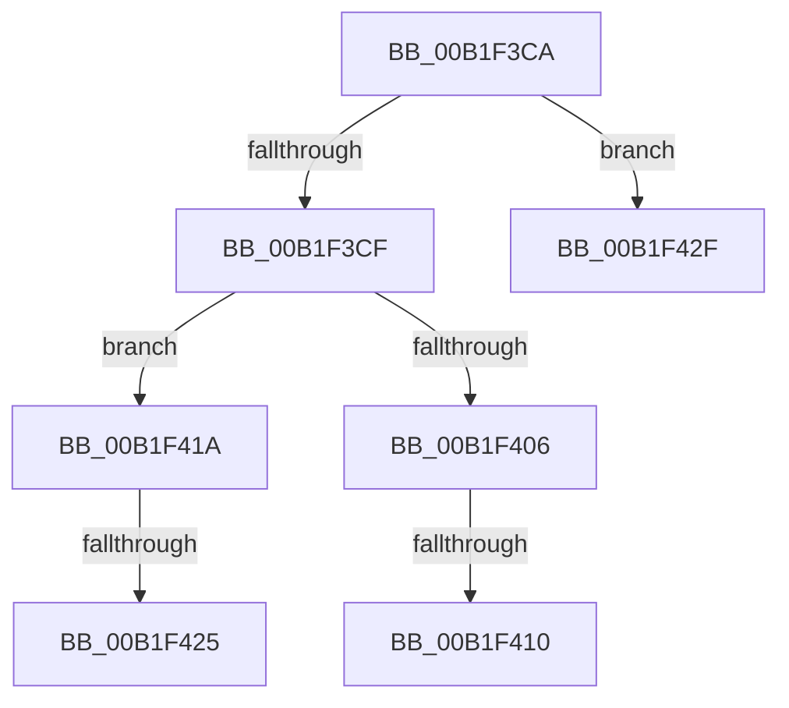

# sub_00B1F3CA

- RVA: `0x00B1F3CA`–`0x00B1F439` (길이 `111` bytes)
- VA: `0x0000000140B1F3CA`
- 실행 섹션: `PAGE`
- PDB 이름 있음: `아니요`; PDB Function 태그: `아니요`
- unwind 정보 RVA: `0x00087D1C`
- 디코드: `25`개 명령, `111/111` bytes 표시
- 미해석 바이트: `0` (있으면 어셈블리에 `.byte`로 보존)

> 이 문서는 커널 이미지의 기계어와 PDB 기호를 분석해 생성했습니다. 4번과 5번은 함수 원형과 자료형을 바이너리 사용 방식에서 추정한 C 해석이며 원본 소스 복구 결과는 아닙니다.

## 1. Dependencies

- 직접 호출 지점: **1**; 고유 호출 대상: **1**
- 직접 호출자로 확인된 함수: **0**
- RIP 상대 이미지 참조: **1**

### Outgoing calls
- `0x00B1F3FB` → [CmGetDeviceRegProp](../8E/CmGetDeviceRegProp_function_008ED870.md) (function, `0x008ED870`)

### Direct callers
- 이 함수 시작 RVA로 연결되는 직접 call은 확인되지 않았습니다. 간접 호출은 완전히 역산할 수 없습니다.

### Static image references
- `0x00B1F3E2` → RVA `0x00E66398` (`.data`; read)

## 2. Other-region calls and transfers

- 다른 실행 섹션으로 향하는 call: **0**
- call이 아닌 외부 분기/꼬리 이동: **5**
  - `0x00B1F40A` → [PiControlGetPropertyData + 0x131](../8F/PiControlGetPropertyData_function_008FA330.md) (`tail-transfer`)
  - `0x00B1F415` → [PiControlGetPropertyData + 0x13E](../8F/PiControlGetPropertyData_function_008FA330.md) (`tail-transfer`)
  - `0x00B1F41F` → [PiControlGetPropertyData + 0x13E](../8F/PiControlGetPropertyData_function_008FA330.md) (`tail-transfer`)
  - `0x00B1F42A` → [PiControlGetPropertyData + 0x12D](../8F/PiControlGetPropertyData_function_008FA330.md) (`tail-transfer`)
  - `0x00B1F434` → [PiControlGetPropertyData + 0x13E](../8F/PiControlGetPropertyData_function_008FA330.md) (`tail-transfer`)

## 3. Assembly (complete function range)

```asm
00B1F3CA  83 F8 01                        cmp eax, 1
00B1F3CD  75 60                           jne 0x140b1f42f
00B1F3CF  83 64 24 38 00                  and dword ptr [rsp + 0x38], 0
00B1F3D4  48 8D 45 38                     lea rax, [rbp + 0x38]
00B1F3D8  48 8B 53 30                     mov rdx, qword ptr [rbx + 0x30]
00B1F3DC  41 B9 22 00 00 00               mov r9d, 0x22
00B1F3E2  48 8B 0D AF 6F 34 00            mov rcx, qword ptr [rip + 0x346faf]
00B1F3E9  45 33 C0                        xor r8d, r8d
00B1F3EC  48 89 74 24 30                  mov qword ptr [rsp + 0x30], rsi
00B1F3F1  48 89 7C 24 28                  mov qword ptr [rsp + 0x28], rdi
00B1F3F6  48 89 44 24 20                  mov qword ptr [rsp + 0x20], rax
00B1F3FB  E8 70 E4 DC FF                  call 0x1408ed870
00B1F400  8B D8                           mov ebx, eax
00B1F402  85 C0                           test eax, eax
00B1F404  78 14                           js 0x140b1f41a
00B1F406  83 7D 38 04                     cmp dword ptr [rbp + 0x38], 4
00B1F40A  0F 84 51 B0 DD FF               je 0x1408fa461
00B1F410  BB F0 00 00 C0                  mov ebx, 0xc00000f0
00B1F415  E9 54 B0 DD FF                  jmp 0x1408fa46e
00B1F41A  3D 25 02 00 C0                  cmp eax, 0xc0000225
00B1F41F  0F 85 49 B0 DD FF               jne 0x1408fa46e
00B1F425  BB 34 00 00 C0                  mov ebx, 0xc0000034
00B1F42A  E9 2E B0 DD FF                  jmp 0x1408fa45d
00B1F42F  BB 0D 00 00 C0                  mov ebx, 0xc000000d
00B1F434  E9 35 B0 DD FF                  jmp 0x1408fa46e
```

## 4. C-style interpretation (structured pseudocode)

```c
__int64 __fastcall sub_00B1F3CA(__int64 a1, __int64 a2, int a3, __int64 a4, __int64 a5, __int64 a6, unsigned int a7)
{
    __int64 result;
    unsigned __int64 v_stack_p20;
    unsigned __int64 v_stack_p28;
    unsigned __int64 v_stack_p30;

    if (((unsigned int)(result)) != 1) goto loc_00B1F42F;
    a3 = 0;
    v_stack_p30 = v_rsi;
    v_stack_p28 = v_rdi;
    v_stack_p20 = v_rbp + 56;
    result = CmGetDeviceRegProp(*(unsigned __int64 *)(v_rip + 3436463), *(unsigned __int64 *)(v_rbx + 48), a3, 34);
    if (sign_flag) goto loc_00B1F41A;
loc_00B1F41A:
loc_00B1F42F:
}
```

## 5. (Beta) C Style

```c
int64_t sub_00B1F3CA(int64_t Arg1, int64_t Arg2, int32_t Arg3, int64_t Arg4, uint64_t Arg5, uint64_t Arg6, uint32_t Arg7)
{
    int64_t result;
    uint64_t v_stack_p20;
    uint64_t v_stack_p28;
    uint64_t v_stack_p30;

    if (((uint32_t)(result)) != 1) goto loc_00B1F42F;
    Arg3 = 0;
    v_stack_p30 = local_rsi;
    v_stack_p28 = local_rdi;
    v_stack_p20 = local_rbp + 56;
    result = CmGetDeviceRegProp(*(uint64_t *)(v_rip + 0x346FAF), *(uint64_t *)(local_rbx + 0x30), Arg3, 34);
    if (sign_flag) goto loc_00B1F41A;
loc_00B1F41A:
loc_00B1F42F:
}
```

## 6. Execution-region graph

[열기: 2D/3D 그래프와 함수 탐색 컨트롤 패널](../../../control-panel.html?section=page&rva=0x00B1F3CA&view=graph)

- 2D 그래프는 위에서 아래로 흐르고, 3D 그래프는 빈 공간을 드래그해 회전합니다. Shift+드래그는 이동, 휠은 확대·축소, 함수 노드 선택은 대상 보고서 이동입니다.

### Static fallback


