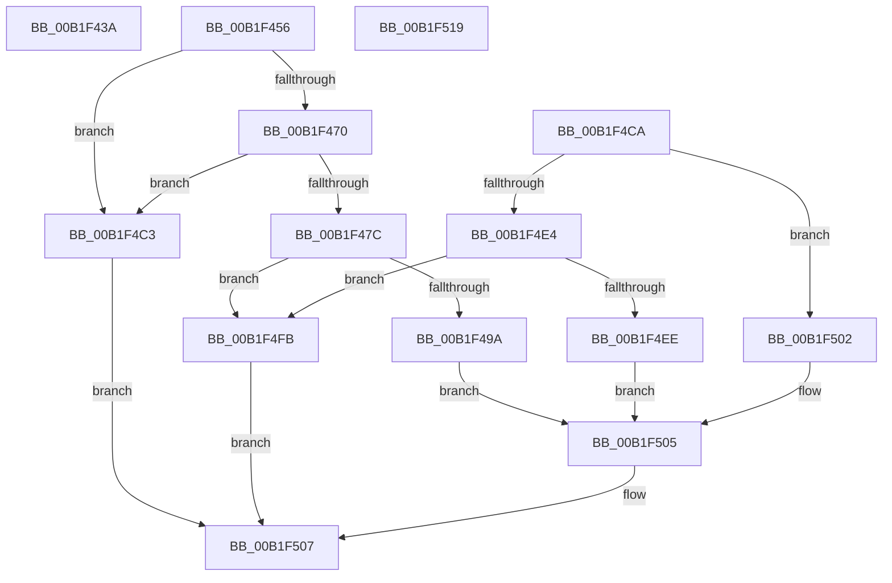

# sub_00B1F43A

- RVA: `0x00B1F43A`–`0x00B1F532` (길이 `248` bytes)
- VA: `0x0000000140B1F43A`
- 실행 섹션: `PAGE`
- PDB 이름 있음: `아니요`; PDB Function 태그: `아니요`
- unwind 정보 RVA: `0x00087D54`
- 디코드: `67`개 명령, `248/248` bytes 표시
- 미해석 바이트: `0` (있으면 어셈블리에 `.byte`로 보존)

> 이 문서는 커널 이미지의 기계어와 PDB 기호를 분석해 생성했습니다. 4번과 5번은 함수 원형과 자료형을 바이너리 사용 방식에서 추정한 C 해석이며 원본 소스 복구 결과는 아닙니다.

## 1. Dependencies

- 직접 호출 지점: **10**; 고유 호출 대상: **6**
- 직접 호출자로 확인된 함수: **0**
- RIP 상대 이미지 참조: **1**

### Outgoing calls
- `0x00B1F44A` → [PiGetDeviceRegistryProperty](../72/PiGetDeviceRegistryProperty_function_007280A8.md) (function, `0x007280A8`)
- `0x00B1F45D` → [ExAcquireFastMutex](../../text/20/ExAcquireFastMutex_function_0020E5A0.md) (function, `0x0020E5A0`)
- `0x00B1F47C` → [PnpDetermineResourceListSize](../8F/PnpDetermineResourceListSize_function_008FC6F8.md) (function, `0x008FC6F8`)
- `0x00B1F486` → [PnpDetermineResourceListSize](../8F/PnpDetermineResourceListSize_function_008FC6F8.md) (function, `0x008FC6F8`)
- `0x00B1F4A7` → [memcpy](../../text/6C/memcpy_function_006C6840.md) (function, `0x006C6840`)
- `0x00B1F4BA` → [memcpy](../../text/6C/memcpy_function_006C6840.md) (function, `0x006C6840`)
- `0x00B1F4D1` → [ExAcquireFastMutex](../../text/20/ExAcquireFastMutex_function_0020E5A0.md) (function, `0x0020E5A0`)
- `0x00B1F4F4` → [memcpy](../../text/6C/memcpy_function_006C6840.md) (function, `0x006C6840`)
- `0x00B1F50E` → [ExReleaseFastMutex](../../text/25/ExReleaseFastMutex_function_002519C0.md) (function, `0x002519C0`)
- `0x00B1F527` → [PpvUtilFailDriver](../../text/5A/PpvUtilFailDriver_function_005AA498.md) (function, `0x005AA498`)

### Direct callers
- 이 함수 시작 RVA로 연결되는 직접 call은 확인되지 않았습니다. 간접 호출은 완전히 역산할 수 없습니다.

### Static image references
- `0x00B1F456` → RVA `0x00F8C3E0` (`.data`; read)

## 2. Other-region calls and transfers

- 다른 실행 섹션으로 향하는 call: **7**
  - `0x00B1F45D` → [ExAcquireFastMutex](../../text/20/ExAcquireFastMutex_function_0020E5A0.md) (`PAGE` → `.text`)
  - `0x00B1F4A7` → [memcpy](../../text/6C/memcpy_function_006C6840.md) (`PAGE` → `.text`)
  - `0x00B1F4BA` → [memcpy](../../text/6C/memcpy_function_006C6840.md) (`PAGE` → `.text`)
  - `0x00B1F4D1` → [ExAcquireFastMutex](../../text/20/ExAcquireFastMutex_function_0020E5A0.md) (`PAGE` → `.text`)
  - `0x00B1F4F4` → [memcpy](../../text/6C/memcpy_function_006C6840.md) (`PAGE` → `.text`)
  - `0x00B1F50E` → [ExReleaseFastMutex](../../text/25/ExReleaseFastMutex_function_002519C0.md) (`PAGE` → `.text`)
  - `0x00B1F527` → [PpvUtilFailDriver](../../text/5A/PpvUtilFailDriver_function_005AA498.md) (`PAGE` → `.text`)
- call이 아닌 외부 분기/꼬리 이동: **3**
  - `0x00B1F451` → [IoGetDeviceProperty + 0xF7](../8F/IoGetDeviceProperty_function_008FA720.md) (`tail-transfer`)
  - `0x00B1F514` → [IoGetDeviceProperty + 0xF7](../8F/IoGetDeviceProperty_function_008FA720.md) (`tail-transfer`)
  - `0x00B1F52D` → [IoGetDeviceProperty + 0x121](../8F/IoGetDeviceProperty_function_008FA720.md) (`tail-transfer`)

## 3. Assembly (complete function range)

```asm
00B1F43A  4C 89 74 24 28                  mov qword ptr [rsp + 0x28], r14
00B1F43F  48 8B CF                        mov rcx, rdi
00B1F442  4C 89 64 24 20                  mov qword ptr [rsp + 0x20], r12
00B1F447  45 89 2E                        mov dword ptr [r14], r13d
00B1F44A  E8 59 8C C0 FF                  call 0x1407280a8
00B1F44F  8B D8                           mov ebx, eax
00B1F451  E9 C1 B3 DD FF                  jmp 0x1408fa817
00B1F456  48 8D 0D 83 CF 46 00            lea rcx, [rip + 0x46cf83]
00B1F45D  E8 3E F1 6E FF                  call 0x14020e5a0
00B1F462  48 8B 8E A0 01 00 00            mov rcx, qword ptr [rsi + 0x1a0]
00B1F469  33 C0                           xor eax, eax
00B1F46B  48 85 C9                        test rcx, rcx
00B1F46E  74 53                           je 0x140b1f4c3
00B1F470  48 8B 9E A8 01 00 00            mov rbx, qword ptr [rsi + 0x1a8]
00B1F477  48 85 DB                        test rbx, rbx
00B1F47A  74 47                           je 0x140b1f4c3
00B1F47C  E8 77 D2 DD FF                  call 0x1408fc6f8
00B1F481  48 8B CB                        mov rcx, rbx
00B1F484  8B F8                           mov edi, eax
00B1F486  E8 6D D2 DD FF                  call 0x1408fc6f8
00B1F48B  44 8B F8                        mov r15d, eax
00B1F48E  41 8D 0C 3F                     lea ecx, [r15 + rdi]
00B1F492  41 89 0E                        mov dword ptr [r14], ecx
00B1F495  41 3B CD                        cmp ecx, r13d
00B1F498  77 61                           ja 0x140b1f4fb
00B1F49A  48 8B 96 A0 01 00 00            mov rdx, qword ptr [rsi + 0x1a0]
00B1F4A1  44 8B C7                        mov r8d, edi
00B1F4A4  49 8B CC                        mov rcx, r12
00B1F4A7  E8 94 73 BA FF                  call 0x1406c6840
00B1F4AC  48 8B 96 A8 01 00 00            mov rdx, qword ptr [rsi + 0x1a8]
00B1F4B3  4A 8D 0C 27                     lea rcx, [rdi + r12]
00B1F4B7  45 8B C7                        mov r8d, r15d
00B1F4BA  E8 81 73 BA FF                  call 0x1406c6840
00B1F4BF  33 FF                           xor edi, edi
00B1F4C1  EB 42                           jmp 0x140b1f505
00B1F4C3  41 89 06                        mov dword ptr [r14], eax
00B1F4C6  8B D8                           mov ebx, eax
00B1F4C8  EB 3D                           jmp 0x140b1f507
00B1F4CA  48 8D 0D 0F CF 46 00            lea rcx, [rip + 0x46cf0f]
00B1F4D1  E8 CA F0 6E FF                  call 0x14020e5a0
00B1F4D6  48 8B 96 B8 01 00 00            mov rdx, qword ptr [rsi + 0x1b8]
00B1F4DD  33 FF                           xor edi, edi
00B1F4DF  48 85 D2                        test rdx, rdx
00B1F4E2  74 1E                           je 0x140b1f502
00B1F4E4  8B 02                           mov eax, dword ptr [rdx]
00B1F4E6  41 89 06                        mov dword ptr [r14], eax
00B1F4E9  41 3B C5                        cmp eax, r13d
00B1F4EC  77 0D                           ja 0x140b1f4fb
00B1F4EE  44 8B 02                        mov r8d, dword ptr [rdx]
00B1F4F1  49 8B CC                        mov rcx, r12
00B1F4F4  E8 47 73 BA FF                  call 0x1406c6840
00B1F4F9  EB 0A                           jmp 0x140b1f505
00B1F4FB  BB 23 00 00 C0                  mov ebx, 0xc0000023
00B1F500  EB 05                           jmp 0x140b1f507
00B1F502  41 89 3E                        mov dword ptr [r14], edi
00B1F505  8B DF                           mov ebx, edi
00B1F507  48 8D 0D D2 CE 46 00            lea rcx, [rip + 0x46ced2]
00B1F50E  E8 AD 24 73 FF                  call 0x1402519c0
00B1F513  90                              nop
00B1F514  E9 FE B2 DD FF                  jmp 0x1408fa817
00B1F519  48 8B 55 57                     mov rdx, qword ptr [rbp + 0x57]
00B1F51D  45 33 C9                        xor r9d, r9d
00B1F520  4C 8B C7                        mov r8, rdi
00B1F523  41 8D 49 02                     lea ecx, [r9 + 2]
00B1F527  E8 6C AF A8 FF                  call 0x1405aa498
00B1F52C  90                              nop
00B1F52D  E9 0F B3 DD FF                  jmp 0x1408fa841
```

## 4. C-style interpretation (structured pseudocode)

```c
__int64 __fastcall sub_00B1F43A(__int64 a1, __int64 a2, __int64 a3, int a4)
{
    __int64 result;
    unsigned __int64 v_stack_p20;
    unsigned __int64 v_stack_p28;

    v_stack_p28 = v_r14;
    v_stack_p20 = v_r12;
    *(unsigned int *)(v_r14) = (unsigned int)(v_r13);
    result = PiGetDeviceRegistryProperty(v_rdi, a2, a3, a4);
}
```

## 5. (Beta) C Style

```c
int64_t sub_00B1F43A(int64_t Arg1, int64_t Arg2, int64_t Arg3, int32_t Arg4)
{
    int64_t result;
    uint64_t v_stack_p20;
    uint64_t v_stack_p28;

    v_stack_p28 = local_r14;
    v_stack_p20 = local_r12;
    *(uint32_t *)(local_r14) = (uint32_t)(local_r13);
    result = PiGetDeviceRegistryProperty(local_rdi, Arg2, Arg3, Arg4);
}
```

## 6. Execution-region graph

[열기: 2D/3D 그래프와 함수 탐색 컨트롤 패널](../../../control-panel.html?section=page&rva=0x00B1F43A&view=graph)

- 2D 그래프는 위에서 아래로 흐르고, 3D 그래프는 빈 공간을 드래그해 회전합니다. Shift+드래그는 이동, 휠은 확대·축소, 함수 노드 선택은 대상 보고서 이동입니다.

### Static fallback


