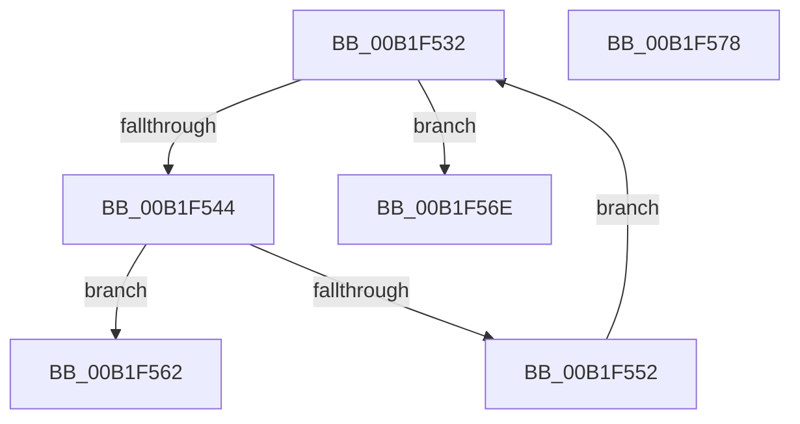

# sub_00B1F532

- RVA: `0x00B1F532`–`0x00B1F5B6` (길이 `132` bytes)
- VA: `0x0000000140B1F532`
- 실행 섹션: `PAGE`
- PDB 이름 있음: `아니요`; PDB Function 태그: `아니요`
- unwind 정보 RVA: `0x00087D8C`
- 디코드: `34`개 명령, `132/132` bytes 표시
- 미해석 바이트: `0` (있으면 어셈블리에 `.byte`로 보존)

> 이 문서는 커널 이미지의 기계어와 PDB 기호를 분석해 생성했습니다. 4번과 5번은 함수 원형과 자료형을 바이너리 사용 방식에서 추정한 C 해석이며 원본 소스 복구 결과는 아닙니다.

## 1. Dependencies

- 직접 호출 지점: **2**; 고유 호출 대상: **2**
- 직접 호출자로 확인된 함수: **0**
- RIP 상대 이미지 참조: **0**

### Outgoing calls
- `0x00B1F537` → [wcschr](../../text/50/wcschr_function_00501A60.md) (function, `0x00501A60`)
- `0x00B1F5AA` → [RtlFormatMessageEx](../A8/RtlFormatMessageEx_function_00A860E0.md) (function, `0x00A860E0`)

### Direct callers
- 이 함수 시작 RVA로 연결되는 직접 call은 확인되지 않았습니다. 간접 호출은 완전히 역산할 수 없습니다.

### Static image references
- 디코드된 RIP-relative 메모리 참조가 없습니다.

## 2. Other-region calls and transfers

- 다른 실행 섹션으로 향하는 call: **1**
  - `0x00B1F537` → [wcschr](../../text/50/wcschr_function_00501A60.md) (`PAGE` → `.text`)
- call이 아닌 외부 분기/꼬리 이동: **3**
  - `0x00B1F569` → [PiGetDeviceRegProperty + 0x12E](../8F/PiGetDeviceRegProperty_function_008FAC6C.md) (`tail-transfer`)
  - `0x00B1F573` → [PiGetDeviceRegProperty + 0x240](../8F/PiGetDeviceRegProperty_function_008FAC6C.md) (`tail-transfer`)
  - `0x00B1F5B1` → [PiGetDeviceRegProperty + 0x150](../8F/PiGetDeviceRegProperty_function_008FAC6C.md) (`tail-transfer`)

## 3. Assembly (complete function range)

```asm
00B1F532  BA 2C 00 00 00                  mov edx, 0x2c
00B1F537  E8 24 25 9E FF                  call 0x140501a60
00B1F53C  45 33 C0                        xor r8d, r8d
00B1F53F  48 85 C0                        test rax, rax
00B1F542  74 2A                           je 0x140b1f56e
00B1F544  66 44 89 00                     mov word ptr [rax], r8w
00B1F548  48 83 C0 02                     add rax, 2
00B1F54C  41 83 FD 13                     cmp r13d, 0x13
00B1F550  73 10                           jae 0x140b1f562
00B1F552  41 8B CD                        mov ecx, r13d
00B1F555  41 FF C5                        inc r13d
00B1F558  48 89 44 CC 70                  mov qword ptr [rsp + rcx*8 + 0x70], rax
00B1F55D  48 8B C8                        mov rcx, rax
00B1F560  EB D0                           jmp 0x140b1f532
00B1F562  4C 8B 6C 24 60                  mov r13, qword ptr [rsp + 0x60]
00B1F567  B1 01                           mov cl, 1
00B1F569  E9 2C B8 DD FF                  jmp 0x1408fad9a
00B1F56E  4C 8B 6C 24 60                  mov r13, qword ptr [rsp + 0x60]
00B1F573  E9 34 B9 DD FF                  jmp 0x1408faeac
00B1F578  4C 89 44 24 48                  mov qword ptr [rsp + 0x48], r8
00B1F57D  45 33 C9                        xor r9d, r9d
00B1F580  4C 89 64 24 40                  mov qword ptr [rsp + 0x40], r12
00B1F585  45 33 C0                        xor r8d, r8d
00B1F588  89 44 24 38                     mov dword ptr [rsp + 0x38], eax
00B1F58C  33 D2                           xor edx, edx
00B1F58E  48 8B 44 24 68                  mov rax, qword ptr [rsp + 0x68]
00B1F593  48 8B CE                        mov rcx, rsi
00B1F596  48 89 44 24 30                  mov qword ptr [rsp + 0x30], rax
00B1F59B  48 8D 44 24 70                  lea rax, [rsp + 0x70]
00B1F5A0  48 89 44 24 28                  mov qword ptr [rsp + 0x28], rax
00B1F5A5  C6 44 24 20 01                  mov byte ptr [rsp + 0x20], 1
00B1F5AA  E8 31 6B F6 FF                  call 0x140a860e0
00B1F5AF  8B D8                           mov ebx, eax
00B1F5B1  E9 06 B8 DD FF                  jmp 0x1408fadbc
```

## 4. C-style interpretation (structured pseudocode)

```c
__int64 __fastcall sub_00B1F532(__int64 a1, __int64 a2, int a3, int a4, __int64 a5, __int64 a6, __int64 a7, __int64 a8, __int64 a9, __int64 a10, __int64 a11, __int64 a12)
{
    __int64 result;
    __int64 v_r13;
    unsigned __int8 v_stack_p20;
    unsigned __int64 v_stack_p28;
    unsigned __int64 v_stack_p30;
    unsigned int v_stack_p38;
    unsigned __int64 v_stack_p40;
    unsigned __int64 v_stack_p48;
    unsigned __int64 v_stack_p68;
    unsigned __int64 v_stack_p70;

    result = wcschr(a1, 44, a3, a4);
    a3 = 0;
    if (result == 0) goto loc_00B1F56E;
    *(unsigned __int16 *)(result) = 0;
    result = (result) + (2);
    if (((unsigned int)(v_r13)) >= 19) goto loc_00B1F562;
    v_r13 = (unsigned int)((v_r13) + 1);
    *(unsigned __int64 *)(v_rsp + (unsigned int)((unsigned int)(v_r13)) * 8 + 112) = result;
    goto loc_00B1F532;
loc_00B1F562:
loc_00B1F56E:
}
```

## 5. (Beta) C Style

```c
int64_t sub_00B1F532(int64_t Arg1, int64_t Arg2, int32_t Arg3, int32_t Arg4, uint64_t Arg5, uint64_t Arg6, uint64_t Arg7, uint64_t Arg8, uint64_t Arg9, uint64_t Arg10, uint64_t Arg11, int64_t Arg12)
{
    int64_t result;
    int64_t local_r13;
    uint8_t v_stack_p20;
    uint64_t v_stack_p28;
    uint64_t v_stack_p30;
    uint32_t v_stack_p38;
    uint64_t v_stack_p40;
    uint64_t v_stack_p48;
    uint64_t v_stack_p68;
    uint64_t v_stack_p70;

    result = wcschr(Arg1, 44, Arg3, Arg4);
    Arg3 = 0;
    if (result == 0) goto loc_00B1F56E;
    *(uint16_t *)(result) = 0;
    result = (result) + (2);
    if (((uint32_t)(local_r13)) >= 19) goto loc_00B1F562;
    local_r13 = (uint32_t)((local_r13) + 1);
    *(uint64_t *)(local_rsp + (uint32_t)((uint32_t)(local_r13)) * 8 + 0x70) = result;
    goto loc_00B1F532;
loc_00B1F562:
loc_00B1F56E:
}
```

## 6. Execution-region graph

[열기: 2D/3D 그래프와 함수 탐색 컨트롤 패널](../../../control-panel.html?section=page&rva=0x00B1F532&view=graph)

- 2D 그래프는 위에서 아래로 흐르고, 3D 그래프는 빈 공간을 드래그해 회전합니다. Shift+드래그는 이동, 휠은 확대·축소, 함수 노드 선택은 대상 보고서 이동입니다.

### Static fallback


