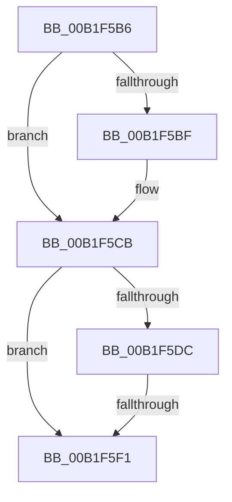

# sub_00B1F5B6

- RVA: `0x00B1F5B6`–`0x00B1F608` (길이 `82` bytes)
- VA: `0x0000000140B1F5B6`
- 실행 섹션: `PAGE`
- PDB 이름 있음: `아니요`; PDB Function 태그: `아니요`
- unwind 정보 RVA: `0x00087DF4`
- 디코드: `23`개 명령, `82/82` bytes 표시
- 미해석 바이트: `0` (있으면 어셈블리에 `.byte`로 보존)

> 이 문서는 커널 이미지의 기계어와 PDB 기호를 분석해 생성했습니다. 4번과 5번은 함수 원형과 자료형을 바이너리 사용 방식에서 추정한 C 해석이며 원본 소스 복구 결과는 아닙니다.

## 1. Dependencies

- 직접 호출 지점: **4**; 고유 호출 대상: **4**
- 직접 호출자로 확인된 함수: **0**
- RIP 상대 이미지 참조: **2**

### Outgoing calls
- `0x00B1F5C6` → [McTemplateK0z_EtwWriteTransfer](../../text/4D/McTemplateK0z_EtwWriteTransfer_function_004DEF6C.md) (function, `0x004DEF6C`)
- `0x00B1F5D1` → [PipSetGuestAssignedProperty](../74/PipSetGuestAssignedProperty_function_00740558.md) (function, `0x00740558`)
- `0x00B1F5E2` → [PipSendGuestAssignedNotification](../74/PipSendGuestAssignedNotification_function_007404B4.md) (function, `0x007404B4`)
- `0x00B1F5FD` → [PnpRequestDeviceRemoval](../8F/PnpRequestDeviceRemoval_function_008FC294.md) (function, `0x008FC294`)

### Direct callers
- 이 함수 시작 RVA로 연결되는 직접 call은 확인되지 않았습니다. 간접 호출은 완전히 역산할 수 없습니다.

### Static image references
- `0x00B1F5B6` → RVA `0x00EF012C` (`.data`; read)
- `0x00B1F5BF` → RVA `0x000271F0` (`.rdata`; read)

## 2. Other-region calls and transfers

- 다른 실행 섹션으로 향하는 call: **1**
  - `0x00B1F5C6` → [McTemplateK0z_EtwWriteTransfer](../../text/4D/McTemplateK0z_EtwWriteTransfer_function_004DEF6C.md) (`PAGE` → `.text`)
- call이 아닌 외부 분기/꼬리 이동: **2**
  - `0x00B1F5EB` → [PiUpdateGuestAssignedState + 0x46](../8F/PiUpdateGuestAssignedState_function_008FB370.md) (`tail-transfer`)
  - `0x00B1F603` → [PiUpdateGuestAssignedState + 0x46](../8F/PiUpdateGuestAssignedState_function_008FB370.md) (`tail-transfer`)

## 3. Assembly (complete function range)

```asm
00B1F5B6  F6 05 6F 0B 3D 00 08            test byte ptr [rip + 0x3d0b6f], 8
00B1F5BD  74 0C                           je 0x140b1f5cb
00B1F5BF  48 8D 15 2A 7C 50 FF            lea rdx, [rip - 0xaf83d6]
00B1F5C6  E8 A1 F9 9B FF                  call 0x1404def6c
00B1F5CB  40 8A D6                        mov dl, sil
00B1F5CE  48 8B CF                        mov rcx, rdi
00B1F5D1  E8 82 0F C2 FF                  call 0x140740558
00B1F5D6  8B D8                           mov ebx, eax
00B1F5D8  85 C0                           test eax, eax
00B1F5DA  78 15                           js 0x140b1f5f1
00B1F5DC  40 8A D6                        mov dl, sil
00B1F5DF  48 8B CF                        mov rcx, rdi
00B1F5E2  E8 CD 0E C2 FF                  call 0x1407404b4
00B1F5E7  8B D8                           mov ebx, eax
00B1F5E9  85 C0                           test eax, eax
00B1F5EB  0F 89 C5 BD DD FF               jns 0x1408fb3b6
00B1F5F1  33 D2                           xor edx, edx
00B1F5F3  44 8B CB                        mov r9d, ebx
00B1F5F6  48 8B CF                        mov rcx, rdi
00B1F5F9  44 8D 42 39                     lea r8d, [rdx + 0x39]
00B1F5FD  E8 92 CC DD FF                  call 0x1408fc294
00B1F602  90                              nop
00B1F603  E9 AE BD DD FF                  jmp 0x1408fb3b6
```

## 4. C-style interpretation (structured pseudocode)

```c
__int64 __fastcall sub_00B1F5B6(void)
{
    __int64 result;

    if (((*(unsigned __int8 *)(v_rip + 4000623)) & (8)) != 0) {
        a2 = v_rip - 11502550;
        result = McTemplateK0z_EtwWriteTransfer(a1, a2, a3, a4);
    }
    result = PipSetGuestAssignedProperty(v_rdi, (unsigned __int8)(v_rsi), a3, a4);
    if (sign_flag) goto loc_00B1F5F1;
    result = PipSendGuestAssignedNotification(v_rdi, (unsigned __int8)(v_rsi), a3, a4);
loc_00B1F5F1:
    a2 = 0;
    result = PnpRequestDeviceRemoval(v_rdi, a2, a2 + 57, (unsigned int)((unsigned int)((unsigned int)((unsigned int)(result)))));
}
```

## 5. (Beta) C Style

```c
void sub_00B1F5B6(void)
{
    int64_t result;

    if (((*(uint8_t *)(v_rip + 0x3D0B6F)) & (8)) != 0) {
        a2 = v_rip - 11502550;
        result = McTemplateK0z_EtwWriteTransfer(a1, a2, a3, a4);
    }
    result = PipSetGuestAssignedProperty(local_rdi, (uint8_t)(local_rsi), a3, a4);
    if (sign_flag) goto loc_00B1F5F1;
    result = PipSendGuestAssignedNotification(local_rdi, (uint8_t)(local_rsi), a3, a4);
loc_00B1F5F1:
    a2 = 0;
    result = PnpRequestDeviceRemoval(local_rdi, a2, a2 + 57, (uint32_t)((uint32_t)((uint32_t)((uint32_t)(result)))));
}
```

## 6. Execution-region graph

[열기: 2D/3D 그래프와 함수 탐색 컨트롤 패널](../../../control-panel.html?section=page&rva=0x00B1F5B6&view=graph)

- 2D 그래프는 위에서 아래로 흐르고, 3D 그래프는 빈 공간을 드래그해 회전합니다. Shift+드래그는 이동, 휠은 확대·축소, 함수 노드 선택은 대상 보고서 이동입니다.

### Static fallback


