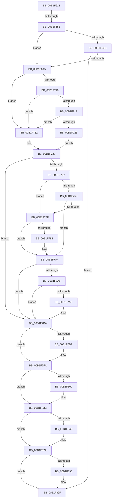

# sub_00B1F622

- RVA: `0x00B1F622`–`0x00B1F9A0` (길이 `894` bytes)
- VA: `0x0000000140B1F622`
- 실행 섹션: `PAGE`
- PDB 이름 있음: `아니요`; PDB Function 태그: `아니요`
- unwind 정보 RVA: `0x00087EB4`
- 디코드: `203`개 명령, `894/894` bytes 표시
- 미해석 바이트: `0` (있으면 어셈블리에 `.byte`로 보존)

> 이 문서는 커널 이미지의 기계어와 PDB 기호를 분석해 생성했습니다. 4번과 5번은 함수 원형과 자료형을 바이너리 사용 방식에서 추정한 C 해석이며 원본 소스 복구 결과는 아닙니다.

## 1. Dependencies

- 직접 호출 지점: **28**; 고유 호출 대상: **20**
- 직접 호출자로 확인된 함수: **0**
- RIP 상대 이미지 참조: **6**

### Outgoing calls
- `0x00B1F646` → [PnpDeviceObjectToDeviceInstance](../8F/PnpDeviceObjectToDeviceInstance_function_008FD630.md) (function, `0x008FD630`)
- `0x00B1F663` → [PnpQueryID](../8F/PnpQueryID_function_008FB984.md) (function, `0x008FB984`)
- `0x00B1F678` → [PnpQueryID](../8F/PnpQueryID_function_008FB984.md) (function, `0x008FB984`)
- `0x00B1F692` → [PnpGenerateDeviceIdsHash](../A2/PnpGenerateDeviceIdsHash_function_00A2B120.md) (function, `0x00A2B120`)
- `0x00B1F6CF` → [ExAcquireResourceSharedLite](../../text/21/ExAcquireResourceSharedLite_function_00211BC0.md) (function, `0x00211BC0`)
- `0x00B1F710` → [CmGetDeviceRegProp](../8E/CmGetDeviceRegProp_function_008ED870.md) (function, `0x008ED870`)
- `0x00B1F774` → [PnpCheckDeviceIdsChanged](../97/PnpCheckDeviceIdsChanged_function_00972938.md) (function, `0x00972938`)
- `0x00B1F79F` → [PnpCheckDeviceIdsChanged](../97/PnpCheckDeviceIdsChanged_function_00972938.md) (function, `0x00972938`)
- `0x00B1F7EB` → [CmSetDeviceRegProp](../8F/CmSetDeviceRegProp_function_008FD68C.md) (function, `0x008FD68C`)
- `0x00B1F7F5` → [ExFreePoolWithTag](../../poolcode/B8/ExFreePoolWithTag_function_00B82870.md) (function, `0x00B82870`)
- `0x00B1F82D` → [CmSetDeviceRegProp](../8F/CmSetDeviceRegProp_function_008FD68C.md) (function, `0x008FD68C`)
- `0x00B1F837` → [ExFreePoolWithTag](../../poolcode/B8/ExFreePoolWithTag_function_00B82870.md) (function, `0x00B82870`)
- `0x00B1F875` → [CmSetDeviceRegProp](../8F/CmSetDeviceRegProp_function_008FD68C.md) (function, `0x008FD68C`)
- `0x00B1F881` → [ExReleaseResourceLite](../../text/25/ExReleaseResourceLite_function_0025FA10.md) (function, `0x0025FA10`)
- `0x00B1F886` → [KeLeaveCriticalRegion](../../text/25/KeLeaveCriticalRegion_function_0025D8B0.md) (function, `0x0025D8B0`)
- `0x00B1F89A` → [PpDevCfgProcessDevice](../AB/PpDevCfgProcessDevice_function_00AB6DB0.md) (function, `0x00AB6DB0`)
- `0x00B1F8E6` → [PnpSetObjectProperty](../8F/PnpSetObjectProperty_function_008F66E8.md) (function, `0x008F66E8`)
- `0x00B1F8F6` → [RtlInitUnicodeString](../../text/42/RtlInitUnicodeString_function_0042A780.md) (function, `0x0042A780`)
- `0x00B1F906` → [RtlGUIDFromString](../8F/RtlGUIDFromString_function_008F1EF0.md) (function, `0x008F1EF0`)
- `0x00B1F913` → [PipSetDevNodeFlags](../8F/PipSetDevNodeFlags_function_008FC048.md) (function, `0x008FC048`)
- `0x00B1F932` → [ExAcquireResourceSharedLite](../../text/21/ExAcquireResourceSharedLite_function_00211BC0.md) (function, `0x00211BC0`)
- `0x00B1F946` → [PiDcUpdateDeviceContainerMembership](../8F/PiDcUpdateDeviceContainerMembership_function_008FD0A8.md) (function, `0x008FD0A8`)
- `0x00B1F952` → [ExReleaseResourceLite](../../text/25/ExReleaseResourceLite_function_0025FA10.md) (function, `0x0025FA10`)
- `0x00B1F957` → [KeLeaveCriticalRegion](../../text/25/KeLeaveCriticalRegion_function_0025D8B0.md) (function, `0x0025D8B0`)
- `0x00B1F963` → [PiUpdateDevicePanel](../8F/PiUpdateDevicePanel_function_008FBD4C.md) (function, `0x008FBD4C`)
- `0x00B1F96C` → [ZwClose](../../text/6A/ZwClose_function_006AD2B0.md) (function, `0x006AD2B0`)
- `0x00B1F97B` → [PnpRaiseNtPlugPlayDevicePropertyChangeEvent](../8F/PnpRaiseNtPlugPlayDevicePropertyChangeEvent_function_008F7D80.md) (function, `0x008F7D80`)
- `0x00B1F98B` → [PnpSetPlugPlayEvent](../8F/PnpSetPlugPlayEvent_function_008FBE04.md) (function, `0x008FBE04`)

### Direct callers
- 이 함수 시작 RVA로 연결되는 직접 call은 확인되지 않았습니다. 간접 호출은 완전히 역산할 수 없습니다.

### Static image references
- `0x00B1F6A9` → RVA `0x00F8C600` (`.data`; read)
- `0x00B1F6E6` → RVA `0x00E66398` (`.data`; read)
- `0x00B1F8A3` → RVA `0x00E66268` (`.data`; read)
- `0x00B1F8CD` → RVA `0x000212D0` (`.rdata`; read)
- `0x00B1F8EB` → RVA `0x00AFE270` (` ?? ::NNGAKEGL::`string'`; read)
- `0x00B1F984` → RVA `0x00011610` (`.rdata`; read)

## 2. Other-region calls and transfers

- 다른 실행 섹션으로 향하는 call: **10**
  - `0x00B1F6CF` → [ExAcquireResourceSharedLite](../../text/21/ExAcquireResourceSharedLite_function_00211BC0.md) (`PAGE` → `.text`)
  - `0x00B1F7F5` → [ExFreePoolWithTag](../../poolcode/B8/ExFreePoolWithTag_function_00B82870.md) (`PAGE` → `POOLCODE`)
  - `0x00B1F837` → [ExFreePoolWithTag](../../poolcode/B8/ExFreePoolWithTag_function_00B82870.md) (`PAGE` → `POOLCODE`)
  - `0x00B1F881` → [ExReleaseResourceLite](../../text/25/ExReleaseResourceLite_function_0025FA10.md) (`PAGE` → `.text`)
  - `0x00B1F886` → [KeLeaveCriticalRegion](../../text/25/KeLeaveCriticalRegion_function_0025D8B0.md) (`PAGE` → `.text`)
  - `0x00B1F8F6` → [RtlInitUnicodeString](../../text/42/RtlInitUnicodeString_function_0042A780.md) (`PAGE` → `.text`)
  - `0x00B1F932` → [ExAcquireResourceSharedLite](../../text/21/ExAcquireResourceSharedLite_function_00211BC0.md) (`PAGE` → `.text`)
  - `0x00B1F952` → [ExReleaseResourceLite](../../text/25/ExReleaseResourceLite_function_0025FA10.md) (`PAGE` → `.text`)
  - `0x00B1F957` → [KeLeaveCriticalRegion](../../text/25/KeLeaveCriticalRegion_function_0025D8B0.md) (`PAGE` → `.text`)
  - `0x00B1F96C` → [ZwClose](../../text/6A/ZwClose_function_006AD2B0.md) (`PAGE` → `.text`)
- call이 아닌 외부 분기/꼬리 이동: **2**
  - `0x00B1F64D` → [PipProcessStartPhase3 + 0x66](../8F/PipProcessStartPhase3_function_008FBAF8.md) (`tail-transfer`)
  - `0x00B1F99B` → [PipProcessStartPhase3 + 0x66](../8F/PipProcessStartPhase3_function_008FBAF8.md) (`tail-transfer`)

## 3. Assembly (complete function range)

```asm
00B1F622  0F 57 C0                        xorps xmm0, xmm0
00B1F625  4C 89 65 E7                     mov qword ptr [rbp - 0x19], r12
00B1F629  41 B8 19 00 02 00               mov r8d, 0x20019
00B1F62F  44 89 65 DF                     mov dword ptr [rbp - 0x21], r12d
00B1F633  48 8D 55 CF                     lea rdx, [rbp - 0x31]
00B1F637  4C 89 65 EF                     mov qword ptr [rbp - 0x11], r12
00B1F63B  49 8B CF                        mov rcx, r15
00B1F63E  44 89 65 E3                     mov dword ptr [rbp - 0x1d], r12d
00B1F642  0F 11 45 FF                     movups xmmword ptr [rbp - 1], xmm0
00B1F646  E8 E5 DF DD FF                  call 0x1408fd630
00B1F64B  85 C0                           test eax, eax
00B1F64D  0F 88 0B C5 DD FF               js 0x1408fbb5e
00B1F653  4C 8D 4D E3                     lea r9, [rbp - 0x1d]
00B1F657  BA 01 00 00 00                  mov edx, 1
00B1F65C  4C 8D 45 EF                     lea r8, [rbp - 0x11]
00B1F660  48 8B CF                        mov rcx, rdi
00B1F663  E8 1C C3 DD FF                  call 0x1408fb984
00B1F668  4C 8D 4D DF                     lea r9, [rbp - 0x21]
00B1F66C  BA 02 00 00 00                  mov edx, 2
00B1F671  4C 8D 45 E7                     lea r8, [rbp - 0x19]
00B1F675  48 8B CF                        mov rcx, rdi
00B1F678  E8 07 C3 DD FF                  call 0x1408fb984
00B1F67D  4C 8B 75 E7                     mov r14, qword ptr [rbp - 0x19]
00B1F681  4C 8D 87 AC 02 00 00            lea r8, [rdi + 0x2ac]
00B1F688  48 8B 5D EF                     mov rbx, qword ptr [rbp - 0x11]
00B1F68C  49 8B D6                        mov rdx, r14
00B1F68F  48 8B CB                        mov rcx, rbx
00B1F692  E8 89 BA F0 FF                  call 0x140a2b120
00B1F697  48 85 DB                        test rbx, rbx
00B1F69A  75 09                           jne 0x140b1f6a5
00B1F69C  4D 85 F6                        test r14, r14
00B1F69F  0F 84 FA 01 00 00               je 0x140b1f89f
00B1F6A5  44 89 65 C7                     mov dword ptr [rbp - 0x39], r12d
00B1F6A9  48 8D 0D 50 CF 46 00            lea rcx, [rip + 0x46cf50]
00B1F6B0  44 89 65 D7                     mov dword ptr [rbp - 0x29], r12d
00B1F6B4  B2 01                           mov dl, 1
00B1F6B6  65 48 8B 04 25 88 01 00 00      mov rax, qword ptr gs:[0x188]
00B1F6BF  44 88 65 77                     mov byte ptr [rbp + 0x77], r12b
00B1F6C3  44 88 65 7F                     mov byte ptr [rbp + 0x7f], r12b
00B1F6C7  66 FF 88 E4 01 00 00            dec word ptr [rax + 0x1e4]
00B1F6CE  90                              nop
00B1F6CF  E8 EC 24 6F FF                  call 0x140211bc0
00B1F6D4  4C 8B 45 CF                     mov r8, qword ptr [rbp - 0x31]
00B1F6D8  48 8D 45 DB                     lea rax, [rbp - 0x25]
00B1F6DC  48 8B 57 30                     mov rdx, qword ptr [rdi + 0x30]
00B1F6E0  41 B9 0B 00 00 00               mov r9d, 0xb
00B1F6E6  48 8B 0D AB 6C 34 00            mov rcx, qword ptr [rip + 0x346cab]
00B1F6ED  44 89 64 24 38                  mov dword ptr [rsp + 0x38], r12d
00B1F6F2  48 89 44 24 30                  mov qword ptr [rsp + 0x30], rax
00B1F6F7  48 8D 45 C7                     lea rax, [rbp - 0x39]
00B1F6FB  48 89 44 24 28                  mov qword ptr [rsp + 0x28], rax
00B1F700  48 8D 45 D7                     lea rax, [rbp - 0x29]
00B1F704  48 89 44 24 20                  mov qword ptr [rsp + 0x20], rax
00B1F709  C7 45 DB 04 00 00 00            mov dword ptr [rbp - 0x25], 4
00B1F710  E8 5B E1 DC FF                  call 0x1408ed870
00B1F715  85 C0                           test eax, eax
00B1F717  78 19                           js 0x140b1f732
00B1F719  83 7D D7 04                     cmp dword ptr [rbp - 0x29], 4
00B1F71D  75 13                           jne 0x140b1f732
00B1F71F  83 7D DB 04                     cmp dword ptr [rbp - 0x25], 4
00B1F723  75 0D                           jne 0x140b1f732
00B1F725  8B 45 C7                        mov eax, dword ptr [rbp - 0x39]
00B1F728  24 21                           and al, 0x21
00B1F72A  3C 20                           cmp al, 0x20
00B1F72C  41 0F 94 C6                     sete r14b
00B1F730  EB 07                           jmp 0x140b1f739
00B1F732  44 89 65 C7                     mov dword ptr [rbp - 0x39], r12d
00B1F736  41 B6 01                        mov r14b, 1
00B1F739  F7 45 C7 00 04 00 00            test dword ptr [rbp - 0x39], 0x400
00B1F740  48 8B 5D E7                     mov rbx, qword ptr [rbp - 0x19]
00B1F744  44 8B 6D DF                     mov r13d, dword ptr [rbp - 0x21]
00B1F748  48 8B 75 EF                     mov rsi, qword ptr [rbp - 0x11]
00B1F74C  44 8B 65 E3                     mov r12d, dword ptr [rbp - 0x1d]
00B1F750  75 68                           jne 0x140b1f7ba
00B1F752  33 C0                           xor eax, eax
00B1F754  48 85 F6                        test rsi, rsi
00B1F757  74 26                           je 0x140b1f77f
00B1F759  48 8B 55 CF                     mov rdx, qword ptr [rbp - 0x31]
00B1F75D  48 8D 45 77                     lea rax, [rbp + 0x77]
00B1F761  48 89 44 24 28                  mov qword ptr [rsp + 0x28], rax
00B1F766  45 8B CC                        mov r9d, r12d
00B1F769  4C 8B C6                        mov r8, rsi
00B1F76C  C6 44 24 20 01                  mov byte ptr [rsp + 0x20], 1
00B1F771  48 8B CF                        mov rcx, rdi
00B1F774  E8 BF 31 E5 FF                  call 0x140972938
00B1F779  80 7D 77 00                     cmp byte ptr [rbp + 0x77], 0
00B1F77D  75 25                           jne 0x140b1f7a4
00B1F77F  48 85 DB                        test rbx, rbx
00B1F782  74 20                           je 0x140b1f7a4
00B1F784  48 8B 55 CF                     mov rdx, qword ptr [rbp - 0x31]
00B1F788  48 8D 45 77                     lea rax, [rbp + 0x77]
00B1F78C  48 89 44 24 28                  mov qword ptr [rsp + 0x28], rax
00B1F791  45 8B CD                        mov r9d, r13d
00B1F794  4C 8B C3                        mov r8, rbx
00B1F797  C6 44 24 20 00                  mov byte ptr [rsp + 0x20], 0
00B1F79C  48 8B CF                        mov rcx, rdi
00B1F79F  E8 94 31 E5 FF                  call 0x140972938
00B1F7A4  85 C0                           test eax, eax
00B1F7A6  78 12                           js 0x140b1f7ba
00B1F7A8  80 7D 77 00                     cmp byte ptr [rbp + 0x77], 0
00B1F7AC  74 0C                           je 0x140b1f7ba
00B1F7AE  0F BA 6D C7 0A                  bts dword ptr [rbp - 0x39], 0xa
00B1F7B3  41 B6 01                        mov r14b, 1
00B1F7B6  C6 45 7F 01                     mov byte ptr [rbp + 0x7f], 1
00B1F7BA  48 85 F6                        test rsi, rsi
00B1F7BD  74 3B                           je 0x140b1f7fa
00B1F7BF  83 64 24 38 00                  and dword ptr [rsp + 0x38], 0
00B1F7C4  41 B9 02 00 00 00               mov r9d, 2
00B1F7CA  4C 8B 45 CF                     mov r8, qword ptr [rbp - 0x31]
00B1F7CE  48 8B 57 30                     mov rdx, qword ptr [rdi + 0x30]
00B1F7D2  48 8B 0D BF 6B 34 00            mov rcx, qword ptr [rip + 0x346bbf]
00B1F7D9  44 89 64 24 30                  mov dword ptr [rsp + 0x30], r12d
00B1F7DE  48 89 74 24 28                  mov qword ptr [rsp + 0x28], rsi
00B1F7E3  C7 44 24 20 07 00 00 00         mov dword ptr [rsp + 0x20], 7
00B1F7EB  E8 9C DE DD FF                  call 0x1408fd68c
00B1F7F0  33 D2                           xor edx, edx
00B1F7F2  48 8B CE                        mov rcx, rsi
00B1F7F5  E8 76 30 06 00                  call 0x140b82870
00B1F7FA  45 33 E4                        xor r12d, r12d
00B1F7FD  48 85 DB                        test rbx, rbx
00B1F800  74 3A                           je 0x140b1f83c
00B1F802  4C 8B 45 CF                     mov r8, qword ptr [rbp - 0x31]
00B1F806  45 8D 4C 24 03                  lea r9d, [r12 + 3]
00B1F80B  48 8B 57 30                     mov rdx, qword ptr [rdi + 0x30]
00B1F80F  48 8B 0D 82 6B 34 00            mov rcx, qword ptr [rip + 0x346b82]
00B1F816  44 89 64 24 38                  mov dword ptr [rsp + 0x38], r12d
00B1F81B  44 89 6C 24 30                  mov dword ptr [rsp + 0x30], r13d
00B1F820  48 89 5C 24 28                  mov qword ptr [rsp + 0x28], rbx
00B1F825  C7 44 24 20 07 00 00 00         mov dword ptr [rsp + 0x20], 7
00B1F82D  E8 5A DE DD FF                  call 0x1408fd68c
00B1F832  33 D2                           xor edx, edx
00B1F834  48 8B CB                        mov rcx, rbx
00B1F837  E8 34 30 06 00                  call 0x140b82870
00B1F83C  44 38 65 7F                     cmp byte ptr [rbp + 0x7f], r12b
00B1F840  74 38                           je 0x140b1f87a
00B1F842  4C 8B 45 CF                     mov r8, qword ptr [rbp - 0x31]
00B1F846  48 8D 45 C7                     lea rax, [rbp - 0x39]
00B1F84A  48 8B 57 30                     mov rdx, qword ptr [rdi + 0x30]
00B1F84E  41 B9 0B 00 00 00               mov r9d, 0xb
00B1F854  48 8B 0D 3D 6B 34 00            mov rcx, qword ptr [rip + 0x346b3d]
00B1F85B  44 89 64 24 38                  mov dword ptr [rsp + 0x38], r12d
00B1F860  C7 44 24 30 04 00 00 00         mov dword ptr [rsp + 0x30], 4
00B1F868  48 89 44 24 28                  mov qword ptr [rsp + 0x28], rax
00B1F86D  C7 44 24 20 04 00 00 00         mov dword ptr [rsp + 0x20], 4
00B1F875  E8 12 DE DD FF                  call 0x1408fd68c
00B1F87A  48 8D 0D 7F CD 46 00            lea rcx, [rip + 0x46cd7f]
00B1F881  E8 8A 01 74 FF                  call 0x14025fa10
00B1F886  E8 25 E0 73 FF                  call 0x14025d8b0
00B1F88B  45 84 F6                        test r14b, r14b
00B1F88E  74 0F                           je 0x140b1f89f
00B1F890  48 8B 55 CF                     mov rdx, qword ptr [rbp - 0x31]
00B1F894  45 33 C0                        xor r8d, r8d
00B1F897  48 8B CF                        mov rcx, rdi
00B1F89A  E8 11 75 F9 FF                  call 0x140ab6db0
00B1F89F  4C 8B 4D CF                     mov r9, qword ptr [rbp - 0x31]
00B1F8A3  48 8D 05 BE 69 34 00            lea rax, [rip + 0x3469be]
00B1F8AA  48 8B 57 30                     mov rdx, qword ptr [rdi + 0x30]
00B1F8AE  41 B8 01 00 00 00               mov r8d, 1
00B1F8B4  48 8B 0D DD 6A 34 00            mov rcx, qword ptr [rip + 0x346add]
00B1F8BB  44 89 64 24 48                  mov dword ptr [rsp + 0x48], r12d
00B1F8C0  C7 44 24 40 04 00 00 00         mov dword ptr [rsp + 0x40], 4
00B1F8C8  48 89 44 24 38                  mov qword ptr [rsp + 0x38], rax
00B1F8CD  48 8D 05 FC 19 50 FF            lea rax, [rip - 0xafe604]
00B1F8D4  C7 44 24 30 07 00 00 00         mov dword ptr [rsp + 0x30], 7
00B1F8DC  48 89 44 24 28                  mov qword ptr [rsp + 0x28], rax
00B1F8E1  4C 89 64 24 20                  mov qword ptr [rsp + 0x20], r12
00B1F8E6  E8 FD 6D DD FF                  call 0x1408f66e8
00B1F8EB  48 8D 15 7E E9 FD FF            lea rdx, [rip - 0x21682]
00B1F8F2  48 8D 4D FF                     lea rcx, [rbp - 1]
00B1F8F6  E8 85 AE 90 FF                  call 0x14042a780
00B1F8FB  48 8D 97 98 02 00 00            lea rdx, [rdi + 0x298]
00B1F902  48 8D 4D FF                     lea rcx, [rbp - 1]
00B1F906  E8 E5 25 DD FF                  call 0x1408f1ef0
00B1F90B  BA 20 00 00 00                  mov edx, 0x20
00B1F910  48 8B CF                        mov rcx, rdi
00B1F913  E8 30 C7 DD FF                  call 0x1408fc048
00B1F918  65 48 8B 04 25 88 01 00 00      mov rax, qword ptr gs:[0x188]
00B1F921  48 8D 0D D8 CC 46 00            lea rcx, [rip + 0x46ccd8]
00B1F928  B2 01                           mov dl, 1
00B1F92A  66 FF 88 E4 01 00 00            dec word ptr [rax + 0x1e4]
00B1F931  90                              nop
00B1F932  E8 89 22 6F FF                  call 0x140211bc0
00B1F937  48 8B 55 CF                     mov rdx, qword ptr [rbp - 0x31]
00B1F93B  4C 8D 05 2E E9 FD FF            lea r8, [rip - 0x216d2]
00B1F942  48 8B 4F 30                     mov rcx, qword ptr [rdi + 0x30]
00B1F946  E8 5D D7 DD FF                  call 0x1408fd0a8
00B1F94B  48 8D 0D AE CC 46 00            lea rcx, [rip + 0x46ccae]
00B1F952  E8 B9 00 74 FF                  call 0x14025fa10
00B1F957  E8 54 DF 73 FF                  call 0x14025d8b0
00B1F95C  48 8B 55 CF                     mov rdx, qword ptr [rbp - 0x31]
00B1F960  48 8B CF                        mov rcx, rdi
00B1F963  E8 E4 C3 DD FF                  call 0x1408fbd4c
00B1F968  48 8B 4D CF                     mov rcx, qword ptr [rbp - 0x31]
00B1F96C  E8 3F D9 B8 FF                  call 0x1406ad2b0
00B1F971  48 8B 57 30                     mov rdx, qword ptr [rdi + 0x30]
00B1F975  41 B8 01 00 00 00               mov r8d, 1
00B1F97B  E8 00 84 DD FF                  call 0x1408f7d80
00B1F980  48 8B 57 20                     mov rdx, qword ptr [rdi + 0x20]
00B1F984  48 8D 0D 85 1C 4F FF            lea rcx, [rip - 0xb0e37b]
00B1F98B  E8 74 C4 DD FF                  call 0x1408fbe04
00B1F990  44 8B 75 6F                     mov r14d, dword ptr [rbp + 0x6f]
00B1F994  48 8D 9F 8C 01 00 00            lea rbx, [rdi + 0x18c]
00B1F99B  E9 BE C1 DD FF                  jmp 0x1408fbb5e
```

## 4. C-style interpretation (structured pseudocode)

```c
__int64 __fastcall sub_00B1F622(__int64 a1, __int64 a2, __int64 a3, __int64 a4, __int64 a5, __int64 a6, unsigned int a7)
{
    __int64 result;
    __int64 v_r12;
    __int64 v_r14;
    unsigned __int64 v_stack_p20;
    unsigned __int64 v_stack_p28;
    unsigned __int64 v_stack_p30;
    unsigned int v_stack_p38;
    unsigned int v_stack_p40;
    unsigned int v_stack_p48;

    *(unsigned __int64 *)(v_rbp - 25) = v_r12;
    *(unsigned int *)(v_rbp - 33) = (unsigned int)(v_r12);
    *(unsigned __int64 *)(v_rbp - 17) = v_r12;
    *(unsigned int *)(v_rbp - 29) = (unsigned int)(v_r12);
    *(unsigned __int64 *)(v_rbp - 1) = v_xmm0;
    result = PnpDeviceObjectToDeviceInstance(v_r15, v_rbp - 49, (unsigned int)(0x20019ULL), a4);
    result = PnpQueryID(v_rdi, 1, v_rbp - 17, v_rbp - 29);
    result = PnpQueryID(v_rdi, 2, v_rbp - 25, v_rbp - 33);
    result = PnpGenerateDeviceIdsHash(*(unsigned __int64 *)(v_rbp - 17), *(unsigned __int64 *)(v_rbp - 25), v_rdi + 684, v_rbp - 33);
    if (*(unsigned __int64 *)(v_rbp - 17) != 0) goto loc_00B1F6A5;
    if (*(unsigned __int64 *)(v_rbp - 25) == 0) goto loc_00B1F89F;
loc_00B1F6A5:
    *(unsigned int *)(v_rbp - 57) = (unsigned int)(v_r12);
    *(unsigned int *)(v_rbp - 41) = (unsigned int)(v_r12);
    *(unsigned __int8 *)(v_rbp + 119) = (unsigned __int8)(v_r12);
    *(unsigned __int8 *)(v_rbp + 127) = (unsigned __int8)(v_r12);
    result = ExAcquireResourceSharedLite(v_rip + 4640592, 1, v_rdi + 684, v_rbp - 33);
    v_stack_p38 = (unsigned int)(v_r12);
    v_stack_p30 = v_rbp - 37;
    v_stack_p28 = v_rbp - 57;
    v_stack_p20 = v_rbp - 41;
    *(unsigned int *)(v_rbp - 37) = 4;
    result = CmGetDeviceRegProp(*(unsigned __int64 *)(v_rip + 3435691), *(unsigned __int64 *)(v_rdi + 48), *(unsigned __int64 *)(v_rbp - 49), 11);
    if (sign_flag) goto loc_00B1F732;
    if ((*(unsigned int *)(v_rbp - 41)) != 4) goto loc_00B1F732;
    if ((*(unsigned int *)(v_rbp - 37)) != 4) goto loc_00B1F732;
    result = (unsigned __int8)(((unsigned int)(*(unsigned int *)(v_rbp - 57))) & (33));
    v_r14 = (((unsigned __int8)(result)) == 32) ? 1 : 0;
    goto loc_00B1F739;
loc_00B1F732:
    *(unsigned int *)(v_rbp - 57) = (unsigned int)(v_r12);
loc_00B1F739:
    if (((*(unsigned int *)(v_rbp - 57)) & (0x400ULL)) != 0) goto loc_00B1F7BA;
    result = 0;
    if (*(unsigned __int64 *)(v_rbp - 17) == 0) goto loc_00B1F77F;
    v_stack_p28 = v_rbp + 119;
    v_stack_p20 = 1;
    result = PnpCheckDeviceIdsChanged(v_rdi, *(unsigned __int64 *)(v_rbp - 49), *(unsigned __int64 *)(v_rbp - 17), (unsigned int)((unsigned int)((unsigned int)(*(unsigned int *)(v_rbp - 29)))));
    if ((*(unsigned __int8 *)(v_rbp + 119)) != 0) goto loc_00B1F7A4;
loc_00B1F77F:
    if (*(unsigned __int64 *)(v_rbp - 25) != 0) {
        a2 = *(unsigned __int64 *)(v_rbp - 49);
        result = v_rbp + 119;
        v_stack_p28 = result;
        a4 = (unsigned int)((unsigned int)(*(unsigned int *)(v_rbp - 33)));
        a3 = *(unsigned __int64 *)(v_rbp - 25);
        v_stack_p20 = 0;
        a1 = v_rdi;
        result = PnpCheckDeviceIdsChanged(a1, a2, a3, a4);
    }
    if (sign_flag) goto loc_00B1F7BA;
    v_r14 = 1;
    if ((*(unsigned __int8 *)(v_rbp + 119)) != 0) {
        v_r14 = 1;
        *(unsigned __int8 *)(v_rbp + 127) = 1;
    }
    if (*(unsigned __int64 *)(v_rbp - 17) != 0) {
        a4 = 2;
        a3 = *(unsigned __int64 *)(v_rbp - 49);
        a2 = *(unsigned __int64 *)(v_rdi + 48);
        a1 = *(unsigned __int64 *)(v_rip + 3435455);
        v_stack_p30 = (unsigned int)((unsigned int)(*(unsigned int *)(v_rbp - 29)));
        v_stack_p28 = *(unsigned __int64 *)(v_rbp - 17);
        v_stack_p20 = 7;
        result = CmSetDeviceRegProp(a1, a2, a3, a4);
        a2 = 0;
        a1 = *(unsigned __int64 *)(v_rbp - 17);
        result = ExFreePoolWithTag(a1, a2, a3, a4);
    }
    v_r12 = 0;
    if (*(unsigned __int64 *)(v_rbp - 25) != 0) {
        a3 = *(unsigned __int64 *)(v_rbp - 49);
        a4 = v_r12 + 3;
        a2 = *(unsigned __int64 *)(v_rdi + 48);
        a1 = *(unsigned __int64 *)(v_rip + 3435394);
        v_stack_p38 = 0;
        v_stack_p30 = (unsigned int)((unsigned int)(*(unsigned int *)(v_rbp - 33)));
        v_stack_p28 = *(unsigned __int64 *)(v_rbp - 25);
        v_stack_p20 = 7;
        result = CmSetDeviceRegProp(a1, a2, a3, a4);
        a2 = 0;
        a1 = *(unsigned __int64 *)(v_rbp - 25);
        result = ExFreePoolWithTag(a1, a2, a3, a4);
    }
    if ((*(unsigned __int8 *)(v_rbp + 127)) != 0) {
        a3 = *(unsigned __int64 *)(v_rbp - 49);
        result = v_rbp - 57;
        a2 = *(unsigned __int64 *)(v_rdi + 48);
        a4 = 11;
        a1 = *(unsigned __int64 *)(v_rip + 3435325);
        v_stack_p38 = 0;
        v_stack_p30 = 4;
        v_stack_p28 = result;
        v_stack_p20 = 4;
        result = CmSetDeviceRegProp(a1, a2, a3, a4);
    }
    result = ExReleaseResourceLite(v_rip + 4640127, a2, a3, a4);
    result = KeLeaveCriticalRegion(v_rip + 4640127, a2, a3, a4);
    if ((unsigned __int8)(v_r14) != 0) {
        a2 = *(unsigned __int64 *)(v_rbp - 49);
        a3 = 0;
        a1 = v_rdi;
        result = PpDevCfgProcessDevice(a1, a2, a3, a4);
    }
    v_stack_p48 = 0;
    v_stack_p40 = 4;
    v_stack_p38 = v_rip + 3434942;
    v_stack_p30 = 7;
    v_stack_p28 = v_rip - 11527684;
    v_stack_p20 = 0;
    result = PnpSetObjectProperty(*(unsigned __int64 *)(v_rip + 3435229), *(unsigned __int64 *)(v_rdi + 48), 1, *(unsigned __int64 *)(v_rbp - 49));
    result = RtlInitUnicodeString(v_rbp - 1, v_rip - 136834, 1, *(unsigned __int64 *)(v_rbp - 49));
    result = RtlGUIDFromString(v_rbp - 1, v_rdi + 664, 1, *(unsigned __int64 *)(v_rbp - 49));
    result = PipSetDevNodeFlags(v_rdi, 32, 1, *(unsigned __int64 *)(v_rbp - 49));
    result = ExAcquireResourceSharedLite(v_rip + 4639960, 1, 1, *(unsigned __int64 *)(v_rbp - 49));
    result = PiDcUpdateDeviceContainerMembership(*(unsigned __int64 *)(v_rdi + 48), *(unsigned __int64 *)(v_rbp - 49), v_rip - 136914, *(unsigned __int64 *)(v_rbp - 49));
    result = ExReleaseResourceLite(v_rip + 4639918, *(unsigned __int64 *)(v_rbp - 49), v_rip - 136914, *(unsigned __int64 *)(v_rbp - 49));
    result = KeLeaveCriticalRegion(v_rip + 4639918, *(unsigned __int64 *)(v_rbp - 49), v_rip - 136914, *(unsigned __int64 *)(v_rbp - 49));
    result = PiUpdateDevicePanel(v_rdi, *(unsigned __int64 *)(v_rbp - 49), v_rip - 136914, *(unsigned __int64 *)(v_rbp - 49));
    result = ZwClose(*(unsigned __int64 *)(v_rbp - 49), *(unsigned __int64 *)(v_rbp - 49), v_rip - 136914, *(unsigned __int64 *)(v_rbp - 49));
    result = PnpRaiseNtPlugPlayDevicePropertyChangeEvent(*(unsigned __int64 *)(v_rbp - 49), *(unsigned __int64 *)(v_rdi + 48), 1, *(unsigned __int64 *)(v_rbp - 49));
    result = PnpSetPlugPlayEvent(v_rip - 11592571, *(unsigned __int64 *)(v_rdi + 32), 1, *(unsigned __int64 *)(v_rbp - 49));
}
```

## 5. (Beta) C Style

```c
int64_t sub_00B1F622(int64_t Arg1, int64_t Arg2, int64_t Arg3, int64_t Arg4, uint64_t Arg5, uint64_t Arg6, uint32_t Arg7)
{
    int64_t result;
    int64_t local_r12;
    int64_t local_r14;
    uint64_t v_stack_p20;
    uint64_t v_stack_p28;
    uint64_t v_stack_p30;
    uint32_t v_stack_p38;
    uint32_t v_stack_p40;
    uint32_t v_stack_p48;

    *(uint64_t *)(local_rbp - 0x19) = local_r12;
    *(uint32_t *)(local_rbp - 0x21) = (uint32_t)(local_r12);
    *(uint64_t *)(local_rbp - 0x11) = local_r12;
    *(uint32_t *)(local_rbp - 0x1D) = (uint32_t)(local_r12);
    *(uint64_t *)(local_rbp - 0x1) = v_xmm0;
    result = PnpDeviceObjectToDeviceInstance(local_r15, local_rbp - 49, (uint32_t)(0x20019ULL), Arg4);
    result = PnpQueryID(local_rdi, 1, local_rbp - 17, local_rbp - 29);
    result = PnpQueryID(local_rdi, 2, local_rbp - 25, local_rbp - 33);
    result = PnpGenerateDeviceIdsHash(*(uint64_t *)(local_rbp - 0x11), *(uint64_t *)(local_rbp - 0x19), local_rdi + 684, local_rbp - 33);
    if (*(uint64_t *)(local_rbp - 0x11) != 0) goto loc_00B1F6A5;
    if (*(uint64_t *)(local_rbp - 0x19) == 0) goto loc_00B1F89F;
loc_00B1F6A5:
    *(uint32_t *)(local_rbp - 0x39) = (uint32_t)(local_r12);
    *(uint32_t *)(local_rbp - 0x29) = (uint32_t)(local_r12);
    *(uint8_t *)(local_rbp + 0x77) = (uint8_t)(local_r12);
    *(uint8_t *)(local_rbp + 0x7F) = (uint8_t)(local_r12);
    result = ExAcquireResourceSharedLite(v_rip + 4640592, 1, local_rdi + 684, local_rbp - 33);
    v_stack_p38 = (uint32_t)(local_r12);
    v_stack_p30 = local_rbp - 37;
    v_stack_p28 = local_rbp - 57;
    v_stack_p20 = local_rbp - 41;
    *(uint32_t *)(local_rbp - 0x25) = 4;
    result = CmGetDeviceRegProp(*(uint64_t *)(v_rip + 0x346CAB), *(uint64_t *)(local_rdi + 0x30), *(uint64_t *)(local_rbp - 0x31), 11);
    if (sign_flag) goto loc_00B1F732;
    if ((*(uint32_t *)(local_rbp - 0x29)) != 4) goto loc_00B1F732;
    if ((*(uint32_t *)(local_rbp - 0x25)) != 4) goto loc_00B1F732;
    result = (uint8_t)(((uint32_t)(*(uint32_t *)(local_rbp - 0x39))) & (33));
    local_r14 = (((uint8_t)(result)) == 32) ? 1 : 0;
    goto loc_00B1F739;
loc_00B1F732:
    *(uint32_t *)(local_rbp - 0x39) = (uint32_t)(local_r12);
loc_00B1F739:
    if (((*(uint32_t *)(local_rbp - 0x39)) & (0x400ULL)) != 0) goto loc_00B1F7BA;
    result = 0;
    if (*(uint64_t *)(local_rbp - 0x11) == 0) goto loc_00B1F77F;
    v_stack_p28 = local_rbp + 119;
    v_stack_p20 = 1;
    result = PnpCheckDeviceIdsChanged(local_rdi, *(uint64_t *)(local_rbp - 0x31), *(uint64_t *)(local_rbp - 0x11), (uint32_t)((uint32_t)((uint32_t)(*(uint32_t *)(local_rbp - 0x1D)))));
    if ((*(uint8_t *)(local_rbp + 0x77)) != 0) goto loc_00B1F7A4;
loc_00B1F77F:
    if (*(uint64_t *)(local_rbp - 0x19) != 0) {
        Arg2 = *(uint64_t *)(local_rbp - 0x31);
        result = local_rbp + 119;
        v_stack_p28 = result;
        Arg4 = (uint32_t)((uint32_t)(*(uint32_t *)(local_rbp - 0x21)));
        Arg3 = *(uint64_t *)(local_rbp - 0x19);
        v_stack_p20 = 0;
        Arg1 = local_rdi;
        result = PnpCheckDeviceIdsChanged(Arg1, Arg2, Arg3, Arg4);
    }
    if (sign_flag) goto loc_00B1F7BA;
    local_r14 = 1;
    if ((*(uint8_t *)(local_rbp + 0x77)) != 0) {
        local_r14 = 1;
        *(uint8_t *)(local_rbp + 0x7F) = 1;
    }
    if (*(uint64_t *)(local_rbp - 0x11) != 0) {
        Arg4 = 2;
        Arg3 = *(uint64_t *)(local_rbp - 0x31);
        Arg2 = *(uint64_t *)(local_rdi + 0x30);
        Arg1 = *(uint64_t *)(v_rip + 0x346BBF);
        v_stack_p30 = (uint32_t)((uint32_t)(*(uint32_t *)(local_rbp - 0x1D)));
        v_stack_p28 = *(uint64_t *)(local_rbp - 0x11);
        v_stack_p20 = 7;
        result = CmSetDeviceRegProp(Arg1, Arg2, Arg3, Arg4);
        Arg2 = 0;
        Arg1 = *(uint64_t *)(local_rbp - 0x11);
        result = ExFreePoolWithTag(Arg1, Arg2, Arg3, Arg4);
    }
    local_r12 = 0;
    if (*(uint64_t *)(local_rbp - 0x19) != 0) {
        Arg3 = *(uint64_t *)(local_rbp - 0x31);
        Arg4 = local_r12 + 3;
        Arg2 = *(uint64_t *)(local_rdi + 0x30);
        Arg1 = *(uint64_t *)(v_rip + 0x346B82);
        v_stack_p38 = 0;
        v_stack_p30 = (uint32_t)((uint32_t)(*(uint32_t *)(local_rbp - 0x21)));
        v_stack_p28 = *(uint64_t *)(local_rbp - 0x19);
        v_stack_p20 = 7;
        result = CmSetDeviceRegProp(Arg1, Arg2, Arg3, Arg4);
        Arg2 = 0;
        Arg1 = *(uint64_t *)(local_rbp - 0x19);
        result = ExFreePoolWithTag(Arg1, Arg2, Arg3, Arg4);
    }
    if ((*(uint8_t *)(local_rbp + 0x7F)) != 0) {
        Arg3 = *(uint64_t *)(local_rbp - 0x31);
        result = local_rbp - 57;
        Arg2 = *(uint64_t *)(local_rdi + 0x30);
        Arg4 = 11;
        Arg1 = *(uint64_t *)(v_rip + 0x346B3D);
        v_stack_p38 = 0;
        v_stack_p30 = 4;
        v_stack_p28 = result;
        v_stack_p20 = 4;
        result = CmSetDeviceRegProp(Arg1, Arg2, Arg3, Arg4);
    }
    result = ExReleaseResourceLite(v_rip + 4640127, Arg2, Arg3, Arg4);
    result = KeLeaveCriticalRegion(v_rip + 4640127, Arg2, Arg3, Arg4);
    if ((uint8_t)(local_r14) != 0) {
        Arg2 = *(uint64_t *)(local_rbp - 0x31);
        Arg3 = 0;
        Arg1 = local_rdi;
        result = PpDevCfgProcessDevice(Arg1, Arg2, Arg3, Arg4);
    }
    v_stack_p48 = 0;
    v_stack_p40 = 4;
    v_stack_p38 = v_rip + 3434942;
    v_stack_p30 = 7;
    v_stack_p28 = v_rip - 11527684;
    v_stack_p20 = 0;
    result = PnpSetObjectProperty(*(uint64_t *)(v_rip + 0x346ADD), *(uint64_t *)(local_rdi + 0x30), 1, *(uint64_t *)(local_rbp - 0x31));
    result = RtlInitUnicodeString(local_rbp - 1, v_rip - 136834, 1, *(uint64_t *)(local_rbp - 0x31));
    result = RtlGUIDFromString(local_rbp - 1, local_rdi + 664, 1, *(uint64_t *)(local_rbp - 0x31));
    result = PipSetDevNodeFlags(local_rdi, 32, 1, *(uint64_t *)(local_rbp - 0x31));
    result = ExAcquireResourceSharedLite(v_rip + 4639960, 1, 1, *(uint64_t *)(local_rbp - 0x31));
    result = PiDcUpdateDeviceContainerMembership(*(uint64_t *)(local_rdi + 0x30), *(uint64_t *)(local_rbp - 0x31), v_rip - 136914, *(uint64_t *)(local_rbp - 0x31));
    result = ExReleaseResourceLite(v_rip + 4639918, *(uint64_t *)(local_rbp - 0x31), v_rip - 136914, *(uint64_t *)(local_rbp - 0x31));
    result = KeLeaveCriticalRegion(v_rip + 4639918, *(uint64_t *)(local_rbp - 0x31), v_rip - 136914, *(uint64_t *)(local_rbp - 0x31));
    result = PiUpdateDevicePanel(local_rdi, *(uint64_t *)(local_rbp - 0x31), v_rip - 136914, *(uint64_t *)(local_rbp - 0x31));
    result = ZwClose(*(uint64_t *)(local_rbp - 0x31), *(uint64_t *)(local_rbp - 0x31), v_rip - 136914, *(uint64_t *)(local_rbp - 0x31));
    result = PnpRaiseNtPlugPlayDevicePropertyChangeEvent(*(uint64_t *)(local_rbp - 0x31), *(uint64_t *)(local_rdi + 0x30), 1, *(uint64_t *)(local_rbp - 0x31));
    result = PnpSetPlugPlayEvent(v_rip - 11592571, *(uint64_t *)(local_rdi + 0x20), 1, *(uint64_t *)(local_rbp - 0x31));
}
```

## 6. Execution-region graph

[열기: 2D/3D 그래프와 함수 탐색 컨트롤 패널](../../../control-panel.html?section=page&rva=0x00B1F622&view=graph)

- 2D 그래프는 위에서 아래로 흐르고, 3D 그래프는 빈 공간을 드래그해 회전합니다. Shift+드래그는 이동, 휠은 확대·축소, 함수 노드 선택은 대상 보고서 이동입니다.

### Static fallback


