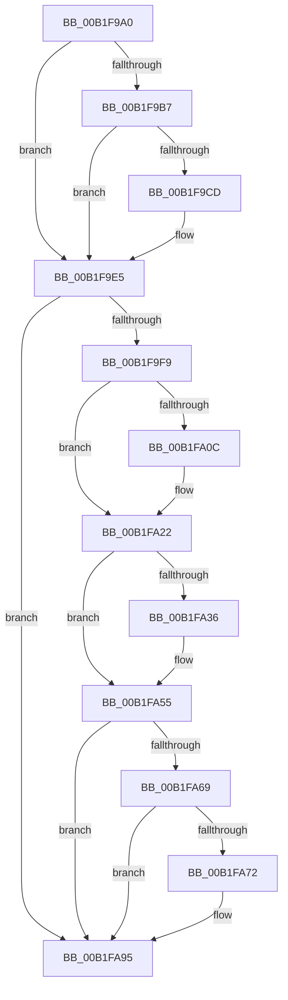

# sub_00B1F9A0

- RVA: `0x00B1F9A0`–`0x00B1FAAF` (길이 `271` bytes)
- VA: `0x0000000140B1F9A0`
- 실행 섹션: `PAGE`
- PDB 이름 있음: `아니요`; PDB Function 태그: `아니요`
- unwind 정보 RVA: `0x00087F20`
- 디코드: `69`개 명령, `271/271` bytes 표시
- 미해석 바이트: `0` (있으면 어셈블리에 `.byte`로 보존)

> 이 문서는 커널 이미지의 기계어와 PDB 기호를 분석해 생성했습니다. 4번과 5번은 함수 원형과 자료형을 바이너리 사용 방식에서 추정한 C 해석이며 원본 소스 복구 결과는 아닙니다.

## 1. Dependencies

- 직접 호출 지점: **12**; 고유 호출 대상: **2**
- 직접 호출자로 확인된 함수: **0**
- RIP 상대 이미지 참조: **0**

### Outgoing calls
- `0x00B1F9A7` → [IoAddTriageDumpDataBlock](../../text/42/IoAddTriageDumpDataBlock_function_00428374.md) (function, `0x00428374`)
- `0x00B1F9BB` → [IoAddTriageDumpDataBlock](../../text/42/IoAddTriageDumpDataBlock_function_00428374.md) (function, `0x00428374`)
- `0x00B1F9CF` → [IoAddTriageDumpDataBlock](../../text/42/IoAddTriageDumpDataBlock_function_00428374.md) (function, `0x00428374`)
- `0x00B1F9E0` → [IoAddTriageDumpDataBlock](../../text/42/IoAddTriageDumpDataBlock_function_00428374.md) (function, `0x00428374`)
- `0x00B1FA02` → [IoAddTriageDumpDataBlock](../../text/42/IoAddTriageDumpDataBlock_function_00428374.md) (function, `0x00428374`)
- `0x00B1FA11` → [IoAddTriageDumpDataBlock](../../text/42/IoAddTriageDumpDataBlock_function_00428374.md) (function, `0x00428374`)
- `0x00B1FA1D` → [IoAddTriageDumpDataBlock](../../text/42/IoAddTriageDumpDataBlock_function_00428374.md) (function, `0x00428374`)
- `0x00B1FA38` → [IoAddTriageDumpDataBlock](../../text/42/IoAddTriageDumpDataBlock_function_00428374.md) (function, `0x00428374`)
- `0x00B1FA50` → [IoAddTriageDumpDataBlock](../../text/42/IoAddTriageDumpDataBlock_function_00428374.md) (function, `0x00428374`)
- `0x00B1FA74` → [IoAddTriageDumpDataBlock](../../text/42/IoAddTriageDumpDataBlock_function_00428374.md) (function, `0x00428374`)
- `0x00B1FA90` → [IoAddTriageDumpDataBlock](../../text/42/IoAddTriageDumpDataBlock_function_00428374.md) (function, `0x00428374`)
- `0x00B1FAA9` → [KeBugCheckEx](../../text/4F/KeBugCheckEx_function_004FD660.md) (function, `0x004FD660`)

### Direct callers
- 이 함수 시작 RVA로 연결되는 직접 call은 확인되지 않았습니다. 간접 호출은 완전히 역산할 수 없습니다.

### Static image references
- 디코드된 RIP-relative 메모리 참조가 없습니다.

## 2. Other-region calls and transfers

- 다른 실행 섹션으로 향하는 call: **12**
  - `0x00B1F9A7` → [IoAddTriageDumpDataBlock](../../text/42/IoAddTriageDumpDataBlock_function_00428374.md) (`PAGE` → `.text`)
  - `0x00B1F9BB` → [IoAddTriageDumpDataBlock](../../text/42/IoAddTriageDumpDataBlock_function_00428374.md) (`PAGE` → `.text`)
  - `0x00B1F9CF` → [IoAddTriageDumpDataBlock](../../text/42/IoAddTriageDumpDataBlock_function_00428374.md) (`PAGE` → `.text`)
  - `0x00B1F9E0` → [IoAddTriageDumpDataBlock](../../text/42/IoAddTriageDumpDataBlock_function_00428374.md) (`PAGE` → `.text`)
  - `0x00B1FA02` → [IoAddTriageDumpDataBlock](../../text/42/IoAddTriageDumpDataBlock_function_00428374.md) (`PAGE` → `.text`)
  - `0x00B1FA11` → [IoAddTriageDumpDataBlock](../../text/42/IoAddTriageDumpDataBlock_function_00428374.md) (`PAGE` → `.text`)
  - `0x00B1FA1D` → [IoAddTriageDumpDataBlock](../../text/42/IoAddTriageDumpDataBlock_function_00428374.md) (`PAGE` → `.text`)
  - `0x00B1FA38` → [IoAddTriageDumpDataBlock](../../text/42/IoAddTriageDumpDataBlock_function_00428374.md) (`PAGE` → `.text`)
  - `0x00B1FA50` → [IoAddTriageDumpDataBlock](../../text/42/IoAddTriageDumpDataBlock_function_00428374.md) (`PAGE` → `.text`)
  - `0x00B1FA74` → [IoAddTriageDumpDataBlock](../../text/42/IoAddTriageDumpDataBlock_function_00428374.md) (`PAGE` → `.text`)
  - `0x00B1FA90` → [IoAddTriageDumpDataBlock](../../text/42/IoAddTriageDumpDataBlock_function_00428374.md) (`PAGE` → `.text`)
  - `0x00B1FAA9` → [KeBugCheckEx](../../text/4F/KeBugCheckEx_function_004FD660.md) (`PAGE` → `.text`)
- 별도 외부 분기/꼬리 이동을 확인하지 못했습니다.

## 3. Assembly (complete function range)

```asm
00B1F9A0  0F B7 52 02                     movzx edx, word ptr [rdx + 2]
00B1F9A4  48 8B CB                        mov rcx, rbx
00B1F9A7  E8 C8 89 90 FF                  call 0x140428374
00B1F9AC  48 8B 4B 08                     mov rcx, qword ptr [rbx + 8]
00B1F9B0  33 FF                           xor edi, edi
00B1F9B2  48 85 C9                        test rcx, rcx
00B1F9B5  74 2E                           je 0x140b1f9e5
00B1F9B7  0F BF 51 02                     movsx edx, word ptr [rcx + 2]
00B1F9BB  E8 B4 89 90 FF                  call 0x140428374
00B1F9C0  48 8B 4B 08                     mov rcx, qword ptr [rbx + 8]
00B1F9C4  48 83 C1 38                     add rcx, 0x38
00B1F9C8  66 39 39                        cmp word ptr [rcx], di
00B1F9CB  74 18                           je 0x140b1f9e5
00B1F9CD  8B D5                           mov edx, ebp
00B1F9CF  E8 A0 89 90 FF                  call 0x140428374
00B1F9D4  48 8B 4B 08                     mov rcx, qword ptr [rbx + 8]
00B1F9D8  0F B7 51 38                     movzx edx, word ptr [rcx + 0x38]
00B1F9DC  48 8B 49 40                     mov rcx, qword ptr [rcx + 0x40]
00B1F9E0  E8 8F 89 90 FF                  call 0x140428374
00B1F9E5  48 8B 83 38 01 00 00            mov rax, qword ptr [rbx + 0x138]
00B1F9EC  48 8B 48 28                     mov rcx, qword ptr [rax + 0x28]
00B1F9F0  48 85 C9                        test rcx, rcx
00B1F9F3  0F 84 9C 00 00 00               je 0x140b1fa95
00B1F9F9  BA 88 03 00 00                  mov edx, 0x388
00B1F9FE  48 8D 71 28                     lea rsi, [rcx + 0x28]
00B1FA02  E8 6D 89 90 FF                  call 0x140428374
00B1FA07  66 39 3E                        cmp word ptr [rsi], di
00B1FA0A  74 16                           je 0x140b1fa22
00B1FA0C  8B D5                           mov edx, ebp
00B1FA0E  48 8B CE                        mov rcx, rsi
00B1FA11  E8 5E 89 90 FF                  call 0x140428374
00B1FA16  0F B7 16                        movzx edx, word ptr [rsi]
00B1FA19  48 8B 4E 08                     mov rcx, qword ptr [rsi + 8]
00B1FA1D  E8 52 89 90 FF                  call 0x140428374
00B1FA22  48 8B 83 38 01 00 00            mov rax, qword ptr [rbx + 0x138]
00B1FA29  48 8B 48 28                     mov rcx, qword ptr [rax + 0x28]
00B1FA2D  48 83 C1 38                     add rcx, 0x38
00B1FA31  66 39 39                        cmp word ptr [rcx], di
00B1FA34  74 1F                           je 0x140b1fa55
00B1FA36  8B D5                           mov edx, ebp
00B1FA38  E8 37 89 90 FF                  call 0x140428374
00B1FA3D  48 8B 83 38 01 00 00            mov rax, qword ptr [rbx + 0x138]
00B1FA44  48 8B 48 28                     mov rcx, qword ptr [rax + 0x28]
00B1FA48  0F B7 51 38                     movzx edx, word ptr [rcx + 0x38]
00B1FA4C  48 8B 49 40                     mov rcx, qword ptr [rcx + 0x40]
00B1FA50  E8 1F 89 90 FF                  call 0x140428374
00B1FA55  48 8B 83 38 01 00 00            mov rax, qword ptr [rbx + 0x138]
00B1FA5C  48 8B 48 28                     mov rcx, qword ptr [rax + 0x28]
00B1FA60  48 8B 41 10                     mov rax, qword ptr [rcx + 0x10]
00B1FA64  48 85 C0                        test rax, rax
00B1FA67  74 2C                           je 0x140b1fa95
00B1FA69  48 8D 48 38                     lea rcx, [rax + 0x38]
00B1FA6D  66 39 39                        cmp word ptr [rcx], di
00B1FA70  74 23                           je 0x140b1fa95
00B1FA72  8B D5                           mov edx, ebp
00B1FA74  E8 FB 88 90 FF                  call 0x140428374
00B1FA79  48 8B 83 38 01 00 00            mov rax, qword ptr [rbx + 0x138]
00B1FA80  48 8B 48 28                     mov rcx, qword ptr [rax + 0x28]
00B1FA84  48 8B 49 10                     mov rcx, qword ptr [rcx + 0x10]
00B1FA88  0F B7 51 38                     movzx edx, word ptr [rcx + 0x38]
00B1FA8C  48 8B 49 40                     mov rcx, qword ptr [rcx + 0x40]
00B1FA90  E8 DF 88 90 FF                  call 0x140428374
00B1FA95  45 33 C9                        xor r9d, r9d
00B1FA98  48 89 7C 24 20                  mov qword ptr [rsp + 0x20], rdi
00B1FA9D  4C 8B C3                        mov r8, rbx
00B1FAA0  B9 CA 00 00 00                  mov ecx, 0xca
00B1FAA5  41 8D 51 04                     lea edx, [r9 + 4]
00B1FAA9  E8 B2 DB 9D FF                  call 0x1404fd660
00B1FAAE  CC                              int3
```

## 4. C-style interpretation (structured pseudocode)

```c
__int64 __fastcall sub_00B1F9A0(__int64 a1, __int64 a2, __int64 a3, int a4)
{
    __int64 result;
    __int64 v_rdi;
    unsigned __int64 v_stack_p20;

    result = IoAddTriageDumpDataBlock(v_rbx, *(unsigned __int16 *)(a2 + 2), a3, a4);
    v_rdi = 0;
    if (*(unsigned __int64 *)(v_rbx + 8) == 0) goto loc_00B1F9E5;
    result = IoAddTriageDumpDataBlock(*(unsigned __int64 *)(v_rbx + 8), (__int16)(*(unsigned __int16 *)(*(unsigned __int64 *)(v_rbx + 8) + 2)), a3, a4);
    a1 = (*(unsigned __int64 *)(v_rbx + 8)) + (56);
    if ((*(unsigned __int16 *)(a1)) != 0) {
        a2 = (unsigned int)(v_rbp);
        result = IoAddTriageDumpDataBlock(a1, a2, a3, a4);
        a1 = *(unsigned __int64 *)(v_rbx + 8);
        a2 = *(unsigned __int16 *)(a1 + 56);
        a1 = *(unsigned __int64 *)(a1 + 64);
        result = IoAddTriageDumpDataBlock(a1, a2, a3, a4);
    }
    if (*(unsigned __int64 *)(*(unsigned __int64 *)(v_rbx + 312) + 40) == 0) goto loc_00B1FA95;
    result = IoAddTriageDumpDataBlock(*(unsigned __int64 *)(*(unsigned __int64 *)(v_rbx + 312) + 40), 904, a3, a4);
    if ((*(unsigned __int16 *)(*(unsigned __int64 *)(*(unsigned __int64 *)(v_rbx + 312) + 40) + 40)) != 0) {
        a2 = (unsigned int)(v_rbp);
        a1 = *(unsigned __int64 *)(*(unsigned __int64 *)(v_rbx + 312) + 40) + 40;
        result = IoAddTriageDumpDataBlock(a1, a2, a3, a4);
        a2 = *(unsigned __int16 *)(*(unsigned __int64 *)(*(unsigned __int64 *)(v_rbx + 312) + 40) + 40);
        a1 = *(unsigned __int64 *)(*(unsigned __int64 *)(*(unsigned __int64 *)(v_rbx + 312) + 40) + 40 + 8);
        result = IoAddTriageDumpDataBlock(a1, a2, a3, a4);
    }
    a1 = (*(unsigned __int64 *)(*(unsigned __int64 *)(v_rbx + 312) + 40)) + (56);
    result = *(unsigned __int64 *)(v_rbx + 312);
    if ((*(unsigned __int16 *)(a1)) != 0) {
        a2 = (unsigned int)(v_rbp);
        result = IoAddTriageDumpDataBlock(a1, a2, a3, a4);
        result = *(unsigned __int64 *)(v_rbx + 312);
        a1 = *(unsigned __int64 *)(result + 40);
        a2 = *(unsigned __int16 *)(a1 + 56);
        a1 = *(unsigned __int64 *)(a1 + 64);
        result = IoAddTriageDumpDataBlock(a1, a2, a3, a4);
    }
    if (*(unsigned __int64 *)(*(unsigned __int64 *)(*(unsigned __int64 *)(v_rbx + 312) + 40) + 16) == 0) goto loc_00B1FA95;
    result = *(unsigned __int64 *)(*(unsigned __int64 *)(*(unsigned __int64 *)(v_rbx + 312) + 40) + 16);
    if ((*(unsigned __int16 *)(*(unsigned __int64 *)(*(unsigned __int64 *)(*(unsigned __int64 *)(v_rbx + 312) + 40) + 16) + 56)) != 0) {
        a2 = (unsigned int)(v_rbp);
        result = IoAddTriageDumpDataBlock(*(unsigned __int64 *)(*(unsigned __int64 *)(*(unsigned __int64 *)(v_rbx + 312) + 40) + 16) + 56, a2, a3, a4);
        result = *(unsigned __int64 *)(v_rbx + 312);
        a1 = *(unsigned __int64 *)(result + 40);
        a1 = *(unsigned __int64 *)(a1 + 16);
        a2 = *(unsigned __int16 *)(a1 + 56);
        a1 = *(unsigned __int64 *)(a1 + 64);
        result = IoAddTriageDumpDataBlock(a1, a2, a3, a4);
    }
    a4 = 0;
    v_stack_p20 = 0;
    result = KeBugCheckEx(202, a4 + 4, v_rbx, a4);
    return result;
}
```

## 5. (Beta) C Style

```c
int64_t sub_00B1F9A0(int64_t Arg1, void *Arg2, int64_t Arg3, int32_t Arg4)
{
    uint8_t *arg2 = (uint8_t *)Arg2;

    int64_t result;
    int64_t local_rdi;
    uint64_t v_stack_p20;

    result = IoAddTriageDumpDataBlock(local_rbx, *(uint16_t *)(arg2 + 0x2), Arg3, Arg4);
    local_rdi = 0;
    if (*(uint64_t *)(local_rbx + 0x8) == 0) goto loc_00B1F9E5;
    result = IoAddTriageDumpDataBlock(*(uint64_t *)(local_rbx + 0x8), (int16_t)(*(uint16_t *)(*(uint64_t *)(local_rbx + 0x8) + 0x2)), Arg3, Arg4);
    Arg1 = (*(uint64_t *)(local_rbx + 0x8)) + (56);
    if ((*(uint16_t *)(Arg1)) != 0) {
        Arg2 = (uint32_t)(local_rbp);
        result = IoAddTriageDumpDataBlock(Arg1, Arg2, Arg3, Arg4);
        Arg1 = *(uint64_t *)(local_rbx + 0x8);
        Arg2 = *(uint16_t *)(Arg1 + 0x38);
        Arg1 = *(uint64_t *)(Arg1 + 0x40);
        result = IoAddTriageDumpDataBlock(Arg1, Arg2, Arg3, Arg4);
    }
    if (*(uint64_t *)(*(uint64_t *)(local_rbx + 0x138) + 0x28) == 0) goto loc_00B1FA95;
    result = IoAddTriageDumpDataBlock(*(uint64_t *)(*(uint64_t *)(local_rbx + 0x138) + 0x28), 904, Arg3, Arg4);
    if ((*(uint16_t *)(*(uint64_t *)(*(uint64_t *)(local_rbx + 0x138) + 0x28) + 0x28)) != 0) {
        Arg2 = (uint32_t)(local_rbp);
        Arg1 = *(uint64_t *)(*(uint64_t *)(local_rbx + 0x138) + 0x28) + 40;
        result = IoAddTriageDumpDataBlock(Arg1, Arg2, Arg3, Arg4);
        Arg2 = *(uint16_t *)(*(uint64_t *)(*(uint64_t *)(local_rbx + 0x138) + 0x28) + 0x28);
        Arg1 = *(uint64_t *)(*(uint64_t *)(*(uint64_t *)(local_rbx + 0x138) + 0x28) + 0x28 + 0x8);
        result = IoAddTriageDumpDataBlock(Arg1, Arg2, Arg3, Arg4);
    }
    Arg1 = (*(uint64_t *)(*(uint64_t *)(local_rbx + 0x138) + 0x28)) + (56);
    result = *(uint64_t *)(local_rbx + 0x138);
    if ((*(uint16_t *)(Arg1)) != 0) {
        Arg2 = (uint32_t)(local_rbp);
        result = IoAddTriageDumpDataBlock(Arg1, Arg2, Arg3, Arg4);
        result = *(uint64_t *)(local_rbx + 0x138);
        Arg1 = *(uint64_t *)(result + 0x28);
        Arg2 = *(uint16_t *)(Arg1 + 0x38);
        Arg1 = *(uint64_t *)(Arg1 + 0x40);
        result = IoAddTriageDumpDataBlock(Arg1, Arg2, Arg3, Arg4);
    }
    if (*(uint64_t *)(*(uint64_t *)(*(uint64_t *)(local_rbx + 0x138) + 0x28) + 0x10) == 0) goto loc_00B1FA95;
    result = *(uint64_t *)(*(uint64_t *)(*(uint64_t *)(local_rbx + 0x138) + 0x28) + 0x10);
    if ((*(uint16_t *)(*(uint64_t *)(*(uint64_t *)(*(uint64_t *)(local_rbx + 0x138) + 0x28) + 0x10) + 0x38)) != 0) {
        Arg2 = (uint32_t)(local_rbp);
        result = IoAddTriageDumpDataBlock(*(uint64_t *)(*(uint64_t *)(*(uint64_t *)(local_rbx + 0x138) + 0x28) + 0x10) + 56, Arg2, Arg3, Arg4);
        result = *(uint64_t *)(local_rbx + 0x138);
        Arg1 = *(uint64_t *)(result + 0x28);
        Arg1 = *(uint64_t *)(Arg1 + 0x10);
        Arg2 = *(uint16_t *)(Arg1 + 0x38);
        Arg1 = *(uint64_t *)(Arg1 + 0x40);
        result = IoAddTriageDumpDataBlock(Arg1, Arg2, Arg3, Arg4);
    }
    Arg4 = 0;
    v_stack_p20 = 0;
    result = KeBugCheckEx(202, Arg4 + 4, local_rbx, Arg4);
    return result;
}
```

### 관측된 메모리 오프셋

구조체 형식이 확인되지 않은 접근은 인자 기준의 오프셋으로만 기록했습니다.

| 기준 인자 | 오프셋 표현 | 폭 (bit) | 접근 |
|---|---:|---:|---|
| `Arg2` | `+ 0x2` | `16` | `R` |

## 6. Execution-region graph

[열기: 2D/3D 그래프와 함수 탐색 컨트롤 패널](../../../control-panel.html?section=page&rva=0x00B1F9A0&view=graph)

- 2D 그래프는 위에서 아래로 흐르고, 3D 그래프는 빈 공간을 드래그해 회전합니다. Shift+드래그는 이동, 휠은 확대·축소, 함수 노드 선택은 대상 보고서 이동입니다.

### Static fallback


