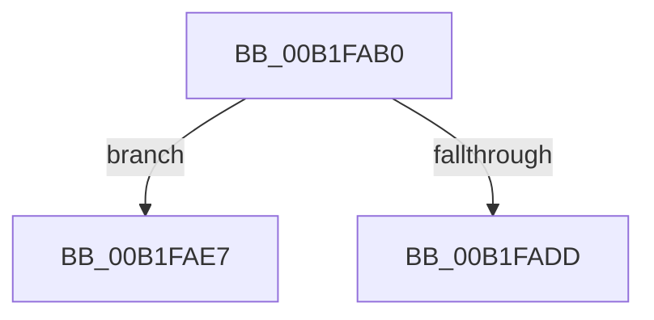

# sub_00B1FAB0

- RVA: `0x00B1FAB0`–`0x00B1FB42` (길이 `146` bytes)
- VA: `0x0000000140B1FAB0`
- 실행 섹션: `PAGE`
- PDB 이름 있음: `아니요`; PDB Function 태그: `아니요`
- unwind 정보 RVA: `0x00087F88`
- 디코드: `33`개 명령, `146/146` bytes 표시
- 미해석 바이트: `0` (있으면 어셈블리에 `.byte`로 보존)

> 이 문서는 커널 이미지의 기계어와 PDB 기호를 분석해 생성했습니다. 4번과 5번은 함수 원형과 자료형을 바이너리 사용 방식에서 추정한 C 해석이며 원본 소스 복구 결과는 아닙니다.

## 1. Dependencies

- 직접 호출 지점: **3**; 고유 호출 대상: **3**
- 직접 호출자로 확인된 함수: **0**
- RIP 상대 이미지 참조: **0**

### Outgoing calls
- `0x00B1FAD0` → [PnpAllocateCriticalMemory](../A0/PnpAllocateCriticalMemory_function_00A07924.md) (function, `0x00A07924`)
- `0x00B1FB27` → [PnpInitializeTargetDeviceRemoveEvent](../94/PnpInitializeTargetDeviceRemoveEvent_function_0094FBC8.md) (function, `0x0094FBC8`)
- `0x00B1FB37` → [PnpInsertEventInQueue](../95/PnpInsertEventInQueue_function_00951B78.md) (function, `0x00951B78`)

### Direct callers
- 이 함수 시작 RVA로 연결되는 직접 call은 확인되지 않았습니다. 간접 호출은 완전히 역산할 수 없습니다.

### Static image references
- 디코드된 RIP-relative 메모리 참조가 없습니다.

## 2. Other-region calls and transfers

- 다른 실행 섹션으로 향하는 call: **0**
- call이 아닌 외부 분기/꼬리 이동: **2**
  - `0x00B1FAE2` → [PnpRequestDeviceRemoval + 0x6E](../8F/PnpRequestDeviceRemoval_function_008FC294.md) (`tail-transfer`)
  - `0x00B1FB3D` → [PnpRequestDeviceRemoval + 0x6E](../8F/PnpRequestDeviceRemoval_function_008FC294.md) (`tail-transfer`)

## 3. Assembly (complete function range)

```asm
00B1FAB0  49 8B CF                        mov rcx, r15
00B1FAB3  0F B7 71 28                     movzx esi, word ptr [rcx + 0x28]
00B1FAB7  BA 00 01 00 00                  mov edx, 0x100
00B1FABC  81 C6 CA 00 00 00               add esi, 0xca
00B1FAC2  B9 03 00 00 00                  mov ecx, 3
00B1FAC7  44 8B C6                        mov r8d, esi
00B1FACA  41 B9 50 6E 70 4B               mov r9d, 0x4b706e50
00B1FAD0  E8 4F 7E EE FF                  call 0x140a07924
00B1FAD5  48 8B F8                        mov rdi, rax
00B1FAD8  48 85 C0                        test rax, rax
00B1FADB  75 0A                           jne 0x140b1fae7
00B1FADD  B8 9A 00 00 C0                  mov eax, 0xc000009a
00B1FAE2  E9 1B C8 DD FF                  jmp 0x1408fc302
00B1FAE7  4C 89 7C 24 60                  mov qword ptr [rsp + 0x60], r15
00B1FAEC  41 B9 01 00 00 00               mov r9d, 1
00B1FAF2  4C 89 7C 24 58                  mov qword ptr [rsp + 0x58], r15
00B1FAF7  4C 8B C3                        mov r8, rbx
00B1FAFA  4C 89 7C 24 50                  mov qword ptr [rsp + 0x50], r15
00B1FAFF  8B D6                           mov edx, esi
00B1FB01  4C 89 7C 24 48                  mov qword ptr [rsp + 0x48], r15
00B1FB06  48 8B CF                        mov rcx, rdi
00B1FB09  89 6C 24 40                     mov dword ptr [rsp + 0x40], ebp
00B1FB0D  44 89 74 24 38                  mov dword ptr [rsp + 0x38], r14d
00B1FB12  C7 44 24 30 01 00 00 00         mov dword ptr [rsp + 0x30], 1
00B1FB1A  44 89 7C 24 28                  mov dword ptr [rsp + 0x28], r15d
00B1FB1F  C7 44 24 20 01 00 00 00         mov dword ptr [rsp + 0x20], 1
00B1FB27  E8 9C 00 E3 FF                  call 0x14094fbc8
00B1FB2C  48 8B CF                        mov rcx, rdi
00B1FB2F  4C 89 7F 20                     mov qword ptr [rdi + 0x20], r15
00B1FB33  4C 89 7F 28                     mov qword ptr [rdi + 0x28], r15
00B1FB37  E8 3C 20 E3 FF                  call 0x140951b78
00B1FB3C  90                              nop
00B1FB3D  E9 C0 C7 DD FF                  jmp 0x1408fc302
```

## 4. C-style interpretation (structured pseudocode)

```c
__int64 __fastcall sub_00B1FAB0(void)
{
    __int64 result;
    __int64 v_rsi;
    unsigned int v_stack_p20;
    unsigned int v_stack_p28;
    unsigned int v_stack_p30;
    unsigned int v_stack_p38;
    unsigned int v_stack_p40;
    unsigned __int64 v_stack_p48;
    unsigned __int64 v_stack_p50;
    unsigned __int64 v_stack_p58;
    unsigned __int64 v_stack_p60;

    v_rsi = (unsigned int)((*(unsigned __int16 *)(v_r15 + 40)) + (202));
    result = PnpAllocateCriticalMemory(3, 256, (unsigned int)((unsigned int)(v_rsi)), (unsigned int)(0x4B706E50ULL));
    if (result != 0) goto loc_00B1FAE7;
loc_00B1FAE7:
    v_stack_p60 = v_r15;
    v_stack_p58 = v_r15;
    v_stack_p50 = v_r15;
    v_stack_p48 = v_r15;
    v_stack_p40 = (unsigned int)(v_rbp);
    v_stack_p38 = (unsigned int)(v_r14);
    v_stack_p30 = 1;
    v_stack_p28 = (unsigned int)(v_r15);
    v_stack_p20 = 1;
    result = PnpInitializeTargetDeviceRemoveEvent(result, (unsigned int)((unsigned int)(v_rsi)), v_rbx, 1);
    *(unsigned __int64 *)(result + 32) = v_r15;
    *(unsigned __int64 *)(result + 40) = v_r15;
    result = PnpInsertEventInQueue(result, (unsigned int)((unsigned int)(v_rsi)), v_rbx, 1);
}
```

## 5. (Beta) C Style

```c
void sub_00B1FAB0(void)
{
    int64_t result;
    int64_t local_rsi;
    uint32_t v_stack_p20;
    uint32_t v_stack_p28;
    uint32_t v_stack_p30;
    uint32_t v_stack_p38;
    uint32_t v_stack_p40;
    uint64_t v_stack_p48;
    uint64_t v_stack_p50;
    uint64_t v_stack_p58;
    uint64_t v_stack_p60;

    local_rsi = (uint32_t)((*(uint16_t *)(local_r15 + 0x28)) + (202));
    result = PnpAllocateCriticalMemory(3, 256, (uint32_t)((uint32_t)(local_rsi)), (uint32_t)(0x4B706E50ULL));
    if (result != 0) goto loc_00B1FAE7;
loc_00B1FAE7:
    v_stack_p60 = local_r15;
    v_stack_p58 = local_r15;
    v_stack_p50 = local_r15;
    v_stack_p48 = local_r15;
    v_stack_p40 = (uint32_t)(local_rbp);
    v_stack_p38 = (uint32_t)(local_r14);
    v_stack_p30 = 1;
    v_stack_p28 = (uint32_t)(local_r15);
    v_stack_p20 = 1;
    result = PnpInitializeTargetDeviceRemoveEvent(result, (uint32_t)((uint32_t)(local_rsi)), local_rbx, 1);
    *(uint64_t *)(result + 0x20) = local_r15;
    *(uint64_t *)(result + 0x28) = local_r15;
    result = PnpInsertEventInQueue(result, (uint32_t)((uint32_t)(local_rsi)), local_rbx, 1);
}
```

## 6. Execution-region graph

[열기: 2D/3D 그래프와 함수 탐색 컨트롤 패널](../../../control-panel.html?section=page&rva=0x00B1FAB0&view=graph)

- 2D 그래프는 위에서 아래로 흐르고, 3D 그래프는 빈 공간을 드래그해 회전합니다. Shift+드래그는 이동, 휠은 확대·축소, 함수 노드 선택은 대상 보고서 이동입니다.

### Static fallback


