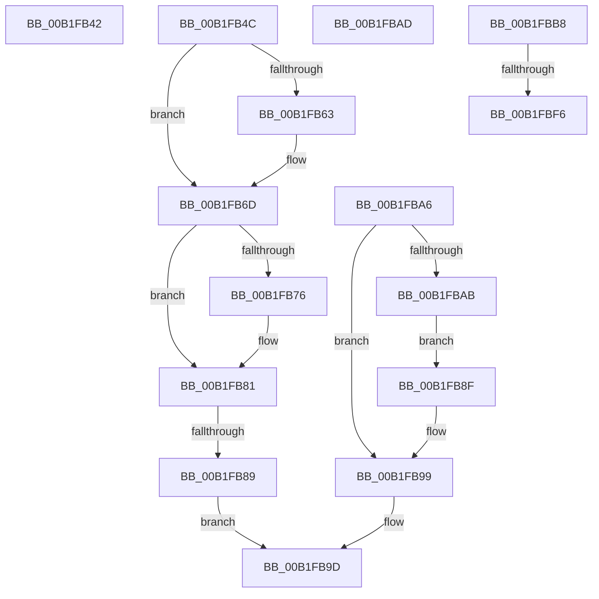

# sub_00B1FB42

- RVA: `0x00B1FB42`–`0x00B1FC3C` (길이 `250` bytes)
- VA: `0x0000000140B1FB42`
- 실행 섹션: `PAGE`
- PDB 이름 있음: `아니요`; PDB Function 태그: `아니요`
- unwind 정보 RVA: `0x00087FB4`
- 디코드: `63`개 명령, `250/250` bytes 표시
- 미해석 바이트: `0` (있으면 어셈블리에 `.byte`로 보존)

> 이 문서는 커널 이미지의 기계어와 PDB 기호를 분석해 생성했습니다. 4번과 5번은 함수 원형과 자료형을 바이너리 사용 방식에서 추정한 C 해석이며 원본 소스 복구 결과는 아닙니다.

## 1. Dependencies

- 직접 호출 지점: **7**; 고유 호출 대상: **5**
- 직접 호출자로 확인된 함수: **0**
- RIP 상대 이미지 참조: **2**

### Outgoing calls
- `0x00B1FB57` → [PnpMergeFilteredResourceRequirementsList](../73/PnpMergeFilteredResourceRequirementsList_function_0073D950.md) (function, `0x0073D950`)
- `0x00B1FB68` → [ExFreePoolWithTag](../../poolcode/B8/ExFreePoolWithTag_function_00B82870.md) (function, `0x00B82870`)
- `0x00B1FB78` → [ExFreePoolWithTag](../../poolcode/B8/ExFreePoolWithTag_function_00B82870.md) (function, `0x00B82870`)
- `0x00B1FB94` → [ExFreePoolWithTag](../../poolcode/B8/ExFreePoolWithTag_function_00B82870.md) (function, `0x00B82870`)
- `0x00B1FBE9` → [_CmOpenDeviceRegKey](../8E/_CmOpenDeviceRegKey_function_008EE540.md) (function, `0x008EE540`)
- `0x00B1FC28` → [ZwSetValueKey](../../text/6A/ZwSetValueKey_function_006ADCD0.md) (function, `0x006ADCD0`)
- `0x00B1FC31` → [ZwClose](../../text/6A/ZwClose_function_006AD2B0.md) (function, `0x006AD2B0`)

### Direct callers
- 이 함수 시작 RVA로 연결되는 직접 call은 확인되지 않았습니다. 간접 호출은 완전히 역산할 수 없습니다.

### Static image references
- `0x00B1FBB8` → RVA `0x00E66398` (`.data`; read)
- `0x00B1FBFA` → RVA `0x00B00100` (` ?? ::NNGAKEGL::`string'`; read)

## 2. Other-region calls and transfers

- 다른 실행 섹션으로 향하는 call: **5**
  - `0x00B1FB68` → [ExFreePoolWithTag](../../poolcode/B8/ExFreePoolWithTag_function_00B82870.md) (`PAGE` → `POOLCODE`)
  - `0x00B1FB78` → [ExFreePoolWithTag](../../poolcode/B8/ExFreePoolWithTag_function_00B82870.md) (`PAGE` → `POOLCODE`)
  - `0x00B1FB94` → [ExFreePoolWithTag](../../poolcode/B8/ExFreePoolWithTag_function_00B82870.md) (`PAGE` → `POOLCODE`)
  - `0x00B1FC28` → [ZwSetValueKey](../../text/6A/ZwSetValueKey_function_006ADCD0.md) (`PAGE` → `.text`)
  - `0x00B1FC31` → [ZwClose](../../text/6A/ZwClose_function_006AD2B0.md) (`PAGE` → `.text`)
- call이 아닌 외부 분기/꼬리 이동: **6**
  - `0x00B1FB47` → [IopQueryDeviceResources + 0x13F](../8F/IopQueryDeviceResources_function_008FC344.md) (`tail-transfer`)
  - `0x00B1FB83` → [IopQueryDeviceResources + 0x13D](../8F/IopQueryDeviceResources_function_008FC344.md) (`tail-transfer`)
  - `0x00B1FBA1` → [IopQueryDeviceResources + 0x186](../8F/IopQueryDeviceResources_function_008FC344.md) (`tail-transfer`)
  - `0x00B1FBB3` → [IopQueryDeviceResources + 0x1ED](../8F/IopQueryDeviceResources_function_008FC344.md) (`tail-transfer`)
  - `0x00B1FBF0` → [IopQueryDeviceResources + 0x1A8](../8F/IopQueryDeviceResources_function_008FC344.md) (`tail-transfer`)
  - `0x00B1FC37` → [IopQueryDeviceResources + 0x1A8](../8F/IopQueryDeviceResources_function_008FC344.md) (`tail-transfer`)

## 3. Assembly (complete function range)

```asm
00B1FB42  B8 17 00 00 C0                  mov eax, 0xc0000017
00B1FB47  E9 37 C9 DD FF                  jmp 0x1408fc483
00B1FB4C  48 8B 4D A7                     mov rcx, qword ptr [rbp - 0x59]
00B1FB50  4C 8D 45 B7                     lea r8, [rbp - 0x49]
00B1FB54  48 8B D6                        mov rdx, rsi
00B1FB57  E8 F4 DD C1 FF                  call 0x14073d950
00B1FB5C  8B D8                           mov ebx, eax
00B1FB5E  48 85 F6                        test rsi, rsi
00B1FB61  74 0A                           je 0x140b1fb6d
00B1FB63  33 D2                           xor edx, edx
00B1FB65  48 8B CE                        mov rcx, rsi
00B1FB68  E8 03 2D 06 00                  call 0x140b82870
00B1FB6D  48 8B 4D A7                     mov rcx, qword ptr [rbp - 0x59]
00B1FB71  48 85 C9                        test rcx, rcx
00B1FB74  74 0B                           je 0x140b1fb81
00B1FB76  33 D2                           xor edx, edx
00B1FB78  E8 F3 2C 06 00                  call 0x140b82870
00B1FB7D  48 89 7D A7                     mov qword ptr [rbp - 0x59], rdi
00B1FB81  85 DB                           test ebx, ebx
00B1FB83  0F 88 F8 C8 DD FF               js 0x1408fc481
00B1FB89  48 8B 75 B7                     mov rsi, qword ptr [rbp - 0x49]
00B1FB8D  EB 0E                           jmp 0x140b1fb9d
00B1FB8F  33 D2                           xor edx, edx
00B1FB91  48 8B CE                        mov rcx, rsi
00B1FB94  E8 D7 2C 06 00                  call 0x140b82870
00B1FB99  48 8B 75 A7                     mov rsi, qword ptr [rbp - 0x59]
00B1FB9D  4C 8B 6D 67                     mov r13, qword ptr [rbp + 0x67]
00B1FBA1  E9 24 C9 DD FF                  jmp 0x1408fc4ca
00B1FBA6  48 85 F6                        test rsi, rsi
00B1FBA9  74 EE                           je 0x140b1fb99
00B1FBAB  EB E2                           jmp 0x140b1fb8f
00B1FBAD  49 89 3E                        mov qword ptr [r14], rdi
00B1FBB0  41 89 3F                        mov dword ptr [r15], edi
00B1FBB3  E9 79 C9 DD FF                  jmp 0x1408fc531
00B1FBB8  48 8B 0D D9 67 34 00            mov rcx, qword ptr [rip + 0x3467d9]
00B1FBBF  48 8D 45 67                     lea rax, [rbp + 0x67]
00B1FBC3  48 89 7C 24 38                  mov qword ptr [rsp + 0x38], rdi
00B1FBC8  45 33 C9                        xor r9d, r9d
00B1FBCB  48 89 44 24 30                  mov qword ptr [rsp + 0x30], rax
00B1FBD0  48 8B 45 AF                     mov rax, qword ptr [rbp - 0x51]
00B1FBD4  C6 44 24 28 01                  mov byte ptr [rsp + 0x28], 1
00B1FBD9  45 8D 41 13                     lea r8d, [r9 + 0x13]
00B1FBDD  C7 44 24 20 19 00 02 00         mov dword ptr [rsp + 0x20], 0x20019
00B1FBE5  48 8B 50 30                     mov rdx, qword ptr [rax + 0x30]
00B1FBE9  E8 52 E9 DC FF                  call 0x1408ee540
00B1FBEE  85 C0                           test eax, eax
00B1FBF0  0F 88 F6 C8 DD FF               js 0x1408fc4ec
00B1FBF6  48 8B 4D 67                     mov rcx, qword ptr [rbp + 0x67]
00B1FBFA  48 8D 05 FF 04 FE FF            lea rax, [rip - 0x1fb01]
00B1FC01  48 89 45 BF                     mov qword ptr [rbp - 0x41], rax
00B1FC05  48 8D 55 B7                     lea rdx, [rbp - 0x49]
00B1FC09  41 8B 07                        mov eax, dword ptr [r15]
00B1FC0C  41 B9 0A 00 00 00               mov r9d, 0xa
00B1FC12  89 44 24 28                     mov dword ptr [rsp + 0x28], eax
00B1FC16  45 33 C0                        xor r8d, r8d
00B1FC19  49 8B 06                        mov rax, qword ptr [r14]
00B1FC1C  48 89 44 24 20                  mov qword ptr [rsp + 0x20], rax
00B1FC21  C7 45 B7 28 00 2A 00            mov dword ptr [rbp - 0x49], 0x2a0028
00B1FC28  E8 A3 E0 B8 FF                  call 0x1406adcd0
00B1FC2D  48 8B 4D 67                     mov rcx, qword ptr [rbp + 0x67]
00B1FC31  E8 7A D6 B8 FF                  call 0x1406ad2b0
00B1FC36  90                              nop
00B1FC37  E9 B0 C8 DD FF                  jmp 0x1408fc4ec
```

## 4. C-style interpretation (structured pseudocode)

```c
__int64 __fastcall sub_00B1FB42(__int64 a1, __int64 a2, __int64 a3, int a4)
{
    unsigned int v_stack_p20;
    unsigned __int8 v_stack_p28;
    unsigned __int64 v_stack_p30;
    unsigned __int64 v_stack_p38;
}
```

## 5. (Beta) C Style

```c
int64_t sub_00B1FB42(int64_t Arg1, int64_t Arg2, int64_t Arg3, int32_t Arg4)
{
    uint32_t v_stack_p20;
    uint8_t v_stack_p28;
    uint64_t v_stack_p30;
    uint64_t v_stack_p38;
}
```

## 6. Execution-region graph

[열기: 2D/3D 그래프와 함수 탐색 컨트롤 패널](../../../control-panel.html?section=page&rva=0x00B1FB42&view=graph)

- 2D 그래프는 위에서 아래로 흐르고, 3D 그래프는 빈 공간을 드래그해 회전합니다. Shift+드래그는 이동, 휠은 확대·축소, 함수 노드 선택은 대상 보고서 이동입니다.

### Static fallback


