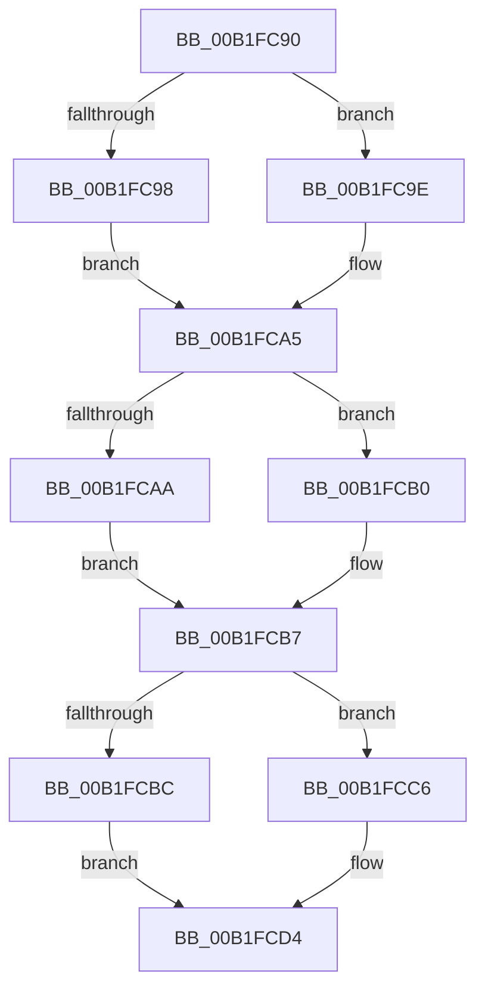

# sub_00B1FC90

- RVA: `0x00B1FC90`–`0x00B1FCFB` (길이 `107` bytes)
- VA: `0x0000000140B1FC90`
- 실행 섹션: `PAGE`
- PDB 이름 있음: `아니요`; PDB Function 태그: `아니요`
- unwind 정보 RVA: `0x00088060`
- 디코드: `27`개 명령, `107/107` bytes 표시
- 미해석 바이트: `0` (있으면 어셈블리에 `.byte`로 보존)

> 이 문서는 커널 이미지의 기계어와 PDB 기호를 분석해 생성했습니다. 4번과 5번은 함수 원형과 자료형을 바이너리 사용 방식에서 추정한 C 해석이며 원본 소스 복구 결과는 아닙니다.

## 1. Dependencies

- 직접 호출 지점: **1**; 고유 호출 대상: **1**
- 직접 호출자로 확인된 함수: **0**
- RIP 상대 이미지 참조: **1**

### Outgoing calls
- `0x00B1FCF0` → [McTemplateK0zzzzdd_EtwWriteTransfer](../../text/5A/McTemplateK0zzzzdd_EtwWriteTransfer_function_005A9CF4.md) (function, `0x005A9CF4`)

### Direct callers
- 이 함수 시작 RVA로 연결되는 직접 call은 확인되지 않았습니다. 간접 호출은 완전히 역산할 수 없습니다.

### Static image references
- `0x00B1FC9E` → RVA `0x00AFCAD0` (` ?? ::NNGAKEGL::`string'`; read)

## 2. Other-region calls and transfers

- 다른 실행 섹션으로 향하는 call: **1**
  - `0x00B1FCF0` → [McTemplateK0zzzzdd_EtwWriteTransfer](../../text/5A/McTemplateK0zzzzdd_EtwWriteTransfer_function_005A9CF4.md) (`PAGE` → `.text`)
- call이 아닌 외부 분기/꼬리 이동: **1**
  - `0x00B1FCF6` → [PiSwProcessParentRemoveIrp + 0x86](../8F/PiSwProcessParentRemoveIrp_function_008FCD6C.md) (`tail-transfer`)

## 3. Assembly (complete function range)

```asm
00B1FC90  45 33 DB                        xor r11d, r11d
00B1FC93  48 85 DB                        test rbx, rbx
00B1FC96  74 06                           je 0x140b1fc9e
00B1FC98  4C 8B 53 08                     mov r10, qword ptr [rbx + 8]
00B1FC9C  EB 07                           jmp 0x140b1fca5
00B1FC9E  4C 8D 15 2B CE FD FF            lea r10, [rip - 0x231d5]
00B1FCA5  48 85 ED                        test rbp, rbp
00B1FCA8  74 06                           je 0x140b1fcb0
00B1FCAA  4C 8B 45 08                     mov r8, qword ptr [rbp + 8]
00B1FCAE  EB 07                           jmp 0x140b1fcb7
00B1FCB0  4C 8D 05 19 CE FD FF            lea r8, [rip - 0x231e7]
00B1FCB7  48 85 D2                        test rdx, rdx
00B1FCBA  74 0A                           je 0x140b1fcc6
00B1FCBC  48 8B 4A 10                     mov rcx, qword ptr [rdx + 0x10]
00B1FCC0  4C 8B 4A 08                     mov r9, qword ptr [rdx + 8]
00B1FCC4  EB 0E                           jmp 0x140b1fcd4
00B1FCC6  48 8D 0D 03 CE FD FF            lea rcx, [rip - 0x231fd]
00B1FCCD  4C 8D 0D FC CD FD FF            lea r9, [rip - 0x23204]
00B1FCD4  41 8B 47 08                     mov eax, dword ptr [r15 + 8]
00B1FCD8  89 44 24 40                     mov dword ptr [rsp + 0x40], eax
00B1FCDC  44 89 5C 24 38                  mov dword ptr [rsp + 0x38], r11d
00B1FCE1  4C 89 54 24 30                  mov qword ptr [rsp + 0x30], r10
00B1FCE6  4C 89 44 24 28                  mov qword ptr [rsp + 0x28], r8
00B1FCEB  48 89 4C 24 20                  mov qword ptr [rsp + 0x20], rcx
00B1FCF0  E8 FF 9F A8 FF                  call 0x1405a9cf4
00B1FCF5  90                              nop
00B1FCF6  E9 F7 D0 DD FF                  jmp 0x1408fcdf2
```

## 4. C-style interpretation (structured pseudocode)

```c
__int64 __fastcall sub_00B1FC90(__int64 a1, __int64 a2)
{
    __int64 result;
    __int64 v_r11;
    unsigned __int64 v_stack_p20;
    unsigned __int64 v_stack_p28;
    unsigned __int64 v_stack_p30;
    unsigned int v_stack_p38;
    unsigned int v_stack_p40;

    v_r11 = 0;
    if (v_rbx == 0) goto loc_00B1FC9E;
    goto loc_00B1FCA5;
loc_00B1FC9E:
loc_00B1FCA5:
    if (v_rbp == 0) goto loc_00B1FCB0;
    goto loc_00B1FCB7;
loc_00B1FCB0:
loc_00B1FCB7:
    if (a2 == 0) goto loc_00B1FCC6;
    goto loc_00B1FCD4;
loc_00B1FCC6:
loc_00B1FCD4:
    v_stack_p40 = (unsigned int)((unsigned int)(*(unsigned int *)(v_r15 + 8)));
    v_stack_p38 = 0;
    v_stack_p30 = v_rip - 143829;
    v_stack_p28 = v_rip - 143847;
    v_stack_p20 = v_rip - 143869;
    result = McTemplateK0zzzzdd_EtwWriteTransfer(v_rip - 143869, a2, v_rip - 143847, v_rip - 143876);
}
```

## 5. (Beta) C Style

```c
int64_t sub_00B1FC90(int64_t Arg1, int64_t Arg2)
{
    int64_t result;
    int64_t local_r11;
    uint64_t v_stack_p20;
    uint64_t v_stack_p28;
    uint64_t v_stack_p30;
    uint32_t v_stack_p38;
    uint32_t v_stack_p40;

    local_r11 = 0;
    if (local_rbx == 0) goto loc_00B1FC9E;
    goto loc_00B1FCA5;
loc_00B1FC9E:
loc_00B1FCA5:
    if (local_rbp == 0) goto loc_00B1FCB0;
    goto loc_00B1FCB7;
loc_00B1FCB0:
loc_00B1FCB7:
    if (Arg2 == 0) goto loc_00B1FCC6;
    goto loc_00B1FCD4;
loc_00B1FCC6:
loc_00B1FCD4:
    v_stack_p40 = (uint32_t)((uint32_t)(*(uint32_t *)(local_r15 + 0x8)));
    v_stack_p38 = 0;
    v_stack_p30 = v_rip - 143829;
    v_stack_p28 = v_rip - 143847;
    v_stack_p20 = v_rip - 143869;
    result = McTemplateK0zzzzdd_EtwWriteTransfer(v_rip - 143869, Arg2, v_rip - 143847, v_rip - 143876);
}
```

## 6. Execution-region graph

[열기: 2D/3D 그래프와 함수 탐색 컨트롤 패널](../../../control-panel.html?section=page&rva=0x00B1FC90&view=graph)

- 2D 그래프는 위에서 아래로 흐르고, 3D 그래프는 빈 공간을 드래그해 회전합니다. Shift+드래그는 이동, 휠은 확대·축소, 함수 노드 선택은 대상 보고서 이동입니다.

### Static fallback


