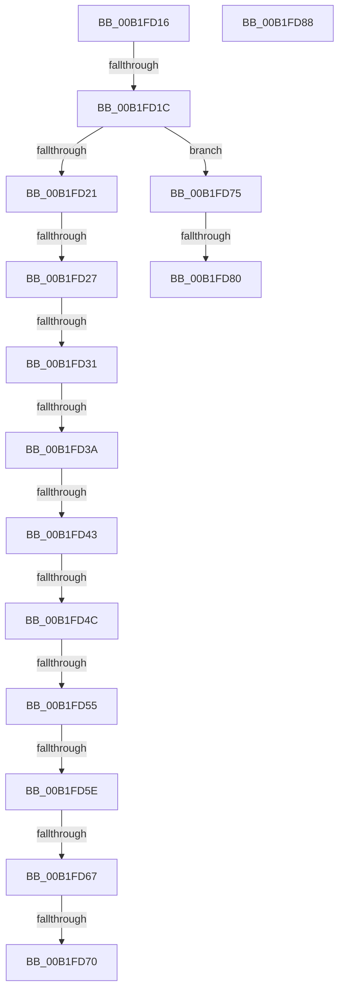

# sub_00B1FD16

- RVA: `0x00B1FD16`–`0x00B1FD92` (길이 `124` bytes)
- VA: `0x0000000140B1FD16`
- 실행 섹션: `PAGE`
- PDB 이름 있음: `아니요`; PDB Function 태그: `아니요`
- unwind 정보 RVA: `0x00088164`
- 디코드: `29`개 명령, `124/124` bytes 표시
- 미해석 바이트: `0` (있으면 어셈블리에 `.byte`로 보존)

> 이 문서는 커널 이미지의 기계어와 PDB 기호를 분석해 생성했습니다. 4번과 5번은 함수 원형과 자료형을 바이너리 사용 방식에서 추정한 C 해석이며 원본 소스 복구 결과는 아닙니다.

## 1. Dependencies

- 직접 호출 지점: **0**; 고유 호출 대상: **0**
- 직접 호출자로 확인된 함수: **0**
- RIP 상대 이미지 참조: **0**

### Outgoing calls
- 직접 디코드된 call 명령이 없습니다.

### Direct callers
- 이 함수 시작 RVA로 연결되는 직접 call은 확인되지 않았습니다. 간접 호출은 완전히 역산할 수 없습니다.

### Static image references
- 디코드된 RIP-relative 메모리 참조가 없습니다.

## 2. Other-region calls and transfers

- 다른 실행 섹션으로 향하는 call: **0**
- call이 아닌 외부 분기/꼬리 이동: **14**
  - `0x00B1FD16` → [_CmSetDeviceRegPropWorker + 0x9D](../8F/_CmSetDeviceRegPropWorker_function_008FD804.md) (`tail-transfer`)
  - `0x00B1FD21` → [_CmSetDeviceRegPropWorker + 0x9D](../8F/_CmSetDeviceRegPropWorker_function_008FD804.md) (`tail-transfer`)
  - `0x00B1FD2B` → [_CmSetDeviceRegPropWorker + 0x215](../8F/_CmSetDeviceRegPropWorker_function_008FD804.md) (`tail-transfer`)
  - `0x00B1FD34` → [_CmSetDeviceRegPropWorker + 0x9D](../8F/_CmSetDeviceRegPropWorker_function_008FD804.md) (`tail-transfer`)
  - `0x00B1FD3D` → [_CmSetDeviceRegPropWorker + 0x9D](../8F/_CmSetDeviceRegPropWorker_function_008FD804.md) (`tail-transfer`)
  - `0x00B1FD46` → [_CmSetDeviceRegPropWorker + 0x9D](../8F/_CmSetDeviceRegPropWorker_function_008FD804.md) (`tail-transfer`)
  - `0x00B1FD4F` → [_CmSetDeviceRegPropWorker + 0x215](../8F/_CmSetDeviceRegPropWorker_function_008FD804.md) (`tail-transfer`)
  - `0x00B1FD58` → [_CmSetDeviceRegPropWorker + 0x9D](../8F/_CmSetDeviceRegPropWorker_function_008FD804.md) (`tail-transfer`)
  - `0x00B1FD61` → [_CmSetDeviceRegPropWorker + 0x215](../8F/_CmSetDeviceRegPropWorker_function_008FD804.md) (`tail-transfer`)
  - `0x00B1FD6A` → [_CmSetDeviceRegPropWorker + 0x215](../8F/_CmSetDeviceRegPropWorker_function_008FD804.md) (`tail-transfer`)
  - `0x00B1FD70` → [_CmSetDeviceRegPropWorker + 0x94](../8F/_CmSetDeviceRegPropWorker_function_008FD804.md) (`tail-transfer`)
  - `0x00B1FD7A` → [_CmSetDeviceRegPropWorker + 0x9D](../8F/_CmSetDeviceRegPropWorker_function_008FD804.md) (`tail-transfer`)
  - `0x00B1FD83` → [_CmSetDeviceRegPropWorker + 0x74](../8F/_CmSetDeviceRegPropWorker_function_008FD804.md) (`tail-transfer`)
  - `0x00B1FD8D` → [_CmSetDeviceRegPropWorker + 0x133](../8F/_CmSetDeviceRegPropWorker_function_008FD804.md) (`tail-transfer`)

## 3. Assembly (complete function range)

```asm
00B1FD16  0F 84 85 DB DD FF               je 0x1408fd8a1
00B1FD1C  83 FF 09                        cmp edi, 9
00B1FD1F  7F 54                           jg 0x140b1fd75
00B1FD21  0F 84 7A DB DD FF               je 0x1408fd8a1
00B1FD27  8B CF                           mov ecx, edi
00B1FD29  85 FF                           test edi, edi
00B1FD2B  0F 84 E8 DC DD FF               je 0x1408fda19
00B1FD31  83 E9 01                        sub ecx, 1
00B1FD34  0F 84 67 DB DD FF               je 0x1408fd8a1
00B1FD3A  83 E9 01                        sub ecx, 1
00B1FD3D  0F 84 5E DB DD FF               je 0x1408fd8a1
00B1FD43  83 E9 01                        sub ecx, 1
00B1FD46  0F 84 55 DB DD FF               je 0x1408fd8a1
00B1FD4C  83 E9 01                        sub ecx, 1
00B1FD4F  0F 84 C4 DC DD FF               je 0x1408fda19
00B1FD55  83 E9 01                        sub ecx, 1
00B1FD58  0F 84 43 DB DD FF               je 0x1408fd8a1
00B1FD5E  83 E9 01                        sub ecx, 1
00B1FD61  0F 84 B2 DC DD FF               je 0x1408fda19
00B1FD67  83 E9 01                        sub ecx, 1
00B1FD6A  0F 84 A9 DC DD FF               je 0x1408fda19
00B1FD70  E9 23 DB DD FF                  jmp 0x1408fd898
00B1FD75  8B CF                           mov ecx, edi
00B1FD77  83 E9 0A                        sub ecx, 0xa
00B1FD7A  0F 84 21 DB DD FF               je 0x1408fd8a1
00B1FD80  83 E9 01                        sub ecx, 1
00B1FD83  E9 F0 DA DD FF                  jmp 0x1408fd878
00B1FD88  BB 0D 00 00 C0                  mov ebx, 0xc000000d
00B1FD8D  E9 A5 DB DD FF                  jmp 0x1408fd937
```

## 4. C-style interpretation (structured pseudocode)

```c
void __fastcall sub_00B1FD16(void)
{
    if (((unsigned int)(v_rdi)) > 9) goto loc_00B1FD75;
    a1 = (unsigned int)(((unsigned int)((unsigned int)(v_rdi))) - (1));
    a1 = (unsigned int)((a1) - (1));
    a1 = (unsigned int)((a1) - (1));
    a1 = (unsigned int)((a1) - (1));
    a1 = (unsigned int)((a1) - (1));
    a1 = (unsigned int)((a1) - (1));
    a1 = (unsigned int)((a1) - (1));
loc_00B1FD75:
    a1 = (unsigned int)(((unsigned int)((unsigned int)(v_rdi))) - (10));
    a1 = (unsigned int)((a1) - (1));
}
```

## 5. (Beta) C Style

```c
void sub_00B1FD16(void)
{
    if (((uint32_t)(local_rdi)) > 9) goto loc_00B1FD75;
    a1 = (uint32_t)(((uint32_t)((uint32_t)(local_rdi))) - (1));
    a1 = (uint32_t)((a1) - (1));
    a1 = (uint32_t)((a1) - (1));
    a1 = (uint32_t)((a1) - (1));
    a1 = (uint32_t)((a1) - (1));
    a1 = (uint32_t)((a1) - (1));
    a1 = (uint32_t)((a1) - (1));
loc_00B1FD75:
    a1 = (uint32_t)(((uint32_t)((uint32_t)(local_rdi))) - (10));
    a1 = (uint32_t)((a1) - (1));
}
```

## 6. Execution-region graph

[열기: 2D/3D 그래프와 함수 탐색 컨트롤 패널](../../../control-panel.html?section=page&rva=0x00B1FD16&view=graph)

- 2D 그래프는 위에서 아래로 흐르고, 3D 그래프는 빈 공간을 드래그해 회전합니다. Shift+드래그는 이동, 휠은 확대·축소, 함수 노드 선택은 대상 보고서 이동입니다.

### Static fallback


