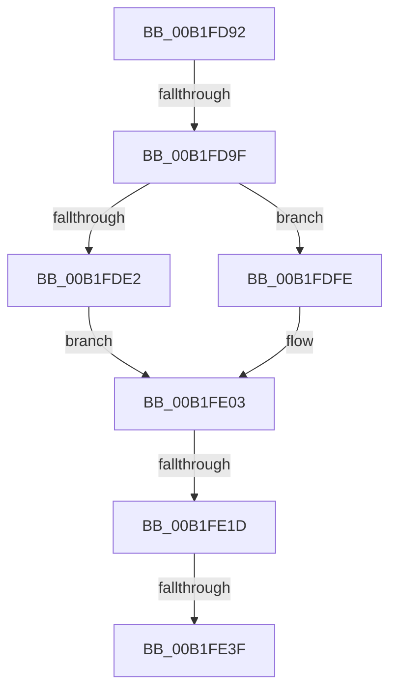

# sub_00B1FD92

- RVA: `0x00B1FD92`–`0x00B1FE52` (길이 `192` bytes)
- VA: `0x0000000140B1FD92`
- 실행 섹션: `PAGE`
- PDB 이름 있음: `아니요`; PDB Function 태그: `아니요`
- unwind 정보 RVA: `0x0008818C`
- 디코드: `42`개 명령, `192/192` bytes 표시
- 미해석 바이트: `0` (있으면 어셈블리에 `.byte`로 보존)

> 이 문서는 커널 이미지의 기계어와 PDB 기호를 분석해 생성했습니다. 4번과 5번은 함수 원형과 자료형을 바이너리 사용 방식에서 추정한 C 해석이며 원본 소스 복구 결과는 아닙니다.

## 1. Dependencies

- 직접 호출 지점: **7**; 고유 호출 대상: **7**
- 직접 호출자로 확인된 함수: **0**
- RIP 상대 이미지 참조: **3**

### Outgoing calls
- `0x00B1FDCC` → [ExAcquireResourceSharedLite](../../text/21/ExAcquireResourceSharedLite_function_00211BC0.md) (function, `0x00211BC0`)
- `0x00B1FDF7` → [ZwSetValueKey](../../text/6A/ZwSetValueKey_function_006ADCD0.md) (function, `0x006ADCD0`)
- `0x00B1FDFE` → [ZwDeleteValueKey](../../text/6A/ZwDeleteValueKey_function_006AECB0.md) (function, `0x006AECB0`)
- `0x00B1FE0A` → [ExReleaseResourceLite](../../text/25/ExReleaseResourceLite_function_0025FA10.md) (function, `0x0025FA10`)
- `0x00B1FE0F` → [KeLeaveCriticalRegion](../../text/25/KeLeaveCriticalRegion_function_0025D8B0.md) (function, `0x0025D8B0`)
- `0x00B1FE30` → [guard_dispatch_icall](../../text/6B/guard_dispatch_icall_function_006BAAD0.md) (function, `0x006BAAD0`)
- `0x00B1FE47` → [PipSetDevNodeFlags](../8F/PipSetDevNodeFlags_function_008FC048.md) (function, `0x008FC048`)

### Direct callers
- 이 함수 시작 RVA로 연결되는 직접 call은 확인되지 않았습니다. 간접 호출은 완전히 역산할 수 없습니다.

### Static image references
- `0x00B1FDA6` → RVA `0x00AFD500` (` ?? ::NNGAKEGL::`string'`; read)
- `0x00B1FDB1` → RVA `0x00F8C600` (`.data`; read)
- `0x00B1FE1D` → RVA `0x00F8C138` (`.data`; read)

## 2. Other-region calls and transfers

- 다른 실행 섹션으로 향하는 call: **6**
  - `0x00B1FDCC` → [ExAcquireResourceSharedLite](../../text/21/ExAcquireResourceSharedLite_function_00211BC0.md) (`PAGE` → `.text`)
  - `0x00B1FDF7` → [ZwSetValueKey](../../text/6A/ZwSetValueKey_function_006ADCD0.md) (`PAGE` → `.text`)
  - `0x00B1FDFE` → [ZwDeleteValueKey](../../text/6A/ZwDeleteValueKey_function_006AECB0.md) (`PAGE` → `.text`)
  - `0x00B1FE0A` → [ExReleaseResourceLite](../../text/25/ExReleaseResourceLite_function_0025FA10.md) (`PAGE` → `.text`)
  - `0x00B1FE0F` → [KeLeaveCriticalRegion](../../text/25/KeLeaveCriticalRegion_function_0025D8B0.md) (`PAGE` → `.text`)
  - `0x00B1FE30` → [guard_dispatch_icall](../../text/6B/guard_dispatch_icall_function_006BAAD0.md) (`PAGE` → `.text`)
- call이 아닌 외부 분기/꼬리 이동: **4**
  - `0x00B1FD99` → [PiQueryAndAllocateBootResources + 0xC8](../8F/PiQueryAndAllocateBootResources_function_008FDB10.md) (`tail-transfer`)
  - `0x00B1FE17` → [PiQueryAndAllocateBootResources + 0xCD](../8F/PiQueryAndAllocateBootResources_function_008FDB10.md) (`tail-transfer`)
  - `0x00B1FE39` → [PiQueryAndAllocateBootResources + 0xC8](../8F/PiQueryAndAllocateBootResources_function_008FDB10.md) (`tail-transfer`)
  - `0x00B1FE4D` → [PiQueryAndAllocateBootResources + 0xC8](../8F/PiQueryAndAllocateBootResources_function_008FDB10.md) (`tail-transfer`)

## 3. Assembly (complete function range)

```asm
00B1FD92  4C 39 B7 20 02 00 00            cmp qword ptr [rdi + 0x220], r14
00B1FD99  0F 85 39 DE DD FF               jne 0x1408fdbd8
00B1FD9F  C7 45 F0 14 00 16 00            mov dword ptr [rbp - 0x10], 0x160014
00B1FDA6  48 8D 05 53 D7 FD FF            lea rax, [rip - 0x228ad]
00B1FDAD  48 89 45 F8                     mov qword ptr [rbp - 8], rax
00B1FDB1  48 8D 0D 48 C8 46 00            lea rcx, [rip + 0x46c848]
00B1FDB8  65 48 8B 04 25 88 01 00 00      mov rax, qword ptr gs:[0x188]
00B1FDC1  41 8A D7                        mov dl, r15b
00B1FDC4  66 FF 88 E4 01 00 00            dec word ptr [rax + 0x1e4]
00B1FDCB  90                              nop
00B1FDCC  E8 EF 1D 6F FF                  call 0x140211bc0
00B1FDD1  48 8B 5D 50                     mov rbx, qword ptr [rbp + 0x50]
00B1FDD5  48 8D 55 F0                     lea rdx, [rbp - 0x10]
00B1FDD9  48 8B 4D 48                     mov rcx, qword ptr [rbp + 0x48]
00B1FDDD  48 85 DB                        test rbx, rbx
00B1FDE0  74 1C                           je 0x140b1fdfe
00B1FDE2  8B 45 40                        mov eax, dword ptr [rbp + 0x40]
00B1FDE5  41 B9 08 00 00 00               mov r9d, 8
00B1FDEB  89 44 24 28                     mov dword ptr [rsp + 0x28], eax
00B1FDEF  45 33 C0                        xor r8d, r8d
00B1FDF2  48 89 5C 24 20                  mov qword ptr [rsp + 0x20], rbx
00B1FDF7  E8 D4 DE B8 FF                  call 0x1406adcd0
00B1FDFC  EB 05                           jmp 0x140b1fe03
00B1FDFE  E8 AD EE B8 FF                  call 0x1406aecb0
00B1FE03  48 8D 0D F6 C7 46 00            lea rcx, [rip + 0x46c7f6]
00B1FE0A  E8 01 FC 73 FF                  call 0x14025fa10
00B1FE0F  E8 9C DA 73 FF                  call 0x14025d8b0
00B1FE14  48 85 DB                        test rbx, rbx
00B1FE17  0F 84 C0 DD DD FF               je 0x1408fdbdd
00B1FE1D  48 8B 05 14 C3 46 00            mov rax, qword ptr [rip + 0x46c314]
00B1FE24  4C 8B C3                        mov r8, rbx
00B1FE27  48 8B 57 20                     mov rdx, qword ptr [rdi + 0x20]
00B1FE2B  B9 04 00 00 00                  mov ecx, 4
00B1FE30  E8 9B AC B9 FF                  call 0x1406baad0
00B1FE35  8B F0                           mov esi, eax
00B1FE37  85 C0                           test eax, eax
00B1FE39  0F 88 99 DD DD FF               js 0x1408fdbd8
00B1FE3F  BA 40 00 00 00                  mov edx, 0x40
00B1FE44  48 8B CF                        mov rcx, rdi
00B1FE47  E8 FC C1 DD FF                  call 0x1408fc048
00B1FE4C  90                              nop
00B1FE4D  E9 86 DD DD FF                  jmp 0x1408fdbd8
```

## 4. C-style interpretation (structured pseudocode)

```c
__int64 __fastcall sub_00B1FD92(__int64 a1, __int64 a2, int a3)
{
    __int64 result;
    unsigned __int64 v_stack_p20;
    unsigned int v_stack_p28;

    *(unsigned int *)(v_rbp - 16) = 0x160014ULL;
    *(unsigned __int64 *)(v_rbp - 8) = v_rip - 141485;
    result = ExAcquireResourceSharedLite(v_rip + 4638792, (unsigned __int8)(v_r15), a3, a4);
    if (*(unsigned __int64 *)(v_rbp + 80) == 0) goto loc_00B1FDFE;
    v_stack_p28 = (unsigned int)((unsigned int)(*(unsigned int *)(v_rbp + 64)));
    a3 = 0;
    v_stack_p20 = *(unsigned __int64 *)(v_rbp + 80);
    result = ZwSetValueKey(*(unsigned __int64 *)(v_rbp + 72), v_rbp - 16, a3, 8);
    goto loc_00B1FE03;
loc_00B1FDFE:
    result = ZwDeleteValueKey(*(unsigned __int64 *)(v_rbp + 72), v_rbp - 16, a3, 8);
loc_00B1FE03:
    result = ExReleaseResourceLite(v_rip + 4638710, v_rbp - 16, a3, 8);
    result = KeLeaveCriticalRegion(v_rip + 4638710, v_rbp - 16, a3, 8);
    result = guard_dispatch_icall(4, *(unsigned __int64 *)(v_rdi + 32), *(unsigned __int64 *)(v_rbp + 80), 8);
    result = PipSetDevNodeFlags(v_rdi, 64, *(unsigned __int64 *)(v_rbp + 80), 8);
}
```

## 5. (Beta) C Style

```c
int64_t sub_00B1FD92(int64_t Arg1, int64_t Arg2, int32_t Arg3)
{
    int64_t result;
    uint64_t v_stack_p20;
    uint32_t v_stack_p28;

    *(uint32_t *)(local_rbp - 0x10) = 0x160014ULL;
    *(uint64_t *)(local_rbp - 0x8) = v_rip - 141485;
    result = ExAcquireResourceSharedLite(v_rip + 4638792, (uint8_t)(local_r15), Arg3, a4);
    if (*(uint64_t *)(local_rbp + 0x50) == 0) goto loc_00B1FDFE;
    v_stack_p28 = (uint32_t)((uint32_t)(*(uint32_t *)(local_rbp + 0x40)));
    Arg3 = 0;
    v_stack_p20 = *(uint64_t *)(local_rbp + 0x50);
    result = ZwSetValueKey(*(uint64_t *)(local_rbp + 0x48), local_rbp - 16, Arg3, 8);
    goto loc_00B1FE03;
loc_00B1FDFE:
    result = ZwDeleteValueKey(*(uint64_t *)(local_rbp + 0x48), local_rbp - 16, Arg3, 8);
loc_00B1FE03:
    result = ExReleaseResourceLite(v_rip + 4638710, local_rbp - 16, Arg3, 8);
    result = KeLeaveCriticalRegion(v_rip + 4638710, local_rbp - 16, Arg3, 8);
    result = guard_dispatch_icall(4, *(uint64_t *)(local_rdi + 0x20), *(uint64_t *)(local_rbp + 0x50), 8);
    result = PipSetDevNodeFlags(local_rdi, 64, *(uint64_t *)(local_rbp + 0x50), 8);
}
```

## 6. Execution-region graph

[열기: 2D/3D 그래프와 함수 탐색 컨트롤 패널](../../../control-panel.html?section=page&rva=0x00B1FD92&view=graph)

- 2D 그래프는 위에서 아래로 흐르고, 3D 그래프는 빈 공간을 드래그해 회전합니다. Shift+드래그는 이동, 휠은 확대·축소, 함수 노드 선택은 대상 보고서 이동입니다.

### Static fallback


