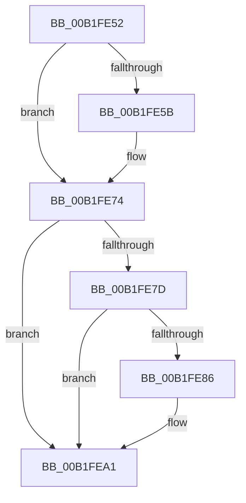

# sub_00B1FE52

- RVA: `0x00B1FE52`–`0x00B1FEBF` (길이 `109` bytes)
- VA: `0x0000000140B1FE52`
- 실행 섹션: `PAGE`
- PDB 이름 있음: `아니요`; PDB Function 태그: `아니요`
- unwind 정보 RVA: `0x00088218`
- 디코드: `28`개 명령, `109/109` bytes 표시
- 미해석 바이트: `0` (있으면 어셈블리에 `.byte`로 보존)

> 이 문서는 커널 이미지의 기계어와 PDB 기호를 분석해 생성했습니다. 4번과 5번은 함수 원형과 자료형을 바이너리 사용 방식에서 추정한 C 해석이며 원본 소스 복구 결과는 아닙니다.

## 1. Dependencies

- 직접 호출 지점: **5**; 고유 호출 대상: **2**
- 직접 호출자로 확인된 함수: **0**
- RIP 상대 이미지 참조: **0**

### Outgoing calls
- `0x00B1FE63` → [IoAddTriageDumpDataBlock](../../text/42/IoAddTriageDumpDataBlock_function_00428374.md) (function, `0x00428374`)
- `0x00B1FE6F` → [IoAddTriageDumpDataBlock](../../text/42/IoAddTriageDumpDataBlock_function_00428374.md) (function, `0x00428374`)
- `0x00B1FE8B` → [IoAddTriageDumpDataBlock](../../text/42/IoAddTriageDumpDataBlock_function_00428374.md) (function, `0x00428374`)
- `0x00B1FE9C` → [IoAddTriageDumpDataBlock](../../text/42/IoAddTriageDumpDataBlock_function_00428374.md) (function, `0x00428374`)
- `0x00B1FEB9` → [KeBugCheckEx](../../text/4F/KeBugCheckEx_function_004FD660.md) (function, `0x004FD660`)

### Direct callers
- 이 함수 시작 RVA로 연결되는 직접 call은 확인되지 않았습니다. 간접 호출은 완전히 역산할 수 없습니다.

### Static image references
- 디코드된 RIP-relative 메모리 참조가 없습니다.

## 2. Other-region calls and transfers

- 다른 실행 섹션으로 향하는 call: **5**
  - `0x00B1FE63` → [IoAddTriageDumpDataBlock](../../text/42/IoAddTriageDumpDataBlock_function_00428374.md) (`PAGE` → `.text`)
  - `0x00B1FE6F` → [IoAddTriageDumpDataBlock](../../text/42/IoAddTriageDumpDataBlock_function_00428374.md) (`PAGE` → `.text`)
  - `0x00B1FE8B` → [IoAddTriageDumpDataBlock](../../text/42/IoAddTriageDumpDataBlock_function_00428374.md) (`PAGE` → `.text`)
  - `0x00B1FE9C` → [IoAddTriageDumpDataBlock](../../text/42/IoAddTriageDumpDataBlock_function_00428374.md) (`PAGE` → `.text`)
  - `0x00B1FEB9` → [KeBugCheckEx](../../text/4F/KeBugCheckEx_function_004FD660.md) (`PAGE` → `.text`)
- 별도 외부 분기/꼬리 이동을 확인하지 못했습니다.

## 3. Assembly (complete function range)

```asm
00B1FE52  48 8D 7B 38                     lea rdi, [rbx + 0x38]
00B1FE56  66 39 2F                        cmp word ptr [rdi], bp
00B1FE59  74 19                           je 0x140b1fe74
00B1FE5B  BA 02 00 00 00                  mov edx, 2
00B1FE60  48 8B CF                        mov rcx, rdi
00B1FE63  E8 0C 85 90 FF                  call 0x140428374
00B1FE68  0F B7 17                        movzx edx, word ptr [rdi]
00B1FE6B  48 8B 4B 40                     mov rcx, qword ptr [rbx + 0x40]
00B1FE6F  E8 00 85 90 FF                  call 0x140428374
00B1FE74  48 8B 43 10                     mov rax, qword ptr [rbx + 0x10]
00B1FE78  48 85 C0                        test rax, rax
00B1FE7B  74 24                           je 0x140b1fea1
00B1FE7D  48 8D 48 38                     lea rcx, [rax + 0x38]
00B1FE81  66 39 29                        cmp word ptr [rcx], bp
00B1FE84  74 1B                           je 0x140b1fea1
00B1FE86  BA 02 00 00 00                  mov edx, 2
00B1FE8B  E8 E4 84 90 FF                  call 0x140428374
00B1FE90  48 8B 4B 10                     mov rcx, qword ptr [rbx + 0x10]
00B1FE94  0F B7 51 38                     movzx edx, word ptr [rcx + 0x38]
00B1FE98  48 8B 49 40                     mov rcx, qword ptr [rcx + 0x40]
00B1FE9C  E8 D3 84 90 FF                  call 0x140428374
00B1FEA1  4C 8B CE                        mov r9, rsi
00B1FEA4  48 89 5C 24 20                  mov qword ptr [rsp + 0x20], rbx
00B1FEA9  BA 13 00 00 00                  mov edx, 0x13
00B1FEAE  B9 CA 00 00 00                  mov ecx, 0xca
00B1FEB3  41 B8 00 10 00 00               mov r8d, 0x1000
00B1FEB9  E8 A2 D7 9D FF                  call 0x1404fd660
00B1FEBE  CC                              int3
```

## 4. C-style interpretation (structured pseudocode)

```c
__int64 __fastcall sub_00B1FE52(void)
{
    __int64 result;
    unsigned __int64 v_stack_p20;

    if ((*(unsigned __int16 *)(v_rbx + 56)) != ((unsigned __int16)(v_rbp))) {
        a2 = 2;
        a1 = v_rbx + 56;
        result = IoAddTriageDumpDataBlock(a1, a2, a3, a4);
        a2 = *(unsigned __int16 *)(v_rbx + 56);
        a1 = *(unsigned __int64 *)(v_rbx + 64);
        result = IoAddTriageDumpDataBlock(a1, a2, a3, a4);
    }
    if (*(unsigned __int64 *)(v_rbx + 16) == 0) goto loc_00B1FEA1;
    result = *(unsigned __int64 *)(v_rbx + 16);
    if ((*(unsigned __int16 *)(*(unsigned __int64 *)(v_rbx + 16) + 56)) != ((unsigned __int16)(v_rbp))) {
        a2 = 2;
        result = IoAddTriageDumpDataBlock(*(unsigned __int64 *)(v_rbx + 16) + 56, a2, a3, a4);
        a1 = *(unsigned __int64 *)(v_rbx + 16);
        a2 = *(unsigned __int16 *)(a1 + 56);
        a1 = *(unsigned __int64 *)(a1 + 64);
        result = IoAddTriageDumpDataBlock(a1, a2, a3, a4);
    }
    v_stack_p20 = v_rbx;
    result = KeBugCheckEx(202, 19, (unsigned int)(0x1000ULL), v_rsi);
    return result;
}
```

## 5. (Beta) C Style

```c
void sub_00B1FE52(void)
{
    int64_t result;
    uint64_t v_stack_p20;

    if ((*(uint16_t *)(local_rbx + 0x38)) != ((uint16_t)(local_rbp))) {
        a2 = 2;
        a1 = local_rbx + 56;
        result = IoAddTriageDumpDataBlock(a1, a2, a3, a4);
        a2 = *(uint16_t *)(local_rbx + 0x38);
        a1 = *(uint64_t *)(local_rbx + 0x40);
        result = IoAddTriageDumpDataBlock(a1, a2, a3, a4);
    }
    if (*(uint64_t *)(local_rbx + 0x10) == 0) goto loc_00B1FEA1;
    result = *(uint64_t *)(local_rbx + 0x10);
    if ((*(uint16_t *)(*(uint64_t *)(local_rbx + 0x10) + 0x38)) != ((uint16_t)(local_rbp))) {
        a2 = 2;
        result = IoAddTriageDumpDataBlock(*(uint64_t *)(local_rbx + 0x10) + 56, a2, a3, a4);
        a1 = *(uint64_t *)(local_rbx + 0x10);
        a2 = *(uint16_t *)(a1 + 0x38);
        a1 = *(uint64_t *)(a1 + 0x40);
        result = IoAddTriageDumpDataBlock(a1, a2, a3, a4);
    }
    v_stack_p20 = local_rbx;
    result = KeBugCheckEx(202, 19, (uint32_t)(0x1000ULL), local_rsi);
    return result;
}
```

## 6. Execution-region graph

[열기: 2D/3D 그래프와 함수 탐색 컨트롤 패널](../../../control-panel.html?section=page&rva=0x00B1FE52&view=graph)

- 2D 그래프는 위에서 아래로 흐르고, 3D 그래프는 빈 공간을 드래그해 회전합니다. Shift+드래그는 이동, 휠은 확대·축소, 함수 노드 선택은 대상 보고서 이동입니다.

### Static fallback


