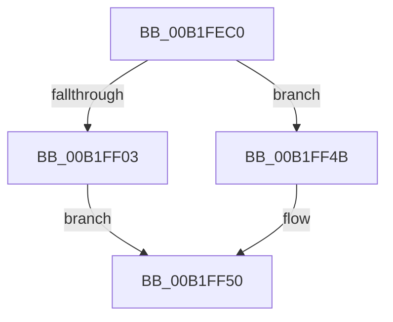

# sub_00B1FEC0

- RVA: `0x00B1FEC0`–`0x00B1FF67` (길이 `167` bytes)
- VA: `0x0000000140B1FEC0`
- 실행 섹션: `PAGE`
- PDB 이름 있음: `아니요`; PDB Function 태그: `아니요`
- unwind 정보 RVA: `0x0008825C`
- 디코드: `35`개 명령, `167/167` bytes 표시
- 미해석 바이트: `0` (있으면 어셈블리에 `.byte`로 보존)

> 이 문서는 커널 이미지의 기계어와 PDB 기호를 분석해 생성했습니다. 4번과 5번은 함수 원형과 자료형을 바이너리 사용 방식에서 추정한 C 해석이며 원본 소스 복구 결과는 아닙니다.

## 1. Dependencies

- 직접 호출 지점: **8**; 고유 호출 대상: **8**
- 직접 호출자로 확인된 함수: **0**
- RIP 상대 이미지 참조: **3**

### Outgoing calls
- `0x00B1FEED` → [ExAcquireResourceSharedLite](../../text/21/ExAcquireResourceSharedLite_function_00211BC0.md) (function, `0x00211BC0`)
- `0x00B1FF15` → [ZwSetValueKey](../../text/6A/ZwSetValueKey_function_006ADCD0.md) (function, `0x006ADCD0`)
- `0x00B1FF21` → [ExAcquireFastMutex](../../text/20/ExAcquireFastMutex_function_0020E5A0.md) (function, `0x0020E5A0`)
- `0x00B1FF34` → [ExReleaseFastMutex](../../text/25/ExReleaseFastMutex_function_002519C0.md) (function, `0x002519C0`)
- `0x00B1FF41` → [PipSetDevNodeFlags](../8F/PipSetDevNodeFlags_function_008FC048.md) (function, `0x008FC048`)
- `0x00B1FF4B` → [ZwDeleteValueKey](../../text/6A/ZwDeleteValueKey_function_006AECB0.md) (function, `0x006AECB0`)
- `0x00B1FF57` → [ExReleaseResourceLite](../../text/25/ExReleaseResourceLite_function_0025FA10.md) (function, `0x0025FA10`)
- `0x00B1FF5C` → [KeLeaveCriticalRegion](../../text/25/KeLeaveCriticalRegion_function_0025D8B0.md) (function, `0x0025D8B0`)

### Direct callers
- 이 함수 시작 RVA로 연결되는 직접 call은 확인되지 않았습니다. 간접 호출은 완전히 역산할 수 없습니다.

### Static image references
- `0x00B1FEC7` → RVA `0x00AFD520` (` ?? ::NNGAKEGL::`string'`; read)
- `0x00B1FED2` → RVA `0x00F8C600` (`.data`; read)
- `0x00B1FF1A` → RVA `0x00F8C3E0` (`.data`; read)

## 2. Other-region calls and transfers

- 다른 실행 섹션으로 향하는 call: **7**
  - `0x00B1FEED` → [ExAcquireResourceSharedLite](../../text/21/ExAcquireResourceSharedLite_function_00211BC0.md) (`PAGE` → `.text`)
  - `0x00B1FF15` → [ZwSetValueKey](../../text/6A/ZwSetValueKey_function_006ADCD0.md) (`PAGE` → `.text`)
  - `0x00B1FF21` → [ExAcquireFastMutex](../../text/20/ExAcquireFastMutex_function_0020E5A0.md) (`PAGE` → `.text`)
  - `0x00B1FF34` → [ExReleaseFastMutex](../../text/25/ExReleaseFastMutex_function_002519C0.md) (`PAGE` → `.text`)
  - `0x00B1FF4B` → [ZwDeleteValueKey](../../text/6A/ZwDeleteValueKey_function_006AECB0.md) (`PAGE` → `.text`)
  - `0x00B1FF57` → [ExReleaseResourceLite](../../text/25/ExReleaseResourceLite_function_0025FA10.md) (`PAGE` → `.text`)
  - `0x00B1FF5C` → [KeLeaveCriticalRegion](../../text/25/KeLeaveCriticalRegion_function_0025D8B0.md) (`PAGE` → `.text`)
- call이 아닌 외부 분기/꼬리 이동: **1**
  - `0x00B1FF62` → [PiQueryResourceRequirements + 0xC6](../8F/PiQueryResourceRequirements_function_008FE61C.md) (`tail-transfer`)

## 3. Assembly (complete function range)

```asm
00B1FEC0  C7 45 F0 22 00 24 00            mov dword ptr [rbp - 0x10], 0x240022
00B1FEC7  48 8D 05 52 D6 FD FF            lea rax, [rip - 0x229ae]
00B1FECE  48 89 45 F8                     mov qword ptr [rbp - 8], rax
00B1FED2  48 8D 0D 27 C7 46 00            lea rcx, [rip + 0x46c727]
00B1FED9  65 48 8B 04 25 88 01 00 00      mov rax, qword ptr gs:[0x188]
00B1FEE2  41 8A D4                        mov dl, r12b
00B1FEE5  66 FF 88 E4 01 00 00            dec word ptr [rax + 0x1e4]
00B1FEEC  90                              nop
00B1FEED  E8 CE 1C 6F FF                  call 0x140211bc0
00B1FEF2  48 8B 5D 38                     mov rbx, qword ptr [rbp + 0x38]
00B1FEF6  48 8D 55 F0                     lea rdx, [rbp - 0x10]
00B1FEFA  48 8B 4D 30                     mov rcx, qword ptr [rbp + 0x30]
00B1FEFE  48 85 DB                        test rbx, rbx
00B1FF01  74 48                           je 0x140b1ff4b
00B1FF03  89 74 24 28                     mov dword ptr [rsp + 0x28], esi
00B1FF07  41 B9 0A 00 00 00               mov r9d, 0xa
00B1FF0D  45 33 C0                        xor r8d, r8d
00B1FF10  48 89 5C 24 20                  mov qword ptr [rsp + 0x20], rbx
00B1FF15  E8 B6 DD B8 FF                  call 0x1406adcd0
00B1FF1A  48 8D 0D BF C4 46 00            lea rcx, [rip + 0x46c4bf]
00B1FF21  E8 7A E6 6E FF                  call 0x14020e5a0
00B1FF26  48 8D 0D B3 C4 46 00            lea rcx, [rip + 0x46c4b3]
00B1FF2D  48 89 9F B8 01 00 00            mov qword ptr [rdi + 0x1b8], rbx
00B1FF34  E8 87 1A 73 FF                  call 0x1402519c0
00B1FF39  BA 00 02 00 00                  mov edx, 0x200
00B1FF3E  48 8B CF                        mov rcx, rdi
00B1FF41  E8 02 C1 DD FF                  call 0x1408fc048
00B1FF46  49 8B DF                        mov rbx, r15
00B1FF49  EB 05                           jmp 0x140b1ff50
00B1FF4B  E8 60 ED B8 FF                  call 0x1406aecb0
00B1FF50  48 8D 0D A9 C6 46 00            lea rcx, [rip + 0x46c6a9]
00B1FF57  E8 B4 FA 73 FF                  call 0x14025fa10
00B1FF5C  E8 4F D9 73 FF                  call 0x14025d8b0
00B1FF61  90                              nop
00B1FF62  E9 7B E7 DD FF                  jmp 0x1408fe6e2
```

## 4. C-style interpretation (structured pseudocode)

```c
__int64 __fastcall sub_00B1FEC0(__int64 a1, __int64 a2, int a3)
{
    __int64 result;
    unsigned __int64 v_stack_p20;
    unsigned int v_stack_p28;

    *(unsigned int *)(v_rbp - 16) = 0x240022ULL;
    *(unsigned __int64 *)(v_rbp - 8) = v_rip - 141742;
    result = ExAcquireResourceSharedLite(v_rip + 4638503, (unsigned __int8)(v_r12), a3, a4);
    if (*(unsigned __int64 *)(v_rbp + 56) == 0) goto loc_00B1FF4B;
    v_stack_p28 = (unsigned int)(v_rsi);
    a3 = 0;
    v_stack_p20 = *(unsigned __int64 *)(v_rbp + 56);
    result = ZwSetValueKey(*(unsigned __int64 *)(v_rbp + 48), v_rbp - 16, a3, 10);
    result = ExAcquireFastMutex(v_rip + 4637887, v_rbp - 16, a3, 10);
    *(unsigned __int64 *)(v_rdi + 440) = *(unsigned __int64 *)(v_rbp + 56);
    result = ExReleaseFastMutex(v_rip + 4637875, v_rbp - 16, a3, 10);
    result = PipSetDevNodeFlags(v_rdi, 512, a3, 10);
    goto loc_00B1FF50;
loc_00B1FF4B:
    result = ZwDeleteValueKey(v_rdi, 512, a3, 10);
loc_00B1FF50:
    result = ExReleaseResourceLite(v_rip + 4638377, 512, a3, 10);
    result = KeLeaveCriticalRegion(v_rip + 4638377, 512, a3, 10);
}
```

## 5. (Beta) C Style

```c
int64_t sub_00B1FEC0(int64_t Arg1, int64_t Arg2, int32_t Arg3)
{
    int64_t result;
    uint64_t v_stack_p20;
    uint32_t v_stack_p28;

    *(uint32_t *)(local_rbp - 0x10) = 0x240022ULL;
    *(uint64_t *)(local_rbp - 0x8) = v_rip - 141742;
    result = ExAcquireResourceSharedLite(v_rip + 4638503, (uint8_t)(local_r12), Arg3, a4);
    if (*(uint64_t *)(local_rbp + 0x38) == 0) goto loc_00B1FF4B;
    v_stack_p28 = (uint32_t)(local_rsi);
    Arg3 = 0;
    v_stack_p20 = *(uint64_t *)(local_rbp + 0x38);
    result = ZwSetValueKey(*(uint64_t *)(local_rbp + 0x30), local_rbp - 16, Arg3, 10);
    result = ExAcquireFastMutex(v_rip + 4637887, local_rbp - 16, Arg3, 10);
    *(uint64_t *)(local_rdi + 0x1B8) = *(uint64_t *)(local_rbp + 0x38);
    result = ExReleaseFastMutex(v_rip + 4637875, local_rbp - 16, Arg3, 10);
    result = PipSetDevNodeFlags(local_rdi, 512, Arg3, 10);
    goto loc_00B1FF50;
loc_00B1FF4B:
    result = ZwDeleteValueKey(local_rdi, 512, Arg3, 10);
loc_00B1FF50:
    result = ExReleaseResourceLite(v_rip + 4638377, 512, Arg3, 10);
    result = KeLeaveCriticalRegion(v_rip + 4638377, 512, Arg3, 10);
}
```

## 6. Execution-region graph

[열기: 2D/3D 그래프와 함수 탐색 컨트롤 패널](../../../control-panel.html?section=page&rva=0x00B1FEC0&view=graph)

- 2D 그래프는 위에서 아래로 흐르고, 3D 그래프는 빈 공간을 드래그해 회전합니다. Shift+드래그는 이동, 휠은 확대·축소, 함수 노드 선택은 대상 보고서 이동입니다.

### Static fallback


