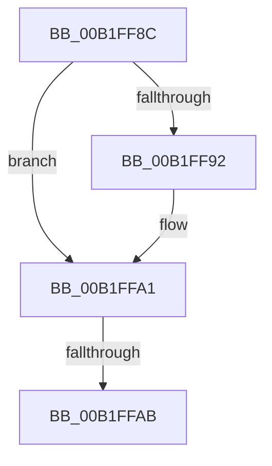

# sub_00B1FF8C

- RVA: `0x00B1FF8C`–`0x00B1FFBD` (길이 `49` bytes)
- VA: `0x0000000140B1FF8C`
- 실행 섹션: `PAGE`
- PDB 이름 있음: `아니요`; PDB Function 태그: `아니요`
- unwind 정보 RVA: `0x0008835C`
- 디코드: `13`개 명령, `49/49` bytes 표시
- 미해석 바이트: `0` (있으면 어셈블리에 `.byte`로 보존)

> 이 문서는 커널 이미지의 기계어와 PDB 기호를 분석해 생성했습니다. 4번과 5번은 함수 원형과 자료형을 바이너리 사용 방식에서 추정한 C 해석이며 원본 소스 복구 결과는 아닙니다.

## 1. Dependencies

- 직접 호출 지점: **2**; 고유 호출 대상: **2**
- 직접 호출자로 확인된 함수: **0**
- RIP 상대 이미지 참조: **0**

### Outgoing calls
- `0x00B1FF9C` → [PnpCtxRegDeleteKey](../96/PnpCtxRegDeleteKey_function_00965EC8.md) (function, `0x00965EC8`)
- `0x00B1FFB2` → [CmDeleteDeviceContainer](../82/CmDeleteDeviceContainer_function_0082AEF4.md) (function, `0x0082AEF4`)

### Direct callers
- 이 함수 시작 RVA로 연결되는 직접 call은 확인되지 않았습니다. 간접 호출은 완전히 역산할 수 없습니다.

### Static image references
- 디코드된 RIP-relative 메모리 참조가 없습니다.

## 2. Other-region calls and transfers

- 다른 실행 섹션으로 향하는 call: **0**
- call이 아닌 외부 분기/꼬리 이동: **2**
  - `0x00B1FFA5` → [_CmAddDeviceToContainerWorker + 0x83](../8F/_CmAddDeviceToContainerWorker_function_008FF2EC.md) (`tail-transfer`)
  - `0x00B1FFB8` → [_CmAddDeviceToContainerWorker + 0x83](../8F/_CmAddDeviceToContainerWorker_function_008FF2EC.md) (`tail-transfer`)

## 3. Assembly (complete function range)

```asm
00B1FF8C  83 7D C7 01                     cmp dword ptr [rbp - 0x39], 1
00B1FF90  75 0F                           jne 0x140b1ffa1
00B1FF92  48 8B 55 D7                     mov rdx, qword ptr [rbp - 0x29]
00B1FF96  45 33 C0                        xor r8d, r8d
00B1FF99  48 8B CF                        mov rcx, rdi
00B1FF9C  E8 27 5F E4 FF                  call 0x140965ec8
00B1FFA1  80 7D BF 01                     cmp byte ptr [rbp - 0x41], 1
00B1FFA5  0F 85 C4 F3 DD FF               jne 0x1408ff36f
00B1FFAB  48 8B 55 67                     mov rdx, qword ptr [rbp + 0x67]
00B1FFAF  48 8B CF                        mov rcx, rdi
00B1FFB2  E8 3D AF D0 FF                  call 0x14082aef4
00B1FFB7  90                              nop
00B1FFB8  E9 B2 F3 DD FF                  jmp 0x1408ff36f
```

## 4. C-style interpretation (structured pseudocode)

```c
__int64 __fastcall sub_00B1FF8C(__int64 a1, __int64 a2, int a3)
{
    __int64 result;

    if ((*(unsigned int *)(v_rbp - 57)) == 1) {
        a2 = *(unsigned __int64 *)(v_rbp - 41);
        a3 = 0;
        a1 = v_rdi;
        result = PnpCtxRegDeleteKey(a1, a2, a3, a4);
    }
    result = CmDeleteDeviceContainer(v_rdi, *(unsigned __int64 *)(v_rbp + 103), a3, a4);
}
```

## 5. (Beta) C Style

```c
int64_t sub_00B1FF8C(int64_t Arg1, int64_t Arg2, int32_t Arg3)
{
    int64_t result;

    if ((*(uint32_t *)(local_rbp - 0x39)) == 1) {
        Arg2 = *(uint64_t *)(local_rbp - 0x29);
        Arg3 = 0;
        Arg1 = local_rdi;
        result = PnpCtxRegDeleteKey(Arg1, Arg2, Arg3, a4);
    }
    result = CmDeleteDeviceContainer(local_rdi, *(uint64_t *)(local_rbp + 0x67), Arg3, a4);
}
```

## 6. Execution-region graph

[열기: 2D/3D 그래프와 함수 탐색 컨트롤 패널](../../../control-panel.html?section=page&rva=0x00B1FF8C&view=graph)

- 2D 그래프는 위에서 아래로 흐르고, 3D 그래프는 빈 공간을 드래그해 회전합니다. Shift+드래그는 이동, 휠은 확대·축소, 함수 노드 선택은 대상 보고서 이동입니다.

### Static fallback


