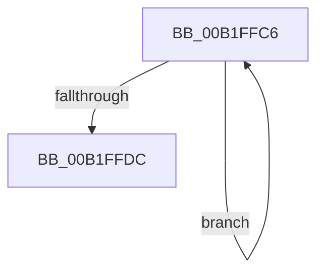

# sub_00B1FFC6

- RVA: `0x00B1FFC6`–`0x00B1FFEC` (길이 `38` bytes)
- VA: `0x0000000140B1FFC6`
- 실행 섹션: `PAGE`
- PDB 이름 있음: `아니요`; PDB Function 태그: `아니요`
- unwind 정보 RVA: `0x00088464`
- 디코드: `11`개 명령, `38/38` bytes 표시
- 미해석 바이트: `0` (있으면 어셈블리에 `.byte`로 보존)

> 이 문서는 커널 이미지의 기계어와 PDB 기호를 분석해 생성했습니다. 4번과 5번은 함수 원형과 자료형을 바이너리 사용 방식에서 추정한 C 해석이며 원본 소스 복구 결과는 아닙니다.

## 1. Dependencies

- 직접 호출 지점: **2**; 고유 호출 대상: **2**
- 직접 호출자로 확인된 함수: **0**
- RIP 상대 이미지 참조: **0**

### Outgoing calls
- `0x00B1FFCD` → [IoDisconnectInterrupt](../90/IoDisconnectInterrupt_function_00900890.md) (function, `0x00900890`)
- `0x00B1FFE1` → [ExFreePoolWithTag](../../poolcode/B8/ExFreePoolWithTag_function_00B82870.md) (function, `0x00B82870`)

### Direct callers
- 이 함수 시작 RVA로 연결되는 직접 call은 확인되지 않았습니다. 간접 호출은 완전히 역산할 수 없습니다.

### Static image references
- 디코드된 RIP-relative 메모리 참조가 없습니다.

## 2. Other-region calls and transfers

- 다른 실행 섹션으로 향하는 call: **1**
  - `0x00B1FFE1` → [ExFreePoolWithTag](../../poolcode/B8/ExFreePoolWithTag_function_00B82870.md) (`PAGE` → `POOLCODE`)
- call이 아닌 외부 분기/꼬리 이동: **1**
  - `0x00B1FFE7` → [IopConnectLineBasedInterrupt + 0x7D](../8F/IopConnectLineBasedInterrupt_function_008FFE64.md) (`tail-transfer`)

## 3. Assembly (complete function range)

```asm
00B1FFC6  48 8B 0E                        mov rcx, qword ptr [rsi]
00B1FFC9  48 83 C1 70                     add rcx, 0x70
00B1FFCD  E8 BE 08 DE FF                  call 0x140900890
00B1FFD2  48 8D 76 08                     lea rsi, [rsi + 8]
00B1FFD6  49 83 EE 01                     sub r14, 1
00B1FFDA  75 EA                           jne 0x140b1ffc6
00B1FFDC  33 D2                           xor edx, edx
00B1FFDE  48 8B CF                        mov rcx, rdi
00B1FFE1  E8 8A 28 06 00                  call 0x140b82870
00B1FFE6  90                              nop
00B1FFE7  E9 F5 FE DD FF                  jmp 0x1408ffee1
```

## 4. C-style interpretation (structured pseudocode)

```c
__int64 __fastcall sub_00B1FFC6(__int64 a1, int a2)
{
    __int64 result;
    __int64 v_r14;

    a1 = (*(unsigned __int64 *)(v_rsi)) + (112);
    result = IoDisconnectInterrupt(a1, a2, a3, a4);
    v_r14 = (v_r14) - (1);
    if (condition_is_not_equal) goto loc_00B1FFC6;
    a2 = 0;
    result = ExFreePoolWithTag(v_rdi, a2, a3, a4);
}
```

## 5. (Beta) C Style

```c
int64_t sub_00B1FFC6(int64_t Arg1, int32_t Arg2)
{
    int64_t result;
    int64_t local_r14;

    Arg1 = (*(uint64_t *)(local_rsi)) + (112);
    result = IoDisconnectInterrupt(Arg1, Arg2, a3, a4);
    local_r14 = (local_r14) - (1);
    if (condition_is_not_equal) goto loc_00B1FFC6;
    Arg2 = 0;
    result = ExFreePoolWithTag(local_rdi, Arg2, a3, a4);
}
```

## 6. Execution-region graph

[열기: 2D/3D 그래프와 함수 탐색 컨트롤 패널](../../../control-panel.html?section=page&rva=0x00B1FFC6&view=graph)

- 2D 그래프는 위에서 아래로 흐르고, 3D 그래프는 빈 공간을 드래그해 회전합니다. Shift+드래그는 이동, 휠은 확대·축소, 함수 노드 선택은 대상 보고서 이동입니다.

### Static fallback


