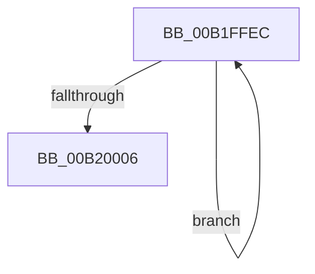

# sub_00B1FFEC

- RVA: `0x00B1FFEC`–`0x00B2000B` (길이 `31` bytes)
- VA: `0x0000000140B1FFEC`
- 실행 섹션: `PAGE`
- PDB 이름 있음: `아니요`; PDB Function 태그: `아니요`
- unwind 정보 RVA: `0x00088484`
- 디코드: `9`개 명령, `31/31` bytes 표시
- 미해석 바이트: `0` (있으면 어셈블리에 `.byte`로 보존)

> 이 문서는 커널 이미지의 기계어와 PDB 기호를 분석해 생성했습니다. 4번과 5번은 함수 원형과 자료형을 바이너리 사용 방식에서 추정한 C 해석이며 원본 소스 복구 결과는 아닙니다.

## 1. Dependencies

- 직접 호출 지점: **1**; 고유 호출 대상: **1**
- 직접 호출자로 확인된 함수: **0**
- RIP 상대 이미지 참조: **0**

### Outgoing calls
- `0x00B1FFFA` → [IoDisconnectInterrupt](../90/IoDisconnectInterrupt_function_00900890.md) (function, `0x00900890`)

### Direct callers
- 이 함수 시작 RVA로 연결되는 직접 call은 확인되지 않았습니다. 간접 호출은 완전히 역산할 수 없습니다.

### Static image references
- 디코드된 RIP-relative 메모리 참조가 없습니다.

## 2. Other-region calls and transfers

- 다른 실행 섹션으로 향하는 call: **0**
- call이 아닌 외부 분기/꼬리 이동: **1**
  - `0x00B20006` → [IoDisconnectInterruptEx + 0x62](../90/IoDisconnectInterruptEx_function_00900140.md) (`tail-transfer`)

## 3. Assembly (complete function range)

```asm
00B1FFEC  8B C3                           mov eax, ebx
00B1FFEE  48 8D 0C 40                     lea rcx, [rax + rax*2]
00B1FFF2  48 03 C9                        add rcx, rcx
00B1FFF5  48 8B 4C CF 18                  mov rcx, qword ptr [rdi + rcx*8 + 0x18]
00B1FFFA  E8 91 08 DE FF                  call 0x140900890
00B1FFFF  FF C3                           inc ebx
00B20001  3B 5F 04                        cmp ebx, dword ptr [rdi + 4]
00B20004  72 E6                           jb 0x140b1ffec
00B20006  E9 97 01 DE FF                  jmp 0x1409001a2
```

## 4. C-style interpretation (structured pseudocode)

```c
__int64 __fastcall sub_00B1FFEC(void)
{
    __int64 result;
    __int64 v_rbx;

    a1 = ((unsigned int)((unsigned int)(v_rbx)) + (unsigned int)((unsigned int)(v_rbx)) * 2) + ((unsigned int)((unsigned int)(v_rbx)) + (unsigned int)((unsigned int)(v_rbx)) * 2);
    result = IoDisconnectInterrupt(*(unsigned __int64 *)(v_rdi + a1 * 8 + 24), a2, a3, a4);
    v_rbx = (unsigned int)((v_rbx) + 1);
    if (((unsigned int)(v_rbx)) < (*(unsigned int *)(v_rdi + 4))) goto loc_00B1FFEC;
}
```

## 5. (Beta) C Style

```c
void sub_00B1FFEC(void)
{
    int64_t result;
    int64_t local_rbx;

    a1 = ((uint32_t)((uint32_t)(local_rbx)) + (uint32_t)((uint32_t)(local_rbx)) * 2) + ((uint32_t)((uint32_t)(local_rbx)) + (uint32_t)((uint32_t)(local_rbx)) * 2);
    result = IoDisconnectInterrupt(*(uint64_t *)(local_rdi + a1 * 8 + 0x18), a2, a3, a4);
    local_rbx = (uint32_t)((local_rbx) + 1);
    if (((uint32_t)(local_rbx)) < (*(uint32_t *)(local_rdi + 0x4))) goto loc_00B1FFEC;
}
```

## 6. Execution-region graph

[열기: 2D/3D 그래프와 함수 탐색 컨트롤 패널](../../../control-panel.html?section=page&rva=0x00B1FFEC&view=graph)

- 2D 그래프는 위에서 아래로 흐르고, 3D 그래프는 빈 공간을 드래그해 회전합니다. Shift+드래그는 이동, 휠은 확대·축소, 함수 노드 선택은 대상 보고서 이동입니다.

### Static fallback


