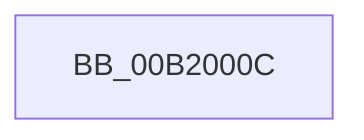

# sub_00B2000C

- RVA: `0x00B2000C`–`0x00B2006F` (길이 `99` bytes)
- VA: `0x0000000140B2000C`
- 실행 섹션: `PAGE`
- PDB 이름 있음: `아니요`; PDB Function 태그: `아니요`
- unwind 정보 RVA: `0x000884AC`
- 디코드: `26`개 명령, `99/99` bytes 표시
- 미해석 바이트: `0` (있으면 어셈블리에 `.byte`로 보존)

> 이 문서는 커널 이미지의 기계어와 PDB 기호를 분석해 생성했습니다. 4번과 5번은 함수 원형과 자료형을 바이너리 사용 방식에서 추정한 C 해석이며 원본 소스 복구 결과는 아닙니다.

## 1. Dependencies

- 직접 호출 지점: **1**; 고유 호출 대상: **1**
- 직접 호출자로 확인된 함수: **0**
- RIP 상대 이미지 참조: **0**

### Outgoing calls
- `0x00B20064` → [IopConnectInterruptFullySpecified](../72/IopConnectInterruptFullySpecified_function_007273E8.md) (function, `0x007273E8`)

### Direct callers
- 이 함수 시작 RVA로 연결되는 직접 call은 확인되지 않았습니다. 간접 호출은 완전히 역산할 수 없습니다.

### Static image references
- 디코드된 RIP-relative 메모리 참조가 없습니다.

## 2. Other-region calls and transfers

- 다른 실행 섹션으로 향하는 call: **0**
- call이 아닌 외부 분기/꼬리 이동: **1**
  - `0x00B2006A` → [IoConnectInterruptEx + 0xE3](../90/IoConnectInterruptEx_function_009001F0.md) (`tail-transfer`)

## 3. Assembly (complete function range)

```asm
00B2000C  48 8B 43 40                     mov rax, qword ptr [rbx + 0x40]
00B20010  0F 57 C0                        xorps xmm0, xmm0
00B20013  4C 8B 4B 20                     mov r9, qword ptr [rbx + 0x20]
00B20017  4C 8B 43 18                     mov r8, qword ptr [rbx + 0x18]
00B2001B  48 8B 53 08                     mov rdx, qword ptr [rbx + 8]
00B2001F  48 8B 4B 10                     mov rcx, qword ptr [rbx + 0x10]
00B20023  0F 11 45 D7                     movups xmmword ptr [rbp - 0x29], xmm0
00B20027  48 89 45 D7                     mov qword ptr [rbp - 0x29], rax
00B2002B  48 8D 45 D7                     lea rax, [rbp - 0x29]
00B2002F  48 89 44 24 50                  mov qword ptr [rsp + 0x50], rax
00B20034  8A 43 32                        mov al, byte ptr [rbx + 0x32]
00B20037  88 44 24 48                     mov byte ptr [rsp + 0x48], al
00B2003B  8B 43 3C                        mov eax, dword ptr [rbx + 0x3c]
00B2003E  89 44 24 40                     mov dword ptr [rsp + 0x40], eax
00B20042  8A 43 30                        mov al, byte ptr [rbx + 0x30]
00B20045  88 44 24 38                     mov byte ptr [rsp + 0x38], al
00B20049  8A 43 38                        mov al, byte ptr [rbx + 0x38]
00B2004C  88 44 24 30                     mov byte ptr [rsp + 0x30], al
00B20050  8B 43 34                        mov eax, dword ptr [rbx + 0x34]
00B20053  89 44 24 28                     mov dword ptr [rsp + 0x28], eax
00B20057  48 8B 43 28                     mov rax, qword ptr [rbx + 0x28]
00B2005B  48 89 44 24 20                  mov qword ptr [rsp + 0x20], rax
00B20060  66 89 75 DF                     mov word ptr [rbp - 0x21], si
00B20064  E8 7F 73 C0 FF                  call 0x1407273e8
00B20069  90                              nop
00B2006A  E9 64 02 DE FF                  jmp 0x1409002d3
```

## 4. C-style interpretation (structured pseudocode)

```c
__int64 __fastcall sub_00B2000C(void)
{
    __int64 result;
    unsigned __int64 v_stack_p20;
    unsigned int v_stack_p28;
    unsigned __int8 v_stack_p30;
    unsigned __int8 v_stack_p38;
    unsigned int v_stack_p40;
    unsigned __int8 v_stack_p48;
    unsigned __int64 v_stack_p50;

    *(unsigned __int64 *)(v_rbp - 41) = v_xmm0;
    *(unsigned __int64 *)(v_rbp - 41) = *(unsigned __int64 *)(v_rbx + 64);
    v_stack_p50 = v_rbp - 41;
    v_stack_p48 = (unsigned __int8)(*(unsigned __int8 *)(v_rbx + 50));
    v_stack_p40 = (unsigned int)((unsigned int)(*(unsigned int *)(v_rbx + 60)));
    v_stack_p38 = (unsigned __int8)(*(unsigned __int8 *)(v_rbx + 48));
    v_stack_p30 = (unsigned __int8)(*(unsigned __int8 *)(v_rbx + 56));
    v_stack_p28 = (unsigned int)((unsigned int)(*(unsigned int *)(v_rbx + 52)));
    v_stack_p20 = *(unsigned __int64 *)(v_rbx + 40);
    *(unsigned __int16 *)(v_rbp - 33) = (unsigned __int16)(v_rsi);
    result = IopConnectInterruptFullySpecified(*(unsigned __int64 *)(v_rbx + 16), *(unsigned __int64 *)(v_rbx + 8), *(unsigned __int64 *)(v_rbx + 24), *(unsigned __int64 *)(v_rbx + 32));
}
```

## 5. (Beta) C Style

```c
void sub_00B2000C(void)
{
    int64_t result;
    uint64_t v_stack_p20;
    uint32_t v_stack_p28;
    uint8_t v_stack_p30;
    uint8_t v_stack_p38;
    uint32_t v_stack_p40;
    uint8_t v_stack_p48;
    uint64_t v_stack_p50;

    *(uint64_t *)(local_rbp - 0x29) = v_xmm0;
    *(uint64_t *)(local_rbp - 0x29) = *(uint64_t *)(local_rbx + 0x40);
    v_stack_p50 = local_rbp - 41;
    v_stack_p48 = (uint8_t)(*(uint8_t *)(local_rbx + 0x32));
    v_stack_p40 = (uint32_t)((uint32_t)(*(uint32_t *)(local_rbx + 0x3C)));
    v_stack_p38 = (uint8_t)(*(uint8_t *)(local_rbx + 0x30));
    v_stack_p30 = (uint8_t)(*(uint8_t *)(local_rbx + 0x38));
    v_stack_p28 = (uint32_t)((uint32_t)(*(uint32_t *)(local_rbx + 0x34)));
    v_stack_p20 = *(uint64_t *)(local_rbx + 0x28);
    *(uint16_t *)(local_rbp - 0x21) = (uint16_t)(local_rsi);
    result = IopConnectInterruptFullySpecified(*(uint64_t *)(local_rbx + 0x10), *(uint64_t *)(local_rbx + 0x8), *(uint64_t *)(local_rbx + 0x18), *(uint64_t *)(local_rbx + 0x20));
}
```

## 6. Execution-region graph

[열기: 2D/3D 그래프와 함수 탐색 컨트롤 패널](../../../control-panel.html?section=page&rva=0x00B2000C&view=graph)

- 2D 그래프는 위에서 아래로 흐르고, 3D 그래프는 빈 공간을 드래그해 회전합니다. Shift+드래그는 이동, 휠은 확대·축소, 함수 노드 선택은 대상 보고서 이동입니다.

### Static fallback


