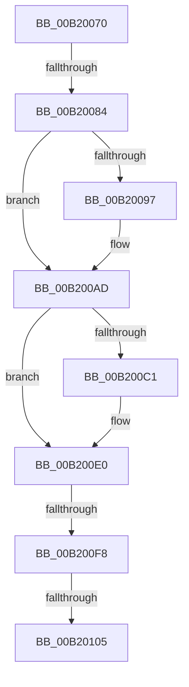

# sub_00B20070

- RVA: `0x00B20070`–`0x00B2012E` (길이 `190` bytes)
- VA: `0x0000000140B20070`
- 실행 섹션: `PAGE`
- PDB 이름 있음: `아니요`; PDB Function 태그: `아니요`
- unwind 정보 RVA: `0x000884D0`
- 디코드: `45`개 명령, `190/190` bytes 표시
- 미해석 바이트: `0` (있으면 어셈블리에 `.byte`로 보존)

> 이 문서는 커널 이미지의 기계어와 PDB 기호를 분석해 생성했습니다. 4번과 5번은 함수 원형과 자료형을 바이너리 사용 방식에서 추정한 C 해석이며 원본 소스 복구 결과는 아닙니다.

## 1. Dependencies

- 직접 호출 지점: **7**; 고유 호출 대상: **1**
- 직접 호출자로 확인된 함수: **0**
- RIP 상대 이미지 참조: **0**

### Outgoing calls
- `0x00B2008D` → [IoAddTriageDumpDataBlock](../../text/42/IoAddTriageDumpDataBlock_function_00428374.md) (function, `0x00428374`)
- `0x00B2009C` → [IoAddTriageDumpDataBlock](../../text/42/IoAddTriageDumpDataBlock_function_00428374.md) (function, `0x00428374`)
- `0x00B200A8` → [IoAddTriageDumpDataBlock](../../text/42/IoAddTriageDumpDataBlock_function_00428374.md) (function, `0x00428374`)
- `0x00B200C3` → [IoAddTriageDumpDataBlock](../../text/42/IoAddTriageDumpDataBlock_function_00428374.md) (function, `0x00428374`)
- `0x00B200DB` → [IoAddTriageDumpDataBlock](../../text/42/IoAddTriageDumpDataBlock_function_00428374.md) (function, `0x00428374`)
- `0x00B20107` → [IoAddTriageDumpDataBlock](../../text/42/IoAddTriageDumpDataBlock_function_00428374.md) (function, `0x00428374`)
- `0x00B20123` → [IoAddTriageDumpDataBlock](../../text/42/IoAddTriageDumpDataBlock_function_00428374.md) (function, `0x00428374`)

### Direct callers
- 이 함수 시작 RVA로 연결되는 직접 call은 확인되지 않았습니다. 간접 호출은 완전히 역산할 수 없습니다.

### Static image references
- 디코드된 RIP-relative 메모리 참조가 없습니다.

## 2. Other-region calls and transfers

- 다른 실행 섹션으로 향하는 call: **7**
  - `0x00B2008D` → [IoAddTriageDumpDataBlock](../../text/42/IoAddTriageDumpDataBlock_function_00428374.md) (`PAGE` → `.text`)
  - `0x00B2009C` → [IoAddTriageDumpDataBlock](../../text/42/IoAddTriageDumpDataBlock_function_00428374.md) (`PAGE` → `.text`)
  - `0x00B200A8` → [IoAddTriageDumpDataBlock](../../text/42/IoAddTriageDumpDataBlock_function_00428374.md) (`PAGE` → `.text`)
  - `0x00B200C3` → [IoAddTriageDumpDataBlock](../../text/42/IoAddTriageDumpDataBlock_function_00428374.md) (`PAGE` → `.text`)
  - `0x00B200DB` → [IoAddTriageDumpDataBlock](../../text/42/IoAddTriageDumpDataBlock_function_00428374.md) (`PAGE` → `.text`)
  - `0x00B20107` → [IoAddTriageDumpDataBlock](../../text/42/IoAddTriageDumpDataBlock_function_00428374.md) (`PAGE` → `.text`)
  - `0x00B20123` → [IoAddTriageDumpDataBlock](../../text/42/IoAddTriageDumpDataBlock_function_00428374.md) (`PAGE` → `.text`)
- call이 아닌 외부 분기/꼬리 이동: **4**
  - `0x00B2007E` → [IoGetDevicePropertyData + 0x83](../90/IoGetDevicePropertyData_function_009005E0.md) (`tail-transfer`)
  - `0x00B200F2` → [IoGetDevicePropertyData + 0x83](../90/IoGetDevicePropertyData_function_009005E0.md) (`tail-transfer`)
  - `0x00B200FF` → [IoGetDevicePropertyData + 0x83](../90/IoGetDevicePropertyData_function_009005E0.md) (`tail-transfer`)
  - `0x00B20129` → [IoGetDevicePropertyData + 0x83](../90/IoGetDevicePropertyData_function_009005E0.md) (`tail-transfer`)

## 3. Assembly (complete function range)

```asm
00B20070  48 8B 83 38 01 00 00            mov rax, qword ptr [rbx + 0x138]
00B20077  48 8B 48 28                     mov rcx, qword ptr [rax + 0x28]
00B2007B  48 85 C9                        test rcx, rcx
00B2007E  0F 84 DF 05 DE FF               je 0x140900663
00B20084  BA 88 03 00 00                  mov edx, 0x388
00B20089  48 8D 79 28                     lea rdi, [rcx + 0x28]
00B2008D  E8 E2 82 90 FF                  call 0x140428374
00B20092  66 39 37                        cmp word ptr [rdi], si
00B20095  74 16                           je 0x140b200ad
00B20097  8B D5                           mov edx, ebp
00B20099  48 8B CF                        mov rcx, rdi
00B2009C  E8 D3 82 90 FF                  call 0x140428374
00B200A1  0F B7 17                        movzx edx, word ptr [rdi]
00B200A4  48 8B 4F 08                     mov rcx, qword ptr [rdi + 8]
00B200A8  E8 C7 82 90 FF                  call 0x140428374
00B200AD  48 8B 83 38 01 00 00            mov rax, qword ptr [rbx + 0x138]
00B200B4  48 8B 48 28                     mov rcx, qword ptr [rax + 0x28]
00B200B8  48 83 C1 38                     add rcx, 0x38
00B200BC  66 39 31                        cmp word ptr [rcx], si
00B200BF  74 1F                           je 0x140b200e0
00B200C1  8B D5                           mov edx, ebp
00B200C3  E8 AC 82 90 FF                  call 0x140428374
00B200C8  48 8B 83 38 01 00 00            mov rax, qword ptr [rbx + 0x138]
00B200CF  48 8B 48 28                     mov rcx, qword ptr [rax + 0x28]
00B200D3  0F B7 51 38                     movzx edx, word ptr [rcx + 0x38]
00B200D7  48 8B 49 40                     mov rcx, qword ptr [rcx + 0x40]
00B200DB  E8 94 82 90 FF                  call 0x140428374
00B200E0  48 8B 83 38 01 00 00            mov rax, qword ptr [rbx + 0x138]
00B200E7  48 8B 48 28                     mov rcx, qword ptr [rax + 0x28]
00B200EB  48 8B 41 10                     mov rax, qword ptr [rcx + 0x10]
00B200EF  48 85 C0                        test rax, rax
00B200F2  0F 84 6B 05 DE FF               je 0x140900663
00B200F8  48 8D 48 38                     lea rcx, [rax + 0x38]
00B200FC  66 39 31                        cmp word ptr [rcx], si
00B200FF  0F 84 5E 05 DE FF               je 0x140900663
00B20105  8B D5                           mov edx, ebp
00B20107  E8 68 82 90 FF                  call 0x140428374
00B2010C  48 8B 83 38 01 00 00            mov rax, qword ptr [rbx + 0x138]
00B20113  48 8B 48 28                     mov rcx, qword ptr [rax + 0x28]
00B20117  48 8B 49 10                     mov rcx, qword ptr [rcx + 0x10]
00B2011B  0F B7 51 38                     movzx edx, word ptr [rcx + 0x38]
00B2011F  48 8B 49 40                     mov rcx, qword ptr [rcx + 0x40]
00B20123  E8 4C 82 90 FF                  call 0x140428374
00B20128  90                              nop
00B20129  E9 35 05 DE FF                  jmp 0x140900663
```

## 4. C-style interpretation (structured pseudocode)

```c
__int64 __fastcall sub_00B20070(void)
{
    __int64 result;

    result = IoAddTriageDumpDataBlock(*(unsigned __int64 *)(*(unsigned __int64 *)(v_rbx + 312) + 40), 904, a3, a4);
    if ((*(unsigned __int16 *)(*(unsigned __int64 *)(*(unsigned __int64 *)(v_rbx + 312) + 40) + 40)) != ((unsigned __int16)(v_rsi))) {
        a2 = (unsigned int)(v_rbp);
        a1 = *(unsigned __int64 *)(*(unsigned __int64 *)(v_rbx + 312) + 40) + 40;
        result = IoAddTriageDumpDataBlock(a1, a2, a3, a4);
        a2 = *(unsigned __int16 *)(*(unsigned __int64 *)(*(unsigned __int64 *)(v_rbx + 312) + 40) + 40);
        a1 = *(unsigned __int64 *)(*(unsigned __int64 *)(*(unsigned __int64 *)(v_rbx + 312) + 40) + 40 + 8);
        result = IoAddTriageDumpDataBlock(a1, a2, a3, a4);
    }
    a1 = (*(unsigned __int64 *)(*(unsigned __int64 *)(v_rbx + 312) + 40)) + (56);
    result = *(unsigned __int64 *)(v_rbx + 312);
    if ((*(unsigned __int16 *)(a1)) != ((unsigned __int16)(v_rsi))) {
        a2 = (unsigned int)(v_rbp);
        result = IoAddTriageDumpDataBlock(a1, a2, a3, a4);
        result = *(unsigned __int64 *)(v_rbx + 312);
        a1 = *(unsigned __int64 *)(result + 40);
        a2 = *(unsigned __int16 *)(a1 + 56);
        a1 = *(unsigned __int64 *)(a1 + 64);
        result = IoAddTriageDumpDataBlock(a1, a2, a3, a4);
    }
    result = IoAddTriageDumpDataBlock(*(unsigned __int64 *)(*(unsigned __int64 *)(*(unsigned __int64 *)(v_rbx + 312) + 40) + 16) + 56, (unsigned int)((unsigned int)(v_rbp)), a3, a4);
    result = IoAddTriageDumpDataBlock(*(unsigned __int64 *)(*(unsigned __int64 *)(*(unsigned __int64 *)(*(unsigned __int64 *)(v_rbx + 312) + 40) + 16) + 64), *(unsigned __int16 *)(*(unsigned __int64 *)(*(unsigned __int64 *)(*(unsigned __int64 *)(v_rbx + 312) + 40) + 16) + 56), a3, a4);
}
```

## 5. (Beta) C Style

```c
void sub_00B20070(void)
{
    int64_t result;

    result = IoAddTriageDumpDataBlock(*(uint64_t *)(*(uint64_t *)(local_rbx + 0x138) + 0x28), 904, a3, a4);
    if ((*(uint16_t *)(*(uint64_t *)(*(uint64_t *)(local_rbx + 0x138) + 0x28) + 0x28)) != ((uint16_t)(local_rsi))) {
        a2 = (uint32_t)(local_rbp);
        a1 = *(uint64_t *)(*(uint64_t *)(local_rbx + 0x138) + 0x28) + 40;
        result = IoAddTriageDumpDataBlock(a1, a2, a3, a4);
        a2 = *(uint16_t *)(*(uint64_t *)(*(uint64_t *)(local_rbx + 0x138) + 0x28) + 0x28);
        a1 = *(uint64_t *)(*(uint64_t *)(*(uint64_t *)(local_rbx + 0x138) + 0x28) + 0x28 + 0x8);
        result = IoAddTriageDumpDataBlock(a1, a2, a3, a4);
    }
    a1 = (*(uint64_t *)(*(uint64_t *)(local_rbx + 0x138) + 0x28)) + (56);
    result = *(uint64_t *)(local_rbx + 0x138);
    if ((*(uint16_t *)(a1)) != ((uint16_t)(local_rsi))) {
        a2 = (uint32_t)(local_rbp);
        result = IoAddTriageDumpDataBlock(a1, a2, a3, a4);
        result = *(uint64_t *)(local_rbx + 0x138);
        a1 = *(uint64_t *)(result + 0x28);
        a2 = *(uint16_t *)(a1 + 0x38);
        a1 = *(uint64_t *)(a1 + 0x40);
        result = IoAddTriageDumpDataBlock(a1, a2, a3, a4);
    }
    result = IoAddTriageDumpDataBlock(*(uint64_t *)(*(uint64_t *)(*(uint64_t *)(local_rbx + 0x138) + 0x28) + 0x10) + 56, (uint32_t)((uint32_t)(local_rbp)), a3, a4);
    result = IoAddTriageDumpDataBlock(*(uint64_t *)(*(uint64_t *)(*(uint64_t *)(*(uint64_t *)(local_rbx + 0x138) + 0x28) + 0x10) + 0x40), *(uint16_t *)(*(uint64_t *)(*(uint64_t *)(*(uint64_t *)(local_rbx + 0x138) + 0x28) + 0x10) + 0x38), a3, a4);
}
```

## 6. Execution-region graph

[열기: 2D/3D 그래프와 함수 탐색 컨트롤 패널](../../../control-panel.html?section=page&rva=0x00B20070&view=graph)

- 2D 그래프는 위에서 아래로 흐르고, 3D 그래프는 빈 공간을 드래그해 회전합니다. Shift+드래그는 이동, 휠은 확대·축소, 함수 노드 선택은 대상 보고서 이동입니다.

### Static fallback


