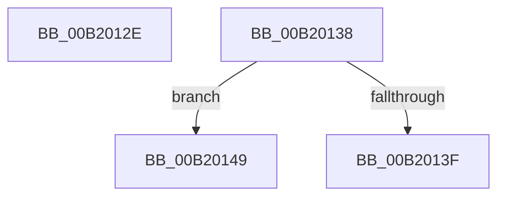

# sub_00B2012E

- RVA: `0x00B2012E`–`0x00B2015F` (길이 `49` bytes)
- VA: `0x0000000140B2012E`
- 실행 섹션: `PAGE`
- PDB 이름 있음: `아니요`; PDB Function 태그: `아니요`
- unwind 정보 RVA: `0x00088504`
- 디코드: `13`개 명령, `49/49` bytes 표시
- 미해석 바이트: `0` (있으면 어셈블리에 `.byte`로 보존)

> 이 문서는 커널 이미지의 기계어와 PDB 기호를 분석해 생성했습니다. 4번과 5번은 함수 원형과 자료형을 바이너리 사용 방식에서 추정한 C 해석이며 원본 소스 복구 결과는 아닙니다.

## 1. Dependencies

- 직접 호출 지점: **1**; 고유 호출 대상: **1**
- 직접 호출자로 확인된 함수: **0**
- RIP 상대 이미지 참조: **0**

### Outgoing calls
- `0x00B20153` → [memcpy](../../text/6C/memcpy_function_006C6840.md) (function, `0x006C6840`)

### Direct callers
- 이 함수 시작 RVA로 연결되는 직접 call은 확인되지 않았습니다. 간접 호출은 완전히 역산할 수 없습니다.

### Static image references
- 디코드된 RIP-relative 메모리 참조가 없습니다.

## 2. Other-region calls and transfers

- 다른 실행 섹션으로 향하는 call: **1**
  - `0x00B20153` → [memcpy](../../text/6C/memcpy_function_006C6840.md) (`PAGE` → `.text`)
- call이 아닌 외부 분기/꼬리 이동: **3**
  - `0x00B20133` → [PnpGetDevicePropertyData + 0x90](../90/PnpGetDevicePropertyData_function_009006D0.md) (`tail-transfer`)
  - `0x00B20144` → [PnpGetDevicePropertyData + 0xE8](../90/PnpGetDevicePropertyData_function_009006D0.md) (`tail-transfer`)
  - `0x00B2015A` → [PnpGetDevicePropertyData + 0xE8](../90/PnpGetDevicePropertyData_function_009006D0.md) (`tail-transfer`)

## 3. Assembly (complete function range)

```asm
00B2012E  48 8B 44 24 68                  mov rax, qword ptr [rsp + 0x68]
00B20133  E9 28 06 DE FF                  jmp 0x140900760
00B20138  8B 02                           mov eax, dword ptr [rdx]
00B2013A  44 3B F8                        cmp r15d, eax
00B2013D  73 0A                           jae 0x140b20149
00B2013F  BB 23 00 00 C0                  mov ebx, 0xc0000023
00B20144  E9 6F 06 DE FF                  jmp 0x1409007b8
00B20149  4C 8B C0                        mov r8, rax
00B2014C  48 83 C2 04                     add rdx, 4
00B20150  48 8B CD                        mov rcx, rbp
00B20153  E8 E8 66 BA FF                  call 0x1406c6840
00B20158  33 DB                           xor ebx, ebx
00B2015A  E9 59 06 DE FF                  jmp 0x1409007b8
```

## 4. C-style interpretation (structured pseudocode)

```c
__int64 __fastcall sub_00B2012E(__int64 a1, __int64 a2, __int64 a3, __int64 a4, __int64 a5, __int64 a6, __int64 a7, __int64 a8, __int64 a9, __int64 a10, __int64 a11, __int64 a12, __int64 a13)
{
}
```

## 5. (Beta) C Style

```c
int64_t sub_00B2012E(int64_t Arg1, int64_t Arg2, int64_t Arg3, int64_t Arg4, uint64_t Arg5, uint64_t Arg6, uint64_t Arg7, uint64_t Arg8, uint64_t Arg9, uint64_t Arg10, uint64_t Arg11, uint64_t Arg12, int64_t Arg13)
{
}
```

## 6. Execution-region graph

[열기: 2D/3D 그래프와 함수 탐색 컨트롤 패널](../../../control-panel.html?section=page&rva=0x00B2012E&view=graph)

- 2D 그래프는 위에서 아래로 흐르고, 3D 그래프는 빈 공간을 드래그해 회전합니다. Shift+드래그는 이동, 휠은 확대·축소, 함수 노드 선택은 대상 보고서 이동입니다.

### Static fallback


