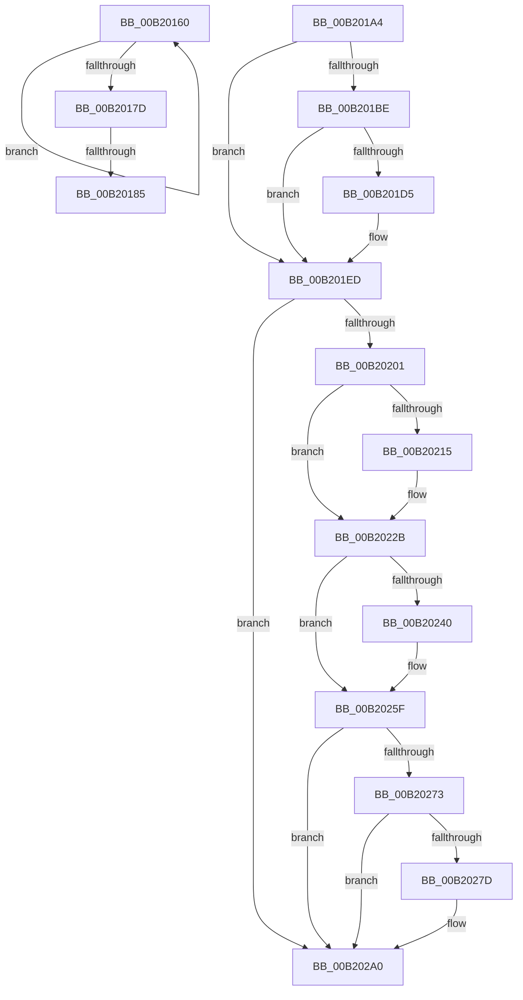

# sub_00B20160

- RVA: `0x00B20160`–`0x00B202B9` (길이 `345` bytes)
- VA: `0x0000000140B20160`
- 실행 섹션: `PAGE`
- PDB 이름 있음: `아니요`; PDB Function 태그: `아니요`
- unwind 정보 RVA: `0x00088534`
- 디코드: `87`개 명령, `345/345` bytes 표시
- 미해석 바이트: `0` (있으면 어셈블리에 `.byte`로 보존)

> 이 문서는 커널 이미지의 기계어와 PDB 기호를 분석해 생성했습니다. 4번과 5번은 함수 원형과 자료형을 바이너리 사용 방식에서 추정한 C 해석이며 원본 소스 복구 결과는 아닙니다.

## 1. Dependencies

- 직접 호출 지점: **13**; 고유 호출 대상: **3**
- 직접 호출자로 확인된 함수: **0**
- RIP 상대 이미지 참조: **0**

### Outgoing calls
- `0x00B20199` → [KeWaitForSingleObject](../../text/20/KeWaitForSingleObject_function_0020E6B0.md) (function, `0x0020E6B0`)
- `0x00B201AB` → [IoAddTriageDumpDataBlock](../../text/42/IoAddTriageDumpDataBlock_function_00428374.md) (function, `0x00428374`)
- `0x00B201C2` → [IoAddTriageDumpDataBlock](../../text/42/IoAddTriageDumpDataBlock_function_00428374.md) (function, `0x00428374`)
- `0x00B201D7` → [IoAddTriageDumpDataBlock](../../text/42/IoAddTriageDumpDataBlock_function_00428374.md) (function, `0x00428374`)
- `0x00B201E8` → [IoAddTriageDumpDataBlock](../../text/42/IoAddTriageDumpDataBlock_function_00428374.md) (function, `0x00428374`)
- `0x00B2020A` → [IoAddTriageDumpDataBlock](../../text/42/IoAddTriageDumpDataBlock_function_00428374.md) (function, `0x00428374`)
- `0x00B2021A` → [IoAddTriageDumpDataBlock](../../text/42/IoAddTriageDumpDataBlock_function_00428374.md) (function, `0x00428374`)
- `0x00B20226` → [IoAddTriageDumpDataBlock](../../text/42/IoAddTriageDumpDataBlock_function_00428374.md) (function, `0x00428374`)
- `0x00B20242` → [IoAddTriageDumpDataBlock](../../text/42/IoAddTriageDumpDataBlock_function_00428374.md) (function, `0x00428374`)
- `0x00B2025A` → [IoAddTriageDumpDataBlock](../../text/42/IoAddTriageDumpDataBlock_function_00428374.md) (function, `0x00428374`)
- `0x00B2027F` → [IoAddTriageDumpDataBlock](../../text/42/IoAddTriageDumpDataBlock_function_00428374.md) (function, `0x00428374`)
- `0x00B2029B` → [IoAddTriageDumpDataBlock](../../text/42/IoAddTriageDumpDataBlock_function_00428374.md) (function, `0x00428374`)
- `0x00B202B3` → [KeBugCheckEx](../../text/4F/KeBugCheckEx_function_004FD660.md) (function, `0x004FD660`)

### Direct callers
- 이 함수 시작 RVA로 연결되는 직접 call은 확인되지 않았습니다. 간접 호출은 완전히 역산할 수 없습니다.

### Static image references
- 디코드된 RIP-relative 메모리 참조가 없습니다.

## 2. Other-region calls and transfers

- 다른 실행 섹션으로 향하는 call: **13**
  - `0x00B20199` → [KeWaitForSingleObject](../../text/20/KeWaitForSingleObject_function_0020E6B0.md) (`PAGE` → `.text`)
  - `0x00B201AB` → [IoAddTriageDumpDataBlock](../../text/42/IoAddTriageDumpDataBlock_function_00428374.md) (`PAGE` → `.text`)
  - `0x00B201C2` → [IoAddTriageDumpDataBlock](../../text/42/IoAddTriageDumpDataBlock_function_00428374.md) (`PAGE` → `.text`)
  - `0x00B201D7` → [IoAddTriageDumpDataBlock](../../text/42/IoAddTriageDumpDataBlock_function_00428374.md) (`PAGE` → `.text`)
  - `0x00B201E8` → [IoAddTriageDumpDataBlock](../../text/42/IoAddTriageDumpDataBlock_function_00428374.md) (`PAGE` → `.text`)
  - `0x00B2020A` → [IoAddTriageDumpDataBlock](../../text/42/IoAddTriageDumpDataBlock_function_00428374.md) (`PAGE` → `.text`)
  - `0x00B2021A` → [IoAddTriageDumpDataBlock](../../text/42/IoAddTriageDumpDataBlock_function_00428374.md) (`PAGE` → `.text`)
  - `0x00B20226` → [IoAddTriageDumpDataBlock](../../text/42/IoAddTriageDumpDataBlock_function_00428374.md) (`PAGE` → `.text`)
  - `0x00B20242` → [IoAddTriageDumpDataBlock](../../text/42/IoAddTriageDumpDataBlock_function_00428374.md) (`PAGE` → `.text`)
  - `0x00B2025A` → [IoAddTriageDumpDataBlock](../../text/42/IoAddTriageDumpDataBlock_function_00428374.md) (`PAGE` → `.text`)
  - `0x00B2027F` → [IoAddTriageDumpDataBlock](../../text/42/IoAddTriageDumpDataBlock_function_00428374.md) (`PAGE` → `.text`)
  - `0x00B2029B` → [IoAddTriageDumpDataBlock](../../text/42/IoAddTriageDumpDataBlock_function_00428374.md) (`PAGE` → `.text`)
  - `0x00B202B3` → [KeBugCheckEx](../../text/4F/KeBugCheckEx_function_004FD660.md) (`PAGE` → `.text`)
- call이 아닌 외부 분기/꼬리 이동: **2**
  - `0x00B2017F` → [IoDisconnectInterrupt + 0xE8](../90/IoDisconnectInterrupt_function_00900890.md) (`tail-transfer`)
  - `0x00B2019F` → [IoDisconnectInterrupt + 0xE8](../90/IoDisconnectInterrupt_function_00900890.md) (`tail-transfer`)

## 3. Assembly (complete function range)

```asm
00B20160  49 8B 00                        mov rax, qword ptr [r8]
00B20163  4D 8D 40 08                     lea r8, [r8 + 8]
00B20167  0F B6 D2                        movzx edx, dl
00B2016A  48 8B 88 98 00 00 00            mov rcx, qword ptr [rax + 0x98]
00B20171  49 3B CA                        cmp rcx, r10
00B20174  41 0F 44 D7                     cmove edx, r15d
00B20178  4D 2B CF                        sub r9, r15
00B2017B  75 E3                           jne 0x140b20160
00B2017D  84 D2                           test dl, dl
00B2017F  0F 85 F3 07 DE FF               jne 0x140900978
00B20185  48 8D 8F 28 01 00 00            lea rcx, [rdi + 0x128]
00B2018C  4C 89 74 24 20                  mov qword ptr [rsp + 0x20], r14
00B20191  45 33 C9                        xor r9d, r9d
00B20194  45 33 C0                        xor r8d, r8d
00B20197  33 D2                           xor edx, edx
00B20199  E8 12 E5 6E FF                  call 0x14020e6b0
00B2019E  90                              nop
00B2019F  E9 D4 07 DE FF                  jmp 0x140900978
00B201A4  0F B7 53 02                     movzx edx, word ptr [rbx + 2]
00B201A8  48 8B CB                        mov rcx, rbx
00B201AB  E8 C4 81 90 FF                  call 0x140428374
00B201B0  48 8B 4B 08                     mov rcx, qword ptr [rbx + 8]
00B201B4  BE 02 00 00 00                  mov esi, 2
00B201B9  48 85 C9                        test rcx, rcx
00B201BC  74 2F                           je 0x140b201ed
00B201BE  0F BF 51 02                     movsx edx, word ptr [rcx + 2]
00B201C2  E8 AD 81 90 FF                  call 0x140428374
00B201C7  48 8B 4B 08                     mov rcx, qword ptr [rbx + 8]
00B201CB  48 83 C1 38                     add rcx, 0x38
00B201CF  66 44 39 31                     cmp word ptr [rcx], r14w
00B201D3  74 18                           je 0x140b201ed
00B201D5  8B D6                           mov edx, esi
00B201D7  E8 98 81 90 FF                  call 0x140428374
00B201DC  48 8B 4B 08                     mov rcx, qword ptr [rbx + 8]
00B201E0  0F B7 51 38                     movzx edx, word ptr [rcx + 0x38]
00B201E4  48 8B 49 40                     mov rcx, qword ptr [rcx + 0x40]
00B201E8  E8 87 81 90 FF                  call 0x140428374
00B201ED  48 8B 83 38 01 00 00            mov rax, qword ptr [rbx + 0x138]
00B201F4  48 8B 48 28                     mov rcx, qword ptr [rax + 0x28]
00B201F8  48 85 C9                        test rcx, rcx
00B201FB  0F 84 9F 00 00 00               je 0x140b202a0
00B20201  BA 88 03 00 00                  mov edx, 0x388
00B20206  48 8D 79 28                     lea rdi, [rcx + 0x28]
00B2020A  E8 65 81 90 FF                  call 0x140428374
00B2020F  66 44 39 37                     cmp word ptr [rdi], r14w
00B20213  74 16                           je 0x140b2022b
00B20215  8B D6                           mov edx, esi
00B20217  48 8B CF                        mov rcx, rdi
00B2021A  E8 55 81 90 FF                  call 0x140428374
00B2021F  0F B7 17                        movzx edx, word ptr [rdi]
00B20222  48 8B 4F 08                     mov rcx, qword ptr [rdi + 8]
00B20226  E8 49 81 90 FF                  call 0x140428374
00B2022B  48 8B 83 38 01 00 00            mov rax, qword ptr [rbx + 0x138]
00B20232  48 8B 48 28                     mov rcx, qword ptr [rax + 0x28]
00B20236  48 83 C1 38                     add rcx, 0x38
00B2023A  66 44 39 31                     cmp word ptr [rcx], r14w
00B2023E  74 1F                           je 0x140b2025f
00B20240  8B D6                           mov edx, esi
00B20242  E8 2D 81 90 FF                  call 0x140428374
00B20247  48 8B 83 38 01 00 00            mov rax, qword ptr [rbx + 0x138]
00B2024E  48 8B 48 28                     mov rcx, qword ptr [rax + 0x28]
00B20252  0F B7 51 38                     movzx edx, word ptr [rcx + 0x38]
00B20256  48 8B 49 40                     mov rcx, qword ptr [rcx + 0x40]
00B2025A  E8 15 81 90 FF                  call 0x140428374
00B2025F  48 8B 83 38 01 00 00            mov rax, qword ptr [rbx + 0x138]
00B20266  48 8B 48 28                     mov rcx, qword ptr [rax + 0x28]
00B2026A  48 8B 41 10                     mov rax, qword ptr [rcx + 0x10]
00B2026E  48 85 C0                        test rax, rax
00B20271  74 2D                           je 0x140b202a0
00B20273  48 8D 48 38                     lea rcx, [rax + 0x38]
00B20277  66 44 39 31                     cmp word ptr [rcx], r14w
00B2027B  74 23                           je 0x140b202a0
00B2027D  8B D6                           mov edx, esi
00B2027F  E8 F0 80 90 FF                  call 0x140428374
00B20284  48 8B 83 38 01 00 00            mov rax, qword ptr [rbx + 0x138]
00B2028B  48 8B 48 28                     mov rcx, qword ptr [rax + 0x28]
00B2028F  48 8B 49 10                     mov rcx, qword ptr [rcx + 0x10]
00B20293  0F B7 51 38                     movzx edx, word ptr [rcx + 0x38]
00B20297  48 8B 49 40                     mov rcx, qword ptr [rcx + 0x40]
00B2029B  E8 D4 80 90 FF                  call 0x140428374
00B202A0  45 33 C9                        xor r9d, r9d
00B202A3  4C 89 74 24 20                  mov qword ptr [rsp + 0x20], r14
00B202A8  4C 8B C3                        mov r8, rbx
00B202AB  48 8B D6                        mov rdx, rsi
00B202AE  B9 CA 00 00 00                  mov ecx, 0xca
00B202B3  E8 A8 D3 9D FF                  call 0x1404fd660
00B202B8  CC                              int3
```

## 4. C-style interpretation (structured pseudocode)

```c
__int64 __fastcall sub_00B20160(__int64 a1, unsigned __int8 a2, __int64 a3, __int64 a4)
{
    __int64 result;
    unsigned __int64 v_stack_p20;

    if ((*(unsigned __int64 *)(*(unsigned __int64 *)(a3) + 152)) == v_r10) { a2 = (unsigned int)(v_r15); }
    a4 = (a4) - (v_r15);
    if (condition_is_not_equal) goto loc_00B20160;
    v_stack_p20 = v_r14;
    a4 = 0;
    a3 = 0;
    a2 = 0;
    result = KeWaitForSingleObject(v_rdi + 296, a2, a3, a4);
}
```

## 5. (Beta) C Style

```c
int64_t sub_00B20160(int64_t Arg1, uint8_t Arg2, void *Arg3, int64_t Arg4)
{
    uint8_t *arg3 = (uint8_t *)Arg3;

    int64_t result;
    uint64_t v_stack_p20;

    if ((*(uint64_t *)(*(uint64_t *)(arg3) + 0x98)) == local_r10) { Arg2 = (uint32_t)(local_r15); }
    Arg4 = (Arg4) - (local_r15);
    if (condition_is_not_equal) goto loc_00B20160;
    v_stack_p20 = local_r14;
    Arg4 = 0;
    Arg3 = 0;
    Arg2 = 0;
    result = KeWaitForSingleObject(local_rdi + 296, Arg2, Arg3, Arg4);
}
```

### 관측된 메모리 오프셋

구조체 형식이 확인되지 않은 접근은 인자 기준의 오프셋으로만 기록했습니다.

| 기준 인자 | 오프셋 표현 | 폭 (bit) | 접근 |
|---|---:|---:|---|
| `Arg3` | `+ 0x0` | `64` | `R` |
| `Arg3` | `+ 0x8` | `64` | `R` |

## 6. Execution-region graph

[열기: 2D/3D 그래프와 함수 탐색 컨트롤 패널](../../../control-panel.html?section=page&rva=0x00B20160&view=graph)

- 2D 그래프는 위에서 아래로 흐르고, 3D 그래프는 빈 공간을 드래그해 회전합니다. Shift+드래그는 이동, 휠은 확대·축소, 함수 노드 선택은 대상 보고서 이동입니다.

### Static fallback


