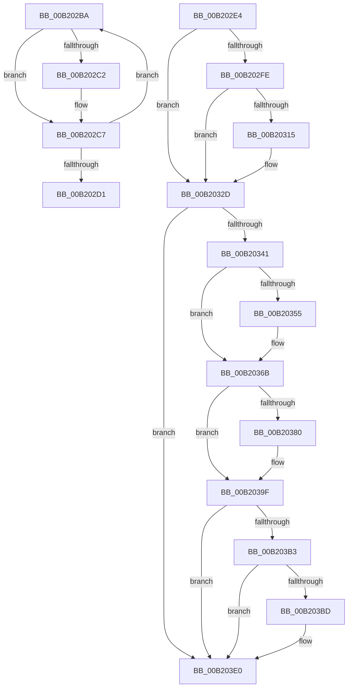

# sub_00B202BA

- RVA: `0x00B202BA`–`0x00B203F9` (길이 `319` bytes)
- VA: `0x0000000140B202BA`
- 실행 섹션: `PAGE`
- PDB 이름 있음: `아니요`; PDB Function 태그: `아니요`
- unwind 정보 RVA: `0x0008857C`
- 디코드: `81`개 명령, `319/319` bytes 표시
- 미해석 바이트: `0` (있으면 어셈블리에 `.byte`로 보존)

> 이 문서는 커널 이미지의 기계어와 PDB 기호를 분석해 생성했습니다. 4번과 5번은 함수 원형과 자료형을 바이너리 사용 방식에서 추정한 C 해석이며 원본 소스 복구 결과는 아닙니다.

## 1. Dependencies

- 직접 호출 지점: **14**; 고유 호출 대상: **4**
- 직접 호출자로 확인된 함수: **0**
- RIP 상대 이미지 참조: **0**

### Outgoing calls
- `0x00B202C2` → [KeFreeInterrupt](../../text/4A/KeFreeInterrupt_function_004A3BAC.md) (function, `0x004A3BAC`)
- `0x00B202D9` → [ExFreePoolWithTag](../../poolcode/B8/ExFreePoolWithTag_function_00B82870.md) (function, `0x00B82870`)
- `0x00B202EB` → [IoAddTriageDumpDataBlock](../../text/42/IoAddTriageDumpDataBlock_function_00428374.md) (function, `0x00428374`)
- `0x00B20302` → [IoAddTriageDumpDataBlock](../../text/42/IoAddTriageDumpDataBlock_function_00428374.md) (function, `0x00428374`)
- `0x00B20317` → [IoAddTriageDumpDataBlock](../../text/42/IoAddTriageDumpDataBlock_function_00428374.md) (function, `0x00428374`)
- `0x00B20328` → [IoAddTriageDumpDataBlock](../../text/42/IoAddTriageDumpDataBlock_function_00428374.md) (function, `0x00428374`)
- `0x00B2034A` → [IoAddTriageDumpDataBlock](../../text/42/IoAddTriageDumpDataBlock_function_00428374.md) (function, `0x00428374`)
- `0x00B2035A` → [IoAddTriageDumpDataBlock](../../text/42/IoAddTriageDumpDataBlock_function_00428374.md) (function, `0x00428374`)
- `0x00B20366` → [IoAddTriageDumpDataBlock](../../text/42/IoAddTriageDumpDataBlock_function_00428374.md) (function, `0x00428374`)
- `0x00B20382` → [IoAddTriageDumpDataBlock](../../text/42/IoAddTriageDumpDataBlock_function_00428374.md) (function, `0x00428374`)
- `0x00B2039A` → [IoAddTriageDumpDataBlock](../../text/42/IoAddTriageDumpDataBlock_function_00428374.md) (function, `0x00428374`)
- `0x00B203BF` → [IoAddTriageDumpDataBlock](../../text/42/IoAddTriageDumpDataBlock_function_00428374.md) (function, `0x00428374`)
- `0x00B203DB` → [IoAddTriageDumpDataBlock](../../text/42/IoAddTriageDumpDataBlock_function_00428374.md) (function, `0x00428374`)
- `0x00B203F3` → [KeBugCheckEx](../../text/4F/KeBugCheckEx_function_004FD660.md) (function, `0x004FD660`)

### Direct callers
- 이 함수 시작 RVA로 연결되는 직접 call은 확인되지 않았습니다. 간접 호출은 완전히 역산할 수 없습니다.

### Static image references
- 디코드된 RIP-relative 메모리 참조가 없습니다.

## 2. Other-region calls and transfers

- 다른 실행 섹션으로 향하는 call: **14**
  - `0x00B202C2` → [KeFreeInterrupt](../../text/4A/KeFreeInterrupt_function_004A3BAC.md) (`PAGE` → `.text`)
  - `0x00B202D9` → [ExFreePoolWithTag](../../poolcode/B8/ExFreePoolWithTag_function_00B82870.md) (`PAGE` → `POOLCODE`)
  - `0x00B202EB` → [IoAddTriageDumpDataBlock](../../text/42/IoAddTriageDumpDataBlock_function_00428374.md) (`PAGE` → `.text`)
  - `0x00B20302` → [IoAddTriageDumpDataBlock](../../text/42/IoAddTriageDumpDataBlock_function_00428374.md) (`PAGE` → `.text`)
  - `0x00B20317` → [IoAddTriageDumpDataBlock](../../text/42/IoAddTriageDumpDataBlock_function_00428374.md) (`PAGE` → `.text`)
  - `0x00B20328` → [IoAddTriageDumpDataBlock](../../text/42/IoAddTriageDumpDataBlock_function_00428374.md) (`PAGE` → `.text`)
  - `0x00B2034A` → [IoAddTriageDumpDataBlock](../../text/42/IoAddTriageDumpDataBlock_function_00428374.md) (`PAGE` → `.text`)
  - `0x00B2035A` → [IoAddTriageDumpDataBlock](../../text/42/IoAddTriageDumpDataBlock_function_00428374.md) (`PAGE` → `.text`)
  - `0x00B20366` → [IoAddTriageDumpDataBlock](../../text/42/IoAddTriageDumpDataBlock_function_00428374.md) (`PAGE` → `.text`)
  - `0x00B20382` → [IoAddTriageDumpDataBlock](../../text/42/IoAddTriageDumpDataBlock_function_00428374.md) (`PAGE` → `.text`)
  - `0x00B2039A` → [IoAddTriageDumpDataBlock](../../text/42/IoAddTriageDumpDataBlock_function_00428374.md) (`PAGE` → `.text`)
  - `0x00B203BF` → [IoAddTriageDumpDataBlock](../../text/42/IoAddTriageDumpDataBlock_function_00428374.md) (`PAGE` → `.text`)
  - `0x00B203DB` → [IoAddTriageDumpDataBlock](../../text/42/IoAddTriageDumpDataBlock_function_00428374.md) (`PAGE` → `.text`)
  - `0x00B203F3` → [KeBugCheckEx](../../text/4F/KeBugCheckEx_function_004FD660.md) (`PAGE` → `.text`)
- call이 아닌 외부 분기/꼬리 이동: **1**
  - `0x00B202DF` → [IopConnectInterrupt + 0x22D](../90/IopConnectInterrupt_function_00900B40.md) (`tail-transfer`)

## 3. Assembly (complete function range)

```asm
00B202BA  48 8B 0F                        mov rcx, qword ptr [rdi]
00B202BD  48 85 C9                        test rcx, rcx
00B202C0  74 05                           je 0x140b202c7
00B202C2  E8 E5 38 98 FF                  call 0x1404a3bac
00B202C7  48 83 C7 08                     add rdi, 8
00B202CB  49 83 EE 01                     sub r14, 1
00B202CF  75 E9                           jne 0x140b202ba
00B202D1  BA 49 6F 69 6E                  mov edx, 0x6e696f49
00B202D6  48 8B CE                        mov rcx, rsi
00B202D9  E8 92 25 06 00                  call 0x140b82870
00B202DE  90                              nop
00B202DF  E9 89 0A DE FF                  jmp 0x140900d6d
00B202E4  0F B7 57 02                     movzx edx, word ptr [rdi + 2]
00B202E8  48 8B CF                        mov rcx, rdi
00B202EB  E8 84 80 90 FF                  call 0x140428374
00B202F0  48 8B 4F 08                     mov rcx, qword ptr [rdi + 8]
00B202F4  BB 02 00 00 00                  mov ebx, 2
00B202F9  48 85 C9                        test rcx, rcx
00B202FC  74 2F                           je 0x140b2032d
00B202FE  0F BF 51 02                     movsx edx, word ptr [rcx + 2]
00B20302  E8 6D 80 90 FF                  call 0x140428374
00B20307  48 8B 4F 08                     mov rcx, qword ptr [rdi + 8]
00B2030B  48 83 C1 38                     add rcx, 0x38
00B2030F  66 44 39 29                     cmp word ptr [rcx], r13w
00B20313  74 18                           je 0x140b2032d
00B20315  8B D3                           mov edx, ebx
00B20317  E8 58 80 90 FF                  call 0x140428374
00B2031C  48 8B 4F 08                     mov rcx, qword ptr [rdi + 8]
00B20320  0F B7 51 38                     movzx edx, word ptr [rcx + 0x38]
00B20324  48 8B 49 40                     mov rcx, qword ptr [rcx + 0x40]
00B20328  E8 47 80 90 FF                  call 0x140428374
00B2032D  48 8B 87 38 01 00 00            mov rax, qword ptr [rdi + 0x138]
00B20334  48 8B 48 28                     mov rcx, qword ptr [rax + 0x28]
00B20338  48 85 C9                        test rcx, rcx
00B2033B  0F 84 9F 00 00 00               je 0x140b203e0
00B20341  BA 88 03 00 00                  mov edx, 0x388
00B20346  48 8D 71 28                     lea rsi, [rcx + 0x28]
00B2034A  E8 25 80 90 FF                  call 0x140428374
00B2034F  66 44 39 2E                     cmp word ptr [rsi], r13w
00B20353  74 16                           je 0x140b2036b
00B20355  8B D3                           mov edx, ebx
00B20357  48 8B CE                        mov rcx, rsi
00B2035A  E8 15 80 90 FF                  call 0x140428374
00B2035F  0F B7 16                        movzx edx, word ptr [rsi]
00B20362  48 8B 4E 08                     mov rcx, qword ptr [rsi + 8]
00B20366  E8 09 80 90 FF                  call 0x140428374
00B2036B  48 8B 87 38 01 00 00            mov rax, qword ptr [rdi + 0x138]
00B20372  48 8B 48 28                     mov rcx, qword ptr [rax + 0x28]
00B20376  48 83 C1 38                     add rcx, 0x38
00B2037A  66 44 39 29                     cmp word ptr [rcx], r13w
00B2037E  74 1F                           je 0x140b2039f
00B20380  8B D3                           mov edx, ebx
00B20382  E8 ED 7F 90 FF                  call 0x140428374
00B20387  48 8B 87 38 01 00 00            mov rax, qword ptr [rdi + 0x138]
00B2038E  48 8B 48 28                     mov rcx, qword ptr [rax + 0x28]
00B20392  0F B7 51 38                     movzx edx, word ptr [rcx + 0x38]
00B20396  48 8B 49 40                     mov rcx, qword ptr [rcx + 0x40]
00B2039A  E8 D5 7F 90 FF                  call 0x140428374
00B2039F  48 8B 87 38 01 00 00            mov rax, qword ptr [rdi + 0x138]
00B203A6  48 8B 48 28                     mov rcx, qword ptr [rax + 0x28]
00B203AA  48 8B 41 10                     mov rax, qword ptr [rcx + 0x10]
00B203AE  48 85 C0                        test rax, rax
00B203B1  74 2D                           je 0x140b203e0
00B203B3  48 8D 48 38                     lea rcx, [rax + 0x38]
00B203B7  66 44 39 29                     cmp word ptr [rcx], r13w
00B203BB  74 23                           je 0x140b203e0
00B203BD  8B D3                           mov edx, ebx
00B203BF  E8 B0 7F 90 FF                  call 0x140428374
00B203C4  48 8B 87 38 01 00 00            mov rax, qword ptr [rdi + 0x138]
00B203CB  48 8B 48 28                     mov rcx, qword ptr [rax + 0x28]
00B203CF  48 8B 49 10                     mov rcx, qword ptr [rcx + 0x10]
00B203D3  0F B7 51 38                     movzx edx, word ptr [rcx + 0x38]
00B203D7  48 8B 49 40                     mov rcx, qword ptr [rcx + 0x40]
00B203DB  E8 94 7F 90 FF                  call 0x140428374
00B203E0  45 33 C9                        xor r9d, r9d
00B203E3  4C 89 6C 24 20                  mov qword ptr [rsp + 0x20], r13
00B203E8  4C 8B C7                        mov r8, rdi
00B203EB  48 8B D3                        mov rdx, rbx
00B203EE  B9 CA 00 00 00                  mov ecx, 0xca
00B203F3  E8 68 D2 9D FF                  call 0x1404fd660
00B203F8  CC                              int3
```

## 4. C-style interpretation (structured pseudocode)

```c
__int64 __fastcall sub_00B202BA(__int64 a1, __int64 a2, __int64 a3, int a4)
{
    __int64 result;
    __int64 v_r14;
    __int64 v_rdi;
    unsigned __int64 v_stack_p20;

    if (*(unsigned __int64 *)(v_rdi) != 0) {
        result = KeFreeInterrupt(*(unsigned __int64 *)(v_rdi), a2, a3, a4);
    }
    v_rdi = (v_rdi) + (8);
    v_r14 = (v_r14) - (1);
    if (condition_is_not_equal) goto loc_00B202BA;
    result = ExFreePoolWithTag(v_rsi, (unsigned int)(0x6E696F49ULL), a3, a4);
}
```

## 5. (Beta) C Style

```c
int64_t sub_00B202BA(int64_t Arg1, int64_t Arg2, int64_t Arg3, int32_t Arg4)
{
    int64_t result;
    int64_t local_r14;
    int64_t local_rdi;
    uint64_t v_stack_p20;

    if (*(uint64_t *)(local_rdi) != 0) {
        result = KeFreeInterrupt(*(uint64_t *)(local_rdi), Arg2, Arg3, Arg4);
    }
    local_rdi = (local_rdi) + (8);
    local_r14 = (local_r14) - (1);
    if (condition_is_not_equal) goto loc_00B202BA;
    result = ExFreePoolWithTag(local_rsi, (uint32_t)(0x6E696F49ULL), Arg3, Arg4);
}
```

## 6. Execution-region graph

[열기: 2D/3D 그래프와 함수 탐색 컨트롤 패널](../../../control-panel.html?section=page&rva=0x00B202BA&view=graph)

- 2D 그래프는 위에서 아래로 흐르고, 3D 그래프는 빈 공간을 드래그해 회전합니다. Shift+드래그는 이동, 휠은 확대·축소, 함수 노드 선택은 대상 보고서 이동입니다.

### Static fallback


