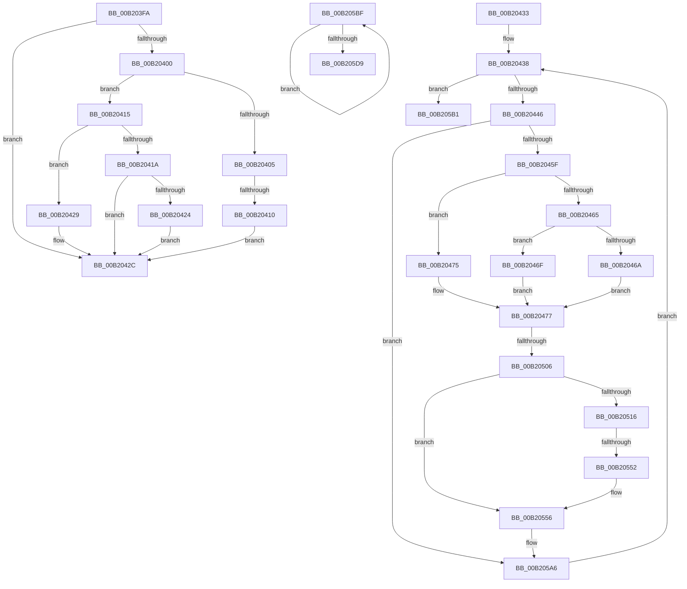

# sub_00B203FA

- RVA: `0x00B203FA`–`0x00B205E9` (길이 `495` bytes)
- VA: `0x0000000140B203FA`
- 실행 섹션: `PAGE`
- PDB 이름 있음: `아니요`; PDB Function 태그: `아니요`
- unwind 정보 RVA: `0x000885E8`
- 디코드: `129`개 명령, `495/495` bytes 표시
- 미해석 바이트: `0` (있으면 어셈블리에 `.byte`로 보존)

> 이 문서는 커널 이미지의 기계어와 PDB 기호를 분석해 생성했습니다. 4번과 5번은 함수 원형과 자료형을 바이너리 사용 방식에서 추정한 C 해석이며 원본 소스 복구 결과는 아닙니다.

## 1. Dependencies

- 직접 호출 지점: **4**; 고유 호출 대상: **4**
- 직접 호출자로 확인된 함수: **0**
- RIP 상대 이미지 참조: **0**

### Outgoing calls
- `0x00B204F7` → [IopConnectInterrupt](../90/IopConnectInterrupt_function_00900B40.md) (function, `0x00900B40`)
- `0x00B20543` → [HalGetMessageRoutingInfo](../../text/2D/HalGetMessageRoutingInfo_function_002D4E00.md) (function, `0x002D4E00`)
- `0x00B205CD` → [IoDisconnectInterrupt](../90/IoDisconnectInterrupt_function_00900890.md) (function, `0x00900890`)
- `0x00B205DE` → [ExFreePoolWithTag](../../poolcode/B8/ExFreePoolWithTag_function_00B82870.md) (function, `0x00B82870`)

### Direct callers
- 이 함수 시작 RVA로 연결되는 직접 call은 확인되지 않았습니다. 간접 호출은 완전히 역산할 수 없습니다.

### Static image references
- 디코드된 RIP-relative 메모리 참조가 없습니다.

## 2. Other-region calls and transfers

- 다른 실행 섹션으로 향하는 call: **2**
  - `0x00B20543` → [HalGetMessageRoutingInfo](../../text/2D/HalGetMessageRoutingInfo_function_002D4E00.md) (`PAGE` → `.text`)
  - `0x00B205DE` → [ExFreePoolWithTag](../../poolcode/B8/ExFreePoolWithTag_function_00B82870.md) (`PAGE` → `POOLCODE`)
- call이 아닌 외부 분기/꼬리 이동: **6**
  - `0x00B2040A` → [IopConnectMessageBasedInterrupt + 0x129](../90/IopConnectMessageBasedInterrupt_function_0090124C.md) (`tail-transfer`)
  - `0x00B2042E` → [IopConnectMessageBasedInterrupt + 0x11F](../90/IopConnectMessageBasedInterrupt_function_0090124C.md) (`tail-transfer`)
  - `0x00B20500` → [IopConnectMessageBasedInterrupt + 0xEB](../90/IopConnectMessageBasedInterrupt_function_0090124C.md) (`tail-transfer`)
  - `0x00B2054C` → [IopConnectMessageBasedInterrupt + 0xEB](../90/IopConnectMessageBasedInterrupt_function_0090124C.md) (`tail-transfer`)
  - `0x00B205BA` → [IopConnectMessageBasedInterrupt + 0xEB](../90/IopConnectMessageBasedInterrupt_function_0090124C.md) (`tail-transfer`)
  - `0x00B205E4` → [IopConnectMessageBasedInterrupt + 0xA9](../90/IopConnectMessageBasedInterrupt_function_0090124C.md) (`tail-transfer`)

## 3. Assembly (complete function range)

```asm
00B203FA  41 83 FF 03                     cmp r15d, 3
00B203FE  75 2C                           jne 0x140b2042c
00B20400  45 84 C0                        test r8b, r8b
00B20403  74 10                           je 0x140b20415
00B20405  46 3A 44 22 10                  cmp r8b, byte ptr [rdx + r12 + 0x10]
00B2040A  0F 82 65 0F DE FF               jb 0x140901375
00B20410  45 8A E8                        mov r13b, r8b
00B20413  EB 17                           jmp 0x140b2042c
00B20415  4D 85 D2                        test r10, r10
00B20418  74 0F                           je 0x140b20429
00B2041A  42 8A 44 22 10                  mov al, byte ptr [rdx + r12 + 0x10]
00B2041F  41 3A C5                        cmp al, r13b
00B20422  76 08                           jbe 0x140b2042c
00B20424  44 8A E8                        mov r13b, al
00B20427  EB 03                           jmp 0x140b2042c
00B20429  44 8A EB                        mov r13b, bl
00B2042C  FF C1                           inc ecx
00B2042E  E9 38 0F DE FF                  jmp 0x14090136b
00B20433  44 88 28                        mov byte ptr [rax], r13b
00B20436  8B C3                           mov eax, ebx
00B20438  89 44 24 68                     mov dword ptr [rsp + 0x68], eax
00B2043C  41 3B 04 24                     cmp eax, dword ptr [r12]
00B20440  0F 83 6B 01 00 00               jae 0x140b205b1
00B20446  4C 6B F0 58                     imul r14, rax, 0x58
00B2044A  49 83 C6 08                     add r14, 8
00B2044E  4D 03 F4                        add r14, r12
00B20451  41 8B 06                        mov eax, dword ptr [r14]
00B20454  FF C8                           dec eax
00B20456  83 F8 02                        cmp eax, 2
00B20459  0F 87 47 01 00 00               ja 0x140b205a6
00B2045F  38 5C 24 60                     cmp byte ptr [rsp + 0x60], bl
00B20463  75 10                           jne 0x140b20475
00B20465  45 84 ED                        test r13b, r13b
00B20468  74 05                           je 0x140b2046f
00B2046A  41 8A C5                        mov al, r13b
00B2046D  EB 08                           jmp 0x140b20477
00B2046F  41 8A 46 08                     mov al, byte ptr [r14 + 8]
00B20473  EB 02                           jmp 0x140b20477
00B20475  8A C3                           mov al, bl
00B20477  41 0F 10 06                     movups xmm0, xmmword ptr [r14]
00B2047B  4C 8B 4C 24 78                  mov r9, qword ptr [rsp + 0x78]
00B20480  48 8D 4D D0                     lea rcx, [rbp - 0x30]
00B20484  41 0F 10 4E 10                  movups xmm1, xmmword ptr [r14 + 0x10]
00B20489  48 8B 55 80                     mov rdx, qword ptr [rbp - 0x80]
00B2048D  45 33 C0                        xor r8d, r8d
00B20490  48 89 4C 24 50                  mov qword ptr [rsp + 0x50], rcx
00B20495  48 8D 4C 24 70                  lea rcx, [rsp + 0x70]
00B2049A  C6 44 24 40 01                  mov byte ptr [rsp + 0x40], 1
00B2049F  88 44 24 38                     mov byte ptr [rsp + 0x38], al
00B204A3  48 8B 85 A8 00 00 00            mov rax, qword ptr [rbp + 0xa8]
00B204AA  48 89 44 24 30                  mov qword ptr [rsp + 0x30], rax
00B204AF  8B 46 04                        mov eax, dword ptr [rsi + 4]
00B204B2  0F 11 45 D8                     movups xmmword ptr [rbp - 0x28], xmm0
00B204B6  89 44 24 28                     mov dword ptr [rsp + 0x28], eax
00B204BA  41 0F 10 46 20                  movups xmm0, xmmword ptr [r14 + 0x20]
00B204BF  48 8B 85 A0 00 00 00            mov rax, qword ptr [rbp + 0xa0]
00B204C6  0F 11 4D E8                     movups xmmword ptr [rbp - 0x18], xmm1
00B204CA  C7 45 D0 01 00 00 00            mov dword ptr [rbp - 0x30], 1
00B204D1  41 0F 10 4E 30                  movups xmm1, xmmword ptr [r14 + 0x30]
00B204D6  48 89 44 24 20                  mov qword ptr [rsp + 0x20], rax
00B204DB  0F 11 45 F8                     movups xmmword ptr [rbp - 8], xmm0
00B204DF  41 0F 10 46 40                  movups xmm0, xmmword ptr [r14 + 0x40]
00B204E4  0F 11 4D 08                     movups xmmword ptr [rbp + 8], xmm1
00B204E8  F2 41 0F 10 4E 50               movsd xmm1, qword ptr [r14 + 0x50]
00B204EE  0F 11 45 18                     movups xmmword ptr [rbp + 0x18], xmm0
00B204F2  F2 0F 11 4D 28                  movsd qword ptr [rbp + 0x28], xmm1
00B204F7  E8 44 06 DE FF                  call 0x140900b40
00B204FC  8B F8                           mov edi, eax
00B204FE  85 C0                           test eax, eax
00B20500  0F 88 31 0E DE FF               js 0x140901337
00B20506  8B 46 04                        mov eax, dword ptr [rsi + 4]
00B20509  4C 8D 3C 40                     lea r15, [rax + rax*2]
00B2050D  4D 03 FF                        add r15, r15
00B20510  41 83 3E 03                     cmp dword ptr [r14], 3
00B20514  75 40                           jne 0x140b20556
00B20516  41 0F 10 46 18                  movups xmm0, xmmword ptr [r14 + 0x18]
00B2051B  41 8B 46 04                     mov eax, dword ptr [r14 + 4]
00B2051F  48 8D 55 D0                     lea rdx, [rbp - 0x30]
00B20523  89 45 98                        mov dword ptr [rbp - 0x68], eax
00B20526  48 8D 4D 90                     lea rcx, [rbp - 0x70]
00B2052A  41 8B 46 48                     mov eax, dword ptr [r14 + 0x48]
00B2052E  F3 0F 7F 45 A0                  movdqu xmmword ptr [rbp - 0x60], xmm0
00B20533  89 5D 90                        mov dword ptr [rbp - 0x70], ebx
00B20536  41 0F 10 46 28                  movups xmm0, xmmword ptr [r14 + 0x28]
00B2053B  89 45 B0                        mov dword ptr [rbp - 0x50], eax
00B2053E  F3 0F 7F 45 B4                  movdqu xmmword ptr [rbp - 0x4c], xmm0
00B20543  E8 B8 48 7B FF                  call 0x1402d4e00
00B20548  8B F8                           mov edi, eax
00B2054A  85 C0                           test eax, eax
00B2054C  0F 88 E5 0D DE FF               js 0x140901337
00B20552  4C 8D 75 D8                     lea r14, [rbp - 0x28]
00B20556  49 8B 46 48                     mov rax, qword ptr [r14 + 0x48]
00B2055A  4A 89 44 FE 08                  mov qword ptr [rsi + r15*8 + 8], rax
00B2055F  41 8B 46 50                     mov eax, dword ptr [r14 + 0x50]
00B20563  42 89 44 FE 20                  mov dword ptr [rsi + r15*8 + 0x20], eax
00B20568  49 8B 46 18                     mov rax, qword ptr [r14 + 0x18]
00B2056C  4A 89 44 FE 10                  mov qword ptr [rsi + r15*8 + 0x10], rax
00B20571  48 8B 44 24 70                  mov rax, qword ptr [rsp + 0x70]
00B20576  48 83 C0 70                     add rax, 0x70
00B2057A  4A 89 44 FE 18                  mov qword ptr [rsi + r15*8 + 0x18], rax
00B2057F  41 8B 46 04                     mov eax, dword ptr [r14 + 4]
00B20583  42 89 44 FE 24                  mov dword ptr [rsi + r15*8 + 0x24], eax
00B20588  41 8A 46 08                     mov al, byte ptr [r14 + 8]
00B2058C  42 88 44 FE 28                  mov byte ptr [rsi + r15*8 + 0x28], al
00B20591  41 8B 46 10                     mov eax, dword ptr [r14 + 0x10]
00B20595  42 89 44 FE 2C                  mov dword ptr [rsi + r15*8 + 0x2c], eax
00B2059A  41 8B 46 0C                     mov eax, dword ptr [r14 + 0xc]
00B2059E  42 89 44 FE 30                  mov dword ptr [rsi + r15*8 + 0x30], eax
00B205A3  FF 46 04                        inc dword ptr [rsi + 4]
00B205A6  8B 44 24 68                     mov eax, dword ptr [rsp + 0x68]
00B205AA  FF C0                           inc eax
00B205AC  E9 87 FE FF FF                  jmp 0x140b20438
00B205B1  48 8B 45 88                     mov rax, qword ptr [rbp - 0x78]
00B205B5  8B FB                           mov edi, ebx
00B205B7  48 89 30                        mov qword ptr [rax], rsi
00B205BA  E9 78 0D DE FF                  jmp 0x140901337
00B205BF  8B C3                           mov eax, ebx
00B205C1  48 8D 0C 40                     lea rcx, [rax + rax*2]
00B205C5  48 03 C9                        add rcx, rcx
00B205C8  48 8B 4C CE 18                  mov rcx, qword ptr [rsi + rcx*8 + 0x18]
00B205CD  E8 BE 02 DE FF                  call 0x140900890
00B205D2  FF C3                           inc ebx
00B205D4  3B 5E 04                        cmp ebx, dword ptr [rsi + 4]
00B205D7  72 E6                           jb 0x140b205bf
00B205D9  33 D2                           xor edx, edx
00B205DB  48 8B CE                        mov rcx, rsi
00B205DE  E8 8D 22 06 00                  call 0x140b82870
00B205E3  90                              nop
00B205E4  E9 0C 0D DE FF                  jmp 0x1409012f5
```

## 4. C-style interpretation (structured pseudocode)

```c
__int64 __fastcall sub_00B203FA(int a1, __int64 a2, int a3)
{
    unsigned __int64 v_stack_p20;
    unsigned int v_stack_p28;
    unsigned __int64 v_stack_p30;
    unsigned __int8 v_stack_p38;
    unsigned __int8 v_stack_p40;
    unsigned __int64 v_stack_p50;
    unsigned __int8 v_stack_p60;
    unsigned int v_stack_p68;
    unsigned __int64 v_stack_p70;
    unsigned __int64 v_stack_p78;

    if (((unsigned int)(v_r15)) != 3) goto loc_00B2042C;
    if ((unsigned __int8)(a3) == 0) goto loc_00B20415;
    goto loc_00B2042C;
loc_00B20415:
    if (v_r10 == 0) goto loc_00B20429;
    if (((unsigned __int8)(*(unsigned __int8 *)(a2 + v_r12 * 1 + 16))) <= ((unsigned __int8)((unsigned __int8)(a3)))) goto loc_00B2042C;
    goto loc_00B2042C;
loc_00B20429:
loc_00B2042C:
    a1 = (unsigned int)((a1) + 1);
}
```

## 5. (Beta) C Style

```c
int64_t sub_00B203FA(int32_t Arg1, void *Arg2, int32_t Arg3)
{
    uint8_t *arg2 = (uint8_t *)Arg2;

    uint64_t v_stack_p20;
    uint32_t v_stack_p28;
    uint64_t v_stack_p30;
    uint8_t v_stack_p38;
    uint8_t v_stack_p40;
    uint64_t v_stack_p50;
    uint8_t v_stack_p60;
    uint32_t v_stack_p68;
    uint64_t v_stack_p70;
    uint64_t v_stack_p78;

    if (((uint32_t)(local_r15)) != 3) goto loc_00B2042C;
    if ((uint8_t)(Arg3) == 0) goto loc_00B20415;
    goto loc_00B2042C;
loc_00B20415:
    if (local_r10 == 0) goto loc_00B20429;
    if (((uint8_t)(*(uint8_t *)(arg2 + local_r12 * 1 + 0x10))) <= ((uint8_t)((uint8_t)(Arg3)))) goto loc_00B2042C;
    goto loc_00B2042C;
loc_00B20429:
loc_00B2042C:
    Arg1 = (uint32_t)((Arg1) + 1);
}
```

### 관측된 메모리 오프셋

구조체 형식이 확인되지 않은 접근은 인자 기준의 오프셋으로만 기록했습니다.

| 기준 인자 | 오프셋 표현 | 폭 (bit) | 접근 |
|---|---:|---:|---|
| `Arg2` | `+ 0x10 + r12*1` | `8` | `R` |

## 6. Execution-region graph

[열기: 2D/3D 그래프와 함수 탐색 컨트롤 패널](../../../control-panel.html?section=page&rva=0x00B203FA&view=graph)

- 2D 그래프는 위에서 아래로 흐르고, 3D 그래프는 빈 공간을 드래그해 회전합니다. Shift+드래그는 이동, 휠은 확대·축소, 함수 노드 선택은 대상 보고서 이동입니다.

### Static fallback


