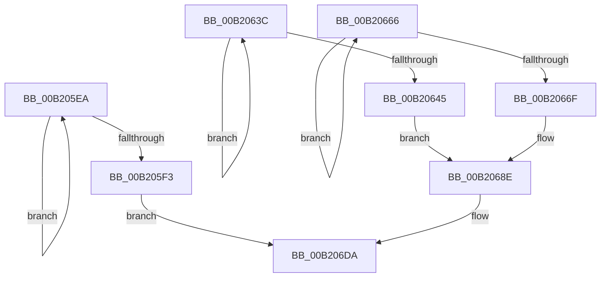

# sub_00B205EA

- RVA: `0x00B205EA`–`0x00B206F6` (길이 `268` bytes)
- VA: `0x0000000140B205EA`
- 실행 섹션: `PAGE`
- PDB 이름 있음: `아니요`; PDB Function 태그: `아니요`
- unwind 정보 RVA: `0x00088618`
- 디코드: `64`개 명령, `268/268` bytes 표시
- 미해석 바이트: `0` (있으면 어셈블리에 `.byte`로 보존)

> 이 문서는 커널 이미지의 기계어와 PDB 기호를 분석해 생성했습니다. 4번과 5번은 함수 원형과 자료형을 바이너리 사용 방식에서 추정한 C 해석이며 원본 소스 복구 결과는 아닙니다.

## 1. Dependencies

- 직접 호출 지점: **1**; 고유 호출 대상: **1**
- 직접 호출자로 확인된 함수: **0**
- RIP 상대 이미지 참조: **4**

### Outgoing calls
- `0x00B206EB` → [tlgWriteTransfer_EtwWriteTransfer](../../text/42/tlgWriteTransfer_EtwWriteTransfer_function_004260E0.md) (function, `0x004260E0`)

### Direct callers
- 이 함수 시작 RVA로 연결되는 직접 call은 확인되지 않았습니다. 간접 호출은 완전히 역산할 수 없습니다.

### Static image references
- `0x00B205FC` → RVA `0x00046D56` (`.rdata`; read)
- `0x00B2065D` → RVA `0x00046D9F` (`.rdata`; read)
- `0x00B20687` → RVA `0x00046DF6` (`.rdata`; read)
- `0x00B206E4` → RVA `0x00E06F90` (`.data`; read)

## 2. Other-region calls and transfers

- 다른 실행 섹션으로 향하는 call: **1**
  - `0x00B206EB` → [tlgWriteTransfer_EtwWriteTransfer](../../text/42/tlgWriteTransfer_EtwWriteTransfer_function_004260E0.md) (`PAGE` → `.text`)
- call이 아닌 외부 분기/꼬리 이동: **1**
  - `0x00B206F1` → [PnpCompareInterruptInformation + 0x5B](../90/PnpCompareInterruptInformation_function_009013F0.md) (`tail-transfer`)

## 3. Assembly (complete function range)

```asm
00B205EA  48 FF C0                        inc rax
00B205ED  44 38 34 01                     cmp byte ptr [rcx + rax], r14b
00B205F1  75 F7                           jne 0x140b205ea
00B205F3  FF C0                           inc eax
00B205F5  48 89 4D D7                     mov qword ptr [rbp - 0x29], rcx
00B205F9  89 45 DF                        mov dword ptr [rbp - 0x21], eax
00B205FC  48 8D 15 53 67 52 FF            lea rdx, [rip - 0xad98ad]
00B20603  48 8D 45 FF                     lea rax, [rbp - 1]
00B20607  48 C7 45 EF 02 00 00 00         mov qword ptr [rbp - 0x11], 2
00B2060F  48 89 45 E7                     mov qword ptr [rbp - 0x19], rax
00B20613  48 8B 46 30                     mov rax, qword ptr [rsi + 0x30]
00B20617  48 89 45 F7                     mov qword ptr [rbp - 9], rax
00B2061B  0F B7 46 28                     movzx eax, word ptr [rsi + 0x28]
00B2061F  89 45 FF                        mov dword ptr [rbp - 1], eax
00B20622  48 8D 45 B7                     lea rax, [rbp - 0x49]
00B20626  48 89 44 24 28                  mov qword ptr [rsp + 0x28], rax
00B2062B  C7 44 24 20 05 00 00 00         mov dword ptr [rsp + 0x20], 5
00B20633  44 89 75 03                     mov dword ptr [rbp + 3], r14d
00B20637  E9 9E 00 00 00                  jmp 0x140b206da
00B2063C  48 FF C0                        inc rax
00B2063F  44 38 34 01                     cmp byte ptr [rcx + rax], r14b
00B20643  75 F7                           jne 0x140b2063c
00B20645  FF C0                           inc eax
00B20647  48 89 4D D7                     mov qword ptr [rbp - 0x29], rcx
00B2064B  89 45 DF                        mov dword ptr [rbp - 0x21], eax
00B2064E  48 8D 4D AB                     lea rcx, [rbp - 0x55]
00B20652  48 8D 45 A7                     lea rax, [rbp - 0x59]
00B20656  44 89 45 A7                     mov dword ptr [rbp - 0x59], r8d
00B2065A  89 7D AB                        mov dword ptr [rbp - 0x55], edi
00B2065D  48 8D 15 3B 67 52 FF            lea rdx, [rip - 0xad98c5]
00B20664  EB 28                           jmp 0x140b2068e
00B20666  48 FF C0                        inc rax
00B20669  44 38 34 01                     cmp byte ptr [rcx + rax], r14b
00B2066D  75 F7                           jne 0x140b20666
00B2066F  FF C0                           inc eax
00B20671  48 89 4D D7                     mov qword ptr [rbp - 0x29], rcx
00B20675  89 45 DF                        mov dword ptr [rbp - 0x21], eax
00B20678  48 8D 4D A7                     lea rcx, [rbp - 0x59]
00B2067C  48 8D 45 AB                     lea rax, [rbp - 0x55]
00B20680  44 89 45 AB                     mov dword ptr [rbp - 0x55], r8d
00B20684  89 7D A7                        mov dword ptr [rbp - 0x59], edi
00B20687  48 8D 15 68 67 52 FF            lea rdx, [rip - 0xad9898]
00B2068E  48 89 45 E7                     mov qword ptr [rbp - 0x19], rax
00B20692  48 8D 45 1F                     lea rax, [rbp + 0x1f]
00B20696  48 89 45 07                     mov qword ptr [rbp + 7], rax
00B2069A  48 8B 46 30                     mov rax, qword ptr [rsi + 0x30]
00B2069E  48 89 45 17                     mov qword ptr [rbp + 0x17], rax
00B206A2  0F B7 46 28                     movzx eax, word ptr [rsi + 0x28]
00B206A6  89 45 1F                        mov dword ptr [rbp + 0x1f], eax
00B206A9  48 8D 45 B7                     lea rax, [rbp - 0x49]
00B206AD  48 89 44 24 28                  mov qword ptr [rsp + 0x28], rax
00B206B2  C7 44 24 20 07 00 00 00         mov dword ptr [rsp + 0x20], 7
00B206BA  44 89 75 23                     mov dword ptr [rbp + 0x23], r14d
00B206BE  48 C7 45 0F 02 00 00 00         mov qword ptr [rbp + 0xf], 2
00B206C6  48 C7 45 FF 04 00 00 00         mov qword ptr [rbp - 1], 4
00B206CE  48 89 4D F7                     mov qword ptr [rbp - 9], rcx
00B206D2  48 C7 45 EF 04 00 00 00         mov qword ptr [rbp - 0x11], 4
00B206DA  45 33 C9                        xor r9d, r9d
00B206DD  44 89 75 E3                     mov dword ptr [rbp - 0x1d], r14d
00B206E1  45 33 C0                        xor r8d, r8d
00B206E4  48 8D 0D A5 68 2E 00            lea rcx, [rip + 0x2e68a5]
00B206EB  E8 F0 59 90 FF                  call 0x1404260e0
00B206F0  90                              nop
00B206F1  E9 55 0D DE FF                  jmp 0x14090144b
```

## 4. C-style interpretation (structured pseudocode)

```c
__int64 __fastcall sub_00B205EA(__int64 a1, __int64 a2, int a3, int a4)
{
    __int64 result;
    unsigned int v_stack_p20;
    unsigned __int64 v_stack_p28;

    result = (result) + 1;
    if ((*(unsigned __int8 *)(a1 + result * 1)) != ((unsigned __int8)(v_r14))) goto loc_00B205EA;
    result = (unsigned int)((result) + 1);
    *(unsigned __int64 *)(v_rbp - 41) = a1;
    *(unsigned int *)(v_rbp - 33) = (unsigned int)(result);
    *(unsigned __int64 *)(v_rbp - 17) = 2;
    *(unsigned __int64 *)(v_rbp - 25) = v_rbp - 1;
    *(unsigned __int64 *)(v_rbp - 9) = *(unsigned __int64 *)(v_rsi + 48);
    *(unsigned int *)(v_rbp - 1) = (unsigned int)(*(unsigned __int16 *)(v_rsi + 40));
    v_stack_p28 = v_rbp - 73;
    v_stack_p20 = 5;
    *(unsigned int *)(v_rbp + 3) = (unsigned int)(v_r14);
    goto loc_00B206DA;
loc_00B206DA:
    a4 = 0;
    *(unsigned int *)(v_rbp - 29) = (unsigned int)(v_r14);
    a3 = 0;
    result = tlgWriteTransfer_EtwWriteTransfer(v_rip + 3041445, v_rip - 11376813, a3, a4);
}
```

## 5. (Beta) C Style

```c
int64_t sub_00B205EA(void *Arg1, int64_t Arg2, int32_t Arg3, int32_t Arg4)
{
    uint8_t *arg1 = (uint8_t *)Arg1;

    int64_t result;
    uint32_t v_stack_p20;
    uint64_t v_stack_p28;

    result = (result) + 1;
    if ((*(uint8_t *)(arg1 + result * 1)) != ((uint8_t)(local_r14))) goto loc_00B205EA;
    result = (uint32_t)((result) + 1);
    *(void **)(local_rbp - 0x29) = Arg1;
    *(uint32_t *)(local_rbp - 0x21) = (uint32_t)(result);
    *(uint64_t *)(local_rbp - 0x11) = 2;
    *(uint64_t *)(local_rbp - 0x19) = local_rbp - 1;
    *(uint64_t *)(local_rbp - 0x9) = *(uint64_t *)(local_rsi + 0x30);
    *(uint32_t *)(local_rbp - 0x1) = (uint32_t)(*(uint16_t *)(local_rsi + 0x28));
    v_stack_p28 = local_rbp - 73;
    v_stack_p20 = 5;
    *(uint32_t *)(local_rbp + 0x3) = (uint32_t)(local_r14);
    goto loc_00B206DA;
loc_00B206DA:
    Arg4 = 0;
    *(uint32_t *)(local_rbp - 0x1D) = (uint32_t)(local_r14);
    Arg3 = 0;
    result = tlgWriteTransfer_EtwWriteTransfer(v_rip + 3041445, v_rip - 11376813, Arg3, Arg4);
}
```

### 관측된 메모리 오프셋

구조체 형식이 확인되지 않은 접근은 인자 기준의 오프셋으로만 기록했습니다.

| 기준 인자 | 오프셋 표현 | 폭 (bit) | 접근 |
|---|---:|---:|---|
| `Arg1` | `+ 0x0 + rax*1` | `8` | `R` |

## 6. Execution-region graph

[열기: 2D/3D 그래프와 함수 탐색 컨트롤 패널](../../../control-panel.html?section=page&rva=0x00B205EA&view=graph)

- 2D 그래프는 위에서 아래로 흐르고, 3D 그래프는 빈 공간을 드래그해 회전합니다. Shift+드래그는 이동, 휠은 확대·축소, 함수 노드 선택은 대상 보고서 이동입니다.

### Static fallback


